# M6b plan: Wingman

Upstream's `com.norwood.mcheli.wingman` package (about 10,000 lines) adds marker blocks for
airbases, AI wingmen that fly in formation, an autonomous mission state machine, taxi routes, the
base and planner screens and the `/wingman` command. PORTING_PLAN.md section 6 sets the milestone's
exit criterion: formation and one CAP mission fly end to end. Bounded UAV control streaming was
brought forward into M6 (M6_PLAN.md, "UAV 5,000-block control increment").

## Increments

1. Marker screen and registry.
2. Taxi routes and the base screen's Taxi Routes tab (`TaxiRoute`, `TaxiRouteRegistry`, `GuiBaseConfig`).
3. Wingman entries, formation flight and the wingman panel (`WingmanEntry`, `WingmanTickHandler`,
   `GuiWingmanPanel`, `WingmanKeyHandler`).
4. Missions and autonomous flight (`MissionOrder`, `AutonomousFlightHandler`, the base screen's
   Mission tab), with mission chunk loading.
5. The mission planner and its route-node missions (`MissionPlan`, `MissionNode`,
   `GuiWingmanPlanner`, `GuiNewRoute`), the `/wingman` command and `WingmanConfig`.

## Marker screen and registry increment

- `WingmanMarkerBlockEntity` (upstream `WingmanMarkerTileEntity`) keeps the marker ID, parent base
  and parking heading; the type stays in the block state (KNOWN_ISSUES difference 18). A new
  marker is a parking spot, as upstream's block entity started, and takes an ID of its type
  (`p_1`, `wp_2`...) with upstream's chat message to a player within 16 blocks.
- `MarkerRegistry` is per-dimension saved data with upstream's lookups (`findById`, `findByType`,
  `findByBase`, `findAllByBase`, `findChildren`, `resolveMarker`). The parking-spot searches, which
  need the wingman AI, come with increment 3. Markers register when they load and leave the
  registry when their block goes, including through `/setblock`, which skips the block's removal
  hooks; a chunk unloading does not remove them.
- Right-clicking a marker opens `MarkerConfigScreen` (upstream `GuiMarkerConfig`) with upstream's
  layout and labels, including the Japanese heading labels. Save sends `MarkerUpdatePayload`,
  which the server applies only for a player who can reach and edit the block (KNOWN_ISSUES 93).
- Network protocol 22.

Validation: three GameTests cover placement, IDs, removal through `/setblock`, the update's reach
check and per-type rules, the payload codec, base resolution and the registry's save codec; all
228 required GameTests pass. In the client, a placed marker announced `[Parking] id=p_1`, Tab moved
between the fields, switching to Runway-A dropped the heading row and kept the typed text, and Save
set the block state to `runway_a` with the ID and base (screens `m6b-marker-parking.png`,
`m6b-marker-runway.png`).

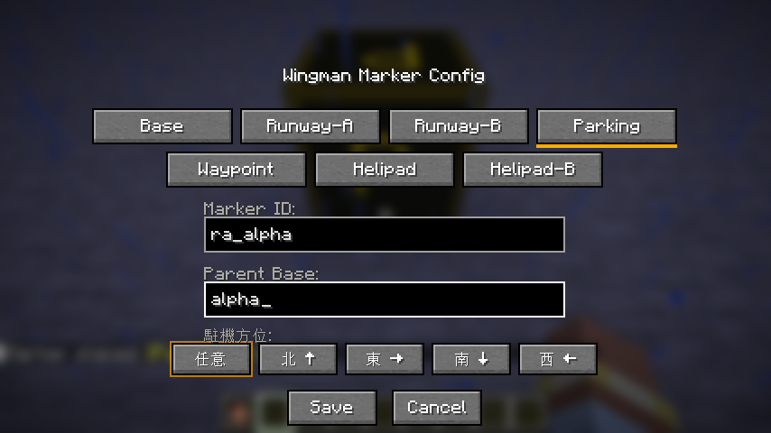
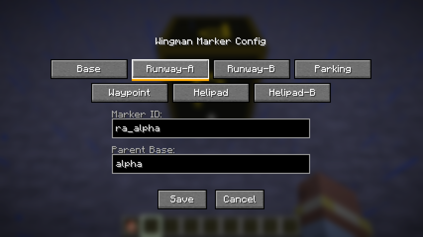

## Taxi routes increment

- `TaxiRoute` is a record with upstream's fields, saved names and legs (`fullDeparture`,
  `fullArrival`, `effectiveArrivalEntry`). `TaxiRouteRegistry` is per-dimension saved data keyed
  by route ID in save order, with upstream's lookups (`getForBase`, `findByParking`,
  `findByRunway`, `findById`).
- A base marker opens `BaseConfigScreen` (upstream `GuiBaseConfig`) on its Taxi Routes tab, from
  `OpenBaseScreenPayload`: the base's routes and its markers by type, with waypoints that lack a
  base still offered within 500 blocks, as upstream. The tab keeps upstream's layout, scrolling,
  highlights, departure and arrival previews, picker rules (end B as the end without an end A, a
  helipad as parking and end) and its client-side checks with their Japanese messages.
- `TaxiRouteActionPayload` replaces `PacketBaseAction`'s route actions; the server checks the
  player can edit the base marker and takes the base from it (KNOWN_ISSUES 94). The Mission tab
  button was shown but disabled until increment 4, which added the nearby-aircraft list upstream
  sent for it.

Validation: a fourth GameTest covers the base screen's marker lists, the 500-block waypoint
fallback, saving under the marker's base, the reach check, a route missing its parking spot,
deleting only the base's own routes, the legs and both codecs; all 229 required GameTests pass.
In the client a base `alpha` with two parking spots, both runway ends, a helipad and two
waypoints showed them all; a route from `p_a1` through `wp_1` and `wp_2` to `ra_1` saved with
"Route r1 saved.", and reopening the screen listed and reloaded it with its picks highlighted.

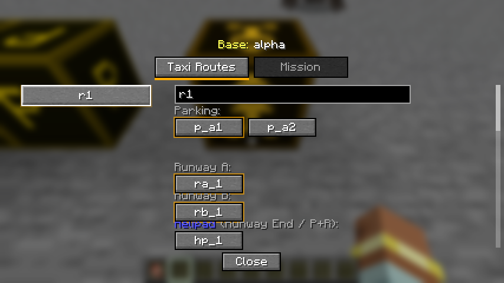
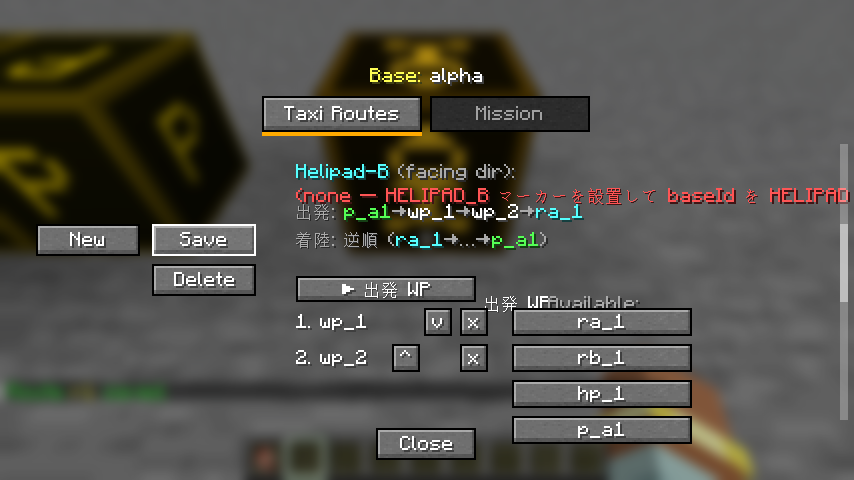

## Marker screen redesign

Upstream's marker screens were hard to read once a base had several markers: the Taxi Routes tab
was placed with fixed offsets, so its Helipad-B line, departure summary, waypoint toggle and lists
overlapped, its labels were partly Japanese, and automatic IDs repeated (a parking spot turned
helipad kept `p_1`, and the next parking spot took `p_1` again). Taxiing looks markers up by ID
alone, so a repeated ID could send an aircraft to the wrong block.

- Automatic IDs take the lowest number no marker uses (`WingmanMarkerBlock.autoId`). Changing a
  marker's type renames an automatic ID of another type (`p_1` becomes `hp_1`), on the screen, on
  save and through `/wingman marker type`; IDs typed by hand are kept. Saving an ID another marker
  has warns in chat.
- `MarkerConfigScreen` is in English, explains the selected type under the type buttons, offers the
  bases within 500 blocks as buttons beside the parent base field, and notes beside each field when
  the ID is already used or the parent base is not nearby. `OpenMarkerScreenPayload` carries the
  nearby bases and the other markers' IDs; network protocol 32.
- The Taxi Routes tab is laid out from the top down, with each label placed where its widgets are:
  route name, then 1. parking spot, 2. take-off and landing (Runway A, Runway B, Helipad rows, and
  which Helipad-B the helipads face), 3. waypoints with Departure and Arrival tabs, an ordered list
  and a list of markers to add (each tagged with its type and listed once), then a summary of both
  legs. What still stops a save, and IDs shared by two of the base's markers, show under the route
  list in English, instead of Japanese chat messages. The Mission tab's labels are in English.
- Differences: KNOWN_ISSUES 111.

Validation: a new GameTest covers unique and renamed automatic IDs, typed IDs being kept, the
nearby bases, the other IDs and the payload codec; all 293 required GameTests pass. The screens were
captured in the client at 1280x720 (GUI scale 3) with a base holding a parking spot and a helipad
that share `p_3`:

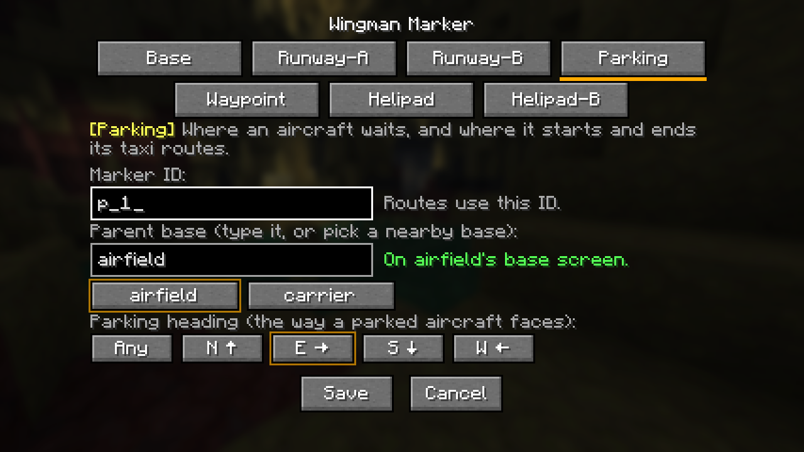
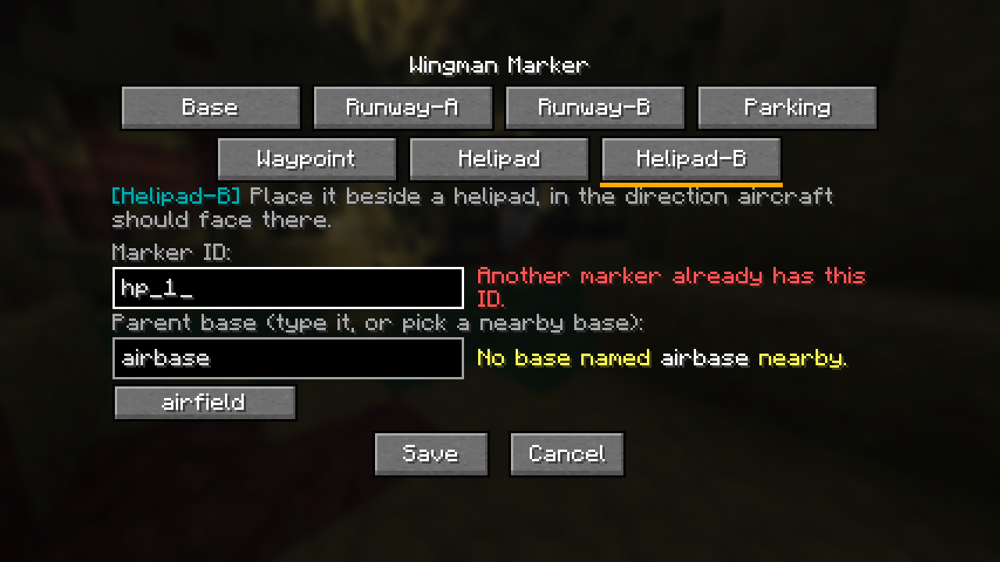
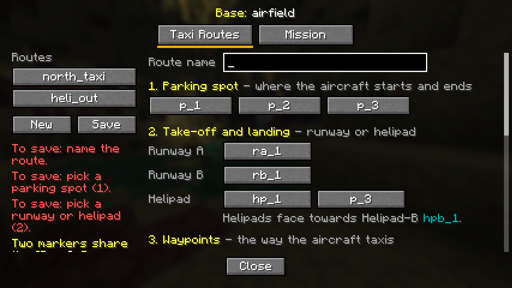
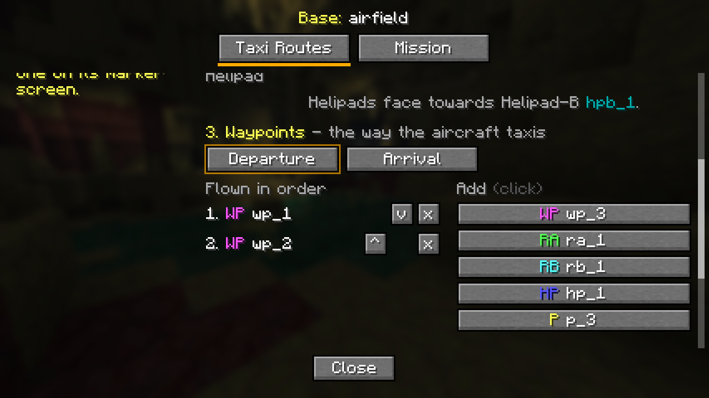
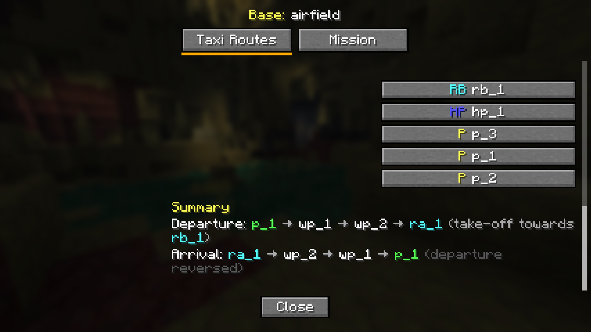

## Wingmen and wingman panel increment

- `WingmanEntry` and `WingmanRegistry` keep upstream's per-wingman state (leader, formation slot,
  attack mode, manual target, weapon type and seat) in memory; the registry is cleared when the
  server stops, as upstream's static maps were.
- `WingmanTickHandler` ports upstream's formation and attack flight: V and column slots from
  `WingmanConfig`'s side, rear and altitude distances, rate-limited yaw and pitch, sibling
  repulsion, the slot boost that catches a wingman up with a fast leader, the hold when the leader
  stops, automatic targeting of hostile mobs, target drones and enemy-team gunners, orbit,
  approach and overfly attack paths, weapon choice by type and the post-fire escape. A wingman
  whose leader has no player pilot holds fire, and one whose leader is gone leaves the registry.
- Helicopter wingmen fly by a hover-relative throttle and nose-down pitch with braking, where
  upstream flew them like planes and they climbed away or flew backwards (KNOWN_ISSUES 97).
  Wingmen fire as themselves, with the target passed to seekers (KNOWN_ISSUES 96).
- The wingman panel (upstream `GuiWingmanPanel`) opens from the numpad 0 key while piloting, with
  a key hint on the HUD. Its Wingmen tab lists up to 8 unassigned aircraft nearby with Follow, and
  the leader's wingmen with Auto, Hold, Stop and a weapon type picker; its Formation tab sets the
  formation and attack altitude limits. `WingmanPanelOpenPayload`, `WingmanPanelDataPayload` and
  `WingmanPanelActionPayload` replace upstream's packets; the server checks every order
  (KNOWN_ISSUES 95).
- Missions, autonomous flight, the base screen's Mission tab, `/wingman` and the config file come
  with increments 4 and 5.
- Network protocol 23.

Validation: two GameTests cover the panel's candidate list, Follow and its limits, the free slot,
leader-only orders, formation clamps and the codecs, and the flight: formation slots, the
helicopter throttle and pitch, the hold, the slot boost, the enemy set, attack throttle, the
auto-hold without a pilot and unregistering after the leader goes; all 231 required GameTests
pass. In the client, an AH-64's panel listed two nearby AH-64s, Follow made them wingmen #0 and #1
following, and they climbed and descended with the leader and settled in their slots; a wingman
moved 44 blocks off its slot flew back and stopped there. Changing the side distance on the
Formation tab and pressing Apply kept the new value when the panel reopened.

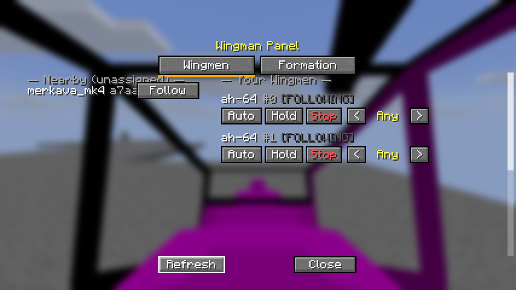
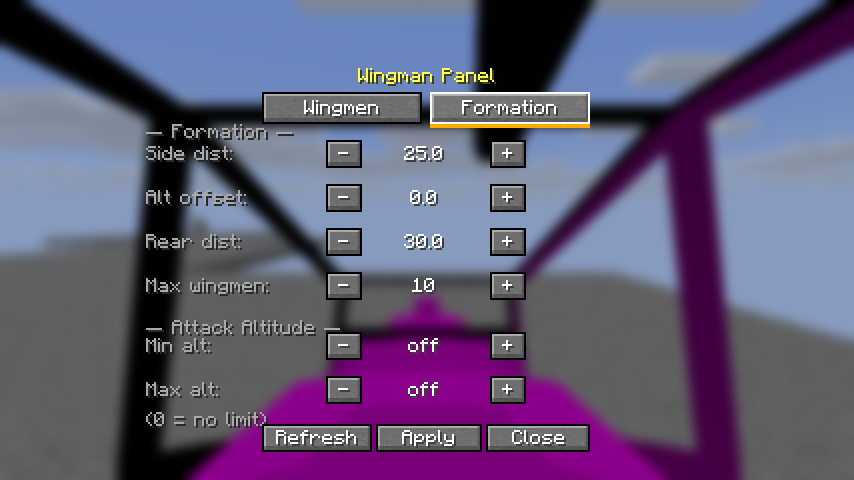

## Missions increment

- `MissionOrder`, `MissionType` and `AutonomousState` carry upstream's orders: CAP, CAS, escort
  and reconnaissance together, or a strike or a ferry flight alone, with the weapons, target
  area, orbit radius, cruise height, strike passes, time limit, orbit attack and the departure and
  arrival routes. `WingmanEntry` gains upstream's autonomous state.
- `AutonomousFlightHandler` ports upstream's order engine: from a parking spot it taxis out along
  the route and lines up, rolls and climbs out along the runway; from a helipad a helicopter (or
  VTOL plane) climbs straight up; otherwise it starts in the air. It flies to the area, orbits it
  attacking (a strike flies 15-second passes, a reconnaissance counts hostile mobs and reports
  them), and returns at the time limit or below a fifth of its fuel. A plane flies the landing
  circuit to runway end A, rolls out towards end B and taxis back to a free parking spot along
  the arrival route; a helicopter, or a VTOL plane given a helipad arrival route, lands on the
  helipad. `WingmanTickHandler` steers it (banking planes into turns), pushes taxiing aircraft at
  upstream's taxi speed and works the landing gear and VTOL nozzles.
- Differences: a helicopter holds its height on throttle as in formation, and climbs clear of a
  raised helipad before landing on it (KNOWN_ISSUES 97); chunks around a mission aircraft stay
  loaded (98); the order is checked and clamped on the server, a player taking the controls or
  the aircraft being destroyed ends it, the mission and attack orbits are kept apart and a parked
  aircraft turns to its spot's heading (99).
- The base screen's Mission tab keeps upstream's layout, toggles, exclusive STRIKE and FERRY,
  Tab between fields and scrolling; `OpenBaseScreenPayload` lists the eight aircraft nearest the
  base, and `DispatchOrderPayload` replaces `PacketBaseAction`'s `DISPATCH_ORDER`.
- Upstream's mission planner, its route-node missions and `GuiNewRoute` move to increment 5 with
  `/wingman`, which they share.
- Network protocol 24.

Validation: three GameTests cover dispatch (the aircraft list, reach, unknown types, a flown
aircraft, clamps, the weapon pick, the full tank and both codecs), the order steps of a
helicopter (air start, transit, arrival, orbit, the time limit, landing in place without a base,
chunk loading, a player taking the controls, a strike pass, low fuel, destruction) and a plane's
taxi out, taxi push, line-up and parking heading; all 234 required GameTests pass. In the client,
on a test base, a P-51D dispatched on a 40-second CAP taxied out along its route, took off along
the runway, orbited the area, flew the circuit, landed and taxied back to its parking spot facing
east. An AH-64 sent on CAS and reconnaissance from the helipad climbed out, orbited the area,
reported its mob count, came back and landed on the helipad. That run found a helicopter that had
dived below the raised pad flying in under it and hovering 2 blocks above the pad without
settling; both are fixed.

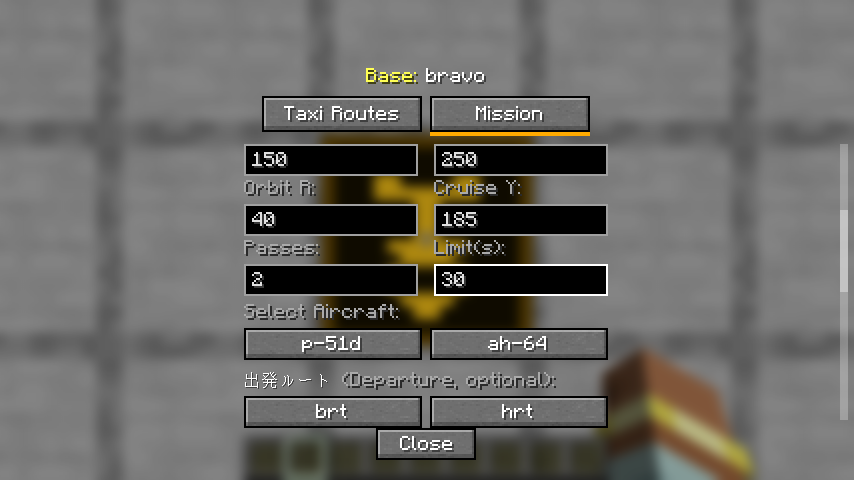
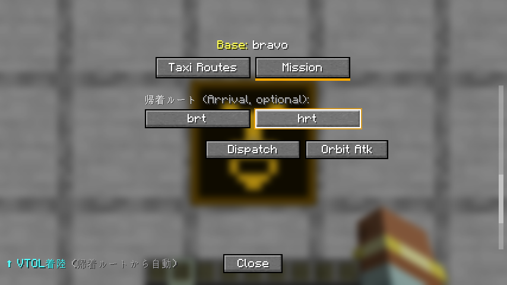
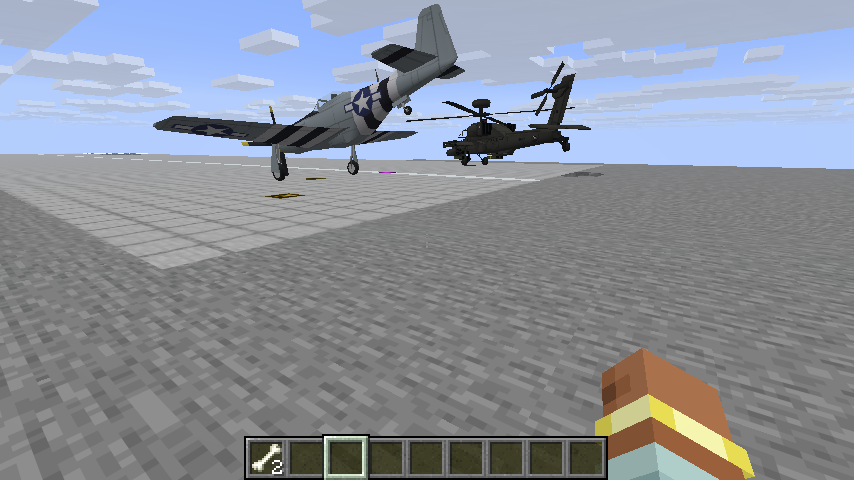

## Planner and command increment

- `MissionNode` and `MissionPlan` keep upstream's node text (`flyto:x,y,z`, `takeoff:id`,
  `land:id`, `attack:radius`, `loiter:ticks`, `park:id`); routes are saved per dimension.
- `AutonomousFlightHandler` flies a route node by node: a take-off taxis straight to runway end A
  and takes off as an order does, a fly-to point is reached within 30 blocks at no less than the
  cruising height, a loiter circles 20 blocks round, an attack waits while a hostile mob is in its
  radius, a landing flies the order's landing circuit and a park taxis to the spot and turns to
  its heading. A take-off or landing node finds the runway from the base or either end's ID.
- `WingmanPlannerScreen` and `NewRouteScreen` port `GuiWingmanPlanner` and `GuiNewRoute`;
  `PlannerDataPayload`, `MissionActionPayload` and `MissionRouteActionPayload` replace
  `PacketPlannerData`, `PacketMissionAction` and `PacketRouteAction`. `MissionPlanner` holds the
  server side the screens and the command share.
- `WingmanCommand` ports `/wingman` with Brigadier, including suggestions for aircraft, routes,
  markers, mission types, weapons and UAV types. The server config's `[wingman]` section ports
  upstream's formation entries.
- The Mission tab's Orbit Atk, which the port had ignored, now flies upstream's AC-130 mode, and
  the attack orbit uses the order's orbit radius.
- Differences: KNOWN_ISSUES 100. Network protocol 25.

Validation: three GameTests cover the nodes, routes, runway lookup, payload codecs and the
Orbit Atk orbit; a helicopter flying a six-node route (a skipped take-off, fly-to, loiter, attack
with and without a mob, park and a take-off taxi), assign replacing an order, aborts and a flown
aircraft refused; and `/wingman` routes, formation values and their ranges, `spawnuav` for
operators only, parking holds and an order dispatched, defaulted and aborted. All 237 required
GameTests pass. In the client, on the test base, a route built with the planner and `/wingman
route create` (take-off from the base, a fly-to point 200 blocks out, a 10-second loiter, a landing
and a park) sent a P-51D through every node: it took off along the runway, flew to the point,
circled, flew the circuit, landed and taxied back to its parking spot. The planner and the route
editor fit the 427 by 240 window.

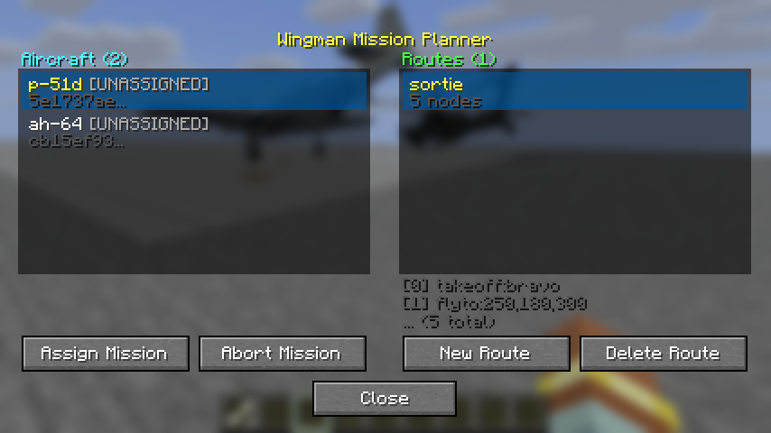
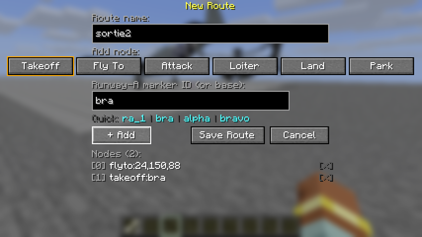
