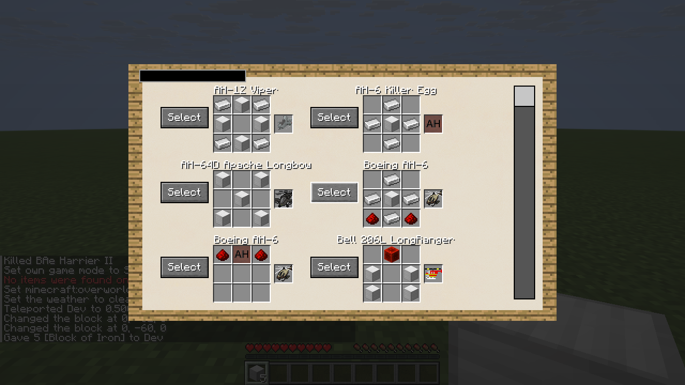
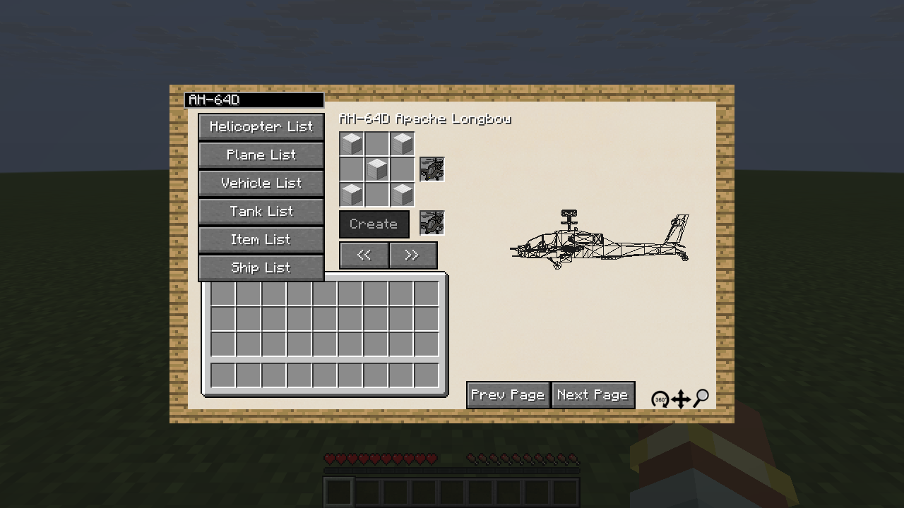
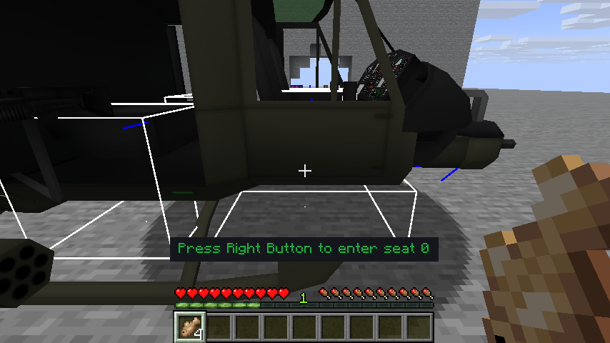
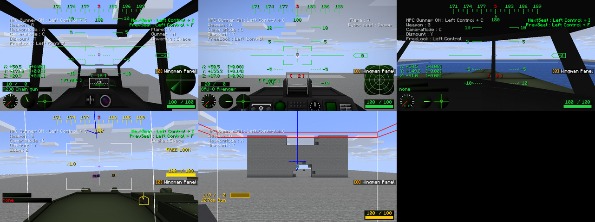

# M6 plan: remaining vehicles and support systems

Status: all eight stages are implemented, and an OpenGL gameplay pass across all five vehicle
types ran clean (see "OpenGL gameplay pass"). This expands PORTING_PLAN.md §6.
The starting checkout is 0.5.1. Preserve decisions D1–D23 and compare
behaviour with McHeli CE 1.5.1 at `cbaff7f30e549ff75e485388c24c74a4316c2228`.

## Scope and implementation order

Each stage needs its own build and relevant tests before the next stage relies on it. Keep the
existing helicopter workflow working throughout. M6b (Wingman) remains separate.

| Stage | Implementation | Acceptance evidence |
|---|---|---|
| 1. Shared vehicle integration | Remove helicopter-only assumptions from placement, pilot movement validation, input dispatch, HUD, engine sounds and renderer registration where the behaviour is shared. Keep helicopter-only fold blades and hover handling specific to helicopters. | Existing helicopter JUnit and GameTests still pass; non-helicopter inputs are checked against the controlling player and correct vehicle ID. |
| 2. Planes | Real plane entity, upstream flight formulas, VTOL/nozzles, variable sweep wings, autopilot, controls, part animations, sounds and weapons. | All 46 stock planes place, mount and save/load; representative conventional and VTOL craft take off, turn and land in both authority modes; upstream formula comparisons. |
| 3. Ships | Real ship entity, water depth/buoyancy, propulsion, steering, controls, models and weapon integration. | All 5 stock ships place, mount and save/load; buoyancy, turning, stopping and torpedo firing checked in water. |
| 4. Tanks and vehicles | Real tank and vehicle entities, upstream movement rules, wheel contacts and terrain tilt, crawler tracks/rollers, turret controls and ERA. Respect vehicle content that disables movement or rotation. | All 12 tanks and 18 vehicles place, mount and save/load; movement and slope tests, stationary gun restrictions, turret firing and track animation checks. |
| 5. Vehicle equipment | Racks, cargo containers, chains, parachutes, ropes/rappelling, searchlights, camera position switching, supply vehicles and remaining aircraft menu functions. | Attach/detach, dismount, destruction, reload and invalid-target cases; no dangling riders or duplicated items. |
| 6. Operators and tools | UAV station/pairing/tablet/control, gunner NPCs and mobs in seats, GLTD, hand-held Stinger/Javelin, wrench, rangefinder, mine defuser and item models. | Control authorization, operator disconnect, death and range limits; gunner IFF; hand-held firing/reloading and tool durability tests. |
| 7. Blocks and teams | Drafting table recipe browser/preview, aircraft charger with the current energy capability, multiplayer teams and spotting markers. | Recipe selection and inventory safety, energy transfer limits, server authority and friendly-target/spotting tests. |
| 8. Deferred combat systems | BVR/passive radar, GPS panel/missiles, mortar radar/RWR, ECM, pulse-Doppler notch, iron curtain, data link, anti-radiation missiles, UAV Destruct bombs and targeting-pod spotting. | Upstream behaviour comparisons and functional tests for target acquisition, loss, countermeasures and friendly-team filtering. |

The counts above are the stock inventory from M2, not a limit on addon definitions.

## First implementation increment

- Plane entities now use their content definitions and shared aircraft seats, fuel, damage and
  weapons. Items create/place planes rather than returning an inert placeholder.
- `PlaneFlightModel` ports upstream control and physics formulas. The initial increment
  incorrectly ran two movement steps per tick; the ship increment corrects this to the pinned
  source's single step and adds an entity-level cadence regression.
- Nozzles/VTOL and folding/sweep wings have server-controlled state and animation; saved
  state is restored without reapplying the default VTOL mode over a saved forward-flight mode.
- Rider controls, HUD, mouse flight, engine sounds and model submission support planes alongside
  helicopters. F switches VTOL and Z folds/sweeps wings outside camera view, as upstream.
- The network keeps the helicopter encoding and adds a plane payload; protocol version 3
  requires matching client/server builds. Vehicle identity and rider authorization are checked.
- Flight tests compare 300 ticks per scenario against a transcription of upstream, including
  cruise, VTOL, transition, reverse, sweep speed, water, landing and target drones. GameTests
  exercise all 46 stock definitions, takeoff, persistence, authorization and movement authority.
- All stock plane body models and textures are checked. The 79 part references absent in the
  pinned upstream model files are recorded explicitly in the parity fixture; additional gaps fail.

This does not complete stage 2. Remaining plane work includes equipment integration and broader
gameplay checks. The subsequent ship increment adds conventional and VTOL flight scenarios plus
local OpenGL/Vulkan flight/weapon and two-client smoke checks. UAV-only and target-drone placement
still waits for the UAV station. The ground increment below addresses stage 4; stages 5–8 remain. Do not
treat the shared renderer or asset tests as proof of visual correctness.

Validation of this increment: the saved installation script completed `build`; all 110 JUnit
tests passed with zero failures/errors/skips, and the dedicated GameTest server completed all
58 required tests successfully. Five new GameTests cover stock planes, control/persistence,
VTOL takeoff, authority bounds and the default-VTOL save/load regression. At that point graphical
and two-client tests had not run; the subsequent effects graphics checks are described below.

## Plane effects increment

- `PlaneParticles` ports nozzle smoke and obstruction spread, landing dust, rotor/fuselage damage
  trails and content-defined water wakes. It takes frame values, block queries and an emission
  sink so the same formulas can be tested without a client level. Each plane owns its histories.
- Damage smoke preserves the pinned upstream's unused `spawnSmoke` gate and `/3.0` trail
  interpolation. It also preserves `MathHelper.sqrt(double)`'s rounding order; a boundary
  regression checks a movement distance where rounding the input would emit one fewer particle.
  Changes to the visual style or those legacy quirks remain outside this porting increment.
- `PlaneVisualMotion` supplies destroyed-plane roll direction and the client-only pitch/roll
  rules near and away from terrain. Authoritative flight formulas are unchanged.
- Addon exhaust flames load `models/exhaustflames/<model>` and contiguous numbered textures
  `textures/exhaustflames/<prefix>0.png`, `...1.png`, etc., up to 100 frames, as upstream.
  The stock pack has no definitions/assets for this newer feature; addons supply their own.
  Missing models or texture sequences are skipped rather than drawing missing-texture geometry.
- Extracted flame draws contain their model groups, pose and texture; submission uses vanilla's
  translucent emissive pipeline and full brightness. No raw OpenGL calls or custom shaders are
  added. Animation retains upstream's per-extraction cadence; shader resource reload clears its
  caches, and a shortened texture sequence cannot leave a stale frame index.

### Graphics validation setup

The development client runs under a local Xvfb display with Mesa software rendering. Separate
ignored `.run/effects-opengl` and `.run/effects-vulkan` game directories contain copies of a flat
test world and a synthetic addon overriding `harrier_en`. It holds throttle at 1, speed at 0 and
gravity at -0.05 for a stationary scene. The addon supplies a small diagnostic triangle and two
coloured textures for `AddExhaustFlame`; these are test fixtures, not new stock artwork.

The scene summons the plane at `(0, -59, 12)` with `PlaneThrottle:1.0d`, `AcFuel:1200` and
`AcDamage:150`, and views it from `(14, -51, -4)` at yaw 41, pitch 22. Allow the remote throttle
interpolation to settle before inspecting flame size. Use `--graphicsBackend OPENGL` or
`--graphicsBackend VULKAN` in the development run's program arguments and verify the actual
backend line in the client log. For the pinned NeoForge build, Vulkan also needs
`earlyWindowControl = false` in that game directory's `config/fml.toml`: its early OpenGL
window otherwise causes GLFW error 65540 when Vulkan creates a surface. The local software
driver uses an explicit lavapipe ICD and a writable Mesa shader-cache directory.

The effects increment passes `build`, all 121 JUnit tests (zero failures/errors/skips), and all
58 required GameTests. The 11 new JUnit cases cover particle values, trail history and rounding,
water gating, landing dust, destroyed-attitude boundaries, exhaust animation, matrix transforms
and texture-cache reload. Live scene checks confirm damage/nozzle smoke and diagnostic exhaust
geometry on both backends, including resource reload. Switching to VTOL removes the diagnostic
flame. Screenshots: [OpenGL](screens/m6-plane-effects-opengl.png) and
[Vulkan](screens/m6-plane-effects-vulkan.png). The coloured triangle is the synthetic addon probe.

These scene checks cover effects/model submission, not complete plane flight, hardware
performance or two-client synchronization. The virtual display has no audio device; audio is
unverified. Full manual flight/weapon and two-client checks remain outstanding.

## Plane camera increment

- Removed the helicopter-only gate in the shared client camera controller. Planes now receive
  gunner camera positioning, zoom, night-vision post effects, TV-missile camera updates and
  content-defined third-person distance through that controller.
- H follows `MCP_ClientPlaneTickHandler#playerControl` at the pinned commit: enter gunner mode
  when allowed; leave gunner mode for position 1 when extra positions exist; cycle the remaining
  positions and return to normal view. If gunner flight conditions are not met, extra positions
  remain available. A plane without gunner mode or extra positions refuses the switch.
- Camera IDs are local viewer state, not NBT or network fields. Only gunner-mode transitions
  send existing control packets, so protocol version 3 is unchanged. Extra positions apply to
  the pilot; crew `InvCamPos` and ordinary passenger viewpoints stay independent.
- Selection resets on pilot mount/dismount, destruction and content changes. Switching directly
  between vehicles also refreshes the client view marker and third-person distance. Changing a
  content type before seats spawn now skips missing seat references instead of crashing.
- All stock planes have one camera position. Addon definitions can supply more; the HUD shows
  the H camera/gunner hint when they do. Camera `FixedRot`, `Yaw` and `Pitch` remain inert because
  the pinned upstream parses those values but never applies them in the mouse/view path.

Validation: `build` passes, with 121 JUnit tests and zero failures/errors/skips. All 63 required
GameTests pass. Five new GameTests exercise the upstream view sequence, planes without gunner
mode, blocked gunner conditions, invalid indices, crew/stranger isolation, `InvCamPos`,
`AlwaysCameraView`, dismount/remount, save/load, content changes, destruction and network controls.
Live camera checks run in isolated `.run/cameras-opengl` and `.run/cameras-vulkan` directories,
using the effects increment's Xvfb/Mesa setup and backend flags. A separate local addon overrides
`harrier_en` with three TXT `CameraPosition` entries: `(0, 2, 0)`, `(14, 4, -10)` and `(-14, 4, -10)`.
It sets speed to zero, enables gunner mode and keeps the normal camera rotation. Coloured block
pillars provide fixed landmarks. These definitions are test fixtures, not changes to stock content.

Both backends show the two extra positions and return to the cockpit. Night vision and dismount
cleanup are checked in OpenGL; Vulkan also checks entering gunner mode in the air, zoom changing
from 1× to 2×, night vision and dismount cleanup. The Vulkan fixture uses `ThrottleUpDown = 3` (the parser clamps
higher values to 3); holding W before H raises throttle above the gunner threshold. This checks
camera integration, not a complete takeoff/flight/landing scenario. Build before launching these
clients: recompiling their shared class output while a client is running invalidates the check.
Screenshots: [OpenGL](screens/m6-plane-camera-opengl.png) and
[Vulkan](screens/m6-plane-camera-vulkan.png), both at the first extra camera position.

Full flight/weapon and two-client checks remain outstanding; TV-missile view is connected but
not exercised in these camera scenes. The subsequent parachute increment adds ejection below.

## Parachute and ejection increment

- `ParachuteEntity` replaces the placeholder; `ParachuteMotion` ports the gravity, forward steering,
  horizontal cap, acceleration multiplier and post-collision drag from `MCH_EntityParachute`.
  Type 1 is the hand chute, type 2 the boosted ejection seat (opening below -0.1 vertical speed),
  and type 3 the transport chute. Type 2 uses reduced gravity/drag before tick 20. The server
  simulates motion; clients use vanilla tracking with the upstream thirteen-tick smoothing length.
- Landing releases the rider and removes the chute after six ground ticks. Water removes it;
  a type-2 seat creates an oak rescue boat only when the upstream 5×5×3 water count exceeds 37.
  Water probes use modern build heights and fluid states. Model type and ordinary entity state
  save/load normally; riders use vanilla passenger persistence.
- The hand item deploys at upstream's `(0.5, 3.5, 0.5)` offset and inherits velocity/fall distance.
  The server mounts the user immediately and consumes an item only after successful deployment;
  creative users keep it. Grounded or mounted use is refused without consuming anything.
- Space ejects the pilot or first crew seat of a supported plane. The server checks the sender,
  vehicle ID, content flag, rider seat, destruction state and reserve availability. Launch position
  and impulse rotate with the aircraft, its velocity is inherited, and ejection opens the canopy.
  Pilot ejection also rescues a non-player in seat 1 when another chute remains; a player in that
  seat chooses their own ejection. A repeated request after transfer cannot charge another item.
- One/two-seat ejection-capable planes expose one/two reserve slots. Two independent storage slots
  save under `ParachutesAC`, so `ItemsAC` fuel/trunk indices remain compatible. Menu transfer rules
  accept one parachute per reserve. The opening packet includes reserve-slot count; protocol 4
  rejects older clients rather than letting their menu slot numbering disagree.
- Y now reaches crew seats. A transport passenger beyond seat 1 can use a type-3 chute when content
  permits it, the hatch is open and the ground is clear. Drop positions use the pinned queue's
  ten-position history and its `current + 1` oldest-index quirk. Ordinary dismount remains available.
  Automatic mob dropping, ropes/rappelling and the remaining equipment controls are still pending.
- `ParachuteRenderer` draws the stock hand chute and selects `$seat`/`$parachute` for the other
  forms. Geometry uses the shared submission pipeline and model-sized culling bounds, without
  raw graphics calls. The stock type-2 MQO has malformed exported names and draws neither part
  upstream. Its exact SHA-256 is pinned in a regression test; no shipped asset is rewritten.
  A valid addon model supplies those names. Ejection smoke retains upstream's triple assignment
  to `motionX`, including its random-call order; visual redesign remains outside the port.

Validation: `runData` completed and `build` passes with all 127 JUnit tests and zero
failures/errors/skips. All 76 required GameTests pass. The thirteen new GameTests cover hand
item use/refusals, creative consumption, real descent and safe landing, initial ejection boost
and opening during descent, wrong sender/vehicle ID, empty reserves, repeated packets, first
crew ejection, other-player protection, non-player rescue, inventory transfers and persistence,
older saves, transport-seat bailout, and both sides of the water-volume threshold.

### Parachute graphics checks

The isolated `.run/parachutes-opengl` and `.run/parachutes-vulkan` game directories use the
existing Xvfb/Mesa setup and explicit backend flags. `zz_parachute_probe` is a local test addon:
it removes the exported-name prefixes from a copy of `parachute2.mqo` and moves the seat object
before the canopy group, so the existing geometry has valid groups. This fixture is not shipped
in the mod and does not change the pinned stock asset.

With `/tick freeze`, summon models 1, 2 and 3 at `(-6, -57, 12)`, `(0, -57, 12)` and `(6, -57, 12)`.
Give model 2 upward motion `(0, 2, 0)` to select its closed seat; model 3 selects the open canopy.
View from `(16, -48, -6)` at yaw 41, pitch 18. Both backends draw the stock hand chute and the
addon's closed seat/open canopy. Reloading resources keeps them visible. In Vulkan, temporarily
removing the addon model and reloading makes only the stock hand chute remain; the stock missing
parts produce no rendering error. Restoring the addon and reloading restores the other forms.

Live OpenGL controls also verify the aircraft menu's reserve slot and shift-click round trip.
Space transfers the pilot to a type-2 chute and changes the reserve from one item to empty;
right-clicking the hand item while airborne deploys type 1. Screenshots:
[menu](screens/m6-parachute-menu.png), [OpenGL](screens/m6-parachutes-opengl.png), and
[Vulkan](screens/m6-parachutes-vulkan.png). The large canopy and small black seat in those model
scenes use the test addon; the smaller brown hand chute uses the shipped model.

These checks cover rendering and an integrated-server control path. Two-client synchronization,
full aircraft flight/weapon checks and hardware performance remain unrun; the virtual display
still has no audio device.

## Ship increment and plane cadence correction

- `ShipEntity` replaces the placeholder and uses ship definitions with real placement, shared seats,
  fuel, damage, weapons, inventories and item data. Stock ground-movement/rotation restrictions
  are enforced. `allShipSpeed` scales each ship's normal and swept-wing speed limits.
- The pinned `MCH_EntityShip` duplicates almost all plane control, movement, parts and particle
  code. `WingedAircraftInfo` and `WingedAircraftEntity` share those implementations; planes and
  ships remain sibling entity types. Ship models/parts/textures load from `ships`, both on demand
  and eagerly. Plane exhaust animation remains specific to planes.
- Buoyancy uses the shared five-slice water probe and each definition's float offset, including
  negative world heights. Steering, throttle, reverse (when enabled), hull levelling, nozzle/wing
  parts, rotor animation, damage smoke, wakes, dust, camera controls and sound follow upstream.
  Steering wheels now rotate about their content pivots rather than remaining at rest.
- `ShipControlPayload` carries common controls and nozzle/wing switches. Protocol 5 requires
  matching clients/servers. Identity, rider, pilot and destroyed-state checks use the shared path.
  Pilot motion application also enforces the existing authority and entity-ID checks directly.
- None of the five stock ship definitions mounts torpedoes. The guided Mk46 integration check
  uses an isolated addon-style ship definition; shipped loadouts and assets are preserved.
- Auditing the pinned source found that the earlier plane increment's two-step cadence was
  incorrect: `MCH_EntityAircraft#onUpdate` calls `onUpdateAircraft` once, which calls
  `MCH_EntityPlane#onUpdate_Server` once, and that method moves once. Both vehicle kinds now use
  one movement step per tick. The old numeric oracle repeated both sides twice and missed the
  integration error; an entity-level movement-call/drag/bounds regression now guards it.

The seven ship GameTests cover all five stock items/definitions, pilot and crew mounting,
world persistence, water-surface equilibrium, acceleration, turning, braking, land restrictions,
destroyed buoyancy, both authority modes, wrong sender/ID, invalid velocity, speed configuration,
crew-only gunfire, guided torpedo launch/travel and item fuel/damage round trips. Three additional
plane tests exercise a conventional P-51D and VTOL Harrier through takeoff, mouse turning,
transition and safe landing, plus weapon launch/ammunition in both authority modes. Flights run
outside the GameTest arena's barrier walls and load their collision chunks. They exercise the
real entities synchronously, not a second networked client.

Automated validation: `build` passes with 129 JUnit tests (zero failures, errors or skips),
and the dedicated GameTest server completes all 87 required tests. The model audit covers all
five ship bodies, every referenced part and all textures, with no missing stock ship assets.
A separate transform check verifies the Zodiac outboard's steering pivot and rotation direction.

### Ship graphics and multiplayer checks

Two real development clients connect to a local offline dedicated server: an OpenGL pilot on
Xvfb `:99` and a Vulkan observer on `:100`, both with Mesa software drivers. Isolated game
folders are `.run/ships-server`, `.run/ships-pilot` and `.run/ships-observer`. The pilot uses eager
model loading; the observer uses on-demand loading. The launch overrides are kept locally in
`/workspace/.graphics/ships-multiplayer.init.gradle`. No test addon is needed for these stock scenes.

A source-water lake spans X/Z -128 to 127, Y -59 to -55. All five stock ship models render in the
fleet scene. Resource reload on both clients keeps their models and textures visible. The pilot
opens the Zodiac fuel menu, steers at full throttle for at least 60 seconds in the default client
authority mode while the observer watches, then brakes to zero throttle and zero horizontal
velocity. The server's `vehicles.serverAuthoritativeMovement` setting is reloaded and broadcast
to both clients; the steering/movement check is repeated in that mode. Server position/rotation
queries and observer frame captures confirm movement and turning in both modes. These are local
movement smoke checks, without measured per-frame smoothness statistics or network latency/loss.

The same clients also exercise a Harrier in each authority mode: start in VTOL on land, hold W
for climb, use F to transition to forward flight, and hold the left mouse button for cannon fire.
Server position, part-status and ammo queries confirm climb, forward movement, nozzle transition
and firing; the Vulkan observer sees the moving plane. Actual mouse-turning and complete manual
approach/landing remain unrun; those sequences are covered by the synchronous entity tests above.
Both clients and the dedicated server shut down cleanly.

Screenshots: [OpenGL fleet](screens/m6-ships-opengl.png), [Vulkan fleet](screens/m6-ships-vulkan.png),
and [ship menu](screens/m6-ships-menu.png). Audio remains unverified because the
virtual displays have no audio device; software rendering does not establish hardware performance.

## Ground-vehicle increment

- Real sibling `TankEntity` and `VehicleEntity` types replace the last main-vehicle placeholders.
  All 12 stock tank/car and 18 placed-vehicle definitions use shared placement, seats, fuel,
  inventory, weapons, damage and item/world persistence. Content movement/rotation restrictions
  and the upstream default fixed-position anchor for placed vehicles remain enforced.
- `GroundMotion` retains the pinned tank throttle/reverse, gravity, buoyancy, speed cap and two
  ground-grip passes around a single movement step. Wheeled vehicles retain the longer upstream
  coast. Ground attitude/keyboard steering runs once per simulation tick (0.05 s), independent
  of rendering frame rate. Local wheel probes provide mirrored contacts, weighted terrain normals
  and constrained pitch/roll; large hull relocations reset probes instead of sweeping the map.
- Mouse motion aims weapons independently of the chassis. W/S drives, A/D steers, held Space
  brakes tanks/cars, H cycles additional camera positions, and Z zooms placed-gun cameras.
  `GroundControlPayload` adds the held brake with pilot/vehicle checks. Protocol 6 requires
  matching builds. Existing helicopter, plane and ship payload layouts remain intact.
- Supported model submission draws wheel steering/spin, crawler links and rollers, shared tank
  turrets and recursive placed-gun yaw/pitch/barrel/recoil parts. Ground assets load both eagerly
  and on demand. Tank damage smoke, dust and content water splashes use shared effects.
- Reactive armor uses synchronized per-entity state and `AcERAState` persistence, rather than
  mutating shared content definitions. Qualifying hits pop active tiles; popped tiles stop
  rendering and receiving hits. Projectile tracing now checks active extra hull boxes as well
  as the base box. No stock definition includes ERA, so the checks use an isolated fixture.

Automated validation: 136 JUnit tests and 95 required GameTests. Seven new GameTests cover all
30 stock placements, pilot/crew mounting and save/item round trips, M1A2/BNR32 drive/steer/brake/
reverse, uneven terrain, authorization and both movement authority settings, stationary gun and
independent tank firing, plus reactive armor threshold, projectile tracing, per-entity isolation
and actual save restoration. The model audit checks every referenced part and texture; only the
MXT-MV canopy is absent, matching the pinned upstream asset. Four formula/animation unit tests
cover the single movement cadence, tracked/wheeled grip, movement restrictions and track wrap.

### Ground graphics and multiplayer checks

The same isolated local dedicated server and two development clients used for ships now exercise
all 12 stock tanks/cars and all 18 stock placed vehicles in separate fleet scenes. The pilot uses
OpenGL with eager model loading; the observer uses Vulkan with on-demand loading, both on Xvfb/Mesa.
Models remain visible after F3+T resource reload on both backends. Screenshots:
[tanks/OpenGL](screens/m6-tanks-opengl.png), [tanks/Vulkan](screens/m6-tanks-vulkan.png),
[guns/OpenGL](screens/m6-ground-guns-opengl.png), [guns/Vulkan](screens/m6-ground-guns-vulkan.png).

A real M1A2 pilot drives and turns with W/A, holds Space to stop, opens the fuel/ammunition menu
and fires the main cannon. The server's position, rotation, throttle, velocity and ammunition
queries confirm the actions. Mouse motion changes rider aim while a stopped hull keeps its yaw.
After changing `serverAuthoritativeMovement` and receiving the config broadcast on both clients,
the same tank drives/turns, reverses, brakes and fires again. The Vulkan observer sees the tank.
The stock 12.7 cm emplacement remains at its placed position and chassis yaw under W/A, aims with
the mouse and fires using real client input. These are local smoke checks without measured
frame-time statistics or simulated latency/loss. The virtual displays have no audio device.

The placed-gun camera check found the rider body occluding the primary camera. Rider render
state now honors pilot `HideRiders` and suppresses the local rider in a primary first-person
marker camera. The visibility decision is extracted into render state and applied through the shared living
renderer event, including players, without graphics backend calls. The primary gun view is clear
on both graphics backends after the fix. Additional captures: [tank menu](screens/m6-tank-menu.png),
[Vulkan tank observer](screens/m6-tank-observer-vulkan.png), and
[gun camera](screens/m6-ground-gun-aim.png).

The collision follow-up below adds crushing and ramming. Solid movement collision still uses
the main hull and wheel probes; extra hit boxes supply damage/crushing regions. Equipment,
operators, tools, blocks/teams and deferred combat systems in stages 5–8 remain unfinished.

### Tank collision follow-up

`TankCollisions` runs after the server's tank tick, with current part positions, in either
movement authority mode. It restores upstream's weight-specific block crushing, wheel soft-block
removal and collision damage. Cars crush vegetation/panes; heavy tanks also crush wood, glass,
carpets, circuits and the configured nether-brick fence. Torch and glowstone exclusions protect
their columns. Each crushing pass stops at the first protected or broken block in a column;
one in eight broken blocks drops items. Active extra hull regions are sampled one tick in three.

Minecraft 26.2 has no old block `Material`. Editable block IDs and tags in
`vehicles.crushing` replace those categories, using current vanilla/NeoForge tags. The server's
existing `vehicles.collisionDestroyBlock` switch gates all crushing. Coordinates use floor and
the level's real build heights, following the existing `GroundProbe` negative-coordinate fixes;
collision scans skip unloaded chunks. No network layout change is needed for server-side effects.

Ramming retains the speed threshold, speed/proximity damage, cumulative per-query bonus,
ordinary/aircraft knockback and car reciprocal damage. Pilot credit uses a mob-attack damage
source even for a player pilot, so contact cannot invoke the vehicle melee-pickup path. General
entity damage is enabled by default; heavy-tank damage has a separate switch disabled by default.
Occupants, their seat entities, items, XP, mod projectiles and chains are excluded; arrows are
cleared. Upstream's occupant grace counters refresh/decrement every ten ticks, so an eight-count
entry lasts up to eighty ticks. Parent/part query duplicates are collapsed within each region;
popped ERA regions cannot crush or ram. Chain links will add their towing exclusions when the
chain system is implemented. Extra boxes still do not form solid movement collision shapes.

Seven additional GameTests exercise car/heavy-tank defaults, protected columns, configuration
overrides and switches, negative-world-height column traversal, damage/credit/knockback in both
movement authority settings, occupant and dismount grace, ignored entity types, heavy-tank opt-in,
car reciprocal damage, multipart deduplication and active/popped ERA collision regions.
The full build passes all 136 JUnit tests and all 102 required GameTests, with no unit-test
failures, errors or skips. Collision fixtures keep the hull still while running real server
ticks; existing drive/terrain/weapon scenarios continue to exercise the stock movement code.

Live verification reuses the isolated dedicated server and OpenGL pilot/Vulkan observer. An
M1A2 starts at `(700.5, -59, 0.5)`, drives through a three-high wooden wall at Z 12 and rams a
marked cow at Z 20.5. Server block queries confirm the wall's center cleared and a protected
glowstone at Z 30 survived; the driver's mob-kill objective increments. W is held eight seconds,
then Space brakes to zero throttle. The default client-authority run reaches Z 74.4. After the
server-authority setting reload reaches both clients, a fresh tank repeats the course with five
seconds of W and five of Space, stops at Z 52.84 and increments the kill count a second time.
No weapon input is used. The Vulkan observer sees the moving tank and contact with the target.

A BNR32 in the parallel lane at X 760.5 clears a three-high glass-pane wall at Z 12, then stops
at Z 24 against the wooden wall at Z 25. Block queries confirm the pane center is gone and the
wood remains. Captures: [tank contact](screens/m6-tank-collision-vulkan.png) and
[car stopped at wood](screens/m6-car-crushing-vulkan.png). These are local functional smoke
checks on software graphics, without latency/loss or hardware-performance measurements.
The dedicated server saves/stops successfully. The Vulkan client reports a native connection
reset on server shutdown and returns to its disconnect screen; both clients then quit normally.

## Supply and medical support increment

- The stock fuel truck now supplies compatible vehicles in its configured 35-block expanded
  bounding box. Fuel supply runs server-side every ten ticks before consumption and transfers
  up to 30 fuel per recipient, capped by recipient capacity. A grounded supplier requires a
  recipient able to resupply; an airborne supplier can refuel airborne recipients.
- Finite suppliers use their current fuel type and pay from their tank; infinite suppliers use
  `FuelSupply.Type` and need no onboard fuel. Empty recipients adopt the source type; nonempty
  incompatible tanks and unaccepted content fuel types are skipped. As upstream, finite sources
  transfer before clamping their remaining fuel, and may supply the last full increment even
  with fewer than 30 units left. A source emptied during a scan may still supply the other
  recipients in that scan. Compatible recipients receive a 40-tick consumption grace even when
  full or unable to land. The grace counter is transient, as upstream.
- `RepairOtherVehicles.Range`/`Value` now reduce nearby vehicle damage every twenty ticks,
  excluding the supplier itself. Upstream does not gate repair on landing or destruction:
  a wreck can supply repair, and reducing wreck damage does not clear its destroyed state.
  All stock repair ranges are zero, so this is an addon feature without stock balance changes.
- `Regeneration` now applies ambient regeneration I for 250 ticks to living secondary-seat
  passengers of an intact medical aircraft while a pilot is present. The pilot is not a
  patient. Effects with at least 500 ticks remaining are left alone; shorter effects use the
  normal effect-merging rules. Stock NH90, US-2 and An-2 definitions already enable this.
- Existing ammo-box resupply remains connected beside fuel supply. The effects run independently
  of movement authority, with no new control payload or client authority over fuel/damage.
- Fuel names remain compatibility tokens until registered fluids/container capabilities are
  ported (KNOWN_ISSUES difference 68). Electric battery/charger support remains pending.

Automated validation: all 136 JUnit tests pass without failures, errors or skips, and all 109
required GameTests pass. Seven new support scenarios check stock fuel and ammo supply in both
movement authority modes, finite transfer/cadence/capacity, fuel compatibility, electric-source
exclusion, range/landing rules, consumption grace, repair/wreck semantics and stock NH90 medical
passengers. Precise addon fixtures run the real shared server tick with movement held still.
The stock-supply scene is elevated above concurrent tests because its 35-block radius exceeds
the GameTest structure spacing; the all-planes spawn check likewise isolates its fuel truck.

Live checks use the isolated dedicated server with the OpenGL pilot (eager models) and Vulkan
passenger/observer (on-demand models), on software Mesa drivers. A stock fuel truck at
`(910.5, -59, 0.5)` refuels the piloted AH-64 nearby from 0 to 1,080, then its 1,200 capacity.
The pilot sees the fuel gauge and the observer sees both models. After changing to server
movement authority, resetting fuel to zero yields 600 after about ten seconds. This verifies
server/client integration locally, without a latency or hardware-performance claim.

In the NH90 at `(960.5, -59, 0.5)`, the Vulkan secondary-seat passenger receives the visible
Regeneration effect; server queries show ambient regeneration with 249 ticks remaining after
an entity tick, while the pilot has no effect. With natural health regeneration disabled, six
points of damage reduce passenger health to 14 and it returns to 20 while the pilot remains
aboard, including after the server-authority setting reload. Clearing the effect after the
pilot exits leaves the passenger without regeneration. Captures:
[fuel truck and AH-64](screens/m6-fuel-truck-vulkan.png) and
[passenger effect panel](screens/m6-medical-passenger-vulkan.png). The server saves/stops
successfully, both clients return to the disconnect screen, and both quit normally with exit 0.

## Cargo container increment

- Replace the inert container entity/item with the stock two-block-wide, fireproof cargo entity.
  The five-block placement ray accepts blocks/source fluids, snaps yaw by quarter turns and
  preserves the upstream half-block spawn offset. Eye obstruction, occupied placement and failed
  server spawn refuse placement without consuming the item; creative placement keeps the item.
- Right-click opens a vanilla six-row inventory, with all 54 slots shared by viewers and normal
  shift-click transfer. The pinned upstream `displayInventory` stub is empty, so connecting this
  menu is an explicit fix (KNOWN_ISSUES difference 69). Validity follows current entity interaction
  distance. Modern slot codecs save counts, components and empty-slot positions. Both direct and
  sided automation expose NeoForge's current transactional item capability.
- Only player melee damages the container, with external scaling, accumulated damage times 20,
  one point of decay per tick, and the strict greater-than-40 threshold. Creative breaks instantly.
  Survival drops one empty container and its inventory; creative drops the inventory alone.
  Repeated destructive removal cannot drop contents twice. Unload and dimension-change removal
  reasons retain contents and do not scatter items into the source world.
- Server physics preserve gravity/buoyancy from five fluid slices, floating in both water and lava,
  a .35 horizontal speed cap, .99/.95 damping, .9 ground friction and five-degree movement yaw.
  The unused upstream speedMultiplier has no effect and is omitted. Cargo emits no walking
  sounds/events, as upstream. Containers push one another;
  the global collision-destruction setting gates corner-probe snow/lily-pad clearing. Preserve
  upstream's floating-point corner-index division. Probes use current build heights/fluid tags.
- The stock container OBJ, texture, .75 tint and .3 vertical render offset use the supported model
  submission path. Client tracking retains the upstream thirteen-tick interpolation extension.
  Protocol 7 rejects clients from before the new container entity data. No new payload is added.
- Aircraft racks, container rack attachment, tow chains and ropes/rappelling remain later M6
  equipment increments. This increment does not enable transport attachment hints prematurely.

Automated validation: all 136 JUnit tests pass with zero failures, errors or skips, and all
116 required GameTests pass. Seven new cargo scenarios exercise real placement/consumption and
refusals, every saved slot (including item components/custom names), shared six-row menus and
shift-click transfer, transactional capability commit/rollback, range/removal validity, damage
threshold/decay and exactly-once drops, unload/dimension-removal reasons, gravity/speed/yaw,
water/lava buoyancy, fire immunity and configured soft-block clearing/container pushing.
Actual cross-dimension travel is not part of this check; its removal reasons and serialized
inventory are covered independently.

Live validation uses the isolated dedicated server with an OpenGL player (eager models) and
Vulkan player (on-demand models) on software Mesa drivers. Both right-click the same crate at
`(1100.5, -59, 0.5)` and see all 54 slots, including items in slot 53. The OpenGL player
shift-clicks 32 diamonds out of slot 0 while the Vulkan player takes 12 emeralds from slot 53.
Server queries show the crate empty and those exact counts in the two player inventories.
Both return their items by shift-click; the crate holds 32 diamonds and 12 emeralds again.

A survival player places the actual container item near `(1085.5, -59, -0.5)`; it settles on the
ground at Y -59, and the player's inventory no longer contains the placement item. Four normal
melee clicks break it into one container item. Breaking the loaded land crate likewise drops one
container plus diamonds in stacks of 10 and 22, and 12 emeralds (the exact stored total).
A crate in an enclosed three-block-deep water pool remains afloat. A server-set X impulse of
.15 moves it from X 1127.5 to the pool wall at X 1133, with Vulkan tracking the movement. Captures:
[OpenGL model](screens/m6-cargo-opengl.png), [Vulkan inventory](screens/m6-cargo-inventory-vulkan.png)
and [Vulkan floating crate](screens/m6-cargo-floating-vulkan.png).
These are local functional checks; software rendering does not establish hardware performance,
audio or latency/loss behavior. The server saves and stops successfully. The Vulkan client
reports a native Netty connection reset on server close, returns to its disconnect screen, and
both clients quit normally with successful Gradle exit. No mod exception occurs during cargo
placement, inventory interaction or movement.

## Aircraft rack increment

- J loads every empty compatible rack in content order, querying each transformed entry point's
  configured range. U releases one load, scanning racks in reverse order. A vehicle pilot can
  press J to board a compatible carrier and U to leave it without leaving their own vehicle.
  Only the actual pilot may send rack actions for that vehicle ID; outsiders and crew are denied.
- Preserve rack name/kind matching (case insensitive), cargo-side RideRack mappings, exclusion
  groups and the server persistent-data `CanMountEntity` opt-in for other entity types. Reject
  occupied/missing racks, existing passengers, destroyed vehicles and nested loaded transports.
  Normal player boarding skips rack slots rather than treating them as spare crew seats.
- `vehicles.enablePutRackInFlying` defaults true. When false, carrier loading needs throttle at
  most .3 and ground within three blocks. As upstream, vehicle self-boarding uses its independent
  path and is not gated by this setting. Vanilla's three-second reboarding cooldown still applies.
- Seats/racks remain children of their carrier, and loads become children of those seats. Vanilla
  serializes the entire tree, including cargo inventory. Existing seats are reused on load.
  Carried containers skip motion; carried vehicles skip their own simulation, pilot motion and
  attitude packets, ground damage and tank crushing/ramming. Their drivers/crew remain aboard.
- Container models receive upstream's carrier-yaw-space pitch/roll transform. Carried aircraft
  use the equivalent composed world attitude, so their own model, weapons, crew seats and living
  crew transforms agree without nested legacy drawing. On release the rack's fixed yaw/pitch
  and zero local roll are restored, matching upstream's detached pose. Supported model rendering
  remains in use. Supported same-dimension teleport transitions synchronize the driver/crew tree
  when a release or parachute touchdown returns vehicle movement authority to the client, replacing
  the old eight-tick release position reserve. Tank carrier-collision grace keeps refreshing while
  carried and is renewed on release, preventing a detached truck from ramming its carrier.
- Releases use explicit UnmountPos when present, otherwise the entry point. Carrier-requested
  aircraft release adds upstream's twelve-block fore/aft offset when no explicit point exists.
  Refuse solidly blocked exits without detaching cargo. If the carrier has no ground in its
  twenty-block downward probe, deploy a type-3 transport chute and inherit carrier velocity.
  Spawn/mount failures and cancelled dismounts retain or restore the original rack/inventory.
  An aircraft pilot can leave a transport chute with U; normal touchdown releases its load.
- `OpenParaAlt` remains parsed but unused by the pinned upstream rack-release code. Do not silently
  reinterpret it as a new altitude rule. The existing stock transport/ejection canopy defect
  remains documented in KNOWN_ISSUES; the descent behavior is independent of the missing mesh.
- Add a dedicated rack-action channel and protocol 8, leaving existing control record layouts
  intact. Key descriptions and capability-based HUD hints appear only with these working actions.
  Tow chains and ropes/rappelling remain separate later M6 equipment increments.

Automated validation: all 139 JUnit tests pass with no failures, errors or skips, and all
127 required GameTests pass. New unit checks round-trip every rack action, neutralize unknown
ordinals and compare container render tilt with composed world attitude. Eleven server scenarios
cover stock CH-47 exclusions, named/kind/RideRack vehicle matching, nested-load rejection,
air-loading gates and opt-in entities, pilot/ID/crew authorization, both movement authority modes,
carried pose/physics/crushing suspension, cooldown/self-boarding, blocked/reverse-order release,
airdrop/touchdown with cargo inventory, passenger-tree save/load, carrier removal and cancellation
of mounting, dismounting, parachute spawning and parachute mounting. Only confirmed successful
attachments count as loads, and cancelled releases preserve the original rack and inventory.
Additional cases verify the released tank still damages nearby living entities while excluding
its carrier, and aircraft touchdown safely returns the load to independent movement.

Live validation uses a dedicated server with separate OpenGL and Vulkan players on software Mesa.
The OpenGL MH-53E pilot loads a Growler occupied by the Vulkan driver using J. Holding forward
inside the loaded truck does not move it independently. The driver leaves with U on the ground,
waits out the vanilla cooldown, then boards again with J. The carrier flies more than forty blocks
above the ground and releases with U; both players retain 20 health and both vehicles retain zero
damage. After transport-chute touchdown the truck drives independently. The server-controlled
movement setting is then enabled and synchronized to both clients; a second occupied Growler
likewise loads, flies, releases, lands and drives, with both vehicles undamaged and both players alive.

A CH-47 loads a container holding 23 diamonds in slot 53, flies thirty blocks above ground and
releases it onto a type-3 chute. The chute's passenger data confirms the crate attachment during
descent. After landing, a survival player opens the crate and sees the same 23 diamonds in the
last slot. Captures: [Vulkan truck after landing](screens/m6-racks-growler-landed-vulkan.png) and
[OpenGL cargo after drop](screens/m6-racks-cargo-after-drop-opengl.png).

The near-ground driver-requested release still logs a brief client-movement correction in default
authority mode before settling at the intended exit. No damage or lost passengers follow; airborne
releases and touchdowns in this run produce no further movement corrections. This remains a
release-smoothing limitation. The server saves/stops and both clients quit successfully. These
checks do not establish hardware performance, audio, network-latency/loss behavior or actual
cross-dimension travel; passenger-tree serialization is checked independently.

## Tow chain increment

- The reusable Chain item selects the trailer/cargo first and the tug second. Endpoints must be
  two to sixteen blocks apart; length is the initial integer distance clamped to three through
  fifteen. Clicking either linked endpoint disconnects it. Selection, connection, disconnect and
  range feedback use translated action-bar messages plus the stock sounds. Nothing consumes or
  drops a chain item. Cargo/vehicle normal interactions are intercepted while holding a chain.
- Resolve multipart hull hits to their parent vehicle. Reject living entities, items, XP,
  projectiles, helper entities, destroyed vehicles, passengers and placed vehicles while the
  upstream anchoring option is enabled. Validate the interaction's actual reach and sight line.
  Store selection by dimension/UUID in modern item custom data; stale selections start over.
- One chain per endpoint prevents duplicate links and cycles. Linked endpoints cannot enter
  racks. A loaded carrier may tow, but its passenger loads cannot be chained separately.
  Cancelled creation preserves item selection and leaves vehicle authority unchanged.
- The trailer faces the tug once taut and receives upstream's inverse-gap weak pull. The gap
  denominator is at least .1 to avoid an explosive impulse immediately past the length boundary.
  At length plus two blocks, collision-aware movement applies the hard correction; an obstruction
  disconnects instead of teleporting the trailer through solids. Reset the trailer's fall distance.
- McHeli trailers remain server-simulated even with a driver aboard, and reject stale pilot motion
  and attitude packets. Tugs retain the selected movement mode. Unpiloted carried/towed weapon
  bases follow hull attitude. Tank partner/occupant collision exclusions refresh while linked
  and persist after disconnect. A supported teleport transition returns trailer client authority.
  Generic client-controlled entities cannot be trailers; this switch belongs to McHeli vehicles.
- Save both endpoint UUIDs and length, with fifty ticks to resolve loaded entities in the current
  level after reload. Removed/destroyed, newly mounted or otherwise invalid endpoints disconnect.
  Unloading detaches runtime references without destructive sounds or item drops. Entity metadata
  sends distinct endpoint IDs, fixing upstream's duplicate trailer ID. Actual disconnect lookup
  replaces its always-null stub. Stock chain OBJ links repeat every .95 blocks via supported
  geometry submission, with culling bounds spanning both ends and no direct OpenGL calls.
- Protocol 9 covers the new chain metadata and synchronized trailer-authority flag. Hosts and
  clients must update together. Ropes/rappelling and searchlights remain later M6 equipment work.

Automated validation: all 139 JUnit tests pass with no failures, errors or skips; all 136 required
GameTests pass. Nine new chain scenarios cover real item/event interception including multipart
hits, selection/disconnect/range and invalid-target handling, cancelled creation, slack and taut
pulling, near-taut numerical stability and hard limits, blocked paths, orphan cleanup and removal
at either end, UUID reconnection with inventory, network-player authority in both movement modes,
ramming/partner grace and rack exclusions. The network-player case checks that a trailer rejects
client motion while retaining its driver, then returns client control on disconnect.

Live validation uses a dedicated server, an OpenGL player and a Vulkan player on software Mesa.
Actual right-clicks select a Growler trailer, then its tug eight blocks away. Server queries show
distinct UUID endpoints and length eight; the selection clears and the one Chain item remains.
Both players board their respective vehicles. Driving and braking moves the pair about fifty
blocks in default movement mode and another fifty after enabling/synchronizing server movement.
Both vehicles retain zero damage and both players survive. A right-click on the tug disconnects;
the server then finds no chain. The same item reconnects the pair. Vulkan shows the stock links
joining the correct vehicles: [paired Growlers](screens/m6-tow-links-vulkan.png).

A second link joins a crate containing 27 diamonds in slot 53 to another Growler. Driving moves
the crate from Z 12.5 to 60.55 and the tug to 70.55. OpenGL renders the complete tether:
[cargo chain](screens/m6-tow-cargo-opengl.png). A full server save/stop/restart preserves both
chains' distinct endpoint UUIDs and length eight. Both graphics clients reconnect and see the
restored links. Another drive moves the saved crate to Z 99.44 and the tug to 109.38; opening the
crate shows the same 27 diamonds in its final slot, and the reusable item is still in the player's
hotbar: [inventory after restart](screens/m6-tow-inventory-after-restart.png).

The chain limits maximum separation, not minimum separation, and does not copy the tug's brakes;
the occupied trailer can roll towards the tug when it stops. One default-mode tug movement
correction was logged after braking, without damage or loss of the link. These checks do not
establish latency/loss behavior, hardware performance, audio or cross-dimension towing. The
server saves/stops successfully after the second session; both clients quit normally.

## Ropes and rappelling increment

- K lets the pilot deploy/retract configured rope hooks, using the existing UNMOUNT_CREW action.
  That action had no sender in the pinned upstream client handler. Ground crew-unloading and
  automatic transport-parachute dropping remain separate equipment work. Readiness requires a
  steady hover, pitch and roll below three degrees, less than .3 blocks of displacement across the
  position history, and no ground in the four-block probe. Reject passengers, towed or destroyed
  vehicles and missing hooks. Crew/outside/wrong-vehicle packets cannot toggle deployment.
- Canonical server length grows .25 blocks per tick up to terrain or fifty blocks; terrain uses
  the current dimension's lower build limit, including negative Y. Readiness begins after tick
  fifty; automatic non-player crew starts after tick sixty at each hook's configured interval.
  Preserve the first crew/gunner seat and rack exclusions, one eligible rider per hook/interval,
  manual round-robin selection and upstream's distinct manual four-block/automatic two-block drop.
- Y lets seated crew use ready ropes; pressing it during deployment keeps them seated. The pilot's
  ordinary Y exit remains available. K appears only for hook-equipped vehicles, and crew see the
  deploying/ready hint. Deployed vehicles use server movement, free look and suppressed flight
  inputs so pilot packets cannot move the helicopter through the riders. Stopping deployment uses
  a supported teleport transition to return control; ending hover also retracts ropes.
- Replace the invisible Hide placeholder with a single-rider, upright, server-authoritative
  descent helper. It follows the transformed hook horizontally and uses upstream's .03 gravity
  and .9 vertical damping. Current solid collisions and rider-body clearance stop blocked paths.
  Landing releases outside blocks with reset fall distance; retraction, parent destruction, rope
  end or obstructions release at the current position and ordinary gravity resumes. Vanilla's
  forced sneak exit remains possible. No chute is consumed or spawned.
- Spawn and validate clearance before leaving the original seat. Cancelled spawn/dismount/mount
  retains or restores the ride and leaves no empty helper. A cancelled final release keeps the
  helper/rider together for retry. Dead/missing riders clean up. Parent/hook checks prevent stale
  references and invalid indexing. Saved deployment, length, readiness, hook and parent UUID allow
  recovery, including separately restored player RootVehicle rides, with fifty ticks of grace.
  This replaces upstream's empty helper NBT; unload does not destructively release saved riders.
- Snapshot transformed hooks independently of model loading and submit vertical black lines with
  supported rendering APIs. Culling includes the entire deployed span. This replaces direct GL
  line drawing and keeps ropes vertical rather than tilting their full length with the airframe.
  Protocol 10 covers the new entity metadata and synchronized rope state. Version stays 0.5.1
  until M6 is complete; searchlights and remaining equipment still follow.

All 139 JUnit tests pass with no failures, errors or skips, and all 145 required GameTests pass.
Nine rope scenarios cover deployment gates and exact timing/length limits below Y zero, packet
authorization and both movement modes, non-player scheduling/exclusions, survival descent and
solid-free landing, cancellation rollback and blocked exits, moving hooks and interrupted descent,
saved parent/passenger recovery, delayed player-ride reattachment, orphan/death cleanup and
cancelled destructive release. The network-player case verifies server control during deployment,
stale motion refusal, crew Y timing, round-robin hook selection and pilot control return.

Live validation uses a dedicated server, an OpenGL pilot and a Vulkan crew player. Both board
an MH-6. The pilot flies from ground Y -59 to about Y -20.5, enters hover with Space, then
deploys with K. Server queries show RopesDeployed true, readiness sixty and extending length;
the crew HUD shows Rappel: Y. Y starts hook 1 with the player's feet .65 blocks below the helper.
The survival player lands at Y -59 with 20 health and no remaining Hide entity. OpenGL renders
the deployed lines: [pilot view](screens/m6-ropes-deployed-opengl.png).

K retracts, clearing deployment and length. Enable/synchronize server-controlled movement,
remount the crew player and deploy again. Y selects hook 0. Stop the server while the helper is
at Y -36.62 and its rider at -37.27, with the correct parent UUID saved. After a full restart,
the pilot reconnects first, then the crew player. The saved rope state and descent recover;
the survival player finishes landing at Y -59 with 20 health and no orphan helper. Another
descent confirms the upright player pose and cable alignment on Vulkan:
[rider view](screens/m6-ropes-rider-vulkan.png).

Place a cow in the second crew seat using the existing entity riding command. It automatically
descends at the stock hook interval and lands at Y -59 with its full 10 health. Vulkan's external
view shows the airframe, both full-length vertical ropes and descending cow:
[external view](screens/m6-ropes-airframe-vulkan.png). Final K retraction sets deployment false
and length zero; the pilot still has 20 health. Both server sessions save/stop, and both clients
quit successfully. No movement-rejection or mod exception occurs during these rope checks;
the offline server's usual authentication-service warning remains unrelated. Vulkan reports the
existing native Netty connection reset on the final server close, then returns to its menu and
quits normally. Software rendering
does not establish hardware performance, audio or latency/loss behavior. Actual cross-dimension
descent and reversing the two players' reconnect order were not exercised; missing-parent
recovery is bounded by the documented fifty-tick grace, after which normal gravity resumes.

## Searchlight increment

- L is a dedicated bindable light switch for the pilot and first crew occupant. It sends the
  existing common-control bit through helicopter, plane, ship and ground payloads; server-side
  vehicle identity, actual seat membership, definition and destruction checks remain authoritative.
  C retains camera mode switching; Ctrl+C retains gunner status. A contextual key hook consumes
  vanilla Advancements clicks when that binding conflicts with the light key and an authorized
  rider operates a vehicle with lamps. Outside that context Advancements remains available.
- Movable lamps prefer first-crew aim and fall back to the pilot. Empty vehicles retain the last
  server-synchronized yaw/pitch. Switch state and retained aim persist across world saves; protocol
  11 covers the two new entity metadata values. Version remains 0.5.1 while M6 continues.
- Port upstream's body/lamp matrix order for movable, fixed and addon steering lamps. Twenty-four
  two-sided additive triangles reproduce each cone's start/end colour and configured length/width
  through registered vanilla-shader render pipelines, with depth testing and no depth writes.
  Extraction snapshots contain no live entity references; culling includes the full cone.
- Restore the living-entity lightmap highlight, gathering tracked aircraft once per frame and
  combining block light with the maximum lamp contribution. Use the actual 3D cone angle and
  retain existing sky/block light. As upstream, this does not update terrain lighting or cast
  dynamic spotlight shadows; the highlight has no block occlusion test. Addon light covers rotate
  about their configured pivots and open/close over two ticks. Stock defines no steering lamps
  or light-cover parts, so those cases are checked with synthetic definitions.
- Restore legacy ARGB alpha for fifteen lamps in Bell 207, Mi-24PS, An-2, Project 1204, Growler
  and BNR32. Content revision 1 refreshes default definitions even on existing 0.5.1 installs,
  without touching separate addon packs. YAML emission already retains eight-digit ARGB values.
- Automated validation: 146 JUnit tests pass with no failures/errors/skips and all 148 required
  GameTests pass. New cases compare all lamp transforms to upstream GL calls, distinguish movable
  and fixed aim, check cone lighting boundaries, verify all stock alpha values, exercise cover
  pivot animation, and migrate existing stock caches while retaining overrides. Dedicated-server
  cases verify pilot/first-crew/later-crew/outsider/wrong-ID authority, absent definitions,
  first-crew aim priority, empty retained aim, two-tick cover timing, save/load and destruction.

### Searchlight graphics and multiplayer checks

Use the dedicated server with default client movement, an OpenGL pilot and a Vulkan observer,
all on this build. All three existing 0.5.1 installations refresh their extracted stock definitions
through the new content revision. At night, press L from the Mi-24PS cockpit: no Advancements
screen opens, server SearchLight changes from false to true, both clients draw the beam, and a
cow in its cone receives the living-entity highlight. Vulkan's external view shows the cone and
cow: [spotlight](screens/m6-searchlight-vulkan.png). OpenGL's cockpit shows the same cone and
Lights off : L hint. Ctrl freelook/mouse movement turns the lamp without turning the grounded hull.

Mount the Vulkan player in first crew seat. That player's L switches the lamp off, then on;
looking sideways changes server retained aim to yaw 118.70001, pitch 17, overriding the pilot's
16.2-degree look. Dismount both players: the unoccupied airframe retains those angles. Move the
OpenGL pilot into a Growler and press L. Its two headlights remain along chassis yaw zero while
the driver's yaw changes to 37.5. Both clients draw the paired cones, including nearby living
highlights: [OpenGL](screens/m6-headlights-opengl.png), [Vulkan](screens/m6-headlights-vulkan.png).
Dismounting leaves the lights on and preserves both vehicles' state before saving.

Stop and fully restart the dedicated server with both vehicles unoccupied. Before either player
reconnects, the helicopter still reports SearchLight true, yaw 118.70001, pitch 17, and the Growler
reports SearchLight true. Both players reconnect successfully and the restored lamps render.
Unmounted L opens vanilla Advancements normally, confirming the input override is contextual.
The final server saves/stops and both clients quit normally. Software Mesa is used; this does
not establish hardware performance, local audio, latency/loss or terrain shadow support. The
expected missing OpenAL device, X11 cursor-shape warning and offline authentication warning
remain environment limitations; no mod exception or graphics-pipeline error occurs in this
final run. Stock has no steering lamps/light covers; those were exercised by automated synthetic
cases, not by a live addon. Broader plane/ship lamp gameplay remains unexercised in this scene.

## UAV station increment

- Replace the station placeholder and both station items with placed full-size and portable
  consoles. Right-click mounts one operator and opens a one-slot deployment menu. Portable
  controllers accept small UAVs only; shift-right-click while unoccupied opens/closes the lid.
  Both stock models use supported render submission, with articulated portable covers.
- Deploy checks the item, aircraft kind, creative restriction, loaded terrain, block/entity
  obstructions and successful entity insertion before consuming anything. XYZ offsets are
  server-clamped to -50..50. All nine stock UAV definitions deploy; target drones launch with
  full fuel and retain autonomous behavior, without becoming the station's controllable UAV.
- Connect last links the station's saved aircraft UUID to its actual seated operator. Existing
  flight controls, main camera, HUD, weapons and I aircraft menu resolve that authorized remote
  pilot. Y leaves the station. Idle operators use I to reopen the station menu and Y to leave.
  UAVs cannot be physically boarded or directly placed from aircraft items.
- Remote motion runs on the server in both movement authority modes; only authorized finite
  attitude/control inputs are accepted. Physical aircraft velocity and seat-switch packets cannot
  move the station operator into the drone. Ordinary aircraft authority is unchanged.
- Control requires tracked, loaded nearby terrain, the aircraft's configured range and a limit
  based on server/client view distance, capped at 128 blocks. The minimum geometric cap is 24
  blocks so default diagonal deployment remains reachable on small view distances; chunk tracking
  is still required. Dismount, death, range loss, station loss and aircraft destruction clear the
  link, held controls, throttle and hover. A cancelled dismount retains the valid session.
- Save station inventory, lid state, offsets and last aircraft UUID. Active control links reset
  across world loading; Connect last deliberately re-establishes them. Menus authorize actions
  through the actual operator and current vanilla menu ID. Protocol 12 requires matching builds;
  the development version remains 0.5.1 while M6 continues.
- The station preview remains NO SIGNAL plus name/fuel/health/distance telemetry. Main-camera
  remote flight does not render the world twice. Pairing devices, tablets, multi-UAV selection,
  remote chunk streaming and UAV Destruct bombs are not part of this increment.

Automated validation: 147 JUnit tests pass and all 157 required GameTests pass. The nine new server
tests cover all stock UAVs, portable compatibility, menu/packet ownership, stale menus, offset
clamps, shift transfers, obstructed/cancelled deployments, remote flight, both authority modes,
finite attitude, spoofed motion, range loss, death/destruction/station removal, reconnect,
inventory/UUID persistence, session reset and cancelled dismount. The model test checks both
stock models, portable articulated groups and all four textures.

### UAV graphics and multiplayer checks

A dedicated server with default client movement, an OpenGL pilot and a Vulkan observer runs the
survival workflow. Place and mount the full station, shift-transfer an RC Goblin, deploy and
connect: [station](screens/m6-uav-station-opengl.png). I opens its aircraft menu remotely; a fuel
can fills it to 100%. Take off, enable hover and steer with the mouse: the server records a rise
from Y -59 to -27.96 during the first climb, and later yaw -79.61 while hovering around Y -44.72.
The main flight camera and HUD follow the drone: [OpenGL](screens/m6-uav-flight-opengl.png).
The Vulkan player sees the drone aloft while the pilot remains at the console:
[observer](screens/m6-uav-observer-vulkan.png). Y restores the local view, dismounts, sets throttle
to zero and disables hover. Mount again and Connect last successfully restores remote control.

On Vulkan, place the portable controller, close and open its articulated lid with shift-right-click,
and mount it. Shift-transfer refuses the MQ-9 while accepting the small Skylark. Deploy it and
Connect last; I opens the Skylark aircraft menu from the remote view:
[portable deployment](screens/m6-uav-portable-vulkan.png). This checks plane control/menu routing;
manual Skylark takeoff and weapon firing were not exercised in this run.

Leave an MQ-9 item in the full station, change X offset to 13 and reconnect its RC Goblin before
saving and fully restarting the dedicated server. Both operators reconnect physically at their
stations with idle station hints rather than active remote sessions. I reopens each menu; the full
station retains its item, offset, last UUID and telemetry:
[restored station](screens/m6-uav-restored-opengl.png). Connect last works on both clients after
restart. Moving the RC Goblin beyond the actual 48-block limit clears the remote view, and a new
connection attempt reports out of control range. Server throttle is zero after cleanup; the idle
station menu and Exit button remain usable. Both server sessions save/stop successfully and both
clients quit normally.

Software Mesa is used for OpenGL and Vulkan. Hardware performance, audio, network latency/loss,
manual UAV weapon firing and every stock airframe's manual flight are untested here. The expected
missing OpenAL device, X11 cursor-shape warning and offline authentication-service warning remain
environment limitations; no mod exception or graphics-pipeline failure occurs in this run.

## UAV pairing and tablet increment

- Replace the pairing-device and tablet placeholder items. The device selects a deployed remote
  UAV by UUID, then registers it when used on a placed station. Shift-right-click with the device
  releases an idle UAV, including when its prior controller is unavailable. Loaded placed owners
  immediately remove that pairing. Target drones, destroyed aircraft, rack/tow loads and active
  remote links cannot be claimed through the tool.
- One controller identity owns each UAV pairing. Deployment automatically registers the aircraft
  with its station. Pairing lists and aircraft-side controller UUIDs persist. Pre-pairing saves
  migrate their last UAV when it loads, without taking aircraft already claimed by another
  controller. Destroying a station releases loaded paired aircraft; a physical tool can recover
  pairings whose previous controller is unavailable.
- The station menu has a paged roster, stable UUID selection, live status/fuel/health/distance
  telemetry and Unpair selected. Each row includes a short identity so identical aircraft can be
  distinguished. Actions carry the current menu ID, station ID and aircraft UUID; the server
  checks actual menu/operator membership and controller ownership before acting. Telemetry is
  sent only to the operator's matching menu and cannot authorize control.
- A tablet directly pairs a released UAV, then right-click air opens its controller. Its stable
  identity and ordered pairings use typed, persistent/networked item components. The temporary
  invisible station keeps the operator at the opening position and uses the existing main flight
  camera and remote controls. Holding that exact item is required; replacing it, changing slots,
  dropping it, leaving, dying or disconnecting ends the session. Active control is not saved.
  Pairing changes write immediately to the item, so there is no delayed writeback to a replacement.
- Tablets control UAVs deployed from a placed station and have no deployment inventory. This
  avoids placing stored items in an unsaved temporary entity. They accept small UAVs by default;
  SERVER `uav.tabletControlNormalUav` enables full-size aircraft. `uav.maxPairedUavs` defaults to
  five, bounded to 0..64. Copied tablets carry copied identity/pairings, but active aircraft links
  still exclude concurrent control. Release before transferring to a distinct controller.
- Protocol 13 covers handheld-station metadata, typed components and roster payloads. All clients
  and hosts must update together. Version remains 0.5.1. Remote range/loaded-terrain limits,
  telemetry-only previews remain unchanged. The later 5,000-block increment below adds bounded
  UAV control streaming.

Automated validation: 151 JUnit tests and all 166 required GameTests pass. Nine new server tests
exercise pairing transfers, one-controller exclusion, full-list item retention, stale/forged menu
actions, stable selection rather than latest deployment, endpoint persistence, old-save migration,
tablet item retention, unsaved helpers, immediate unpair writeback, item replacement, death,
small/full-size configuration, and cancelled spawn/mount cleanup. Four codec tests check immutable
ordered lists, disk/network identity, roster telemetry, menu/UUID action encoding and bounded
decoding of untrusted lists. A real ServerPlayer save test compares placed and tablet controllers:
placed stations retain normal RootVehicle data, while temporary tablet seats omit it entirely.

### Pairing and tablet graphics checks

An OpenGL client and a Vulkan client join the dedicated server with default movement authority.
The previous increment's saved full station and RC Goblin automatically gain matching pairings.
A new full station deploys an RC Goblin and Skylark, shows both in its roster and connects the
selected RC Goblin even though Skylark was deployed last:
[roster](screens/m6-uav-roster-opengl.png). I opens the correct aircraft menu and a fuel can fills
the drone to 100%. The pairing device releases the idle RC Goblin, selects it, and registers it
back at the station. Unpair selected removes it again before binding it to a tablet.

Right-click air opens the tablet roster with its paired drone and current telemetry:
[OpenGL](screens/m6-uav-tablet-opengl.png). Connect, take off, hover and mouse steering work while
the operator remains at the tablet's opening location. Changing the held hotbar slot removes the
temporary controller, restores the player's view and clears server throttle. Drop the same tablet
and let the other player pick it up: its identity and pairing survive, and the Vulkan player can
open it, connect and fly the RC Goblin:
[Vulkan menu](screens/m6-uav-tablet-vulkan.png),
[Vulkan flight](screens/m6-uav-tablet-flight-vulkan.png).
The other client sees the drone airborne and the tablet operator on the ground, with no visible
station helper: [external view](screens/m6-uav-tablet-observer.png).

Both dedicated-server sessions save/stop and both clients quit successfully. After a full server
restart the Vulkan player retains the tablet's UUID/pairing, reopens its roster and reconnects
to the same drone. No temporary controller restores. This check exposed vanilla writing an empty
RootVehicle wrapper for the unsaved seat; the final save-predicate correction removes that wrapper
and is covered by the ServerPlayer serialization regression above. These are software Mesa checks;
hardware performance, audio and adverse network conditions remain untested. Initial Quick Play
attempts occurred before the server finished starting, so the clients rejoined through Direct
Connection. Missing OpenAL hardware and the X11 cursor warning remain environment limitations.
Manual UAV weapon firing and roster paging beyond the default five entries were not exercised.

## Integration points already identified

### Shared Ctrl controls follow-up

The riding key context now conflicts with NeoForge's `IN_GAME` context. `KeyModifier.NONE`
otherwise rejects every riding binding while Ctrl/Shift/Alt is active, including Left Ctrl
itself. This fixes the freelook toggle and Ctrl+C/I/F for all implemented vehicle kinds without
changing packet layouts or stock seat/loadout definitions. Seat hints include Ctrl for crew
as well as pilots, remain visible from the pilot seat, and fit inside the right screen edge.
The Ctrl+C label explicitly says NPC Gunner; it toggles the enabled flag, and NPC implementation
remains pending. H retains the existing camera/gunner-view behavior.

Validation: 130 JUnit tests pass, including a regression for the exact context relationship
used by NeoForge's modifier filter. All 88 required GameTests pass. The new Project 1204 test
checks independent pilot aim, front-gunner aim, access to its three gunner seats, previous-seat
selection and outsider refusal.

A real OpenGL client on Xvfb/Mesa connected to the local dedicated server. Left Ctrl followed
by mouse motion turned the Project 1204 pilot's look to 40.5 degrees while the hull stayed at
zero, and the visible front turret followed it. Ctrl+I cycled through the front gun, rocket
launcher and rear gun seats; Ctrl+F returned to the rocket seat. Ctrl+C changed the server's
`AcGunnerStatus` from true to false. The same freelook check gave a 40.5-degree rider yaw with
zero vehicle yaw in the AH-64 and Harrier. The server stopped and saved cleanly, and the client
closed. These follow-up checks did not repeat Vulkan, two-client synchronization or full flight.

The integration notes below record the starting 0.5.1 audit; the first increment above has
already generalized the helicopter-only paths for planes and ships.

The prior milestone handoff explicitly includes special crafting recipes in M6. Fixed-item and
content recipes already exist; do not treat all crafting as missing. Port the two deferred special
recipes from `MCH_RecipeFuel` and `MCH_RecipeReloadRangeFinder`:

- Fuel refill: exactly one damaged fuel can and one or more occupied coal/charcoal slots, with no
  other ingredients. Each coal slot restores 100 fuel, each charcoal slot 75, capped at full;
  stack size within a slot does not multiply the refill. Upstream's `canFit` names a 3×3 grid,
  but 1.12 consulted it only for the recipe book, so the refill also crafted in the 2×2 grid.
- Rangefinder recharge: exactly one damaged rangefinder and one occupied redstone slot, with no
  other ingredients, producing a fully recharged rangefinder. It also works in a 2×2 grid.
- Test full items, multiple tools/cans, unrelated ingredients, mixed coal/charcoal, partial and
  over-capacity refills, slot stack sizes and crafting consumption. Verify recipe serializers,
  data loading and actual crafting output in the target Minecraft version.

JEI compatibility is also required for the M6 crafting work:

- Support Just Enough Items recipe and ingredient-usage lookup for fixed recipes, generated
  content/addon recipes and both special recipes above. Add custom category/recipe registration
  for special or drafting-table recipes where standard crafting discovery is insufficient.
- Show correct ingredients, tags, damaged-item requirements and outputs, including the variable
  fuel-refill result. Recheck discovery after recipe/resource reloads.
- Keep JEI optional and client-only. Verify with a compatible JEI build for the target Minecraft
  and NeoForge versions, and verify normal client and dedicated-server startup without JEI.
  The special crafting recipes and JEI increment below implements this for fixed, content and
  special recipes; the drafting table is a JEI crafting station for the port's recipes. A
  recheck after `/reload` remains pending.

The stock crafting follow-up below restores the recipes lost by upstream YAML. Paint variants
remain a separate content-restoration question.

- `AircraftEntity` already owns seats, fuel, damage, weapons, camera and shared state. Add sibling
  vehicle subclasses rather than making planes, tanks or ships inherit helicopter physics.
- `ModEntityTypes` still registers planes, ships, tanks, vehicles and the support entities as
  `PlaceholderEntity`. Replace registrations only with functioning entities and matching renderers.
- `AircraftItem#isPlaceable` and `createAircraft` currently accept only helicopters. Generalize
  dispatch while preserving collision checks, creative-only restrictions and item data transfer.
- `ModNetwork` gates control and pilot motion on `HeliEntity`. New controls must retain sender,
  rider and authority checks; existing payload layouts must not change silently.
- `HeliClientControl`, `MouseFlight`, `AircraftHudLayer`, `AircraftClientEvents` and
  `AircraftEngineSound` contain helicopter gates. Audit each individually: some behaviours are
  genuinely helicopter-specific.
- Reuse model loading, shared part poses, weapon sets and the existing render submission path.
  Port the upstream type-specific render parts as well as the main body.
- Extract movement formulas behind small body/state interfaces, as `HeliFlightModel` does, and
  compare tick sequences against upstream rather than testing only that an entity moves.

## Constraints carried forward

- Keep Minecraft 26.2, NeoForge 26.2.0.88, Java 25 and the compatibility asset namespace.
- Default piloting remains client-authoritative with server validation; also test the server
  authority setting. Vehicle-specific speed, reverse and climb rules need explicit validation.
- Rendering uses supported submission APIs and needs OpenGL and Vulkan checks.
- UAV live camera remains the documented telemetry/NO SIGNAL fallback unless supported off-screen
  world rendering is established. Do not promise a live feed based on station implementation alone.
- Charger energy uses the supported NeoForge capability; no GregTech EU dependency is introduced.
- Wingman formation, missions and planner screens stay in M6b. Bounded UAV control streaming
  is implemented by the 5,000-block increment below.
- Preserve the documented HBM limitation and all existing privacy decisions.
- The Vulkan visual-effects update is back on the roadmap as M8, after M7 (PORTING_PLAN.md);
  it is not part of M6. Automatic vehicle turrets stay off the roadmap. Existing OpenGL/Vulkan
  compatibility remains required.

## Validation and completion

Run `./gradlew build` (including JUnit) and `./gradlew runGameTestServer` using Java 25.
Exercise every stock vehicle, both movement authority modes, crew seats, weapon use, fuel,
damage, item pickup, save/load and multiplayer synchronization. Add invalid/unauthorized control
cases alongside successful control cases. Keep current-run results and actual test counts.

The milestone also requires client world-load and dedicated-server startup/shutdown checks,
OpenGL/Vulkan rendering checks, and a two-client movement check. Report checks unavailable in
the current machine as unrun. Vulkan checks are now a documented caveat only: validation runs
on OpenGL. Update CHANGELOG.md, README.md and KNOWN_ISSUES.md only for
implemented behaviour; do not remove the M6 missing-feature list merely because a plan exists.

## Development environment

Java 25 and Gradle 9.2.1 are installed, and the pinned upstream source and wiki have been restored
with `scripts/fetch-upstream.sh`. The earlier NeoForge proxy denial has cleared. The downloaded
JDK needs the system Java trust store, which includes the platform proxy CA: set
`systemProp.javax.net.ssl.trustStore=/etc/ssl/certs/java/cacerts` in the Gradle user properties,
alongside the HTTP(S) proxy settings. TLS verification remains enabled. Build, JUnit and dedicated
GameTest execution now work in this instance. Reusable setup/start instructions have been updated
in the environment draft; draft saving does not publish a new snapshot.

Use `JAVA_HOME=/workspace/.toolchains/jdk-25+36` and `GRADLE_USER_HOME=/workspace/.gradle-home`
for Gradle commands in this environment. The increment sections above record the current
automated, graphics and two-client smoke checks; full gameplay and hardware validation remain.

## UAV 5,000-block control increment

The default disconnect distance is now 5,000 blocks, measured in three dimensions from the
console/tablet operator. `uav.controlRange` permits a smaller server cap; any smaller per-aircraft
range still applies. Autonomous target drones retain their existing behavior.

A remote session forces only the camera window (default four chunks, configurable 2..8 and
limited by server/client view distance). It streams the union of this window and a small operator
area, with incremental edge updates as the UAV moves. Two narrow server mixins retain the session view during vanilla tracking updates and permit
native entity tracking around the authorized UAV camera while keeping vanilla visibility/range checks.
The physical operator stays at the console. Disconnect releases tickets and resends the ordinary
body terrain; death, exit, item loss and dimension/session replacement use the same cleanup.
Session tickets are discarded on world load, so a saved session never restores itself.

A per-dimension saved UUID/location index allows Connect to load one last-known chunk before
validating aircraft ownership, compatibility and exact range. Only registered pairing IDs can
request this lookup. Operator loss or timeout cancels it. Previously saved UAVs become indexed
when they next load. This brings the control-streaming requirement forward from M6b; it does
not implement Wingman or general distant projectile loading. Network protocol 14 requires the
same build on clients and server.

## Special crafting recipes and JEI increment

- `FuelRefillRecipe` (`mcheli_ce_port:charge_fuel`) and `RangeFinderRechargeRecipe`
  (`mcheli_ce_port:charge_power_range_finder`) port `MCH_RecipeFuel` and
  `MCH_RecipeReloadRangeFinder` as special crafting recipes with field-less serializers; their
  recipe files are generated by `ModRecipeProvider`. Matching and results follow upstream: one
  damaged can plus one or more coal/charcoal slots and nothing else, 100 per coal slot and 75 per
  charcoal slot capped at full, a stack counting once; one damaged rangefinder plus exactly one
  redstone slot gives a charged rangefinder. Outputs are fresh items, as upstream's were.
- Upstream's `canFit` (3×3 for fuel, 2×2 for the rangefinder) was only consulted by the 1.12
  recipe book, so both recipes worked in the inventory grid; 26.2 recipes have no grid-size check
  and the port keeps the upstream behaviour.
- JEI: `McheliJeiPlugin` is found by JEI's annotation scan and nothing else references JEI, so the
  mod compiles against `jei-26.2-common-api` only. JEI lists the fixed and content recipes as
  ordinary crafting recipes; it skips special recipes, so the plugin registers example crafting
  grids built from `examples()` (empty can with 1 or 6 coal, 1 or 8 charcoal; used rangefinder
  with redstone) and information pages for the fuel can and rangefinder. A GameTest checks that
  each example's output is exactly what the loaded recipe crafts. `-PwithJei` adds JEI 30.42.0.237
  to development runs; default runs and the GameTest server run without it.

Validation: `build` passed (JUnit includes decoding both recipe files with the game codec), and
the GameTest server passed all 177 required tests, including seven new crafting tests covering
matching, full/partial/over-capacity refills, mixed coal, stack sizes, two cans or finders,
unrelated items, the 2×2 grid, recipe loading through the recipe manager, crafting-table
consumption (shift-click and pickup) and the JEI examples. A dedicated server with JEI started,
and an OpenGL client with JEI joined it: JEI showed the fixed fuel recipe, the refill examples, the
fuel information page and the rangefinder recharge
([refill](screens/m6-jei-fuel-refill.png), [full refill](screens/m6-jei-fuel-refill-full.png),
[info](screens/m6-jei-fuel-info.png), [rangefinder](screens/m6-jei-rangefinder.png)). A server and
client without JEI also started and joined; refilling an empty can in the inventory's 2×2 grid
with coal and charcoal gave 175/600 and used one of each
([screen](screens/m6-fuel-refill-2x2.png)). Not run: Vulkan, `/reload` with JEI open, and addon
content recipes in JEI (stock content has none; they use the same crafting JSON path).

## Wrench, rangefinder and team spotting increment

- `WrenchItem` ports `MCH_ItemWrench`: while used (72,000 ticks, block animation), every 20th
  tick the server repairs the vehicle the user looks at within four blocks (upstream's
  `getMouseOverAircraft`, a block in between stops it) by 10 and costs one durability, playing
  "wrench". It keeps upstream's iron-material numbers (250 uses, enchantability 14, iron ingot
  repair, 6 attack damage), mines `wrench_metal` blocks at 20.5 and `wrench_logic` blocks at 5.5
  (2 otherwise), costs 2 per mined block or hit and drops an iron ingot (1 in 40) or gunpowder
  (1 in 20) from what it hits. `ToolHudLayer` draws `MCH_GuiWrench`'s health bar.
- `RangeFinderItem` and `RangeFinderClient` port `MCH_ItemRangeFinder`,
  `MCH_ClientToolTickHandler` and `MCH_GuiRangeFinder`: scope after eight ticks of use, x2 to x10
  zoom, three modes (players/vehicles by default on servers, mobs in single player, which skips the
  first mode), a 60-tick spot cooldown, charge display and range to the block in view.
  `RangeFinderSpotPayload` carries `PacketRequestSpotEnemy`: filter 0 marks a point, otherwise a
  charge is used (unless `rangeFinderConsume` is off or the player is creative) and entities are
  spotted for `rangeFinderSpotTime` seconds (players and vehicles) or 60 (mobs).
- `Spotting` ports `MCH_Multiplay`'s `spotEntity`, `markPoint`, `canSpotEntity` and the filter
  bits; spotted entity IDs and the mark point go to the spotter and the spotter's team
  (`SpotEnemyPayload`, `MarkPosPayload`). `TargetingPodWeapon` now uses it. `TargetMarkers` keeps
  the client's spotted entities (counted down each second) and mark point, and `ToolHudLayer`
  draws `MCH_GuiTargetMarker`'s triangles and mark point, gated by the client's
  `displayEntityMarker` and the server's `enableEntityMarker` (sent with the server settings).

Validation: `build` passed and the GameTest server passed all 183 required tests, including six
new tool tests: wrench repair cadence, durability, undamaged vehicles, looking away, a block in
between and reach; wrench mining speeds, harvesting, hit and block durability and attack damage;
rangefinder spotting by mode, charge use, the server cooldown, empty and last-charge behaviour,
`rangeFinderConsume`, creative, nothing in view and no rangefinder in hand; mark points without a
charge; `canUse` on foot and as a pilot; and the filters, team rows, crew-based vehicle rows,
teammate exclusion and walls for spotting. On a dedicated server with an OpenGL client: the scope,
zoom to x10, mode switching, charge use (100 to 70 over three spots) and marking without charge
worked; a husk showed a red marker and a cow a grey one after a mobs-mode spot, the mark point
showed its rhombus and distance ([scope](screens/m6-rangefinder-scope.png),
[markers](screens/m6-spotting-markers.png)); and holding the wrench on an AH-64 at 120 damage
repaired it to 80 in about four seconds with the health bar shown
([wrench](screens/m6-wrench-repair.png)). Not run: Vulkan, two players on one team (the GameTests
cover the team rules, not delivery to a second client or its teammate markers), and targeting
pods in flight (stock content has none with spotting settings; see the parity list).

## Hand-held Stinger and Javelin increment

- `LightWeaponItem` ports `MCH_ItemLightWeaponBase` for `fim92` and `fgm148`: used like a bow for
  up to an hour, never swung, and night vision switched on while aiming is topped up from 220 to
  250 ticks. Each launcher reloads with its own missile item.
- `LightWeaponControlPayload` carries `PacketPlayerLightWeaponControl` (fire with target and
  mode, finish a reload, night vision off or on). The server fires the item's weapon definition
  from the player's eyes at the target, empties a survival player's launcher, and reloads it
  from a missile item (see KNOWN_ISSUES 78).
- `LightWeaponClient` ports `MCH_ClientLightWeaponTickHandler`: the lock with the weapon's own
  guidance system and the server's `stingerLockRange`, the lock-on beeps, the 40-tick reload
  with its sound, the zoom, night vision, the Javelin's top-attack mode with its 40-block minimum,
  `lightWeaponAutoFire`, and the hand hidden while aiming. `LightWeaponHudLayer` ports
  `MCH_GuiLightWeapon` (the Stinger scope, the Javelin's sight with its indicators, target box and
  tracking lines, the lock bar, the range and the key hints).

Validation: `build` passed and the GameTest server passed all 194 required tests, including six
new ones: the items (missiles, stack sizes, using, the bow pose, no swing, the weapon names and
aiming after ten ticks); the Stinger's shot (one missile from the eyes chasing the target, the
launcher emptied, no second shot); refused shots (not aiming, the player as target, a missing
target and one beyond the lock range); the Javelin's top attack (mode 1, a wrapped mode, creative
keeping it loaded); reloading (no missile, the wrong missile, one used, creative keeping it); and
night vision (refused without aiming, on, topped up, off). On a dedicated server with an OpenGL
client: the Stinger's scope hid the hand, locked on to a bee 44 m away and up 30 m
([lock](screens/m6-lweapon-stinger-lock.png)) and the held attack key destroyed it
([hit](screens/m6-lweapon-stinger-hit.png)); the Javelin's sight tracked a cow 50 m away
([seek](screens/m6-lweapon-javelin-seek.png)) and its missile killed it, the launcher emptied and
reloaded from a missile after the sight came down; C, X and Z switched night vision, top attack
and the narrow field of view ([night and top](screens/m6-lweapon-javelin-night-top.png)), and
lowering the sight ended night vision. Not run: Vulkan, a second player watching, and firing
from a passenger seat.

## Drafting table recipe browser increment

- `DraftingTableMenu` ports `MCH_DraftingTableGuiContainer`: the inventory at upstream's places,
  an output slot that takes nothing in, shift-click only from the output, the result dropped on
  closing, and within 12 blocks of the table. `DraftingTableRecipes` collects the shaped and
  shapeless recipes for the port's items into upstream's six lists (fixed items in
  `MCH_ItemRecipe`'s order, then content in load order) and ports `MCH_Recipes#canCraft` and
  `consumeInventory`, needing one item per ingredient (KNOWN_ISSUES 79).
- `DraftingTableRecipesPayload` sends the list when the menu opens and
  `DraftingTableCreatePayload` ports `PacketDrafttingTableCreate`; the server makes only a recipe
  the table lists, into an empty output (creative may replace it). Protocol 18.
- `DraftingTableScreen` ports `MCH_DraftingTableGui` and `MCH_CurrentRecipe`: the six list
  buttons (inactive when empty), Create, previous and next recipe (arrow keys and the wheel),
  description and specification pages, the search box and the list page with six recipes, Select
  buttons and a scroll bar; ingredients that accept several items show each in turn and hovered
  items show their tooltip. The 3D vehicle preview page is not ported yet.
- `McheliJeiPlugin` adds the drafting table as a crafting station.

Validation: `build` passed and the GameTest server passed all 198 required tests, including four
new ones (the lists and the list payload, creating from the inventory, every ingredient needed
across stacks with nothing taken when short, and creative, shift-click, dropping on closing and
the table's presence). On a dedicated server with an OpenGL client, using a table opened the
screen ([main](screens/m6-drafting-screen-main.png), [list](screens/m6-drafting-screen-list.png));
the chain was selected and created from 20 iron ingots, leaving 13
([create](screens/m6-drafting-screen-create.png)); searching "uav" listed the two stations
([search](screens/m6-drafting-screen-search.png)); and closing dropped the chain. The stock
vehicles have no recipes, so their lists were inactive and the specification page was not seen.
Not run: Vulkan, JEI in the client, an addon with vehicle recipes.

## Drafting table vehicle model page increment

- `DraftingModelRenderer` ports `MCH_DraftingTableGui#drawModel` as a picture-in-picture
  renderer over the whole screen, with upstream's transforms in GUI units (scale `162 / size`,
  centring on X and Z for planes and ships, else Z and Y, then `guiLeft + 300`, `guiTop + 110`,
  the two angles and the zoom). Faces from `drawFace - faces` to `drawFace` are drawn as dark
  one-pixel lines with vanilla's lines render type, and faces up to `drawFace - faces` with the
  texture through a pipeline of vanilla's entity shader without lighting or overlay; `drawFace`
  grows by 20 a frame and starts again for a different item (KNOWN_ISSUES 79).
- `DraftingTableScreen` adds the page before the specifications when the vehicle has a model
  file, the help icon and its tooltip (lines turn aqua while their button is held), and
  upstream's mouse handling: on the main page a drag in the right half of the window turns
  (left), zooms between 0.1 and 10 (right) or moves (middle) the model, in upstream's window
  pixels. The view is static as upstream's, reset by `init` and the vehicle list buttons to their
  angles, and a new recipe recentres it.

Validation: `build` passed and the GameTest server passed all 198 required tests. On a dedicated
server with an OpenGL client and a test data pack giving the AH-64 and the A-10 recipes, the
AH-64's page built up its lines ([lines](screens/m6-drafting-model-wireframe.png)) and then its
texture ([textured](screens/m6-drafting-model-textured.png)); dragging turned and zoomed it and
the help tooltip showed ([help](screens/m6-drafting-model-help.png)); the A-10 opened from the top
as upstream's plane angles give, and a middle drag moved it
([plane](screens/m6-drafting-model-plane.png)). Not run: Vulkan, a tank or ship.

## Drafting table model increment

- `DraftingTableBlockEntity` ports `MCH_DraftingTableTileEntity` (no data) on both tables, and the
  block is invisible as upstream's `BlockContainer` was; its block model only gives the breaking
  particles. `DraftingTableRenderer` ports `MCH_DraftingTableRenderer`: `blocks/drafting_table.mqo`
  centred on the block, turned by `-direction * 45 + 180` degrees and tinted 75% grey.
- The item uses `ToolItemModel` (`drafting_table`) in every display context, with upstream's
  display transforms from `models/block/drafting_table.json` and the offsets of
  `BuiltInDraftingTableItemRenderer`.

Validation: `build` passed (the item model definition test now covers the table) and the
GameTest server passed all 194 required tests. On a dedicated server with an OpenGL client, tables
set facing north, north-east and west and one placed by hand facing the player drew upstream's
model the right way round, with the 3D item in the hotbar and hand
([tables](screens/m6-drafting-table-model.png), [placed](screens/m6-drafting-table-placed.png),
[third person](screens/m6-drafting-table-third-person.png)). Not run: Vulkan.

## Hand tool item models increment

- `ToolItemModel` (item model type `mcheli_ce_port:tool`) ports upstream's
  `BuiltInLightWeaponItemRenderer`, `BuiltInGLTDItemRenderer`, `BuiltInWrenchItemRenderer` and
  `BuiltInRangeFinderItemRenderer`: the Stinger, Javelin, GLTD, wrench and rangefinder draw their
  MQO/OBJ models in either hand, and the GLTD and rangefinder on the ground too; everywhere else
  the flat item model is the fallback. Upstream's display transforms are reused unchanged
  (`models/item/<tool>_hand.json`), since 26.2's item transform ends in the same half-block
  shift as 1.12's built-in renderer. In first person, a launcher aimed by the local player and a
  rangefinder looking through its scope are hidden; held up in use, the launchers and the
  rangefinder take upstream's offsets and the wrench turns 65 degrees and swings 20 to 28 degrees
  while repairing (`WrenchSwing`, upstream `MCH_ItemWrench#getUseAnimSmooth`).
- The launchers' lock holds once complete until the shot, the target leaving the sight or the
  launcher coming down (KNOWN_ISSUES 78).

Validation: `build` passed with a new unit test for the hand-written item model definitions, and
the GameTest server passed all 194 required tests. On a dedicated server with an OpenGL client
the five tools drew their 3D models in first person
([first person](screens/m6-item-models-first-person.png)), third person
([third person](screens/m6-item-models-third-person.png)) and, for the GLTD and rangefinder, on
the ground ([ground](screens/m6-item-models-ground.png)); the Stinger's lock on a bee stayed
complete for eight seconds with no attack key ([held lock](screens/m6-lweapon-lock-held.png)) and
a single click then fired and destroyed it. Not run: Vulkan, the wrench's repair swing on an
aircraft, and a second player watching.

## Ground laser target designator increment

- `GltdItem` ports `MCH_ItemGLTD`: used on a block within five blocks it sets a `GltdEntity` on
  top, centred and facing the player's way, unless the player's eyes are inside another entity or
  the spot is blocked; creative keeps the item.
- `GltdEntity` ports `MCH_EntityGLTD`: one operator sits half a block behind it, the optics sit
  0.7 up and 0.6 in front, it falls and slows on the ground as upstream, any hit worth more than
  0.4 breaks it (dropping the item unless the attacker is creative), and leaving puts the operator
  1.2 behind. The operator's view stays within 70 degrees of its heading and 70 up or down. Its
  `AircraftCamera` keeps the zoom (1 to 10) and the camera mode, so night vision gives the operator
  the night-vision effect and leaving ends it. The strike is upstream's `MCH_WeaponCAS`
  (`a10gau8`, three A-10 runs 45 ticks apart, the first 50 ticks after the call), owned by the
  operator and by no vehicle, with a 450-tick cool-down (see KNOWN_ISSUES 77).
- `GltdControlPayload` carries `PacketGLTDControl` (camera mode, strike, leave), accepted only
  from the operator. `GltdCameraClient` ports `MCH_ClientGLTDTickHandler` (view entity at the
  optics, zoom by the field of view, night-vision post effect, hidden hand, controls),
  `GltdHudLayer` ports `MCH_GuiGLTD` and `GltdRenderer` ports `MCH_RenderGLTD` (body, the head
  turned with the operator's view and hidden from the operator in first person, and the laser).
- `MineDefuserItem` adds the upstream tooltip; defusing was already ported in `BombEntity`.

Validation: `build` passed and the GameTest server passed all 188 required tests in three runs,
including five new GLTD tests: placement (position, heading, item use, saving, nothing in reach,
eyes inside an entity, creative); mounting (seat position, a second player refused, another
player's controls ignored, the 70-degree view limits, the unmount key and the exit point); night
vision (the camera mode, the operator's effect, and both ended by leaving); the strike (the
450-tick wait, no second strike while waiting, and the operator's A-10 50 ticks later); and damage
(the item dropped, the operator thrown off, nothing dropped for a creative hit). On a dedicated
server with an OpenGL client: the item set the designator up and the laser showed
([placed](screens/m6-gltd-placed.png)); sitting at it gave the camera view and HUD
([HUD](screens/m6-gltd-hud.png)); Z zoomed to x7.4 and C switched night vision with its green
noise ([night vision](screens/m6-gltd-night-vision.png)); the attack key at a block 37 m away
turned the strike red and the A-10's run hit near the mark ([strike](screens/m6-gltd-strike.png),
taken before the laser was narrowed); and the unmount key left, giving the view back. Not run:
Vulkan, a second player watching the operator's head and laser, and sneaking to leave.

## Aircraft charger increment

- `ChargerBlock` and `ChargerBlockEntity` port `MCH_BlockCharger` and `MCH_TileEntityCharger`:
  the buffer (NBT `Energy`) takes energy through `Capabilities.Energy.BLOCK` up to
  `charger.chargerCapacity`, gives none back, and every 10 ticks shares one budget of
  `charger.chargerTransferRate` among the electric vehicles within `charger.chargerRange`: first
  each vehicle's store, then a battery in the fuel slot of a vehicle that allows batteries. Using
  the charger shows `Charger: <energy> / <capacity>` above the hotbar.
- `EnergyCompat` ports the Forge Energy half of `MCH_EnergyCompat` with NeoForge's item energy
  capability; GregTech EU and HBM HE are dropped (PORTING_PLAN.md section 5.9).
- `AircraftEntity` ports `isElectric`, `allowBattery`, `addEnergy` and `updateElectricBattery`, and
  the aircraft menu's fuel slot accepts a battery for vehicles that allow one, as upstream's
  `isFuelSlotItem`.

Validation: `build` passed and the GameTest server passed all 200 required tests, including two
new ones: the energy capability and capacity, the transfer rate shared by vehicles in range,
fuelled and distant vehicles left alone, range 0, battery overflow and top-up, and the fuel slot
accepting batteries only for vehicles that allow them. The port has no battery item, so with
GameTests enabled (development runs only) a copper ingot is a 10,000-energy test battery. On a
dedicated server with an OpenGL client, a charger set with `/setblock` drew its texture, and after
`/data merge` gave it 12,345 energy, using it showed `Charger: 12,345 / 100,000`
([use](screens/m6-charger-use.png)). No stock vehicle is electric, so none was charged in the
client. Not run: Vulkan, an energy mod's cables.

## Aircraft menu command increment

- `AircraftScreen` adds a strip under the player inventory with upstream `MCH_AircraftGui`'s
  command field (512 characters) and its "MOD Options" button, shown as Options. The field holds
  the vehicle's synced command and is sent with `AircraftCommandPayload` (upstream
  `PacketCommandSave`) when the menu closes, before the menu's close packet. The server takes it
  only from an open aircraft menu of that vehicle and only from a game master
  (`AircraftEntity.setCommand`, KNOWN_ISSUES difference 81). Enter runs the field as the player's
  own command. Options closes the menu and opens NeoForge's config screen.
- The network version is 19.

Validation: `build` passed and the GameTest server passed all 201 required tests, including the
new `aircraft_command_needs_operator`: a player and a moderator cannot set the command, a game
master can, and destroying the vehicle with non-player damage runs it. On a dedicated server with
an OpenGL client, an operator riding an AH-64 typed `say destroyed` in the field, closed the menu
with Escape and found it there on reopening ([command](screens/m6-aircraft-command.png)); Enter
ran it as `[Dev] destroyed`; Options opened the config screen
([options](screens/m6-aircraft-options.png)); and `/damage` of 1000 printed `[Server] destroyed`.
Not run: Vulkan, a non-operator client.

## Fuel fluid increment

- `ModFluids` ports `MCH_Fluids`: the `mcheli_ce_port:mch_fuel` fluid type with source and
  flowing fluids and no block, drawn with water's textures tinted `0xCC8A5A2B` as upstream, and
  `FuelBucketItem` for Forge's universal bucket (NeoForge's fluid container item model, its bucket
  fluid capability registered by hand since it subclasses `BucketItem`).
- `FuelFluids` maps 1.12 fuel type names to fluids and back through a definition's `FuelType`
  names (KNOWN_ISSUES difference 68), and tests the fuel slot's fluid containers.
- `AircraftEntity.updateFuel` refuels from a fluid container in the fuel slot in a transaction:
  the first fuel the vehicle accepts (`canAcceptFuel`), up to the free space, committed only when
  the output slot takes what is left of the container (difference 82). The fuel slot takes fluid
  containers, as upstream's `isFuelSlotItem`.
- `AircraftFluidHandler` ports the aircraft's `IFluidHandler` (`fill`, both `drain`s) as
  `Capabilities.Fluid.ENTITY` on every vehicle type, for fuelled vehicles with a tank.

Validation: `build` passed and the GameTest server passed all 204 required tests, including three
new ones: a fuel bucket refuels an AH-64 by 1000 and leaves an empty bucket in the output slot; a
full output slot holds the bucket back and a water bucket gives nothing; and the tank handler
refuses water, rolls back an aborted fill, refuses mixed fuels, does not overfill, drains only
its own fuel and takes another accepted fuel once empty, while electric vehicles have none. On a
dedicated server with an OpenGL client, the fuel bucket drew brown fuel in the inventory
([bucket](screens/m6-fuel-bucket.png)); shift-clicking one into an empty AH-64 filled it to 83%
with an empty bucket in the output slot ([refuel](screens/m6-fuel-bucket-refuel.png)), and a
water bucket stayed in the slot. Not run: Vulkan, another mod's pipes or tanks.

## Team scoreboard screens increment

- `TeamListOverlay` ports `MCH_GuiScoreboard_Base.drawList`: a column for the players in no team
  and one per team by name, with the team's colour, friendly fire, and each player's
  list-objective score and ping. The scoreboard key (L, `ModKeyMappings.SCOREBOARD`) shows it
  while held, and the multiplay manager key (M) opens `MultiplayManagerScreen`; both work only
  off singleplayer or with the debug log on, as upstream's `handleScoreboardAndMultiplayer`
  (KNOWN_ISSUES difference 83).
- `MultiplayManagerScreen` ports `MCH_GuiScoreboard` with its main and create-team screens, at
  upstream's positions: PVP, Team shuffle, New team, Jump spawn pos and Destroy All, and the
  create-team panel (`mp_new_team.png`) with the name, the 16 colours and friendly fire, which
  sends `/team add` and `/team modify` as the player's own commands. A new or removed team lays
  the screen out again.
- `MultiplayActionPayload` carries the buttons (upstream `PacketHandleCommand`) to
  `MultiplayManager`, which checks the game-master level and ports `shuffleTeam`,
  `jumpSpawnPoint`, SETPVP (the `pvp` gamerule) and `destoryAllAircraft`.
  `MultiplayStatePayload` sends the PVP state when the manager opens and to everyone when it
  changes.
- GameTests can run in a batch of their own (`ModGameTests.testAlone`), for the action that
  removes every vehicle of the level.
- The network version is 20.

Validation: `build` passed and the GameTest server passed all 207 required tests, including three
new ones: shuffling puts five players in teams of three and two (and nobody in one with no
teams); a player goes to their respawn point and off their vehicle; and PVP and Destroy All do
nothing for a player or a moderator, while a game master flips PVP and removes the vehicles
without drops. On a dedicated server with an OpenGL client: holding L showed No team, Blue and
Red with Dev's score of 7 and ping ([lists](screens/m6-team-list.png)) without opening
Advancements; M opened the manager ([manager](screens/m6-multiplay-manager.png)); as a
non-operator PVP and Team shuffle changed nothing; as an operator PVP turned OFF, Team shuffle
moved Dev from Red to Blue, New team created a dark green team Green with friendly fire off
([new team](screens/m6-create-team.png)) and the lists made room for it, Jump spawn pos took Dev
to the world spawn, and Destroy All removed an AH-64 in view. Not run: Vulkan, a second player.

### Team join buttons and singleplayer

- `MultiplayManagerScreen` puts a Join button under each team's list ("Joined" and greyed out for
  the player's own team) and a Leave team button under the players in no team, below the action
  buttons. They send `MultiplayActionPayload` `JOIN_TEAM` (with the team's name) and `LEAVE_TEAM`;
  `MultiplayManager.joinTeam` and `leaveTeam` act when the team exists and the player may choose
  (`teams.playersChooseTeam`, on by default, or a game master). `MultiplayStatePayload` tells the
  client whether to show the buttons. The screen lays itself out again when the player's team,
  the list rows or that answer change. Network protocol 31.
- The multiplay keys now work in singleplayer. There L takes over from Advancements only once a
  team exists.

Validation: the `multiplay_join_and_leave_team` GameTest joins, moves, leaves, refuses a missing
team and checks the setting with and without game master; all 258 required GameTests pass. On a
dedicated server, a non-operator OpenGL client joined Red and left it with the buttons
([server](screens/m6-team-join.png)). In a new singleplayer world M opened the manager, New team
made Alpha, Join put the player in it, and holding L showed the lists
([singleplayer](screens/m6-team-join-singleplayer.png)).

### Solid tank hull boxes

- `AircraftHitBox.canBeCollidedWith` makes a vehicle's extra boxes solid when
  `AircraftEntity.hasSolidHitBoxes()`, which only `TankEntity` returns true for. It is not solid for
  the vehicle itself, its other boxes, or anything with the same root vehicle (crew, seats, loads,
  the carrier it rides on). Inactive ERA tiles aren't solid. NeoForge's `Level.getEntities` lists
  part entities, so vanilla's entity collisions pick the boxes up on server and client.
- The tank's wheel probes skip their own tank's parts (`other.is(parent)`).

Validation: the `tank_extra_box_solid` GameTest stops a mob at an extra box, lets one inside move
out, and checks crew, popped ERA and aircraft; all 260 required GameTests pass. In game on OpenGL
against a dedicated server, a survival player walking at an M1A2 stopped 4.2 blocks from its
centre at the front, 6.0 at the rear and 2.2 at the side; its main box alone stops them at 1.3
([screen](screens/m6-tank-solid-hull.png)).

### NTM bombs on stock planes

- 14 new `ntm_*` weapons in `assets/mcheli/weapons/` (see `docs/NTM_NEXT_WEAPONS.md`) carry
  `RequiredMod: hbm`. `WeaponInfo.requiredMod` is parsed and emitted, and
  `ContentRegistries.dropWeaponsOfMissingMods` removes weapon sets of mods that aren't loaded
  after the content is read, so planes without NTM Next keep their old list.
- The planes list the bombs at the end of `Weapons:`, so saved weapon indices don't move, and bay
  `WeaponName:` lines name them so the doors open. `BuiltinAddonPack.CONTENT_REVISION` is 4, so
  existing installs pick up the new stock files.

Validation: `ntm_bombs_only_with_ntm_next` checks the 14 planes with and without NTM Next and
`ntm_little_boy` checks Little Boy's MK5 blast and cloud; 259 GameTests pass without NTM Next and
267 with it. On an OpenGL client of a dedicated server with NTM Next, the B-29 dropped Little Boy
and Fat Man, which left mushroom clouds, craters and fallout, and the F-4 dropped Mk 77 napalm,
which burned on the ground ([screens](screens/ntm-bombs-opengl.png)).

## Mobs in seats increment

- `AircraftEntity.mountMobToSeats` ports upstream's: when a player boards as pilot through the
  vehicle (not a passenger seat, and not when moving over from the seat menu, upstream's
  `keepOnRideRotation`), living things within three blocks that ride nothing take the free seats
  up to the first rack.
- `unmountCrew()` ports upstream's pilot unload: with rope hooks it deploys or retracts the ropes
  (or, near the ground, unloads); in the air above ten blocks a vehicle with `EnableParachuting`
  starts dropping (`startUnmountCrew` opens the hatch); otherwise the crew get out.
  `tickUnmountCrew` drops one mob each `MobDropOption` interval once the hatch is open, through
  `ParachuteEntity.deploy` at the seat's `UnmountPos` (or the drop position), and stops near the
  ground, when nobody is left or when the hatch closes. Players and rack loads stay.
- The `UNMOUNT_CREW` action and its K key now run `unmountCrew` for every vehicle, not only ones
  with rope hooks; the key reads "Unload Crew / Ropes" (KNOWN_ISSUES differences 72 and 84).
- The common config `dismountAll` (upstream `DismountAll`, default off) unloads the mobs when the
  pilot gets out.

Validation: `build` passed and the GameTest server passed all 209 required tests, including two
new ones: three cows beside an AN-2 take seats when a mock pilot boards while one twelve blocks
away stays, and unloading on the ground puts them out with the pilot still aboard; and 40 blocks
up, a parachute drop lets the second-seat cow out, puts the third-seat cow under a parachute and
keeps the fourth for the next interval. On a dedicated server with an OpenGL client: boarding an
AN-2 as pilot brought the two cows beside it aboard
([aboard](screens/m6-mobs-aboard.png)), and K put them back on the ground
([unloaded](screens/m6-mobs-unloaded.png)). Clicking a passenger seat directly seated the
player without bringing mobs. Not run: a parachute drop in flight in the client,
Vulkan.

## Gunner NPCs increment

- `GunnerEntity` ports upstream's `MCH_EntityGunner`: a living entity that only exists in a
  vehicle (it goes away a second after leaving one) and keeps its team, owner, target type and
  creative flag. On a vehicle with gunners switched on (Ctrl+C, on for new vehicles as upstream)
  it searches every second for the nearest monster, or player of another team, within the common
  config ranges that its seat's weapon can reach, turns at upstream's rates, leads the target by
  the weapon's speed and fires through `AircraftWeapons.useCurrentWeapon`, passing the target to
  seeker weapons and waiting for an overheating gun to cool. Against an incoming guided missile it
  uses flares (preferring pattern 10), chaff and the APS, as upstream's gunner did.
- `SpawnGunnerItem` ports `MCH_ItemSpawnGunner` for the two Gunner items: a five-block search
  finds a gunner, then a seat, then a vehicle that is not a UAV; it seats a gunner of the player's
  team, or takes off a gunner the player may remove. `SpawnGunnerHudLayer` ports
  `MCH_GuiSpawnGunner`'s square and label, and `GunnerRenderer` ports `MCH_RenderGunner` with
  upstream's texture on the 64×32 biped.
- The weapon code that asked "is this a player?" now accepts a gunner (`isWeaponUser`), a gunner's
  reload adds the weapon's reload count to its wait as upstream, and a vehicle counts as creative
  when a creative gunner rides it. The gunner registry name is now a real entity, so
  `PlaceholderEntity` is gone.
- New common config settings: the gunner search ranges against monsters and players (upstream's
  `RangeOfGunner_*`) and `hitBoxDelayTick`, as upstream.

Validation: `build` passed and the GameTest server passed all 215 required tests, including six
new ones: a gunner on an AH-64 picks a husk and hits it; it holds fire with gunners switched off;
against players it only targets other teams and never a creative player; it fires flares at an
incoming anti-tank missile; the item seats a gunner of the player's team and a second use takes
it off; and a gunner off a vehicle goes away, dropping its item only when placed in survival. On a
dedicated server with an OpenGL client: the crosshair square named the free seat and then the
seated gunner ([overlay](screens/m6-gunner-overlay.png)), the gunner sat in the AH-64's front
seat with its team name ([seated](screens/m6-gunner-seated.png)), and a creative gunner shot and
killed a husk twenty blocks away within a second of it appearing
([firing](screens/m6-gunner-firing.png)). A gunner placed in survival on a new AH-64 aimed but
did not fire, because the vehicle had no ammunition loaded, as upstream. Not run: vs-player
gunners and countermeasures in the client, Vulkan.

## ECM jammer increment

- `AircraftEntity` ports upstream's jammer: `useECMJammer` runs it for `ECM.UseTime` ticks
  (status bit 15, as upstream, so riders see it) and blocks it for `ECM.WaitTime` ticks from the
  start. The ECM Jammer key (V) sends it with the other countermeasures from the pilot or seat 1.
- `AircraftMissileDetector.destroyMissileECM` ports the soft kill: while a `Type: 2` jammer runs,
  radar and anti-radiation missiles within 80 blocks that home on the vehicle or a rider lose their
  target. `WeaponGuidanceSystem.canLockEntity` refuses radar locks on such a vehicle.
- Gunner NPCs switch the jammer on against incoming missiles, as upstream's gunner did.

Validation: `build` passed and the GameTest server passed all 219 required tests, including four
new ones: the jammer runs for its use time and waits out its wait time; a type 2 jammer strips a
radar missile but not a heat seeker, and a type 1 jammer strips nothing; a radar seeker cannot
lock a jamming vehicle while a heat seeker can; and a gunner switches the jammer on against an
incoming missile. No stock vehicle has a jammer, so it was not tried in the client.

## Destruct bombs, notch and iron curtain increment

- `BombWeapon` ports the `Destruct` branch of upstream's `MCH_WeaponBomb.shot`: on a crewless UAV
  helicopter (the RC Goblin's plastic bomb) the server explodes the weapon's charge at the vehicle
  for the user and removes the vehicle, dropping its contents (upstream `destruct`).
- `WeaponGuidanceSystem.canContinueLocking` ports the pulse-Doppler notch: when the shooter's
  vehicle and the target are both planes, a lock breaks when their courses differ by more than
  `PDHDNMaxDegree` (folded to the acute angle, so head-on and tail-on count alike). The in-flight
  half was already in `BaseBulletEntity`.
- The iron curtain: `AircraftAps` starts `AircraftEntity.startIronCurtain` for an APS with range
  100 and ends it with the APS. The remaining ticks are synced entity data (upstream
  `PacketIronCurtainUse`); `hurtServer` refuses damage while they run; the renderer pulses the
  model red with upstream's wave; `TankParticles.ironCurtain` and
  `BaseBulletEntity.spawnIronCurtainParticle` port the red haze and impact sparks.
- A survey of the remaining combat settings found that upstream never acted on data link, the
  anti-radiation tuning, passive-radar lock-out and several aircraft-level radar flags; they stay
  parsed and inert (KNOWN_ISSUES 88).

Validation: `build` passed and the GameTest server passed all 222 required tests, including three
new ones: the RC Goblin's plastic bomb removes the UAV and hurts a husk beside it; a plane beaming
another plane's seeker breaks its lock past 60° while head-on, tail-on and still targets keep it;
and an iron curtain refuses damage for its use time, after which damage lands. Not run in the
client: no stock vehicle has an iron curtain or crosses planes in a lock, and the RC Goblin's
explosion was checked only by the test.

## Lock boxes increment

- `LockMarkerHudLayer` ports `MCH_RenderAircraft.renderEntityMarker`. While the rider's current
  weapon has a guidance system, every living thing, vehicle and chaff cloud it could lock
  (`canLockEntity`) within 1000 blocks and in clear sight gets upstream's box: its size grows with
  distance on upstream's curve, it dims past `MaxLockOnRange` or the notch angle, and BVR weapons
  skip targets beyond their minimum BVR range. The locking target's box is red and thicker, and in
  first person on a crewed vehicle a red line joins it to the vehicle. The box is upstream's world
  billboard projected with the frame's camera, drawn as a GUI layer below the vehicle HUD.
- `AircraftEntity.getNameOnMyRadar`/`getNameOnOtherRadar` port upstream's radar names (modern or
  early, air or surface); radar seekers print the target vehicle's name before the distance.
- A creative gunner was invulnerable even to `/kill`; it now takes damage that bypasses
  invulnerability, as vanilla mobs do.

Validation: `build` passed and the GameTest server passed all 222 required tests. In the client
(AH-64, AIM-92 Stinger), cows in the air at 45 and 73 blocks showed green boxes with their
distances ([boxes](screens/m6-lock-markers.png)); one held ahead turned red with the line to the
vehicle while locking, and the Stinger fired
([locking](screens/m6-lock-marker-locking.png)). `/kill` removed a creative Blue Gunner.

## Radar switch and RWR scope increment

- `ModKeyMappings.RADAR_SWITCH` (upstream `KeyRadarSwitch`, default grave) toggles
  `AircraftEntity.STATUS_RADAR` (upstream common status 13, `isRadarEnabledRuntime`) for a vehicle
  with a `Radar` section, from any seat, and takes the key tick as upstream's
  `handleCameraAndModes`. Other vehicles play the NG sound. Upstream's separate `switchRadar` byte
  rides in the two spare control-switch bits (`RADAR_ON`, `RADAR_OFF`).
- `RwrHudLayer` ports `HudRWR`'s scope: the plane, helicopter, tank and FAC textures at upstream's
  height-scaled place and size, drawn twice as upstream's HUD list held it twice.
- Upstream's `MCH_RWRThreatManager.serverTick` had no caller, so its threat table, the scope's
  threat labels and the `locked`/`alert_radar` warnings never showed; they are not ported
  (KNOWN_ISSUES 90). E4's radar names (`getNameOnMyRadar`/`getNameOnOtherRadar`) came with the
  lock boxes.

Validation: `build` passed and the GameTest server passed all 223 required tests, including a new
one that sends the switch through the control payload's codec and turns an AH-64's radar on and
off; the payload unit test covers the two new bits. In the client, an AH-64 given `Radar` and
`RWR` sections in the extracted stock pack showed the helicopter scope on the left of its HUD
([scope](screens/m6-rwr-scope.png)). No stock vehicle has either section.

## Entity-info feed, BVR scope and mortar radar increment

- E1, the entity-info feed: `EntityInfoFeed` ports `EntityInfoManagerAsync`. Every ten server
  ticks each player is sent (`EntityInfoSyncPayload`) the players, vehicles, flares, chaff and
  air-to-air missiles of their dimension within 2000 blocks horizontally; planes, helicopters and
  chaff count only 30 blocks above the ground and at 0.5 blocks a tick or more. `EntityInfo`
  carries a kind instead of upstream's class name. `EntityInfoClientTracker` ports the client
  tracker, forgetting an entity after five seconds or 100 snapshots without it.
- `BvrHudLayer` ports `HudBVRLock` with its own look-and-FOV projection, alpha rings, edge ring
  and missile markers; the target held at the centre goes to the server every ten ticks
  (`BvrLockPayload`, upstream `PacketLockTargetBVR`), which sets the rider's seeker target, the
  target an active or passive radar missile then flies at.
- `MortarRadarHudLayer` ports `HudMortarRadar`: shown while `isRadarEnabledRuntime`, turned with
  the weapon set's yaw, with `AircraftWeapons` now keeping upstream's `impactPos`/`prevImpactPos`
  from `getLandInDistance`, and the cross red when a tracked entity is within six blocks of it.
- Planes are found by kind, so they show on both scopes (KNOWN_ISSUES 91, the owner's choice).

Validation: `build` passed and the GameTest server passed all 225 required tests, including two
new ones: the feed's tracking rules and its payload's codec, and the BVR lock setting and clearing
an AH-64 seeker's target. In the client, an AH-64 given a `Radar` section and a Stinger given
`EnableBVR` (`MinRangeBVR: 50`) in the extracted stock pack showed a green BVR box on an A-10 at
124 m, red once centred, and the mortar radar listed the A-10 and a Merkava with their distances
([BVR and mortar radar](screens/m6-bvr-mortar-radar.png), [locked](screens/m6-bvr-locked.png)).
No stock weapon has `EnableBVR`.

## GPS panel increment

- `GpsInputScreen` ports `MCH_GuiGPSInput`: three coordinate fields, Fill with player position,
  Done or Enter (an unreadable entry says "Invalid coordinates"), Cancel or Escape. It opens from
  any seat with `ModKeyMappings.OPEN_GPS_PANEL` (upstream `KeyOpenGPSPanel`), N because the
  port's ropes key holds upstream's K.
- `GpsPosition` ports `GPSPosition`: the client's point for the HUD, cleared when the player is
  off a vehicle (upstream `handleGps`), and `GpsSetPayload` (upstream `PacketResetGPS`) keeps each
  player's point on the server, which nothing reads, as upstream.
- `GpsHudLayer` ports `HudGPS`'s marker and `[GPS distance]` label with its alpha steps and red
  within 1.5°, projected onto the point (KNOWN_ISSUES 92).

Validation: `build` passed, the GameTest server passed all 225 required tests and the payload
unit test covers the GPS and BVR payloads. In the client, N in an AH-64 opened the panel
([panel](screens/m6-gps-panel.png)); 48, 150, 140 marked the point 59.8 m ahead
([marker](screens/m6-gps-marker.png)), and the marker was gone after getting off and back on.

## Passive radar survey

The last radar row in KNOWN_ISSUES was passive radar. Upstream's `MCH_WeaponAAMissile.lock` and
`onUnlock`, which would hand a passive-radar missile in flight the shooter's current lock through
`clientSetTargetEntity` and `PacketLockTarget`, have no callers, and the guidance system's
`passiveRadar` fields are never read. What runs is already ported: passive and active radar
missiles fire without a client lock and take the seeker's server target, which the BVR scope
sets. The row is closed and the dead path recorded in KNOWN_ISSUES 88.

## UAV station preview camera survey

Upstream's `WidgetUavCameraFeed` rendered the whole world a second time from the selected UAV
(`renderWorld` with a swapped view entity) into its own framebuffer and drew it in the station
panel. 26.2's `LevelRenderer.render` always targets `GameRenderer.mainRenderTarget()`, keeps one
section-occlusion graph and one extracted `LevelRenderState` per frame, all built from the main
camera, and runs from `GameRenderer.renderLevel` before the screen is drawn. A second view would
mean replacing that frame pipeline and rebuilding section visibility every frame, so the preview
stays the NO SIGNAL and telemetry panel; the reason is now in KNOWN_ISSUES item 2 and the table
row is closed.

## Stock crafting and drafting-table recipe restoration

The shipped YAML had lost every vehicle and throwable recipe during upstream's TXT conversion.
The generated recipe pack therefore had no content recipes, and the drafting table correctly
received only fixed-item recipes. Restore the legacy `Recepie` blocks in the stock definitions:
115 recipes for 113 vehicles across all five vehicle categories and four throwable recipes.
The infinite fuel truck and ammo supply box had deliberately commented-out recipes in TXT;
they remain unavailable through survival crafting.

Three invalid legacy recipes need explicit repairs: Robinson R44's unused boat key now binds
its `F` pattern slot; PZL M-18's unused water-bucket key now binds `P`; and US-2 accepts any potion
rather than removed 1.12 metadata `8193`. Legacy fixtures remain untouched, and the parity
baseline now records only these three recipe differences instead of all missing recipe blocks.
Addons continue to supply or override their own recipes through their content definitions.

Stock content revision three refreshes `mcheli_addons/default` even when the mod version is
unchanged, so existing installations receive the recipes after installing the updated JAR and
restarting the client/server. Separate addon override packs are preserved. No manual deletion of
the extracted stock directory is required.

Regression coverage decodes all 119 generated stock recipes, verifies a revision-two install
refreshes without touching overrides, checks that all six drafting-table categories are populated
and crafts every vehicle recipe in survival through the server menu while checking inventory
consumption and crafting-table recipe matching.

Validation: 247 JUnit tests and all 253 required GameTests pass locally with the optional JEI
integration excluded because its Maven host is unavailable in this environment. An OpenGL client
received all 115 vehicle recipes, displayed the helicopter list, searched for the Apache and used
the real Create button in survival: five iron blocks were consumed and one AH-64 item appeared
in the output slot. This check uses the normal client/server menu and network handlers.

### Enter-seat prompt

A pass over upstream's client HUD list (`GuiTickHandler`) against the port's GUI layers found
one HUD left unported: `GuiInteractSeat`. Looking at a vehicle in first person now shows its
prompt below the crosshair, "Press <use key> to enter seat N", in upstream's green on a dark
panel. `SeatPrompt` keeps upstream's choice of seat: 0 for an empty pilot's seat, otherwise the
first free crew seat (1 upward), or the crew seat under the crosshair. Nothing shows behind a
closed canopy, during a mode-switch cooldown, for another team's vehicle, on a destroyed one, while
riding or sneaking, or holding a wrench or gunner spawn item. The target is the vanilla crosshair
pick, so the prompt appears at the same reach as the use key; upstream used its own 4-block trace.
Lang keys come from upstream's English, Japanese and Chinese files.

Validation: the `riding_seat_prompt` GameTest covers the empty, crewed, canopy, sneaking, wrench,
crew-seat and rider cases; all 257 required GameTests pass. An OpenGL client on a dedicated server
showed the prompt on a UH-1C.

## OpenGL gameplay pass

One dedicated server and one OpenGL client, without NTM Next, mounted one stock vehicle of each
type in turn, drove it forward and fired its first weapon:

- AH-64 (helicopter): climbed from 150 to 171 under throttle; the M230 fired 5 rounds.
- A-10 (plane): took off by itself after 7 seconds of throttle, climbing at 0.96 blocks per tick;
  the GAU-8 fired 10 rounds.
- CB90 (ship): floated on the water and ran 60 blocks forward in 6 seconds; the pilot seat has no
  weapon, as in upstream.
- M1129 (tank): drove 53 blocks forward in 4 seconds in free look.
- 12.7 mm gun (stationary vehicle): stayed put and fired one round.

The HUD, the cockpit or hull models and the ammunition counters drew correctly in every vehicle.
The only errors in either log came from the test environment: no audio device, and data that NTM
Next left in the test world.

