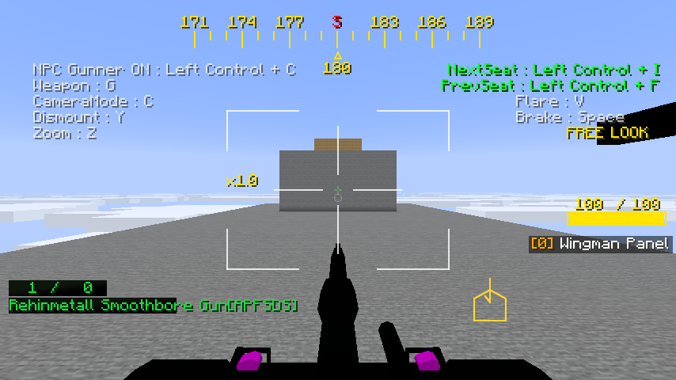
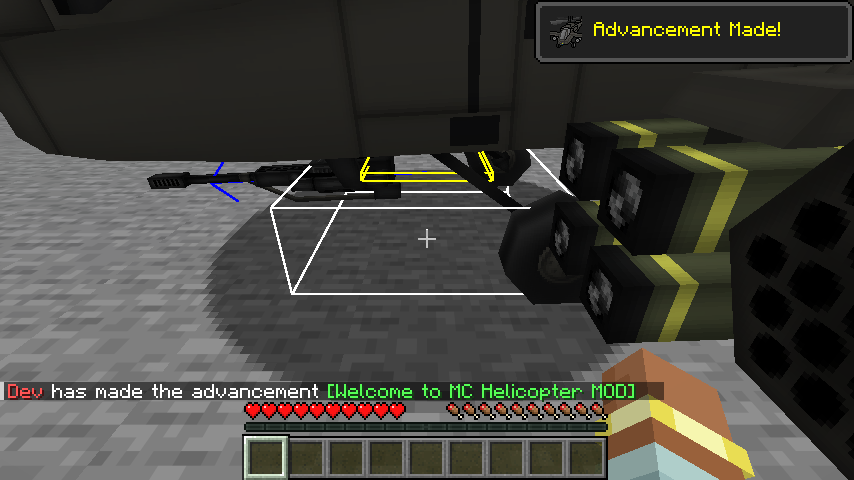
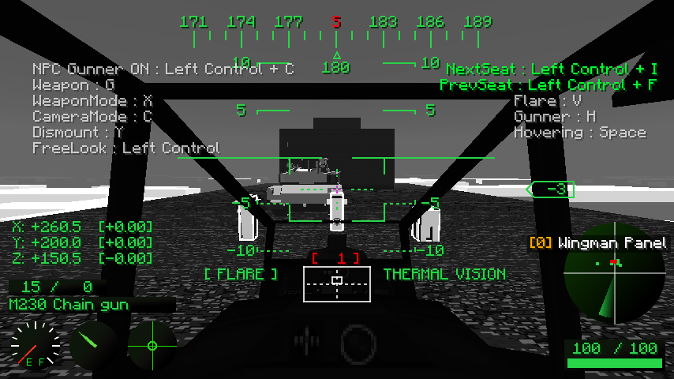

# M7 plan: Polish

PORTING_PLAN.md section 6 lists M7's scope: the remaining `/mcheli` commands, sound and particle
parity, GPU-buffer model rendering, long-distance tracking and rendering, HBM:NTM stubs, thermal
vision and a performance pass. Its exit criterion is no crash in a 30-minute mixed-vehicle soak.

## Optional NTM Next bridge

NTM Next now provides the `hbm` mod for Minecraft 26.2. The official NeoForge release inspected
is [1.0.3, CurseForge file 9130786](https://www.curseforge.com/minecraft/mc-mods/ntm-next/files/9130786).
API reference: [NTM Next source](https://github.com/Warfactory-Official/ntm-next) at
`68ae79fd0aefc5811159aa39b1448bf69904541a`. No NTM Next code or assets are bundled in this port.

`HbmCompat` runs only for server-side projectile explosions whose definition enables `NTM`.
`ModList.isLoaded("hbm")` gates public-API reflection; installations without HBM load no HBM
classes. Both normal projectile explosion overloads use the bridge, including underwater blasts.
HBM effects supplement the normal McHeli explosion, as upstream did. `EffectOnly` suppresses
normal damage and spawns only HBM visuals; mist has no visual-only action. Missing HBM, legacy
unsupported payloads, missing settings or changed APIs warn once and leave the ordinary blast
path in place. There are no automatic retries after partial HBM execution.

- Mini-nukes use `ExplosionNukeSmall.MukeParams`, with NTM Next's boolean particle/tinytot fields
  and its effect-only packet. Blast/kill/radiation, safe mode, shrapnel and resolution are passed
  through. Legacy `ExAttrib[]` no longer exists and is retained as parsed data only.
- Nukes use `EntityNukeExplosionMK5.statFac` and the self-spawning `EntityNukeTorex.statFac`.
  Their block explosion power must be positive.
- Fire uses `EntityFireLingering` and `FlameCreator`; mist uses `EntityMist` and the new
  `NTMFluids.byName` lookup. Counts, areas, spread and duration are retained.
- VNT constructs each detonation's processors from the YAML maps, restricted to the public
  `com.hbm.explosion.vanillant.standard` package. YAML numeric arguments are converted for
  constructors/builders; fractional values cannot silently truncate into integer parameters.
  Its small-cloud effect API is unchanged. NTM Next's named small/standard/large effects replace
  the removed fully parameterized large-effect API, selected by cloud scale.
- Legacy `NTM_NT` and `NTM_CHEMICAL` remain explicit fallbacks; the former's `ExplosionNT` was
  removed, and chlorine has no direct equivalent in the poison-cloud helper. No stock weapon
  enables NTM payloads, so testing requires addon definitions or the integration GameTests.

Validation so far: the bridge compiles against cached Minecraft/NeoForge dependencies and all
six reflection-boundary JUnit tests pass using Java 25. The full Gradle build is blocked locally
by the environment's denial of the existing `maven.blamejared.com` JEI dependency. Full default
GameTests and installed-NTM Next validation are pending; these results do not establish graphics
or multiplayer compatibility with NTM Next.

Run the normal `./gradlew build runGameTestServer` without HBM, and
`./gradlew runGameTestServer -PwithHbm` for the pinned official release. `-PhbmFile=<file ID>`
selects another published NeoForge file. HBM is a test runtime dependency only and remains
optional for users. Client runs with HBM also need its required CrankShaft dependency, as listed
on the official download page. The default GameTest checks normal blast/EffectOnly behavior
without HBM; the additional installed-mod test checks actual fire/mist entities, safe mini-nuke
parameters, visual-only packets and VNT calls without detonating a large nuclear warhead.

## `/mcheli` command increment

- `McheliCommand` ports upstream's `MCH_Command` with Brigadier: `list`, `status entity|tile [min]`,
  `killentity`, `removeentity`, `attackentity <name> <damage> [source]`, `fill <from> <to> <block>
  [replace|destroy|keep|override]` (up to 3,000,000 blocks), `title <seconds> <position> <message>`,
  `delayhitbox [ticks]`, `showboundingbox true|false`, `reconfig` and the existing `dumpyaml`.
- The server config's `[commands]` section ports upstream's `EnableCommand`, `CommandPermission`
  (players who may use a subcommand without operator permission) and `EnableDebugBoundingBox`,
  which the server settings now carry to clients.
- `TitlePayload` and `TitleOverlay` replace `PacketTitle` and `MCH_GuiTitle`: the message is drawn
  at twice the chat's scale on a dark band, at upstream's five positions, and fades in and out.
- `sendss <player>` and `modlist <players>` send the player's client a `CommandRequestPayload`.
  The client answers a screenshot with `ScreenshotChunkPayload`s, a 30,000-byte piece of the PNG
  each tick, or a refusal while `privacy.allowScreenCapture` is off (decision D7), and the mod
  list with a `ModListPayload`, empty unless its `debugLog` is on. `ClientRequests` on the server
  takes answers only from the player asked, a screenshot only in order, up to 16 MB and as a PNG,
  saves it to `screenshots_op`, tells the sender, and drops requests nobody answers.
- Differences: KNOWN_ISSUES 102. Network protocol 28.

Validation: JUnit covers the permission entries and the status counts; two GameTests cover
permissions, the command switch, `delayhitbox`, `showboundingbox`, `title`, `reconfig` and
`list`, then `status`, `attackentity`, `killentity` and `removeentity` by class name and type ID
(never players) and `fill` in each mode, with containers emptied without drops and the size
limit. All 241 required GameTests pass. In the client, against a dedicated server, `title` showed
a gold message at the centre, and with `showboundingbox false` F3 + B no longer drew the pig's
hitbox until `showboundingbox true`.

A third GameTest covers `sendss` and `modlist`: players without the mod are skipped, answers from
another player, out of order or not PNG are refused, a refusal and an unshared mod list end the
request, and a screenshot sent in two pieces is saved byte for byte. All 242 required GameTests
pass. In the client, against a dedicated server, both were refused with the settings off; with
them on, `sendss` saved the player's view (226 KB) and `modlist` showed the mods in chat.

## Projectile chunk loading

`ProjectileChunkLoader` ports upstream's class of the same name with a NeoForge ticket controller.
A projectile whose weapon sets `CanLoadChunks`, or any projectile while the server config's
`projectiles.chunkLoad` is on (upstream `ProjectileChunkLoad`, off by default), leases its own
chunk and the line ahead of it each tick: 4 chunks, and up to 2 more for fast rounds. A lease
lasts `projectiles.chunkLeaseTicks` (upstream `ProjectileChunkLeaseTicks`, 40) after the last
request, so a burst shares its chunks; a sweep after each level tick releases the lapsed ones.
Upstream was bound by Forge's ticket budget, 200 tickets of 25 chunks; the port caps a dimension
at the same 5,000 chunks. The tickets are dropped when the world loads again.

Validation: JUnit covers the path (own chunk only when still or vertical, 72 blocks ahead at 1
block a tick, at most 96). A GameTest fires a stock rocket with the setting off (no lease), then
on (its chunk and the chunk 4 ahead are leased, the one behind is not), and checks the leases run
out after the rocket is gone. All 243 required GameTests pass. No stock weapon sets
`CanLoadChunks`, so nothing changes with the default settings.

## Turret ballistics sight

`AircraftHudLayer#drawTurretBallistics` ports upstream's `drawTurretBallistics` and
`drawDetachedTurretDot`, which every vehicle GUI called after its HUD. It draws a 4-pixel cross at
the centre of the screen and, at the current weapon's aim point, a 32-segment circle as wide as
the weapon's `Accuracy` cone at that distance (at least 2 pixels), with a cross in it when wider.
`WeaponBase#getTrajectoryTarget` ports `getWeaponTrajectoryTarget`: the shot is stepped from the
weapon's mount for up to 256 ticks or its time fuse, with gravity and drag in air and water, and
the dot goes where it meets a block, or at the top of its arc when it meets nothing while
climbing or aimed upwards. The point is projected with the camera's matrices, as the CCIP ring.
Upstream drew with `ONE_MINUS_DST_COLOR, ONE_MINUS_SRC_COLOR`; the port uses vanilla's
`GUI_INVERT` pipeline, the same blend. Upstream's detached weapon aim is not ported, so the shot
always starts from the weapon's mount on the vehicle.

Validation: a GameTest checks the aim point of an M230 at a wall (on the wall's face), of a 60 mm
mortar (on the wall, lower), and of an M230 aimed at the open sky (the top of its path, 500+
blocks up). All 246 required GameTests pass. In the client, riding an M1A2 towards a stone wall,
the green cross showed at the centre and the gun's dot just below it on the wall.

## Advancement triggers

`ModCriteriaTriggers` ports `MCH_CriteriaTriggers`: `put_aircraft`, `supply_ammo`, `supply_fuel`,
`relief_supplies`, `riding_valkyries` and `villager_hurt_bullet`, each a vanilla `PlayerTrigger`
under the mod's ID, fired where upstream fired them (placing a vehicle from its item, an ammunition
supply for the pilot, refuelling from the fuel slot for the pilot, unhitching a towed cargo
container with no block in the 20 below, the pilot boarding a UH-1C, a bullet hurting a villager
for a shooter in a vehicle seat). Upstream had no advancements for them; the port adds six in
`data/mcheli_ce_port/advancement/main`, titled from upstream's achievement names in English,
Japanese and Chinese (KNOWN_ISSUES 104). Upstream's extra-key unhitch (`unhitchChainId`) is now
`RackControlPayload.Action.UNHITCH`; network protocol 29.

Validation: three GameTests check that each advancement loads and its trigger earns it, that
boarding a UH-1C earns Ride Of The Valkyries, and that unhitching a container 25 blocks up earns
Relief supplies while one near the ground does not. All 249 required GameTests pass. In the client,
placing an AH-64 in survival showed the "Advancement Made!" toast and the chat announcement.

## Thermal vision

`AircraftCamera` now has upstream's third mode on vehicle cameras (`new AircraftCamera(true)`):
`getModeNum` is 3 there, so the camera key cycles normal, night vision and thermal vision, while
the GLTD's camera keeps two, as upstream gave only vehicle cameras shader support. The server
keeps the night-vision effect on a viewer in either mode, as before. On the client,
`AircraftCameraClient.updatePostEffect` picks the post effect from the mode:
`post_effect/thermal.json` with `shaders/post/thermal.fsh`, upstream's `thermal.fsh` (by TV90) in
vanilla's post-effect style. Bright, grey pixels turn white; the sky drops to half its grey and
everything else to a quarter.

Upstream made mobs and vehicles hot by binding its plain white `textures/test.png` for every entity
texture while the local rider's camera was in thermal vision, except for the ridden vehicle
(`MCH_TextureManagerDummy`). `ThermalVision` does the same for living entities: at the highest
priority its `RenderLivingEvent.Pre` listener cancels the render and submits the entity again
through a collector that swaps each model's render type for a white one (translucent where the
model blended, else cut out), so the rider-tilt listener still runs once. `AircraftRenderer` swaps
the texture of every vehicle but the ridden one. Differences: KNOWN_ISSUES 105.

Validation: JUnit covers the mode counts (three on a vehicle, wrapping to normal; two on the
GLTD) and the post effect for each mode. A GameTest switches an AH-64 pilot's camera to thermal
vision, checks the night-vision effect, then wraps to normal and checks the effect is removed. All
250 required GameTests pass. In the client, in an AH-64 by day, the third press of C showed
"THERMAL VISION": the husk, cow and villager ahead were white, the M1A2 light grey, the ground and
cockpit dark; the next press gave back the normal view and removed the effect.

