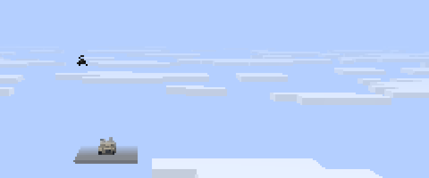

# M7 plan: Polish

PORTING_PLAN.md section 6 lists M7's scope: the remaining `/mcheli` commands, sound and particle
parity, GPU-buffer model rendering, long-distance tracking and rendering, HBM:NTM stubs, thermal
vision and a performance pass. Its exit criterion is no crash in a 30-minute mixed-vehicle soak.

## Optional NTM Next bridge

NTM Next now provides the `hbm` mod for Minecraft 26.2. The official NeoForge release inspected
is [1.0.3, CurseForge file 9130786](https://www.curseforge.com/minecraft/mc-mods/ntm-next/files/9130786).
API reference: [NTM Next source](https://github.com/Warfactory-Official/ntm-next) at
`68ae79fd0aefc5811159aa39b1448bf69904541a`. No NTM Next code or assets are bundled in this port.

`HbmCompat` runs only for server-side projectile explosions whose definition enables `NTM`.
`ModList.isLoaded("hbm")` gates public-API reflection; installations without HBM load no HBM
classes. Both normal projectile explosion overloads use the bridge, including underwater blasts.
HBM effects supplement the normal McHeli explosion, as upstream did. `EffectOnly` suppresses
normal damage and spawns only HBM visuals; mist has no visual-only action. Missing HBM, legacy
unsupported payloads, missing settings or changed APIs warn once and leave the ordinary blast
path in place. There are no automatic retries after partial HBM execution.

- Mini-nukes use `ExplosionNukeSmall.MukeParams`, with NTM Next's boolean particle/tinytot fields
  and its effect-only packet. Blast/kill/radiation, safe mode, shrapnel and resolution are passed
  through. Legacy `ExAttrib[]` no longer exists and is retained as parsed data only.
- Nukes use `EntityNukeExplosionMK5.statFac` and the self-spawning `EntityNukeTorex.statFac`.
  Their block explosion power must be at least one; a zero integer radius selects NTM Next's default 25-block warhead.
- Fire uses `EntityFireLingering` and `FlameCreator`; mist uses `EntityMist` and the new
  `NTMFluids.byName` lookup. Counts, areas, spread and duration are retained.
- VNT constructs each detonation's processors from the YAML maps, restricted to the public
  `com.hbm.explosion.vanillant.standard` package. YAML numeric arguments are converted for
  constructors/builders; fractional values cannot silently truncate into integer parameters.
  Its small-cloud effect API is unchanged. NTM Next's named small/standard/large effects replace
  the removed fully parameterized large-effect API, selected by cloud scale.
- Chemical payloads use the native `com.hbm.entity.particle` cloud constructors, including
  `EntityChlorineFX`, `EntityCloudFX`, `EntityPinkCloudFX` and `EntityOrangeFX`. This avoids the
  renamed poison-cloud helper's changed type-zero behavior. `NTM.Chemical` now configures the
  explicit type, nonnegative integer count and finite nonnegative Gaussian velocity multiplier.
  `EffectOnly` creates no cloud, because the native entities themselves damage their surroundings.
- Legacy `NTM_NT` remains an explicit fallback because `ExplosionNT` was removed. No stock
  weapon enables NTM payloads, so testing requires addon definitions or integration GameTests.
- `NtmEmitter` preserves every parsed NTM container in weapon YAML exports, including unused
  or unsupported legacy settings, mini-nuke preset values and raw nested VNT processor maps.
  Canonical `NTM_MINI_NUKE` names now parse as well as upstream's `MININUKE` alias. Ordinary
  weapons gain no NTM block. `/mcheli dumpyaml` retains its existing non-YAML-only selection;
  the exporter itself now round-trips NTM data. See [NTM_NEXT_ADDONS.md](NTM_NEXT_ADDONS.md).

Validation: initial GitHub Actions run
[39266396386](https://github.com/thisisforfreeAI/26.2-port-of-mcheli-cm/actions/runs/39266396386)
passed the full standard build (including JUnit), all 251 required GameTests without HBM and
all 252 with the official NTM Next 1.0.3 runtime, including the installed-mod payload test.
[Run 39266862038](https://github.com/thisisforfreeAI/26.2-port-of-mcheli-cm/actions/runs/39266862038)
then passed the standard build, 252 default and 253 installed-mod GameTests after merging the
long-distance increment and adding nuclear factory/EffectOnly coverage. Six reflection-boundary
tests pass locally on Java 25. The chemical/export follow-up adds five YAML regression tests and
one installed-mod chemical test; current CI results are attached to PR #74.
Local standard Gradle validation remains blocked by the environment's denial of the existing
JEI Maven host; CI downloads dependencies normally. OpenGL/Vulkan and multiplayer presentation
with NTM Next have not been checked.

Run the normal `./gradlew build runGameTestServer` without HBM, and
`./gradlew runGameTestServer -PwithHbm` for the pinned official release. `-PhbmFile=<file ID>`
selects another published NeoForge file. HBM is a test runtime dependency only and remains
optional for users. Client runs with HBM also need its required CrankShaft dependency, as listed
on the official download page. The default GameTest checks normal blast/EffectOnly behavior
without HBM; the additional installed-mod test checks actual fire/mist entities, safe mini-nuke
parameters, visual-only packets, VNT calls and nuclear entity factories (discarded before their
first tick). The chemical test verifies all four real cloud types, count, motion, zero count and
EffectOnly suppression, cleaning up clouds before they tick.

## `/mcheli` command increment

- `McheliCommand` ports upstream's `MCH_Command` with Brigadier: `list`, `status entity|tile [min]`,
  `killentity`, `removeentity`, `attackentity <name> <damage> [source]`, `fill <from> <to> <block>
  [replace|destroy|keep|override]` (up to 3,000,000 blocks), `title <seconds> <position> <message>`,
  `delayhitbox [ticks]`, `showboundingbox true|false`, `reconfig` and the existing `dumpyaml`.
- The server config's `[commands]` section ports upstream's `EnableCommand`, `CommandPermission`
  (players who may use a subcommand without operator permission) and `EnableDebugBoundingBox`,
  which the server settings now carry to clients.
- `TitlePayload` and `TitleOverlay` replace `PacketTitle` and `MCH_GuiTitle`: the message is drawn
  at twice the chat's scale on a dark band, at upstream's five positions, and fades in and out.
- `sendss <player>` and `modlist <players>` send the player's client a `CommandRequestPayload`.
  The client answers a screenshot with `ScreenshotChunkPayload`s, a 30,000-byte piece of the PNG
  each tick, or a refusal while `privacy.allowScreenCapture` is off (decision D7), and the mod
  list with a `ModListPayload`, empty unless its `debugLog` is on. `ClientRequests` on the server
  takes answers only from the player asked, a screenshot only in order, up to 16 MB and as a PNG,
  saves it to `screenshots_op`, tells the sender, and drops requests nobody answers.
- Differences: KNOWN_ISSUES 102. Network protocol 28.

Validation: JUnit covers the permission entries and the status counts; two GameTests cover
permissions, the command switch, `delayhitbox`, `showboundingbox`, `title`, `reconfig` and
`list`, then `status`, `attackentity`, `killentity` and `removeentity` by class name and type ID
(never players) and `fill` in each mode, with containers emptied without drops and the size
limit. All 241 required GameTests pass. In the client, against a dedicated server, `title` showed
a gold message at the centre, and with `showboundingbox false` F3 + B no longer drew the pig's
hitbox until `showboundingbox true`.

A third GameTest covers `sendss` and `modlist`: players without the mod are skipped, answers from
another player, out of order or not PNG are refused, a refusal and an unshared mod list end the
request, and a screenshot sent in two pieces is saved byte for byte. All 242 required GameTests
pass. In the client, against a dedicated server, both were refused with the settings off; with
them on, `sendss` saved the player's view (226 KB) and `modlist` showed the mods in chat.

## Projectile chunk loading

`ProjectileChunkLoader` ports upstream's class of the same name with a NeoForge ticket controller.
A projectile whose weapon sets `CanLoadChunks`, or any projectile while the server config's
`projectiles.chunkLoad` is on (upstream `ProjectileChunkLoad`, off by default), leases its own
chunk and the line ahead of it each tick: 4 chunks, and up to 2 more for fast rounds. A lease
lasts `projectiles.chunkLeaseTicks` (upstream `ProjectileChunkLeaseTicks`, 40) after the last
request, so a burst shares its chunks; a sweep after each level tick releases the lapsed ones.
Upstream was bound by Forge's ticket budget, 200 tickets of 25 chunks; the port caps a dimension
at the same 5,000 chunks. The tickets are dropped when the world loads again.

Validation: JUnit covers the path (own chunk only when still or vertical, 72 blocks ahead at 1
block a tick, at most 96). A GameTest fires a stock rocket with the setting off (no lease), then
on (its chunk and the chunk 4 ahead are leased, the one behind is not), and checks the leases run
out after the rocket is gone. All 243 required GameTests pass. No stock weapon sets
`CanLoadChunks`, so nothing changes with the default settings.

## Turret ballistics sight

`AircraftHudLayer#drawTurretBallistics` ports upstream's `drawTurretBallistics` and
`drawDetachedTurretDot`, which every vehicle GUI called after its HUD. It draws a 4-pixel cross at
the centre of the screen and, at the current weapon's aim point, a 32-segment circle as wide as
the weapon's `Accuracy` cone at that distance (at least 2 pixels), with a cross in it when wider.
`WeaponBase#getTrajectoryTarget` ports `getWeaponTrajectoryTarget`: the shot is stepped from the
weapon's mount for up to 256 ticks or its time fuse, with gravity and drag in air and water, and
the dot goes where it meets a block, or at the top of its arc when it meets nothing while
climbing or aimed upwards. The point is projected with the camera's matrices, as the CCIP ring.
Upstream drew with `ONE_MINUS_DST_COLOR, ONE_MINUS_SRC_COLOR`; the port uses vanilla's
`GUI_INVERT` pipeline, the same blend. Upstream's detached weapon aim is not ported, so the shot
always starts from the weapon's mount on the vehicle.

Validation: a GameTest checks the aim point of an M230 at a wall (on the wall's face), of a 60 mm
mortar (on the wall, lower), and of an M230 aimed at the open sky (the top of its path, 500+
blocks up). All 246 required GameTests pass. In the client, riding an M1A2 towards a stone wall,
the green cross showed at the centre and the gun's dot just below it on the wall.

## Advancement triggers

`ModCriteriaTriggers` ports `MCH_CriteriaTriggers`: `put_aircraft`, `supply_ammo`, `supply_fuel`,
`relief_supplies`, `riding_valkyries` and `villager_hurt_bullet`, each a vanilla `PlayerTrigger`
under the mod's ID, fired where upstream fired them (placing a vehicle from its item, an ammunition
supply for the pilot, refuelling from the fuel slot for the pilot, unhitching a towed cargo
container with no block in the 20 below, the pilot boarding a UH-1C, a bullet hurting a villager
for a shooter in a vehicle seat). Upstream had no advancements for them; the port adds six in
`data/mcheli_ce_port/advancement/main`, titled from upstream's achievement names in English,
Japanese and Chinese (KNOWN_ISSUES 104). Upstream's extra-key unhitch (`unhitchChainId`) is now
`RackControlPayload.Action.UNHITCH`; network protocol 29.

Validation: three GameTests check that each advancement loads and its trigger earns it, that
boarding a UH-1C earns Ride Of The Valkyries, and that unhitching a container 25 blocks up earns
Relief supplies while one near the ground does not. All 249 required GameTests pass. In the client,
placing an AH-64 in survival showed the "Advancement Made!" toast and the chat announcement.

## Thermal vision

`AircraftCamera` now has upstream's third mode on vehicle cameras (`new AircraftCamera(true)`):
`getModeNum` is 3 there, so the camera key cycles normal, night vision and thermal vision, while
the GLTD's camera keeps two, as upstream gave only vehicle cameras shader support. The server
keeps the night-vision effect on a viewer in either mode, as before. On the client,
`AircraftCameraClient.updatePostEffect` picks the post effect from the mode:
`post_effect/thermal.json` with `shaders/post/thermal.fsh`, upstream's `thermal.fsh` (by TV90) in
vanilla's post-effect style. Bright, grey pixels turn white; the sky drops to half its grey and
everything else to a quarter.

Upstream made mobs and vehicles hot by binding its plain white `textures/test.png` for every entity
texture while the local rider's camera was in thermal vision, except for the ridden vehicle
(`MCH_TextureManagerDummy`). `ThermalVision` does the same for living entities: at the highest
priority its `RenderLivingEvent.Pre` listener cancels the render and submits the entity again
through a collector that swaps each model's render type for a white one (translucent where the
model blended, else cut out), so the rider-tilt listener still runs once. `AircraftRenderer` swaps
the texture of every vehicle but the ridden one. Differences: KNOWN_ISSUES 105.

Validation: JUnit covers the mode counts (three on a vehicle, wrapping to normal; two on the
GLTD) and the post effect for each mode. A GameTest switches an AH-64 pilot's camera to thermal
vision, checks the night-vision effect, then wraps to normal and checks the effect is removed. All
250 required GameTests pass. In the client, in an AH-64 by day, the third press of C showed
"THERMAL VISION": the husk, cow and villager ahead were white, the M1A2 light grey, the ground and
cockpit dark; the next press gave back the normal view and removed the effect.

## Long-distance tracking and rendering

Upstream's long-distance patch (`MixinEntityTrackerEntry`, `MixinEntityRendererFarPass`,
`TrackerHook`, `EntityRendererHook`) was gated by `ExperimentalRemoveClientTrackingRestrictions`,
on by default; the port's switch is the server config's `tracking.longDistance`, also on.

- Server: `LongDistanceTrackingMixin` redirects the two checks in `ChunkMap.TrackedEntity#updatePlayer`.
  For a McHeli vehicle (`LongDistanceTracking.applies`), the visible range is its own tracking range
  (1,200 blocks for helicopters, planes, tanks and ships, 600 for placed guns) rather than the
  smaller of that and the player's view distance, and the player need not have its chunk loaded
  (upstream `getRenderDistance` and `shouldForceWatch`).
- Client ticking: vanilla ticks only entities in chunks the client has loaded. `FarVehicles` ticks
  the vehicles outside them after each client tick, so they keep moving between server updates.
- Client drawing: `FarVehicleVisibilityMixin` lets `LevelExtractor#isEntityVisible` accept such a
  vehicle when it is in the frustum, as vanilla draws entities only in compiled sections. Past
  the render distance, `AircraftRenderer` draws with the `far_vehicle` pipeline, vanilla's entity
  shader without fog, as upstream's far pass turned fog off. Vanilla's far plane (four times the
  render distance or the cloud range) replaces upstream's own 3,000-block projection.
- `AircraftEntity#shouldRenderAtSqrDistance` is always true: upstream drew every vehicle the client
  had (`VehicleRenderHook`); vanilla's size-based test hid vehicles past about 150 blocks even
  inside the view distance.

Differences: KNOWN_ISSUES 106. UAVs keep the port's own remote-session tracking.

Validation: a GameTest puts a mock player (two-chunk view distance) 160 blocks from an AH-64 and a
pig. The AH-64 is sent to the player and the pig is not, and with the setting off the AH-64 is not
either. All 251 required GameTests pass. In the client, against a dedicated server with a view
distance of 10 chunks (160 blocks), an AH-64 250 blocks away showed against the sky without fog,
past the last loaded chunk, and moved when teleported.

## Sound and particle parity

An audit of every upstream sound and particle call against the port found four gaps, now ported:

- `onUpdate_ParticleSmoke`: while the pilot's selected weapon is a smoke generator and the
  throttle is above 0.1, each weapon position trails `SmokeNum` coloured puffs a tick
  (`AircraftEntity#onUpdateParticleSmoke`). The T-4's six smoke weapons did nothing before.
- `MCH_ExplosionV2` threw up to `size` burning flares from explosions of size 4 or more. The hook
  existed in `ExplosionEffects` but nothing filled it; it now adds a client-only `FlareEntity`
  (negative id, so no server entity collides with it) that goes out on landing, on hitting a
  block or after 300 ticks, where upstream's client copy never went out. Only the `CLASSIC` look
  runs this path; `ENHANCED` (M8) draws its own explosions.
- `MCH_MissileDetector`'s UAV branch: the operator's client plays the alert every 20 ticks while a
  missile homes on the UAV. A client reads the missile's synced target id.
- `MCH_EntityUavStation.attackEntityFrom`: "hit" for a player's attack, else "helidmg".

Upstream sounds that never played (the "locked" notify, the commented-out chaff sound, the unused
maintenance wrench) stay out. Validation: all required GameTests pass; in game the T-4's smoke
trails (`docs/screens/m7-smoke-trail.png`) and the debris arcs out of a size-8 explosion with the
`CLASSIC` look (`docs/screens/m7-explosion-debris.png`).

## 30-minute soak

M7's exit criterion. A dedicated server and a client (software rendering, 1280x720) ran for 30
minutes on the build with the parity work above. Every 10 seconds a script summoned three random
vehicles out of twelve (AH-64, AH-6, Bell 206L, A-10, An-2, T-4, M1129, KV-2, Centauro, 12.7 mm
gun, Zodiac, CB90); every 30 seconds it destroyed a random tank and helicopter, which crash and
explode; every 40 seconds the player boarded a random helicopter, plane or tank, switched weapon,
throttled up and fired; every 100 seconds it removed every vehicle. 51 destructions in all.

Result: no crash and no exception from the mod on either side (the only exception was the
container's missing OpenAL device). The server never fell behind ("Can't keep up" never logged).
Average tick time per 100-tick sample stayed between 8 and 24 ms against the 50 ms budget, with a
worst 99th percentile of 89 ms while a large aircraft crashed.

## Performance pass (server)

Measured on a dedicated server (`pause-when-empty-seconds=0`) with 60 parked vehicles of eleven
types on a stone pad, `tick query` averaged over 100-tick samples, and JFR's execution samples
for where the time goes. Parked tanks took about half of the mod's time, nearly all of it in
the wheel probes' collision moves (`TankTerrain`).

| Change | Average tick (60 vehicles; 0.8-1.1 ms empty) |
| --- | --- |
| Before | 6.0-6.6 ms |
| Wheel probes test vanilla's solid-entity check before the seat lookup | 5.1-5.4 ms |
| `BlockList` (breakable and protected block lists) keeps its answer per block, cleared when tags reload | 4.8-5.0 ms |
| Wheel probes skip landing, step sounds and game events, as upstream's own wheel move did | 4.6-4.8 ms |

What the vehicles cost fell by about a third (from about 5.4 to 3.7 ms). The rest of the wheel
probes' time is vanilla block collision, which upstream's wheels did too. Client rendering is
the separate GPU-buffer item.

## GPU-buffer model rendering (render path B)

Path A, from M4, wrote every triangle of every vehicle into a vertex buffer each frame
(`ModelVertices.emit`); with 28 vehicles in view that was about a third of the render thread.
Path B (`client.render.baked`) uploads each model group once, as upstream's display lists did:

- `BakedModelCache` bakes a group into a vertex buffer the first frame it is drawn: position, UV,
  the vertex normal and the normal of the triangle's last corner (for upstream's `GL_FLAT`
  shading), 28 bytes a vertex, drawn as plain triangles. A group undrawn for 1,200 frames is freed,
  which also frees the groups of reloaded or unloaded models.
- `AircraftRenderer.submit` hands the body to `BakedVehicles.submit`, which records each part's
  pose (entity pose times part pose) and normal matrix in a `submitSpecial` node in the solid
  phase. Feature renderers run in registration order, so in path A's translucent phase the body
  would draw after every exhaust flame and search light beam, which write no depth, and cover
  them; in the solid phase they land on top, as in upstream's entity pass.
- `BakedVehicleRenderer`, a NeoForge feature renderer, writes each part's uniform block
  (`McheliPart`: transform, normal matrix, colour, light, flat flag) while the frame is prepared,
  and draws one render pass per group, one draw per part, with `core/baked_vehicle.vsh` and
  vanilla's entity fragment shader, lighting, fog and lightmap.
- M8's surface shading (`VehicleSurfaceShade`) is baked into the buffers: each vertex's shade
  grey, less 128, sits in the spare fourth byte of its normal, and the shader uses it where path A
  would (Enhanced look, `effects.vehicleSurfaceShade` on, untinted vehicle). A group is baked again
  if the model loader replaces its shades.
- Thermal vision, far vehicles, glowing outlines and the emissive exhaust flames stay on path A,
  as does everything when `render.gpuModelBuffers` is off or the path fails once (it then logs and
  turns itself off).

Validation: JUnit covers the vertex and uniform layouts and normal packing; all required
GameTests pass. In game, screenshots with the option on and off match to within the frame-to-frame
noise of moving clouds and rotors, by day, by night, for a wreck, with a search light's beam in
front of the body and after a resource reload (`docs/screens/m7-gpu-models.png`,
`docs/screens/m7-gpu-models-night.png`). With `/tick freeze` and surface shading on, paths A
and B differ by at most 2 of 255 in any channel, while turning the shading off changes the same
image by up to 4. JFR on
the render thread over 20 seconds with 28 vehicles in view (software rendering): 374 samples with
path A, 274 of them drawing vehicles; 140 with path B, 42 drawing vehicles. Frame rate is bound by
software rasterisation here and did not change; on a graphics card the saving is CPU time per frame.
On the Vulkan backend (Mesa lavapipe, started with `--graphicsBackend vulkan` and
`earlyWindowControl = false`, as for M4 §5) the custom pipeline compiles and draws without errors,
JFR shows path B drawing, and screenshots with the option on and off differ in 0.1 % of pixels
(`docs/screens/m7-gpu-models-vulkan.png`).
