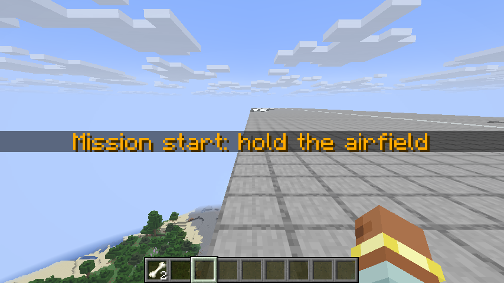
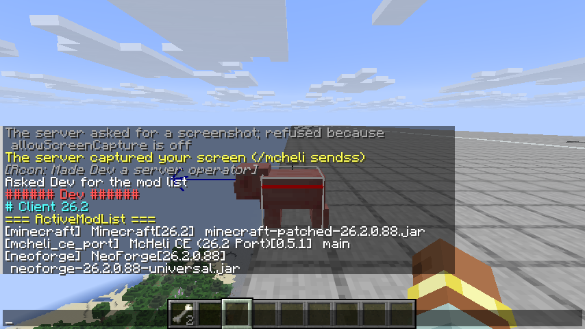

# M7 plan: Polish

PORTING_PLAN.md section 6 lists M7's scope: the remaining `/mcheli` commands, sound and particle
parity, GPU-buffer model rendering, long-distance tracking and rendering, HBM:NTM stubs, thermal
vision and a performance pass. Its exit criterion is no crash in a 30-minute mixed-vehicle soak.

## `/mcheli` command increment

- `McheliCommand` ports upstream's `MCH_Command` with Brigadier: `list`, `status entity|tile [min]`,
  `killentity`, `removeentity`, `attackentity <name> <damage> [source]`, `fill <from> <to> <block>
  [replace|destroy|keep|override]` (up to 3,000,000 blocks), `title <seconds> <position> <message>`,
  `delayhitbox [ticks]`, `showboundingbox true|false`, `reconfig` and the existing `dumpyaml`.
- The server config's `[commands]` section ports upstream's `EnableCommand`, `CommandPermission`
  (players who may use a subcommand without operator permission) and `EnableDebugBoundingBox`,
  which the server settings now carry to clients.
- `TitlePayload` and `TitleOverlay` replace `PacketTitle` and `MCH_GuiTitle`: the message is drawn
  at twice the chat's scale on a dark band, at upstream's five positions, and fades in and out.
- `sendss <player>` and `modlist <players>` send the player's client a `CommandRequestPayload`.
  The client answers a screenshot with `ScreenshotChunkPayload`s, a 30,000-byte piece of the PNG
  each tick, or a refusal while `privacy.allowScreenCapture` is off (decision D7), and the mod
  list with a `ModListPayload`, empty unless its `debugLog` is on. `ClientRequests` on the server
  takes answers only from the player asked, a screenshot only in order, up to 16 MB and as a PNG,
  saves it to `screenshots_op`, tells the sender, and drops requests nobody answers.
- Differences: KNOWN_ISSUES 102. Network protocol 28.

Validation: JUnit covers the permission entries and the status counts; two GameTests cover
permissions, the command switch, `delayhitbox`, `showboundingbox`, `title`, `reconfig` and
`list`, then `status`, `attackentity`, `killentity` and `removeentity` by class name and type ID
(never players) and `fill` in each mode, with containers emptied without drops and the size
limit. All 241 required GameTests pass. In the client, against a dedicated server, `title` showed
a gold message at the centre, and with `showboundingbox false` F3 + B no longer drew the pig's
hitbox until `showboundingbox true`.

A third GameTest covers `sendss` and `modlist`: players without the mod are skipped, answers from
another player, out of order or not PNG are refused, a refusal and an unshared mod list end the
request, and a screenshot sent in two pieces is saved byte for byte. All 242 required GameTests
pass. In the client, against a dedicated server, both were refused with the settings off; with
them on, `sendss` saved the player's view (226 KB) and `modlist` showed the mods in chat.

