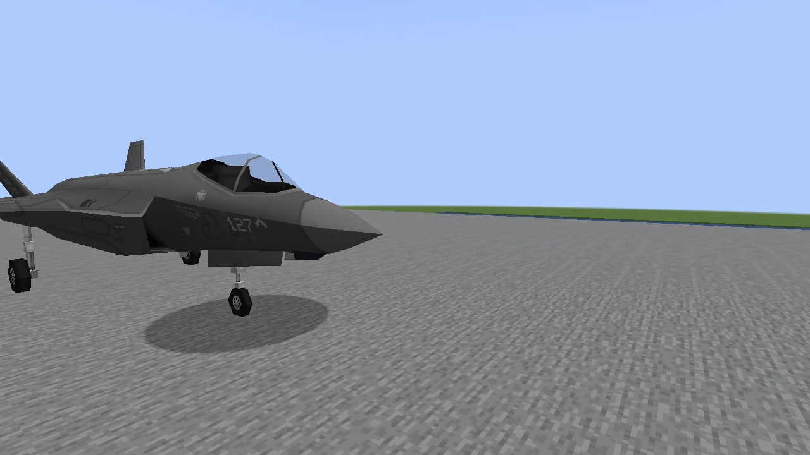
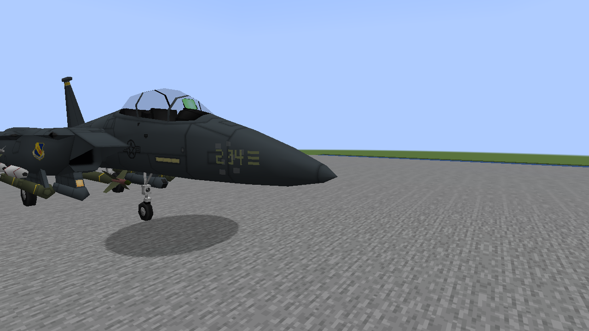
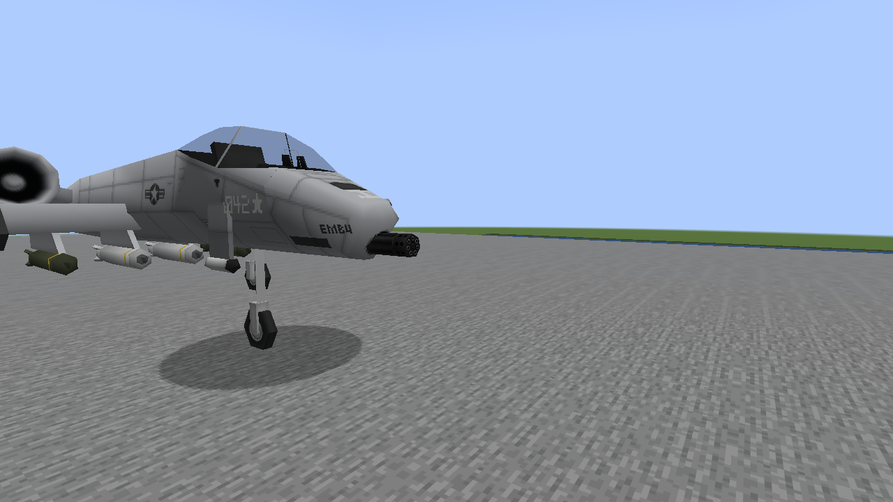
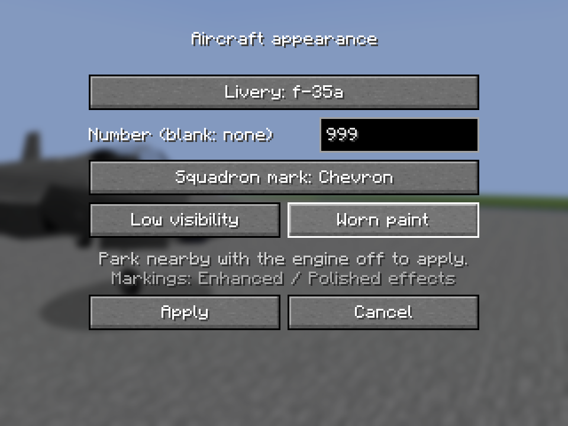
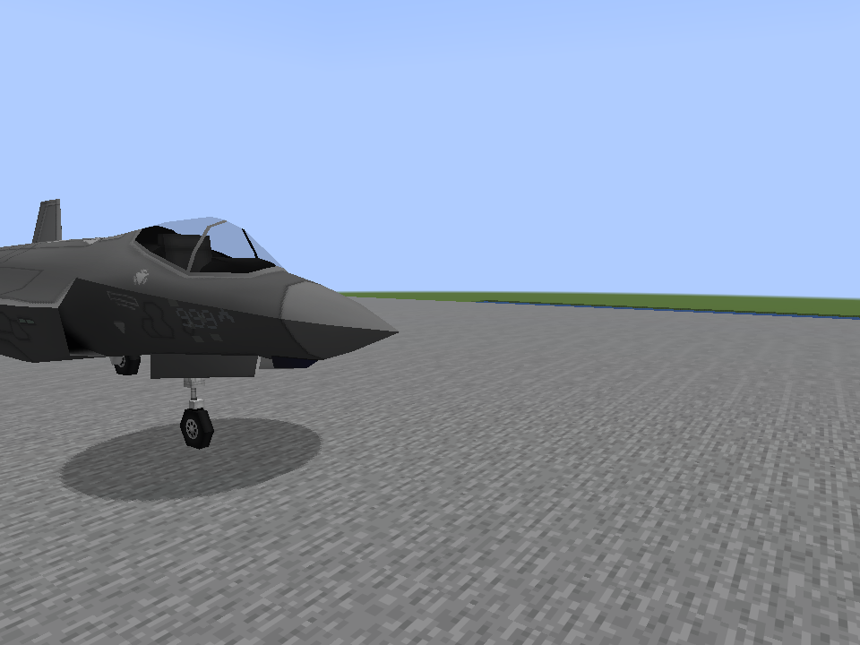

# Aircraft customization: native examples

Unedited captures of original vehicle models with the new fitted number and squadron marks.
The three exterior close views use Vulkan at 1280×720 in daylight. They emphasize the nose
and deliberately crop the rear airframe. Paint chips are restrained and do not replace the
original livery. These are controlled model views, not flight recordings.

## F-35A: 127 and chevron

## F-15E: 204 and bars

## A-10: 042 and star

## Real menu and synchronized result

The OpenGL check opens an actual server vehicle inventory, changes the appearance, sends
Apply and verifies the synchronized 999 / chevron / worn / low-visibility selection. These
960×720 captures use a 320×240 GUI, with every control fitting on screen.

[Controls, coverage and limits](M8_AIRCRAFT_CUSTOMIZATION.md). Target-PC 60 FPS remains unmeasured.
