# Aircraft fire: native Minecraft comparisons

These unedited 1280×720 screenshots show controlled HP and motion fixtures on the production
VehicleAtmosphere path. They are **native previews, not recordings of player-driven flight or
combat**. Aircraft are held above the ground and moved at a fixed speed for comparison, then
stopped and repaired. No physics, flight handling or gameplay damage was changed.

Enhanced quality, Polished style, Balanced budget, damage details on, adaptive effects off,
daylight. Close comparisons below use OpenGL; the same shipping fire code also passed the
full native Vulkan run. Both runs used software Mesa, which does not measure target-PC FPS.

## F-35A

| Moving: flames trail backward | Stopped: flames rise | Repaired: fire cleared |
| --- | --- | --- |
| 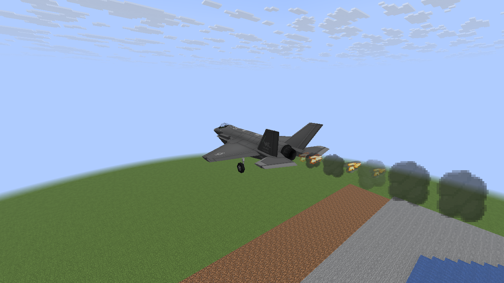 |  | 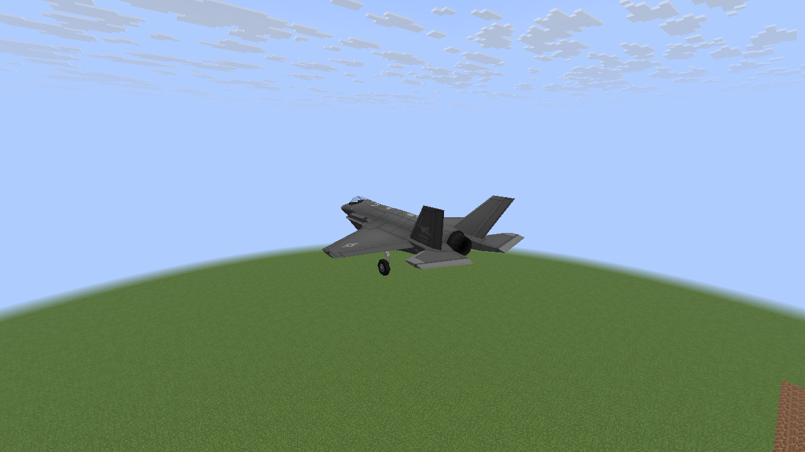 |

## AH-64

This fixture deliberately reports zero simulation velocity while its position moves, exercising
the remote-interpolation fallback to observed travel.

| Moving: flames trail backward | Stopped: flames rise | Repaired: fire cleared |
| --- | --- | --- |
| 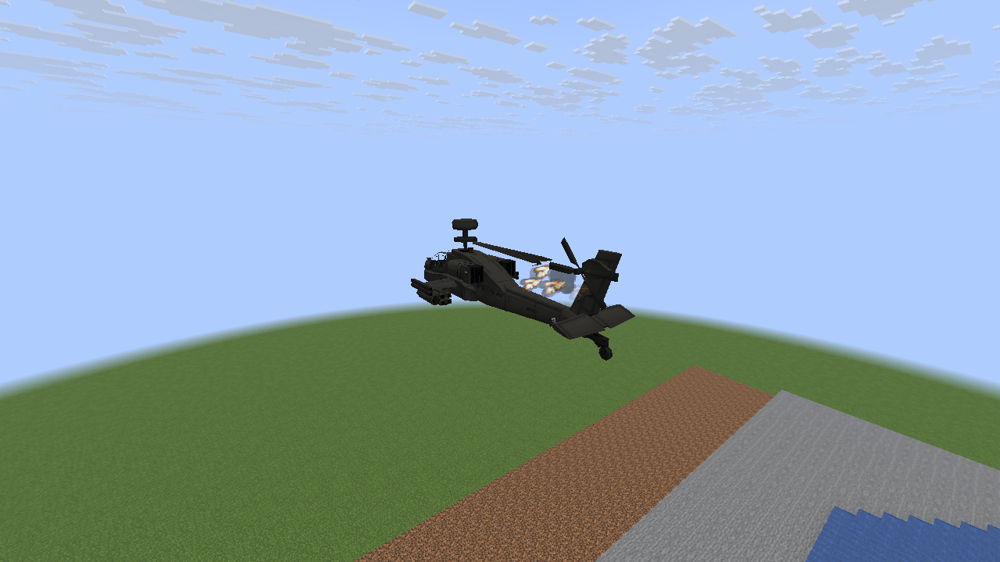 | 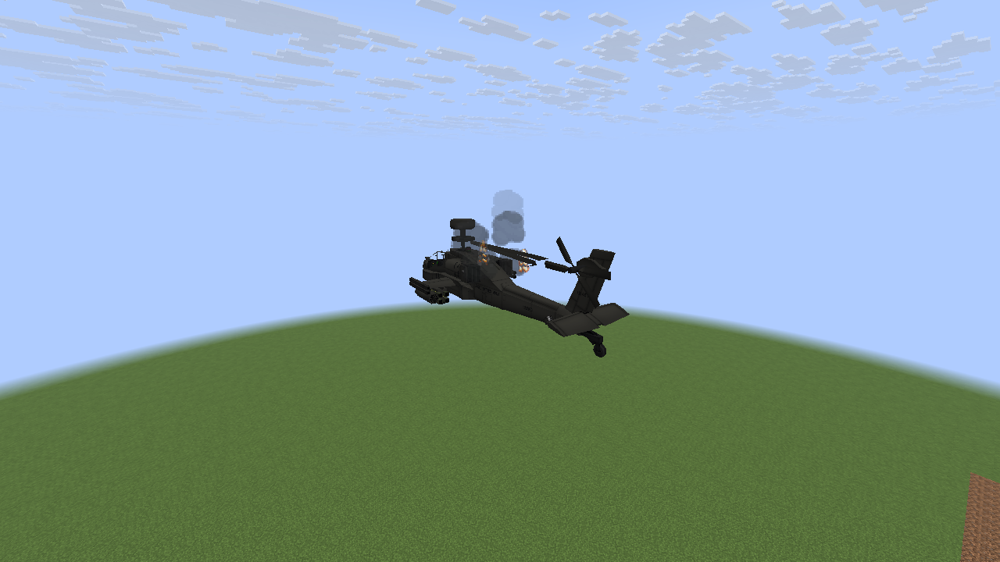 | 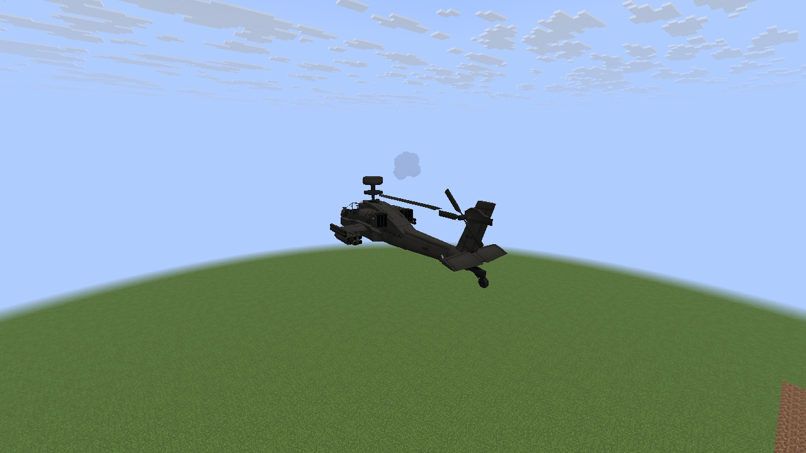 |

## F-22A

| Moving: flames trail backward | Stopped: flames rise | Repaired: fire cleared |
| --- | --- | --- |
| 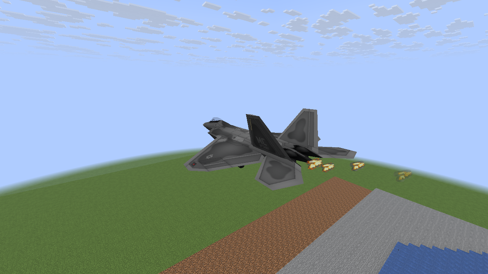 | 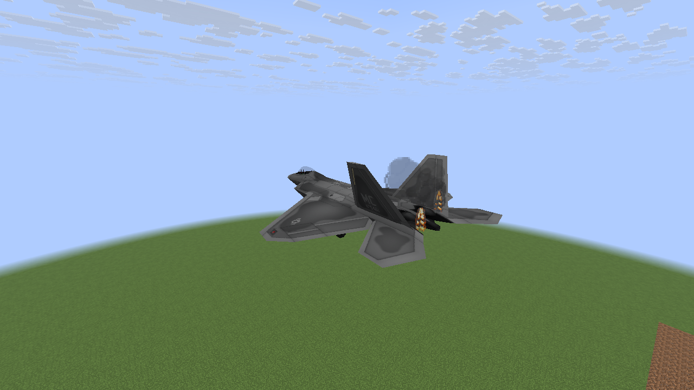 | 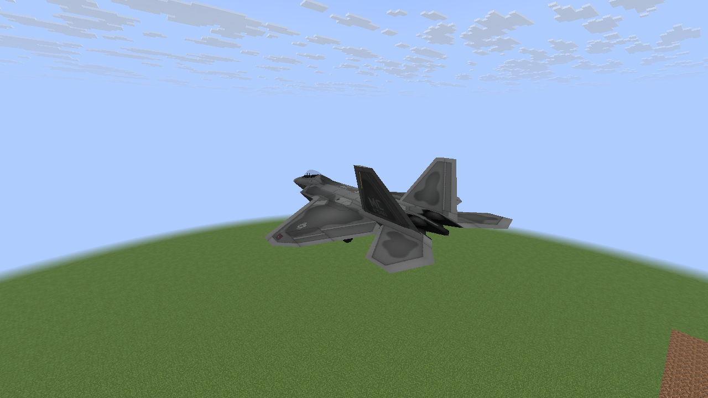 |

## Moving wreck and Classic fallback

The held wreck fixture isolates the fire shape; normal wrecks remain subject to their existing
movement and destruction behavior. Classic continues to use its original wreck particles.

| Polished wreck, moving | Polished wreck, stopped | Classic wreck, stopped |
| --- | --- | --- |
| 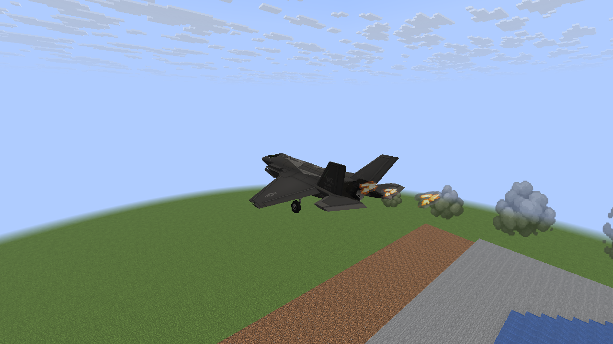 | 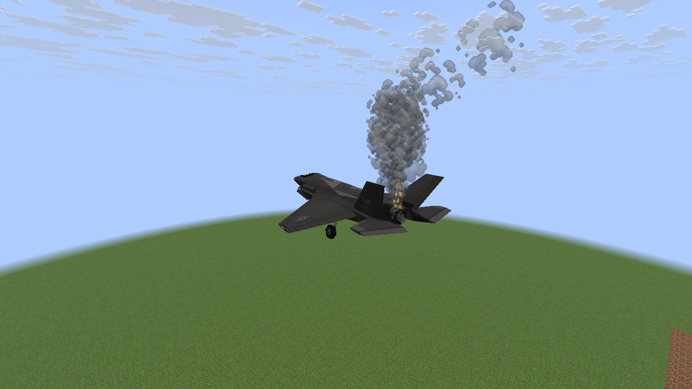 | 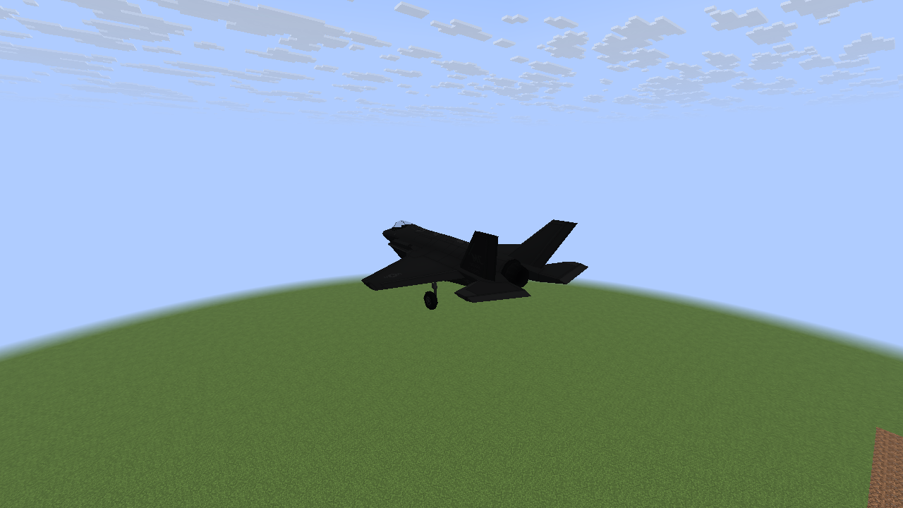 |

## Shared-load check — Vulkan

Thirty-two damaged aircraft share the existing admission system. This crowded synthetic scene
checks bounds and cleanup; it is not a representative combat frame-rate benchmark.

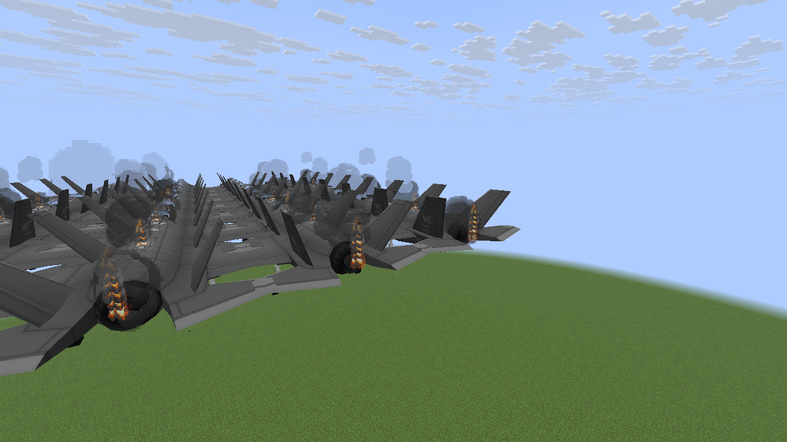

[Implementation and limits](M8_AIRFLOW_FIRE.md) ·
[Capture hashes and observed counts](performance/m8-realism/airflow-fire.json).

The three living-aircraft comparisons are captured at fixture ticks 110, 200 and 290. Damage
starts at tick 40 and repairs at 240. Each flame pocket lives at most 20 ticks; the repair check
waits long enough for all fire to clear. Existing smoke has its own longer fade.

To reproduce in the disposable `M6Smoke` world with cheats enabled:

```sh
./gradlew -I scripts/visual-probe.init.gradle --no-configuration-cache \
  -Dmcheli.probeAirflowFire=true -Dmcheli.probeBackend=VULKAN runClient
```

Use `-Dmcheli.probeBackend=OPENGL` for the other renderer. The opt-in fixture is excluded from
normal builds. Screenshots are copied directly without cropping, recoloring or compositing.
