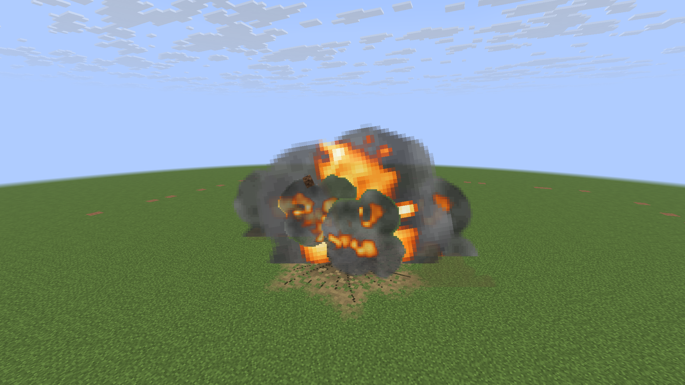
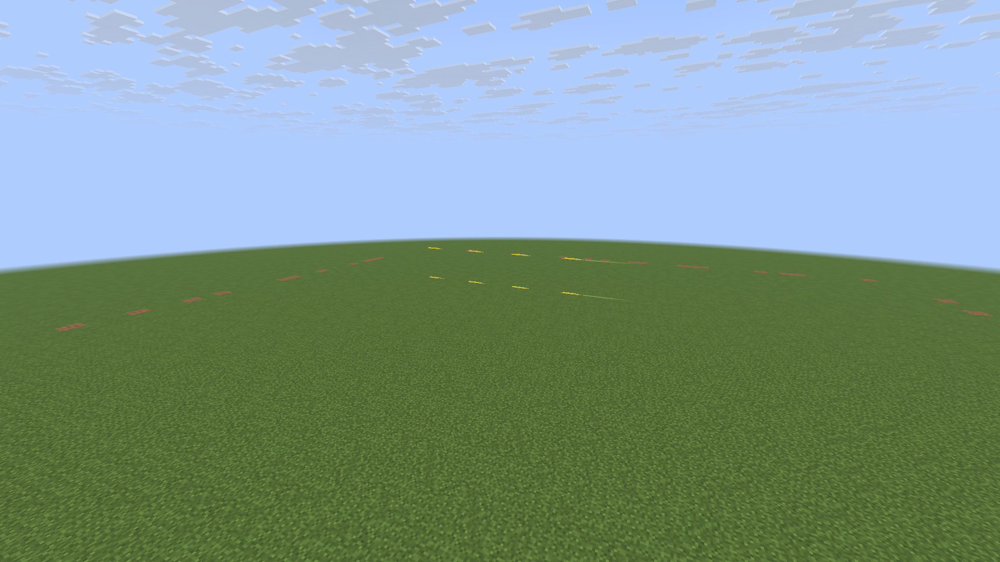
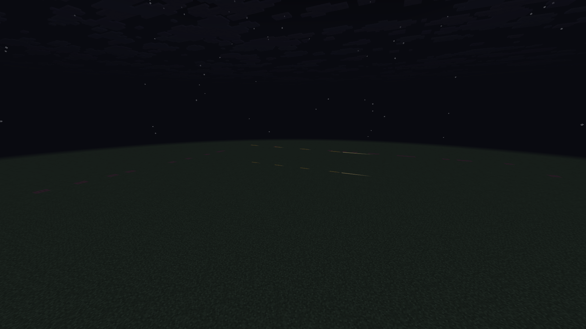
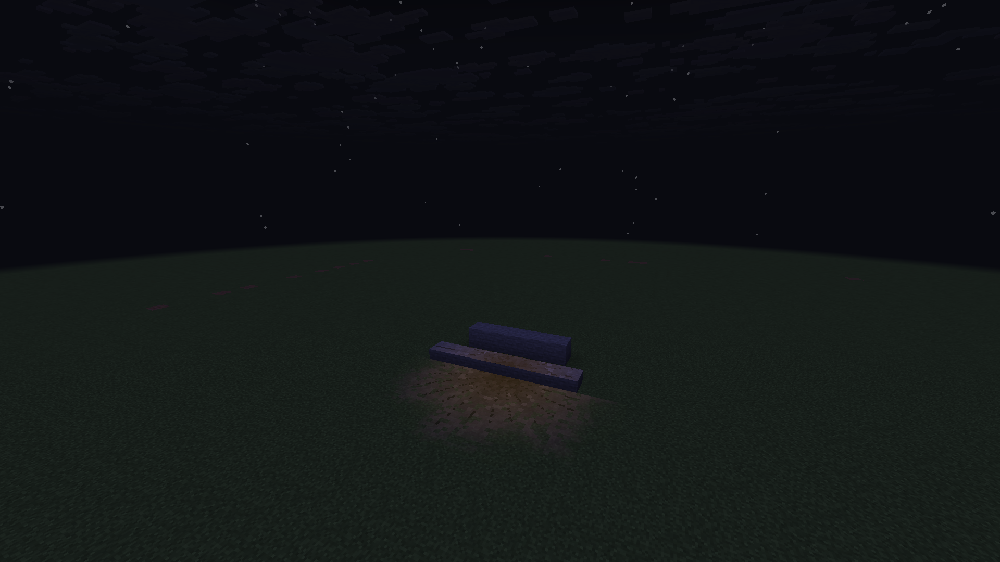

# M8: rolling fire, weapon shapes and terrain flash

Enhanced dry explosions now develop in stages: a fast flash, irregular fire pockets folding
behind smoke, narrow ejecta streams, and a wider low cloud beneath rising bomb smoke. These
are stylized visual cues from real blasts, sized in game blocks rather than simulated yields.
Small rockets/missiles retain their familiar growing smoke puffs.
The [missile follow-up](M8_MISSILE_IMPACTS.md) mixes short primary fire pockets into those
puffs and gives large general warheads, including the AGM-158, a fuller rolling-cloud profile.

## Weapon presentation

- Bombs spread their base billows farther across the ground, with a lower initial upper cloud.
  Twelve baked fire frames stretch and split bright pockets as rolling charcoal smoke covers
  them. Four neutral smoke frames finish the cloud. Each lobe remains one quad.
- Projectile impacts carry the actual pre-explosion velocity heading in three direction bytes.
  Rocket/missile puffs form a tighter burst along that heading. Steep incoming trajectories lift
  cosmetic ejecta above the impact; this is a presentation rule, not a penetration simulation.
  Missing/invalid/near-zero velocity uses the ordinary undirected burst.
- Incendiary fire lasts longer (40–56 ticks before per-pocket variation), including small
  incendiaries, and stays low rather than rising with every smoke billow. Finite particle life
  still bounds it. This does not add persistent fire, damage or changed terrain destruction.
- Nearby large-blast smoke starts with short-lived amber windows using the smoke-heavy final
  fire frames. A bounded light-map boost fades with the parent fire. Later smoke is neutral and
  ambient-lit; there are no world lights, extra glow quads, smoke lighting scans or shaders.

The older smoke sheet, growth and heat remain on small non-incendiary weapons. Classic and
vanilla explosion settings retain their existing paths. Underwater blasts retain splashes.

## Dirt streams and ground light

Two of a typical Balanced bomb's existing six ground-accent requests become narrow, uneven
rising dust streams; two remain low dust fans and two remain tumbling fragments. High quality
can request three streams. A directed small hit replaces its dust request with one stream.
Streams and fragments use similar launch sectors, while material tint, surface rejection and
sampling limits are shared with the existing ground response. Streams use one original
128×128 sprite sheet, one quad each, at most 28 ticks of life and three blocks of admitted
half-size. No stream spawns child particles or performs collision queries.

A brief additive amber patch fits the same exposed block top faces as scorch marks, including
slabs. It uses the existing vanilla glow pipeline and cached, depth-tested geometry. Projection
waits two ticks for crater updates, so the light begins during the initial flash/fire instead of
covering blocks that have just disappeared. Its age starts at impact, not delayed projection:
large weapons stop at nine ticks, small weapons at six. A delayed queue entry cannot create a
late flash. Occlusion, loaded chunks, fluids, leaves and blast reach use the existing projector.

The flash also works with scorch marks disabled, leaving no lasting mark. It has its own small
geometry ceiling: 64 faces total per view on Balanced, 128 on High, at most four patches and
64 faces per patch. Center-first fitting and vertex falloff soften the boundary. Low quality and
adaptive pressure >=2 omit it. Cached flash faces are discarded on expiry or invalidation;
rendering performs no terrain queries. Existing mark storage and two-projections-per-tick
limits still apply. This is a local surface light effect, not dynamic lighting of entities/walls.

## Bullet/tracer correction

Projectile bodies now use ambient world lighting. The former circular bullet halo is removed.
A stable roughly one-in-four visual selection (UUID bits, no firing-order or network state)
gets a thin warm tracer streak. This is a cosmetic mixed-belt approximation, not per-weapon
ammunition simulation. Streaks are 0.045 blocks wide, 22% of a tick's travel and at most two
blocks long, versus 0.22 blocks wide and up to eight blocks before. Opacity is 0.30 in daylight
and up to 0.46 at night, scaled by the definition's alpha. Explicit coloured definitions keep
their hue; neutral colours use amber. Ordinary rounds have no added luminous geometry.
Classic rendering, missile exhaust and countermeasure flare glow keep their existing paths.

## Cost and compatibility

Primary request caps remain 6/12/18 (Low/Balanced/High), further reduced by adaptive pressure.
Dirt streams replace ground requests and share the smoke live-count/weighted admission limits.
Close blasts now interleave low/upper support, one main fire pocket and ground accents before
requesting the rest of the cloud, so coverage admission cannot spend everything on smoke alone.
The existing global fragment caps and 96/192 loaded surface-read budgets are unchanged.
The fire/smoke sheet changes from 256×128 to 256×256; all animation/noise is baked offline by
`scripts/generate-effect-textures.py`. Rendering uses vanilla pipelines on both backends. In the native scene the particle atlas grows
from 512×512 to 1024×512 (about 1 MiB more RGBA storage at mip level zero). This is a small
fixed memory cost, not a measured claim of free rendering.

Network protocol **27** adds three cosmetic direction bytes to the explosion effect packet.
Client and server must update together. Damage, flight, targeting and destruction are unchanged.

## Validation

The development-only `BlastMotionProbe` covers bomb fire stages, opposite rocket headings,
incendiaries at night, an isolated flash across slabs/blocks, high airbursts, water, Low quality,
scorch-disabled flash, overlapping impacts and stock bullet models in daylight, at night and
in Classic mode (two of eight controlled UUIDs select tracers, none in Classic). It asserts shared jet admission, bounded
lifetimes, fragment/read/flash ceilings and no ground effect leakage in suppressed scenes.
Use `-Dmcheli.probeBlastMotion=true -I scripts/visual-probe.init.gradle` with `runClient`;
`-Dmcheli.probeBackend=OPENGL` selects the second backend. It writes labeled screenshots in
`.run/m8-preview/screenshots`, never into production resources.

The final combined base passes 209 JUnit tests and all 241 required dedicated GameTests.
Vulkan/lavapipe passes all 13 native scenes, including two of eight selected tracers in both
lighting conditions and zero in Classic. OpenGL/llvmpipe passes the ten explosion scenes and a separate run of all
three tracer scenes. Both renderers use Mesa 25.0.7 / LLVM 19.1.7 at
1920×1080. The overlap scene stays within 64 flash faces, 24 tracked fragments and 96 ground
reads per tick on Balanced. Airburst/water/Low scenes produce no flash or ground fragments.
Water still produces its normal bounded splash particles. Native sound-device errors are
expected on this headless host; renderer validation does not require audio.

The bullet fixtures hold stock M134 projectile models still with an eight-block/tick render
motion and controlled UUIDs. They isolate appearance and selection; they are not a firing-rate,
network flight or frame-time benchmark. The normal release jar excludes all probe classes.
All ten generated effect PNGs reproduce byte for byte.

Local Gradle validation excludes optional JEI compatibility via an external init script because
its Maven host is blocked in this environment. The JEI source and repository build are unchanged.
The available GPU is Mesa software rendering, so these checks cannot establish the requested
80 FPS on an RTX 3060 8 GB / Ryzen 7 7800X3D at 1080p. Hardware profiling remains necessary.
