# Blast readability — native examples

Unedited 1280×720 screenshots from Minecraft 26.2 / NeoForge. These are game captures, not
concept images. The target remains 60 FPS at 1080p on the user's PC; software Mesa previews
here establish rendering and bounded behavior only.

## Actual weapon impacts

These use ESC → MC Heli Effects → Test range, actual projectiles and production weapon damage.
The weapon's original crater settings are retained. Early pictures follow observed projectile
disappearance; the two-tick flash can already have ended. Later pictures are about 24 client
ticks afterward. Cameras, surfaces and light presets are controlled; blast seeds/wind differ.

| Weapon | Early impact | Developing smoke |
| --- | --- | --- |
| **Hydra 70 — sand, daylight** | 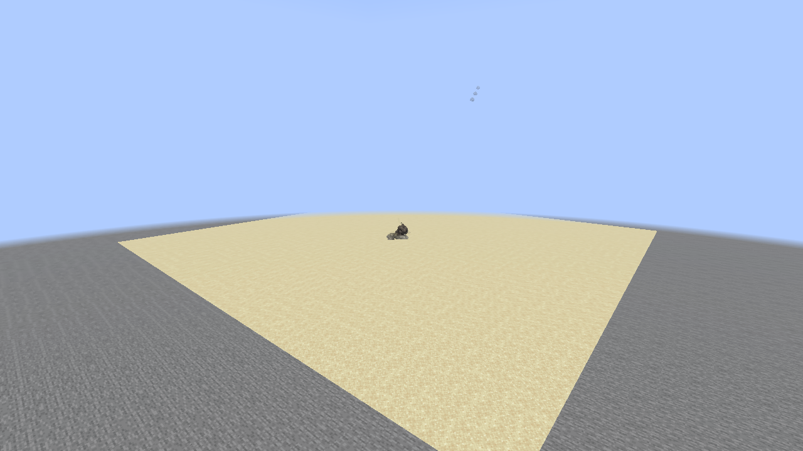 | 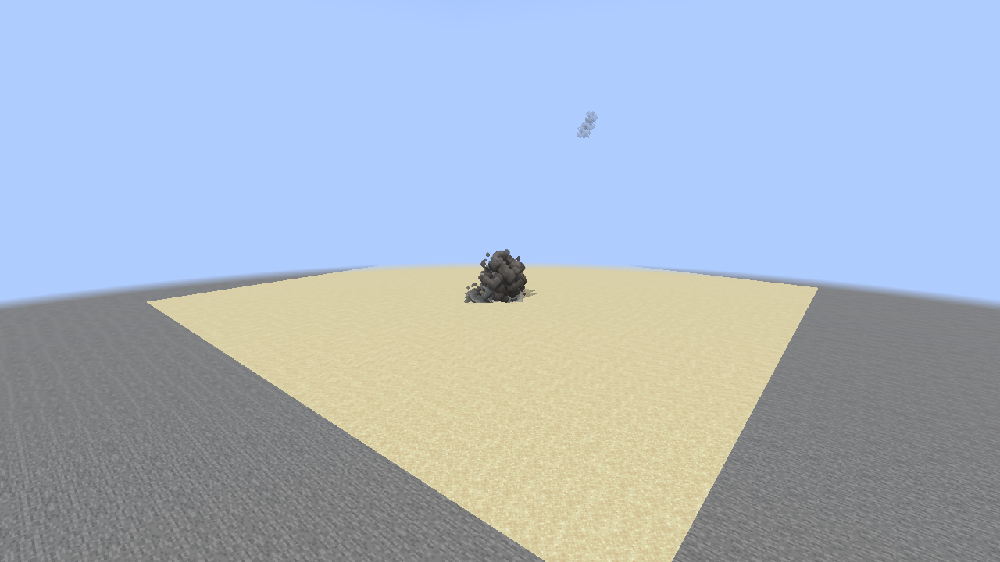 |
| **AGM-158 JASSM — soil, dusk** | 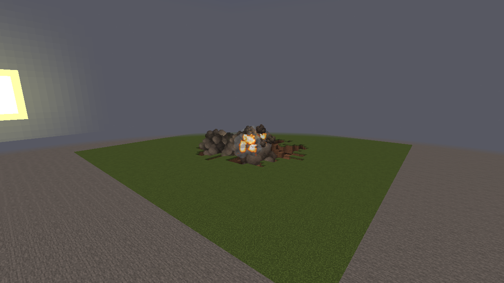 | 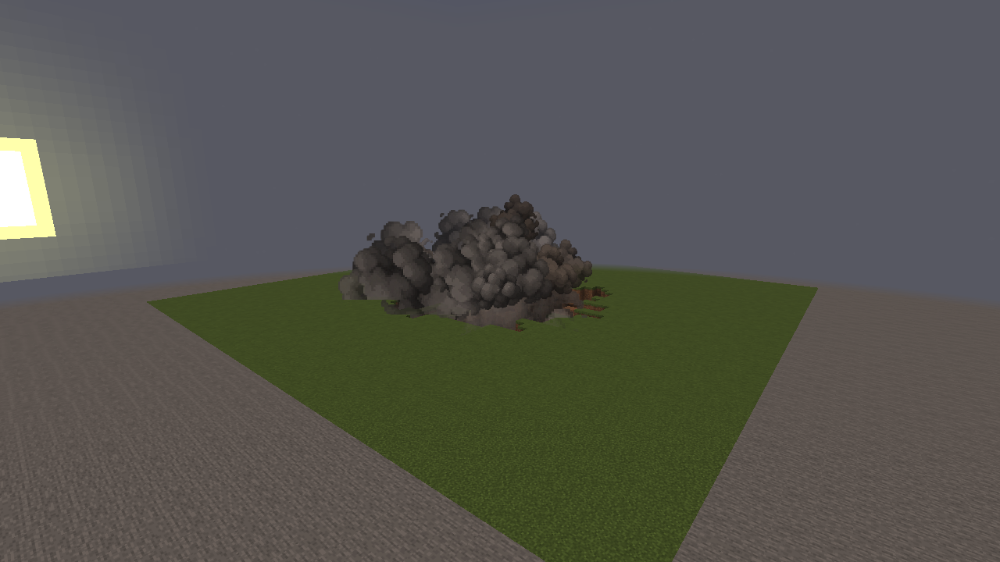 |
| **GBU-57 — soil, night** | 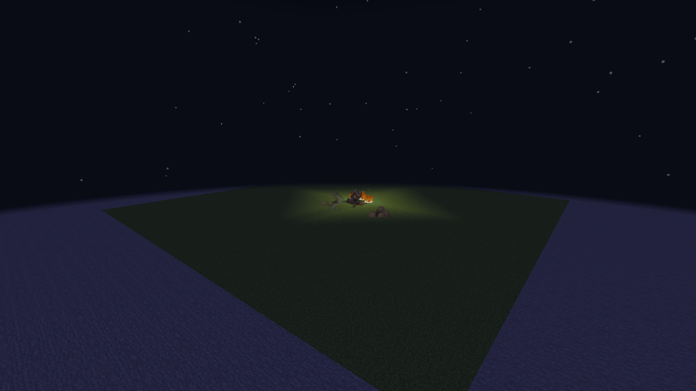 | 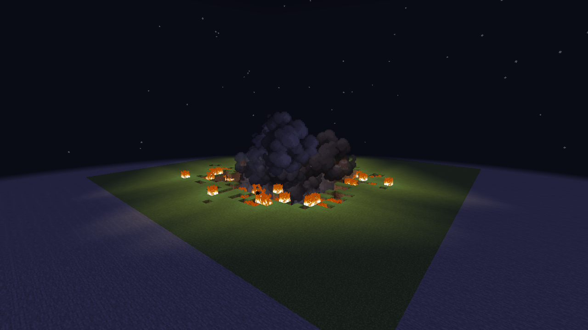 |

**Mk82 on stone.** Its existing weapon power and resistant terrain produce a smaller visible
cloud than the GBU-57. This capture uses the actual bomb; it is not the larger synthetic blast
used by the diagnostics below.

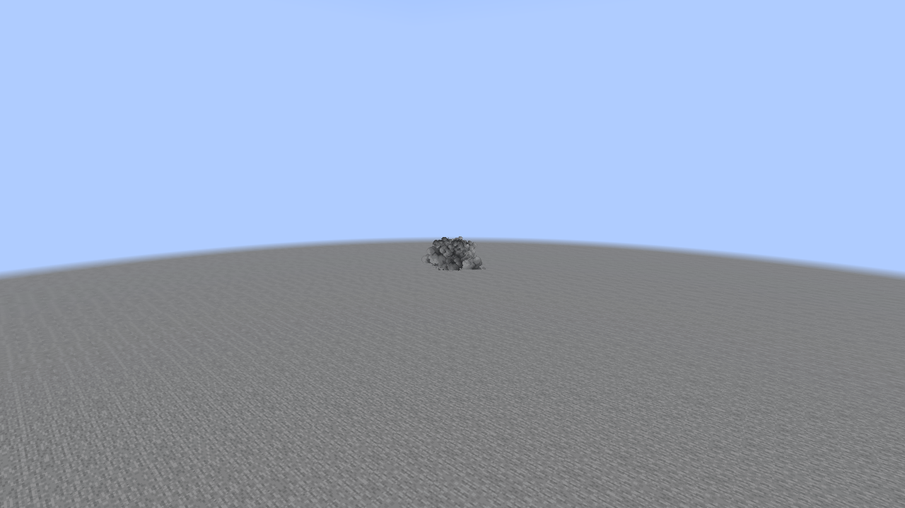

**AGM-158 before this pass**, in the same range surface/light/view at the earlier source revision:

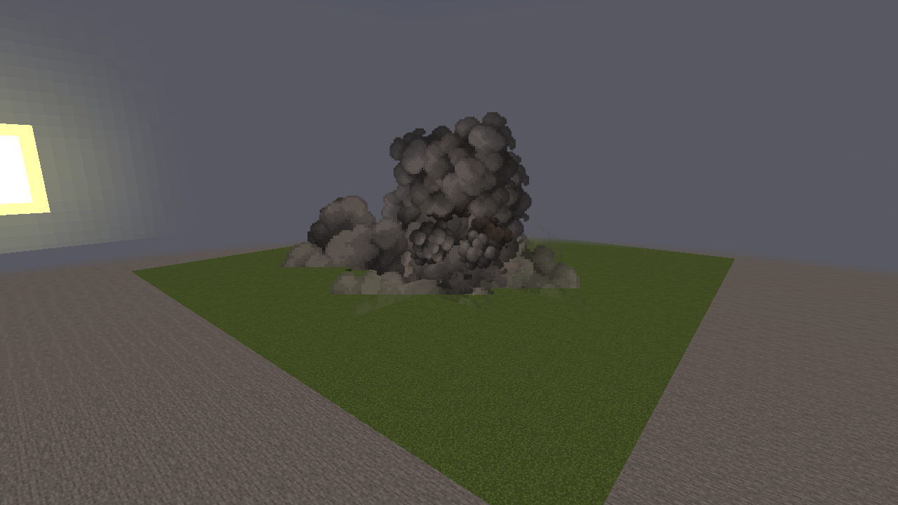

## Vehicle material examples

Stationary client model fixtures, with production models, textures and both normal lighting
and baked surface shading. Changes are intentionally subtle. The M1A2 has explicitly named
rubber/vent groups; the F-35A has 114 alpha-confirmed canopy vertices. The Apache's unknown
glass is not guessed from dark paint, so it receives paint/underside shading only.

| M1A2 Abrams | AH-64 Apache | F-35A Lightning II |
| --- | --- | --- |
| 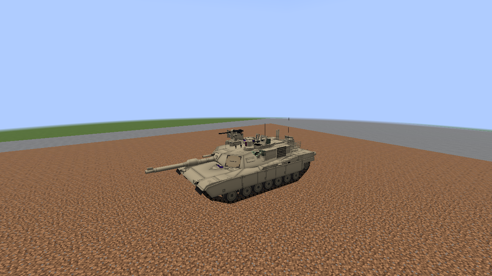 | 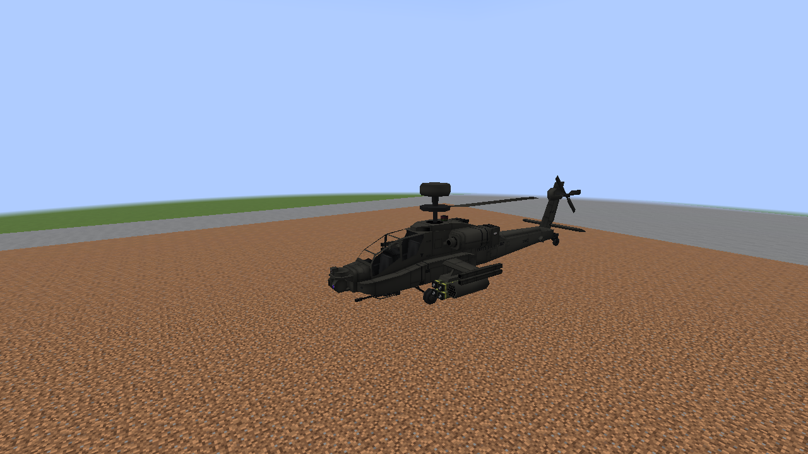 | 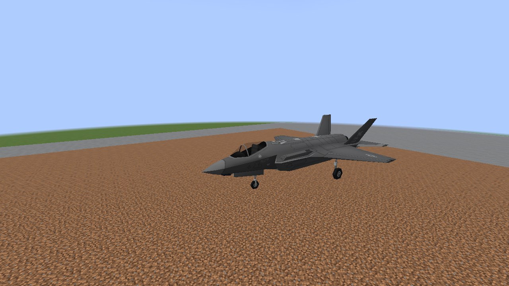 |

## Distance and shared load

These two images are **controlled effects diagnostics**, emitted through the production effect
path with a fixed irregular footprint; they do not depict additional gameplay weapons or real
crater generation. They supplement the actual-weapon photos above.

**128-block horizontal viewing distance:** the reduced cloud keeps its dominant silhouette.

**Overlapping-blast check:** 37 controlled blasts requested over 30 ticks, sharing admission.
The final Vulkan run peaked at 155 custom particles and drained fully. That count is not an FPS
measurement or a guarantee for the target GPU.

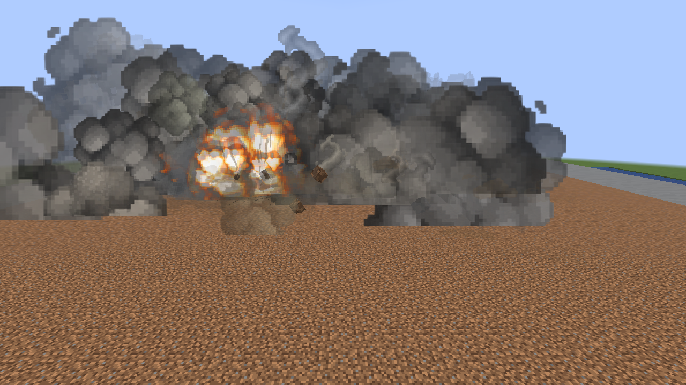

[Implementation, settings and bounds](M8_BLAST_READABILITY.md) ·
[Validation data](performance/m8-realism/blast-readability.json)
