# M8 breakaway sections: closed cuts and tear effects

Torn wings and tails used to show straight through the airframe. Stock models are single-sided
and drawn with back faces culled, and the cut caps were skipped for any open or detailed contour
(more than 128 nodes), which covers most stock bodies, and outside the Polished style.

- Every cut contour is capped. Closed contours are triangulated exactly; open, self-touching or
  detailed ones get an even-odd row or column bulkhead, whichever reads more consistently.
- The skin near each cut gets a mirrored, slightly inset lining, so looking into a stump or a
  falling section shows a dark inner wall, never the sky.
- Kept stumps draw lining and caps in every effect style up to 96 blocks, outside the optional
  detail budget. Falling sections draw their own cached shell with the same transform.
- `BreakawayEffects`: a separation burst (flash, sparks, torn chips, flame, a metal tear), a
  fire-to-smoke trail from the torn edge while the section falls, a short smolder where it lands,
  and arcing, smoking stumps on a plane that keeps flying.

`AllPlaneFracturesTest` tears both wings and the tail of every stock plane body and checks that
both sides of each cut are closed.

## Where the sections are cut

- A wing comes off along its whole chord. The tail line used to run across the full span, so on
  a flying wing or a delta (B-2, X-47B) a torn wing lost only a forward triangle and left its
  outer trailing edge hanging off the stump, and a torn tail took a strip from tip to tip.
- Outboard of a wing cut, the skin is split into pieces joined by shared edges. The largest is the
  wing; a piece clear of its planform and behind it (a stabiliser tip) goes with the tail. The tail
  line itself only cuts between the wing cuts. Attached parts follow `Airframe.section`.
- A section torn off in flight keeps its paint: soot covers a band at the torn root and a fainter
  one past it, darkening as it burns. Sections of a destroyed hulk stay charred all over.
- Small skin chips have a painted underside a plate's thickness in, so a tumbling chip no longer
  vanishes when it turns its back to the camera.

`AllPlaneFracturesTest.theB2LosesWholeWingsAndOnlyItsCentreTail` and
`BreakupMeshesTest.aWingTearsAlongItsWholeChordAndAStabiliserTipGoesWithTheTail` cover both
layouts.

## Native captures

OpenGL / llvmpipe under Xvfb, 1280×720, Polished style. Not composited.

```sh
./gradlew -I scripts/visual-probe.init.gradle --no-configuration-cache \
  -Dmcheli.probeBreakaway=true -Dmcheli.probeBackend=OPENGL runClient
```

The probe creates the `M6Smoke` flat world if it is missing. Set `onboardAccessibility:false`
in `.run/m8-preview/options.txt` on a fresh run directory. `-Dmcheli.probeBreakawayPlanes=a,b`
picks the planes.

| | |
|---|---|
| 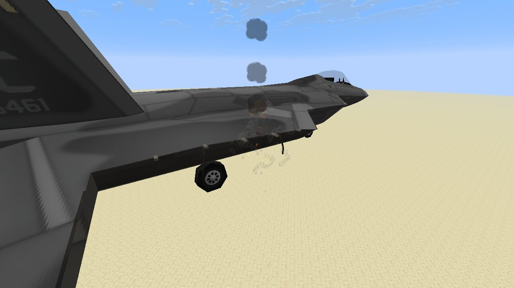 F-22 wing stump | 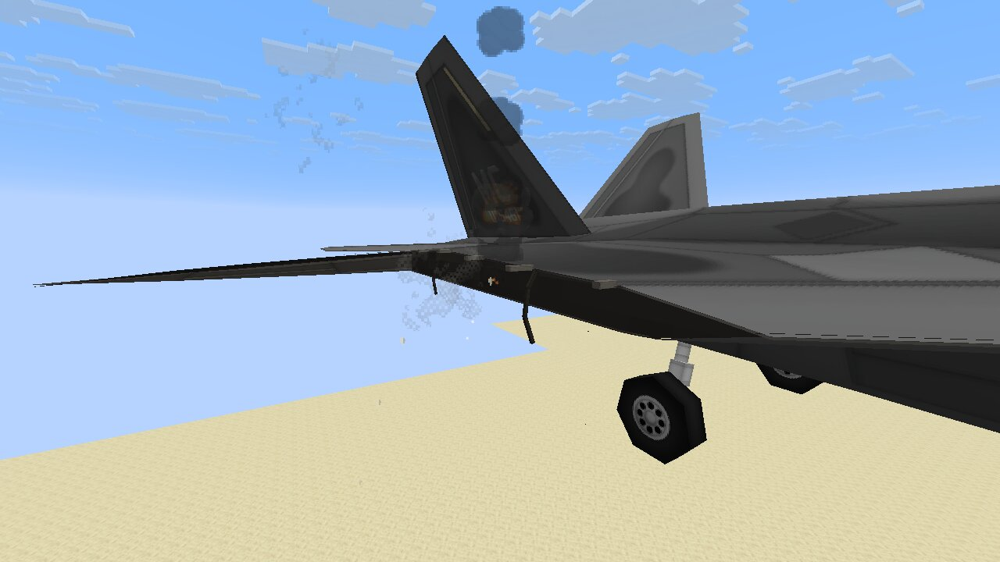 F-22 stump, grazing angle |
| 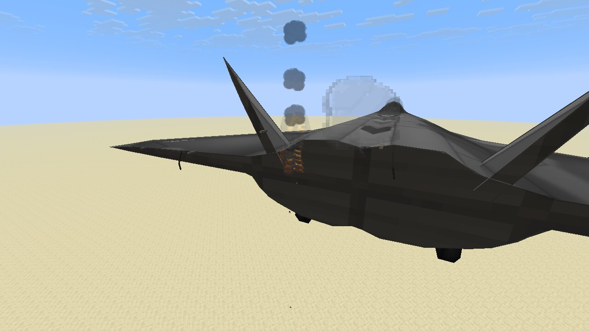 F-22 tail stump | 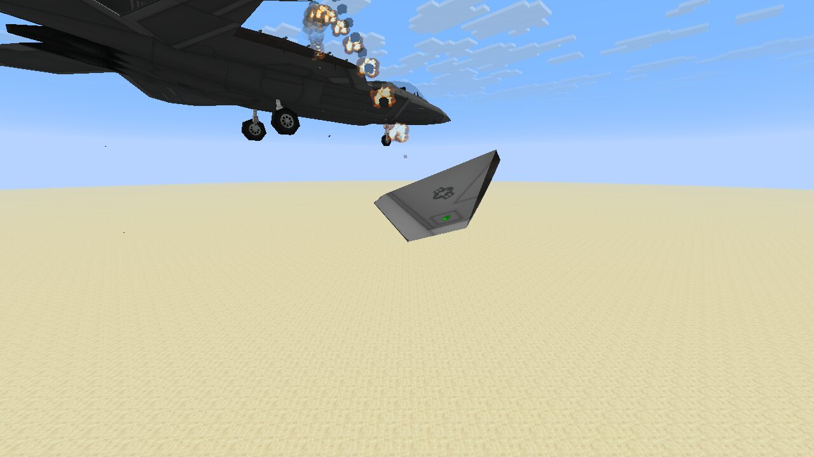 F-22 wing falling, fire trail |
| 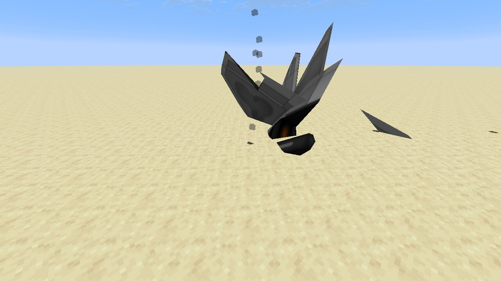 F-22 sections landed | 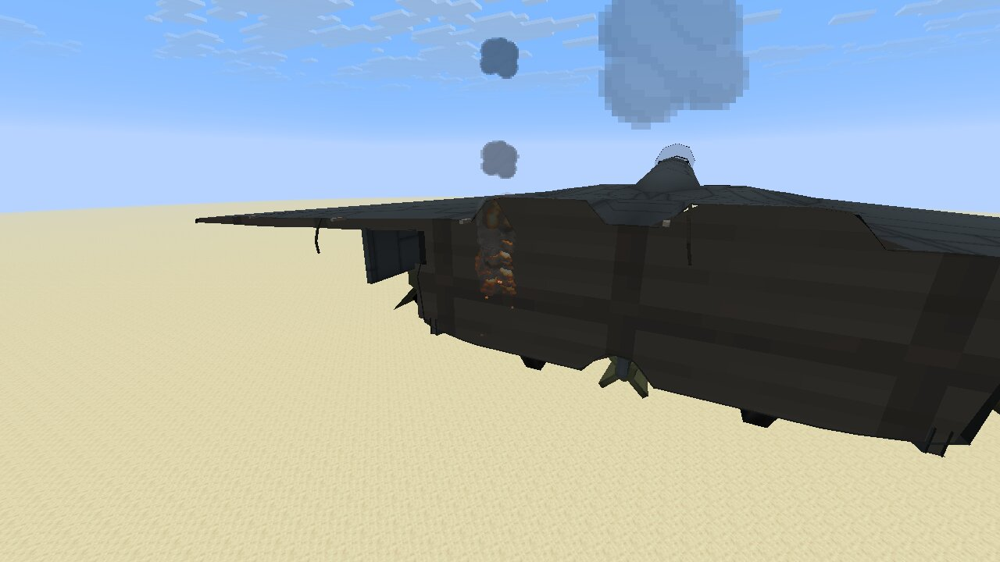 F-15E tail stump |
| 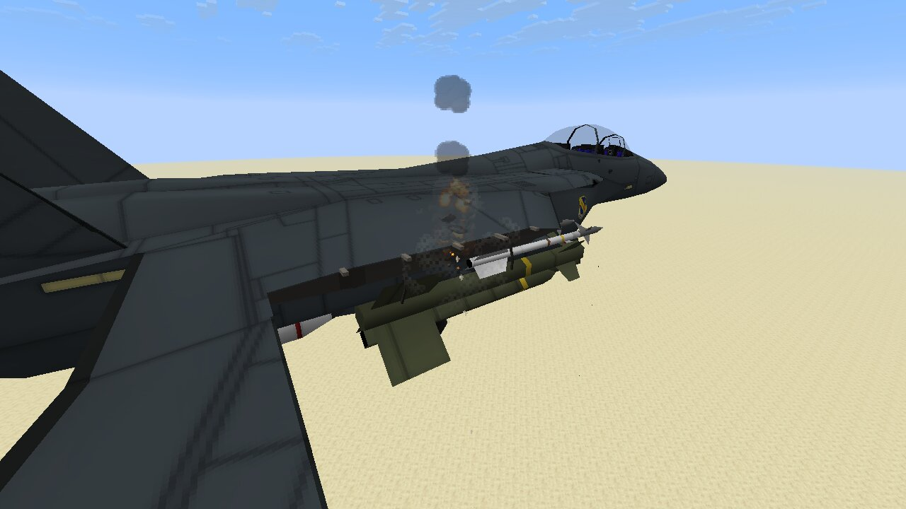 F-15E wing stump | 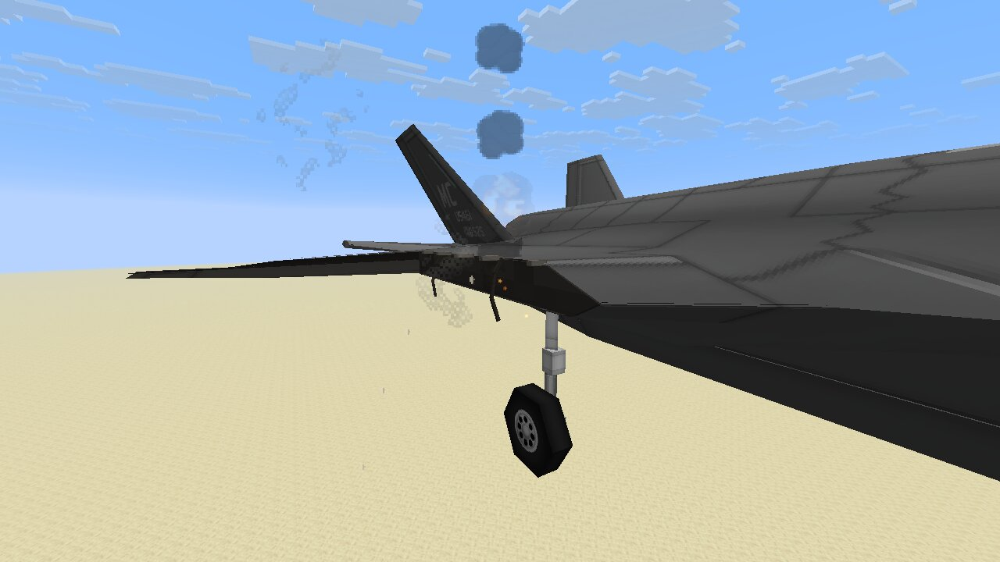 F-35A stump, grazing angle |
| 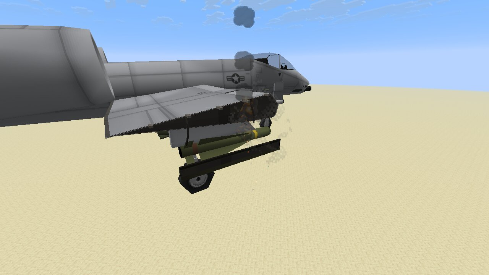 A-10 wing stump | 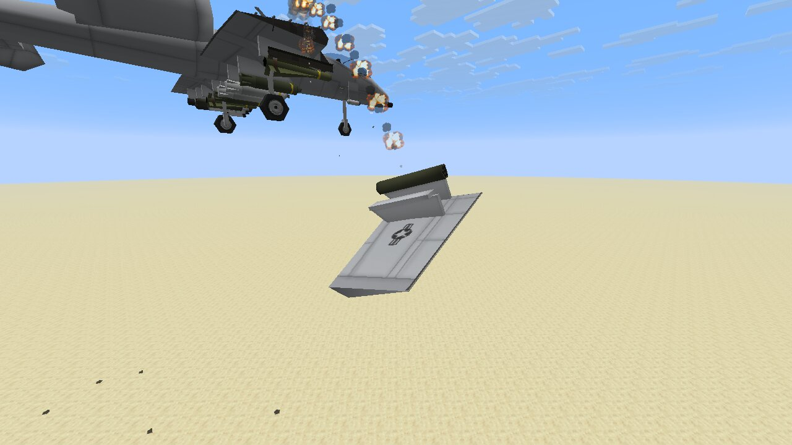 A-10 wing falling |
| 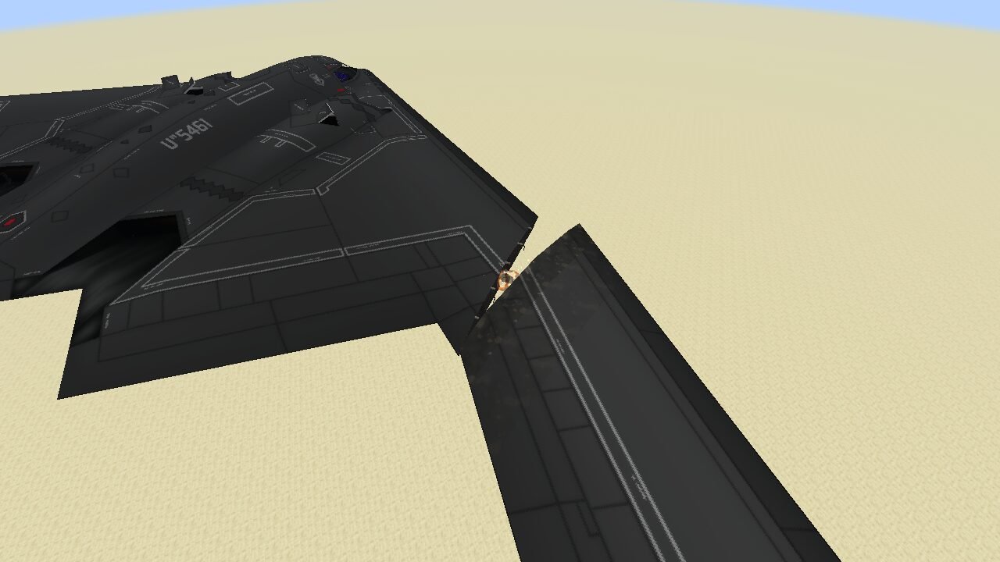 B-2 wing tearing off along its whole chord | 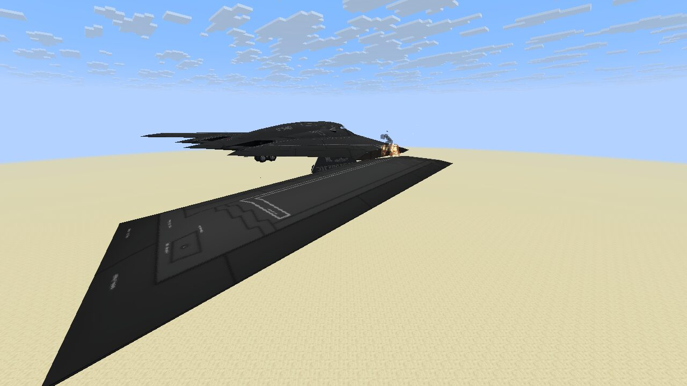 B-2 wing falling, paint kept, root scorched |
| 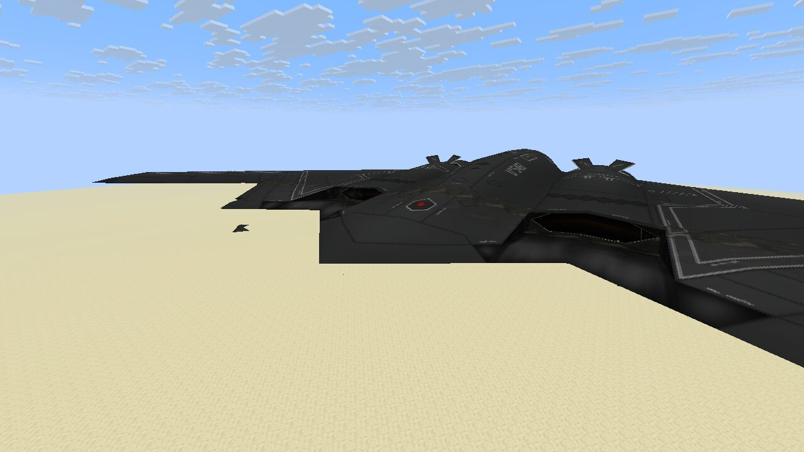 B-2 losing only its centre tail | |
