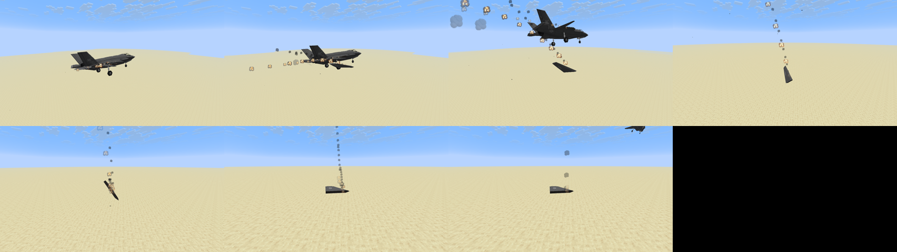
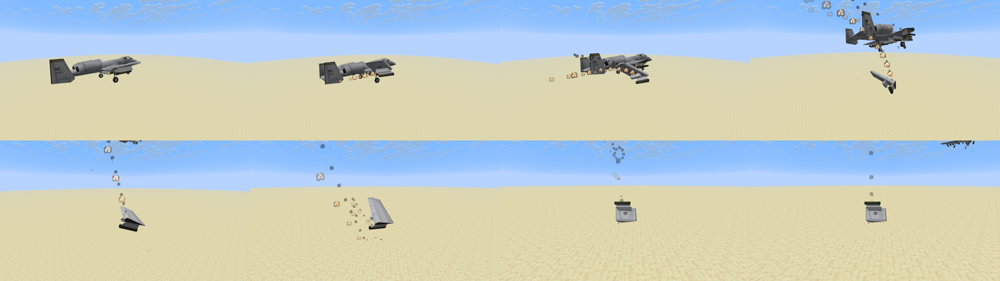
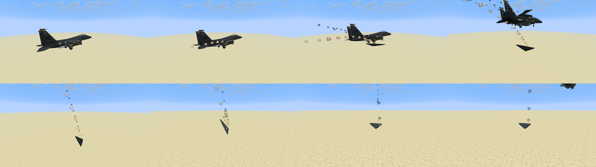

# Torn-section motion

Wings, tails, control surfaces and wreck panels that come off a plane are cosmetic mesh fragments
(no entities, drops or hitboxes). This pass replaces their fixed-rate spin and single bounce with a
small rigid-body model, `DebrisMotion`, used by every fragment `LoosePanels` owns, on every plane.
It builds on the closed (lined and capped) sections and tear effects from the see-through fix.

## Motion

1. **Tear.** A structural section first folds about its torn root for 3 to 6 ticks (longer for
   bigger sections). The fold axis comes from the load on the section: drag against the
   direction of flight, lift along the aircraft's up axis and gravity. A wing therefore folds up
   and back in flight and droops on a parked plane. The root rides along with the aircraft.
2. **Release.** The section lets go with the aircraft's velocity, the aircraft's turn rate (from
   its yaw, pitch and roll change over the last tick) and the tangential speed of its offset
   (ω × r), plus most of the fold's own spin. A rolling plane flings its wing outward.
3. **Flight.** Gravity is 0.035 blocks/tick². Drag is split by face: motion through the
   section's broad face is resisted much more than edge-on travel, so wing panels fall slower than
   compact chunks and slide sideways when tilted. Long sections autorotate about their span,
   like a falling strip of paper, which bends the fall into a fluttering glide. Spin is damped by
   the air and capped at 0.55 rad/tick.
4. **Ground.** Each impact is applied at the section's lowest corner, with restitution along the
   surface normal and Coulomb friction along it. Both change the spin, so off-centre hits flip
   and cartwheel the section. Restitution falls with each bounce and is lower for flat panels.
5. **Slide and settle.** Below a small impact speed (or after five bounces) the section skids,
   losing speed to friction, and rotates onto its broadest face. The centre sits at the oriented
   box's half height, so it rests on the terrain instead of sinking into it. Once still, it rests
   flat.
6. **Water.** A section hitting water splashes, then sinks slowly and fades.

Lighting is resampled at the fragment's position every 10 ticks, so a section falling from bright
sky into shade darkens. Rendering interpolates position and orientation (quaternion slerp) between
ticks.

## Effects

- Ground strikes: block-coloured dust from the struck block, a low dust puff sized to the section,
  and metal sparks above 0.35 blocks/tick (`DebrisImpactEffects.strike`).
- Skids: a thin spray of sparks and grit behind a sliding section (`DebrisImpactEffects.scrape`).
- The burning, smoking trail, separation burst and landing smolder from `BreakawayEffects` now
  follow the torn edge's actual position and orientation.

Everything goes through the shared effect admission and the existing quality, damage-details and
destruction-sequence settings.

## Budgets

The existing limits stay: eight fragments, two births per tick, 24,000 vertices and two world rays
per tick (round-robin over fragments that are still moving). Sweeps run from the last sampled
position to the lowest corner, so landings do not tunnel. Live airframe sections now last up to
600 ticks so they can reach the ground from altitude; any fragment fades 300 ticks (structural)
or 200 ticks (other) after it first touches down, and skin chips 20 ticks after. Repairs and the
existing toggles still remove them at once.

## Checks

`DebrisMotionTest` covers plate vs chunk terminal speed, inherited flight velocity, span
autorotation and the spin cap, the root staying attached during the tear and the release speed,
bounce then slide then resting flat at the right height, water sinking, degenerate input, and
turn-rate inheritance including yaw wrap.

The non-shipping `BreakawayMotionProbe` (`-Dmcheli.probeBreakawayMotion=true` with
`scripts/visual-probe.init.gradle`, planes chosen by `-Dmcheli.probeMotionPlanes`) flies a banking
plane, tears off its left wing and then its tail, and follows each section to the ground.

## Captures

Native OpenGL (llvmpipe) captures from `BreakawayMotionProbe`: a plane flying at 0.7 blocks/tick,
22 blocks above a desert, loses its left wing. Read left to right, top to bottom: the fold at the
root with the separation burst, release, the burning fall with its smoke trail, ground strike, and
the section lying flat. These are labeled previews, not combat captures.

Validation: `./gradlew build` passes with 433 unit tests. The probe log for the F-35A shows the
wing released at about 30 blocks, striking the ground 45 ticks later, bouncing four times, sliding
and resting flat; the A-10 tail section bounced, slid and settled on its stabilizers.
