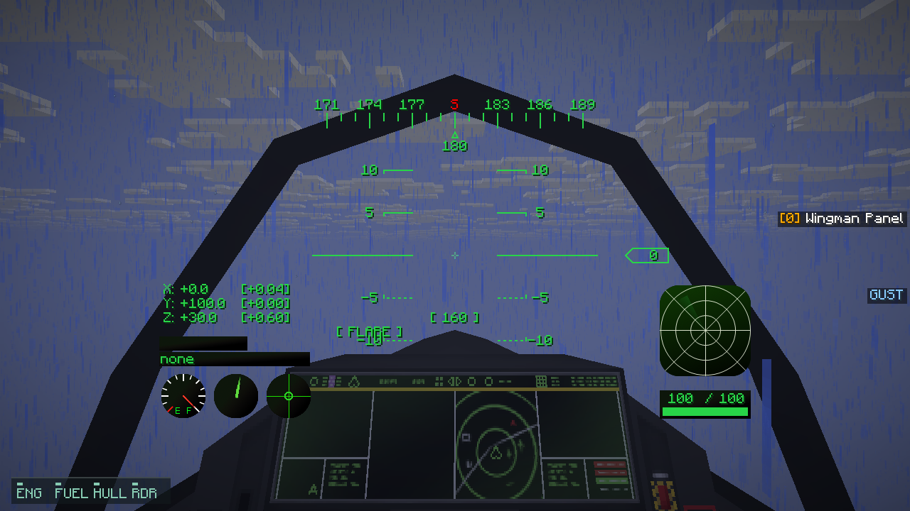
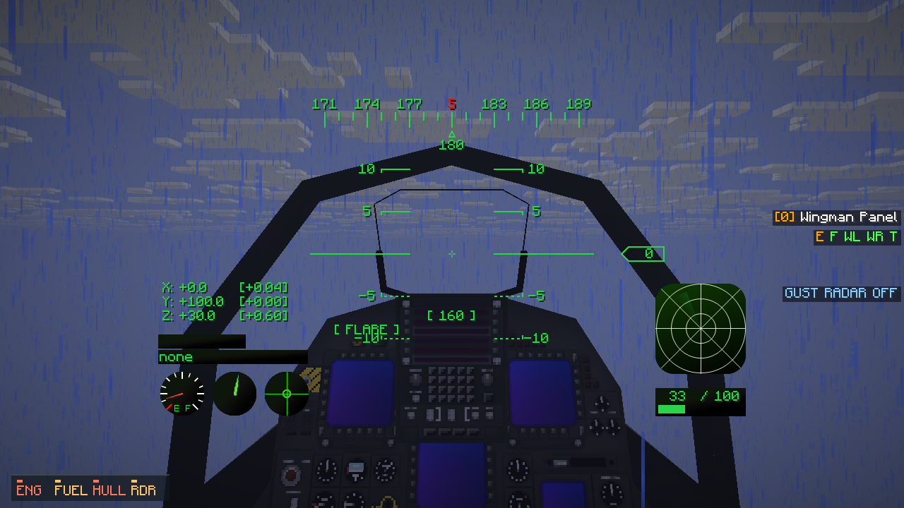
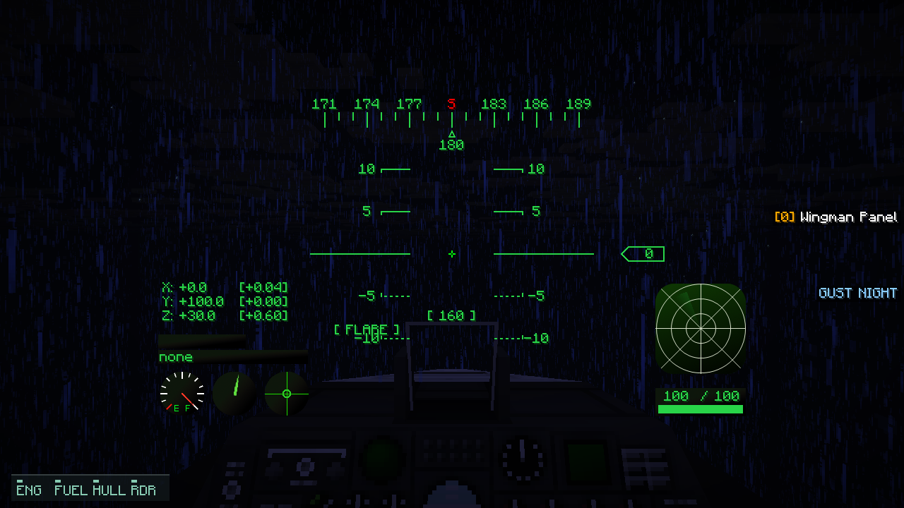

# Cockpit feedback: native examples

Unedited 1280×720 Vulkan screenshots of real vehicle models in controlled client-held
cockpit states, not combat recordings. The supplementary panel is at the lower left;
the existing targeting HUD remains in place. Rain droplets are deliberately sparse and
subtle against vanilla rain. Instrument/cockpit vibration needs motion to assess.

[Implementation, scope and settings](M8_COCKPIT_FEEDBACK.md).

## F-35A — closed canopy in rain

## F-15E — engine, hull, fuel and radar warnings

## A-10 — night cockpit

The F-15E fixture holds component/hull damage, low fuel and radar blanking; these
are the vehicle’s real production warning inputs. A native frame does not establish
target-PC frame rate. Claude’s wreck artwork and AI work are separate.
