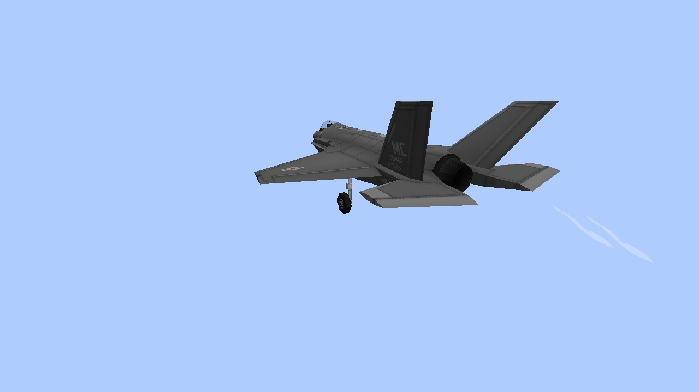
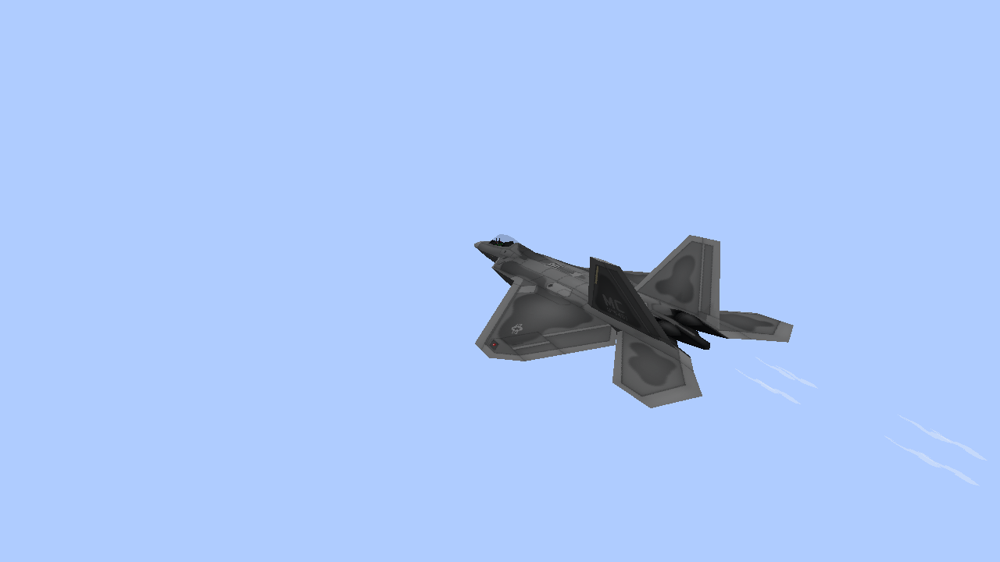
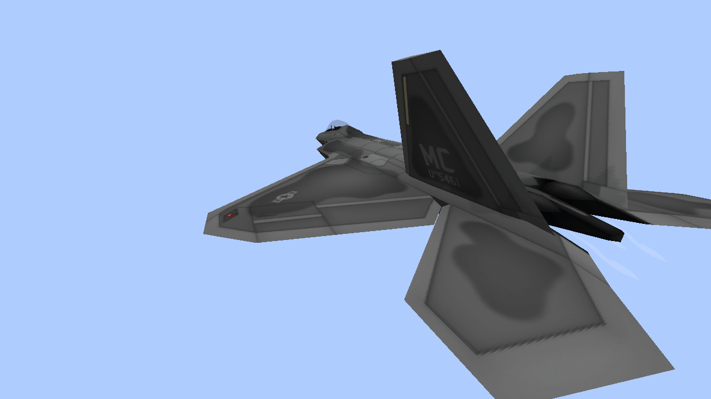
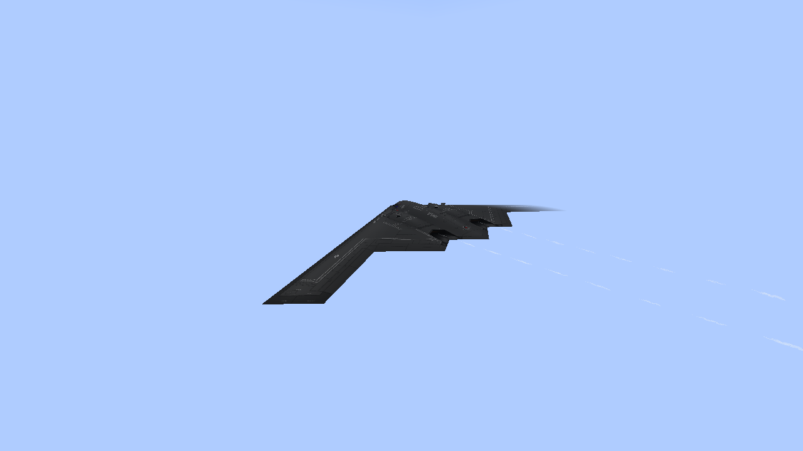
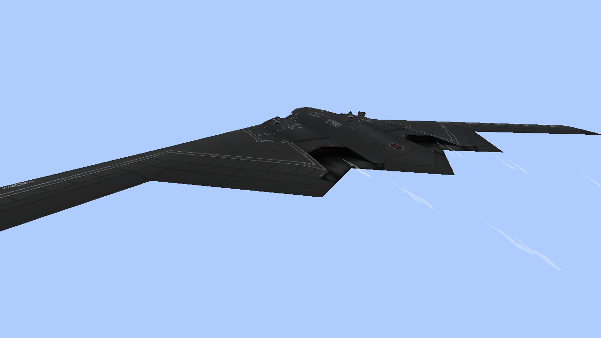
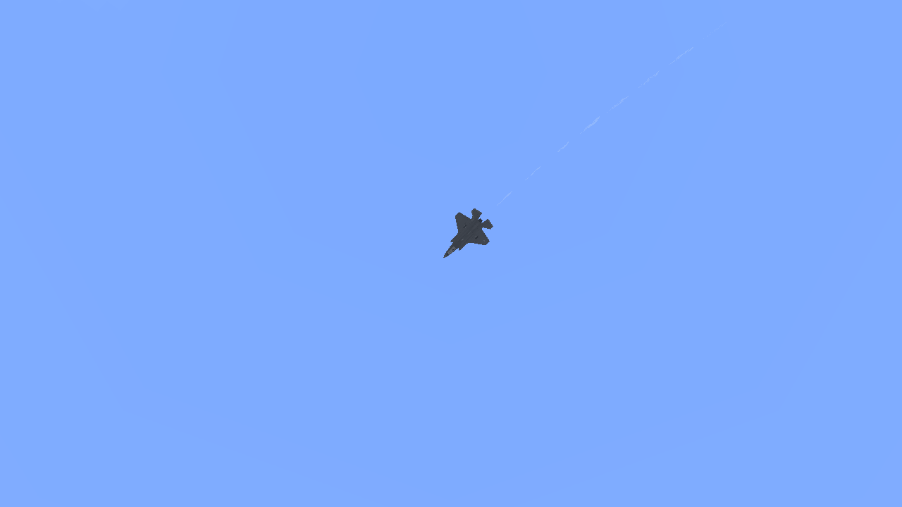
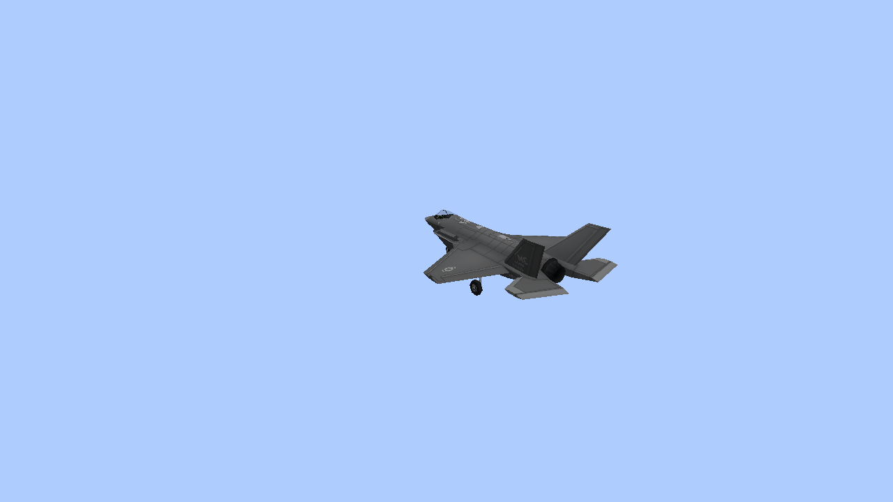
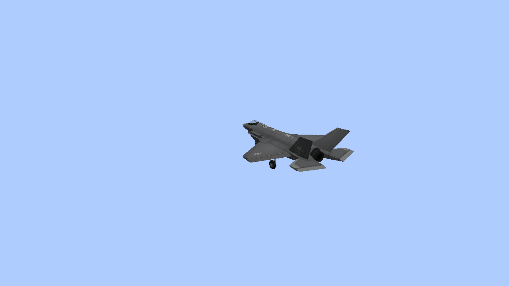
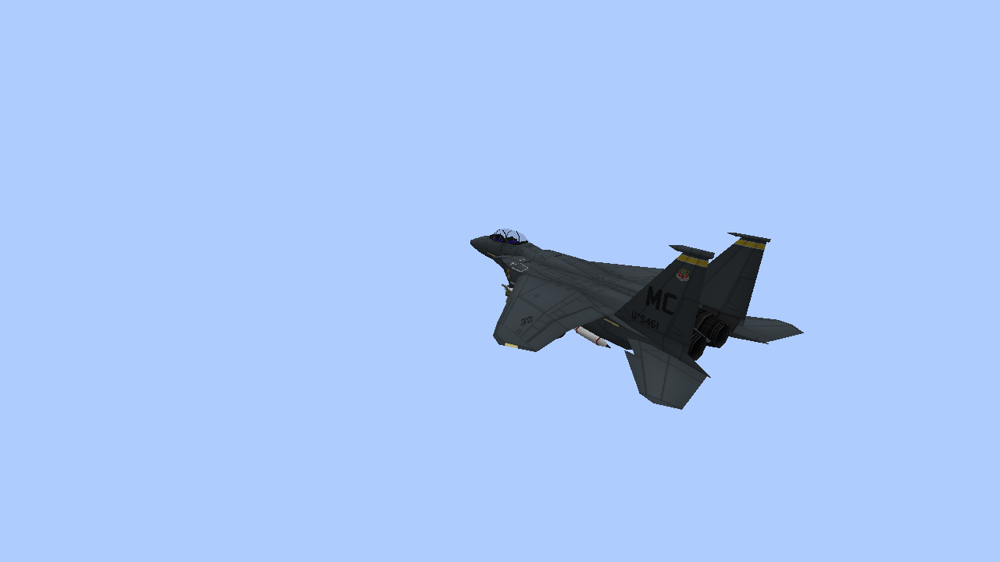
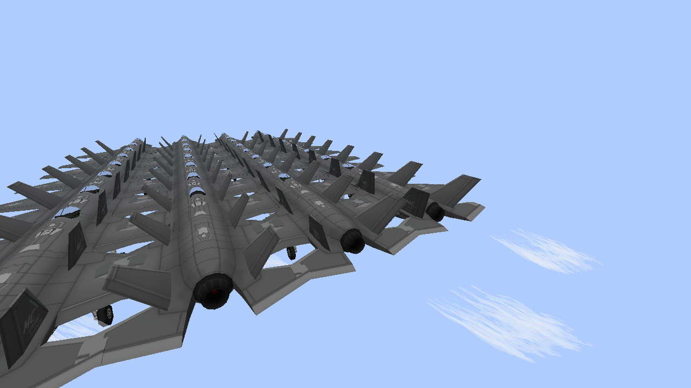

# Contrails: native examples

Unedited 1280×720 Vulkan captures of real vehicle models on controlled, held trajectories.
These are client previews, not combat recordings. Clouds are disabled for visibility.
Normal views use 70° FOV; the distant-observer view uses 35° FOV and 16-chunk view distance
from 200 blocks below the aircraft. Contrails stay thin and become sparser with distance/load.

[Implementation, settings and bounds](M8_CONTRAILS.md).

## F-35A — flight

## F-35A — engine-close

## F-22A — observed remote motion — flight

## F-22A — observed remote motion — engine-close

## B-2A — flight

## B-2A — engine-close

## Distant observer — 200 blocks below

## Low altitude — no cold trail

## Engine off — no cold trail

## F-15E — no authored jet outlet

## 32-aircraft shared load

Other native checks cover shutdown/fade, missing tails, settings, Classic and a mixed
97-aircraft capacity test that preserves nearby damage smoke. These captures do not establish
the target-PC 60 FPS goal. Claude owns the broken-part artwork separately.
