# Damaged control surfaces: native Minecraft examples

These unedited 1280×720 captures use actual component values on held aircraft moving through
the production renderer. They are **controlled previews, not player-driven flight or combat**.
The aircraft retain 85% hull HP during damage phases. Flight handling and collision are unchanged.

Settings: Enhanced, Polished, Balanced, damage details/destruction sequences on, adaptive
effects off, daylight. The first three aircraft below are native Vulkan captures. Small panel
strips approximate control surfaces in the stock fused body geometry, retaining the original UVs.

## F-35A — Vulkan

| Healthy | Damaged, flutter/sag | Severe component damage, small panels shed | Repaired |
| --- | --- | --- | --- |
| 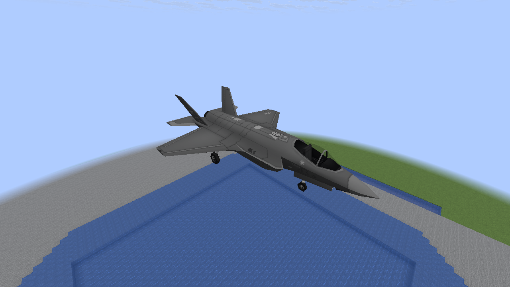 | 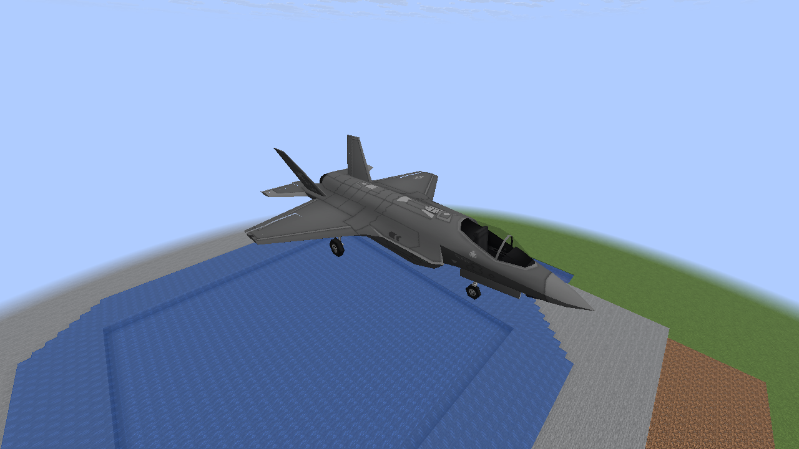 |  | 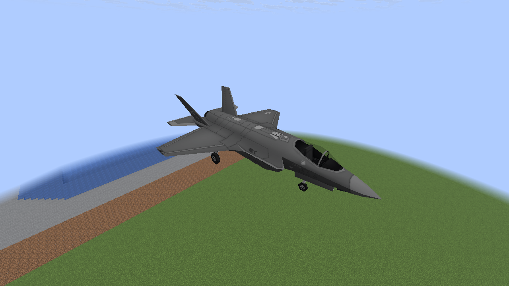 |

## F-22A — Vulkan

This fixture uses observed position changes while reporting zero simulation velocity, checking
that remote-interpolated aircraft still receive motion-dependent flutter.

| Healthy | Damaged, flutter/sag | Severe component damage, small panels shed | Repaired |
| --- | --- | --- | --- |
| 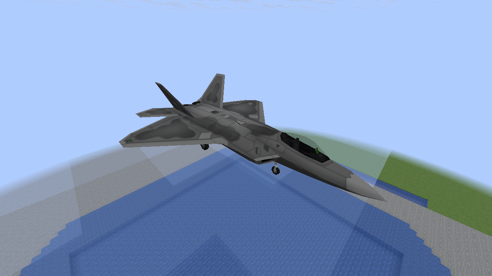 | 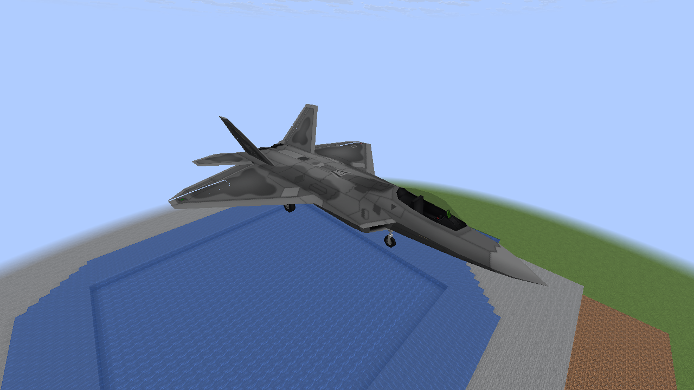 | 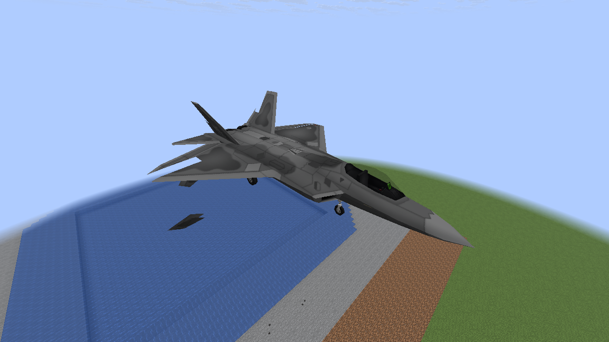 | 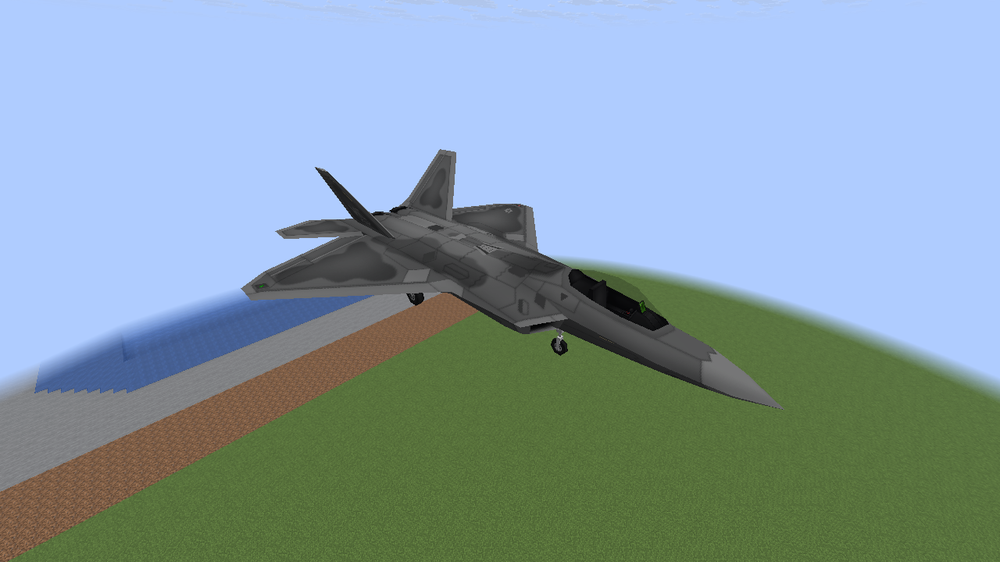 |

## A-10 — Vulkan

| Healthy | Damaged, flutter/sag | Severe component damage, small panels shed | Repaired |
| --- | --- | --- | --- |
| 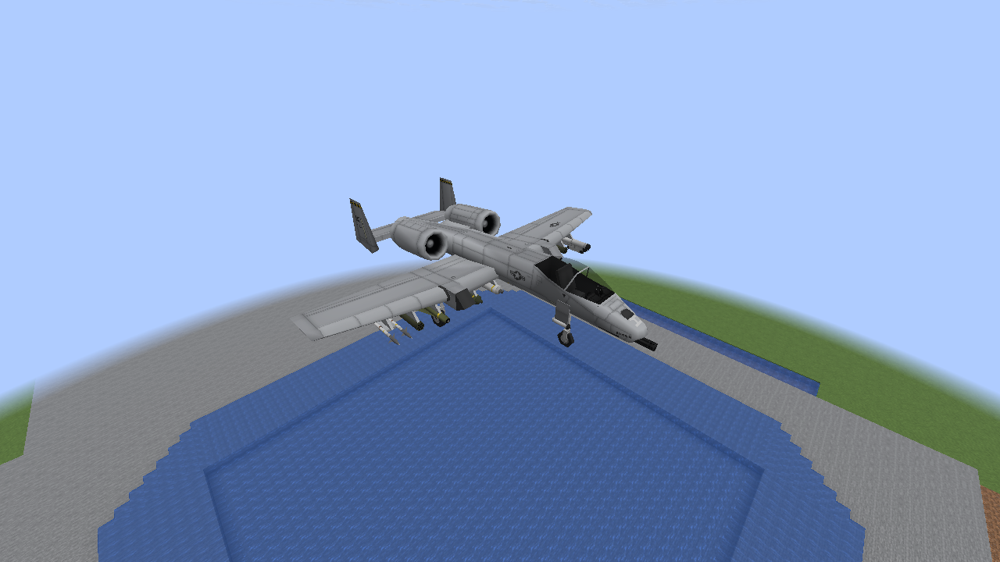 | 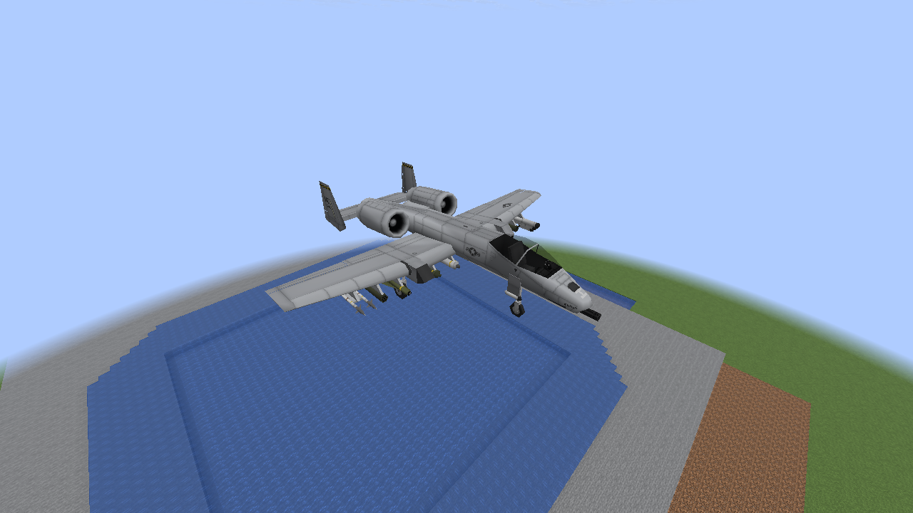 | 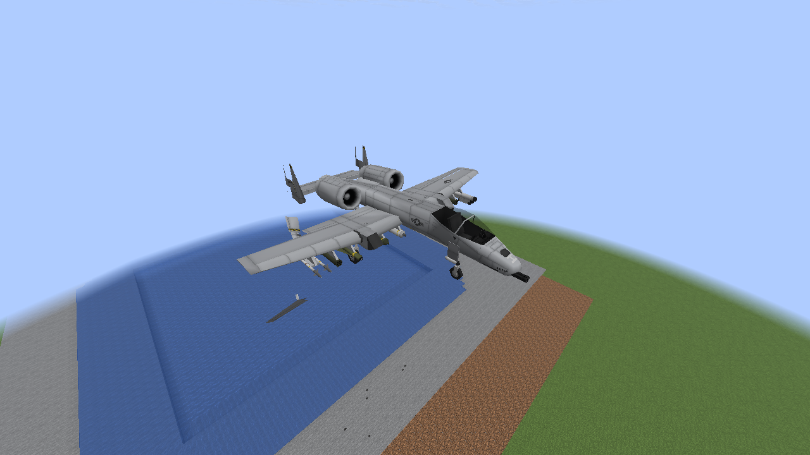 | 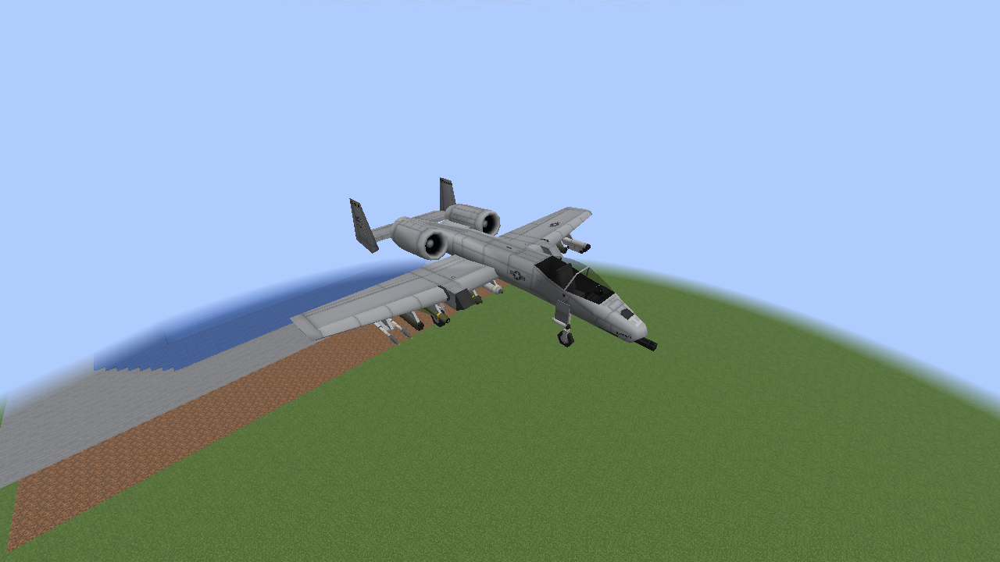 |

## Two sampled flutter frames — Vulkan

These are different animation ticks, not a video. Sag and wobble are deliberately restrained.

| Tick 80 | Tick 95 |
| --- | --- |
|  | 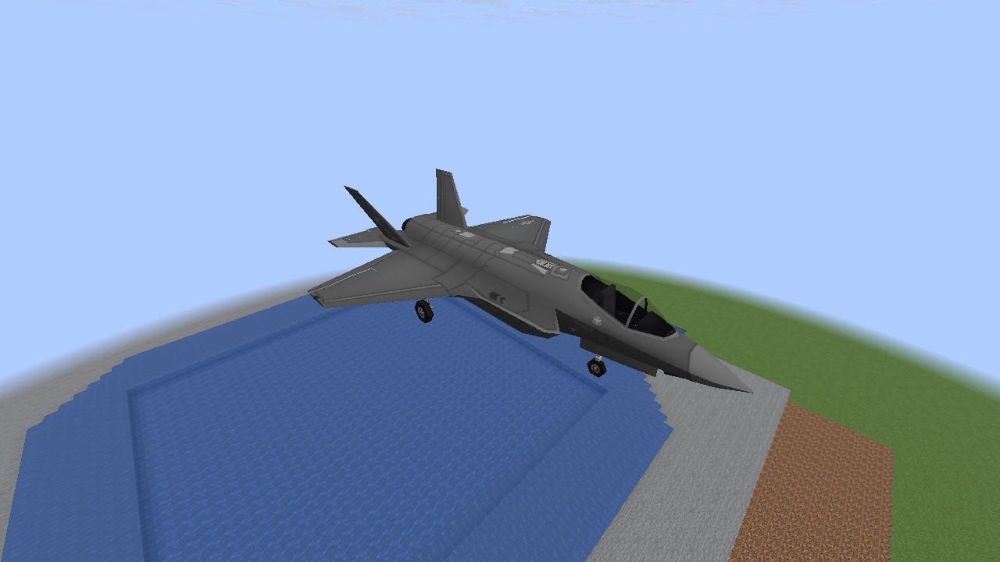 |

## Later whole-wing loss — Vulkan

The large fragment excludes the already missing control skin. This uses the existing live
wing-loss presentation; the new control feature does not add gameplay damage.

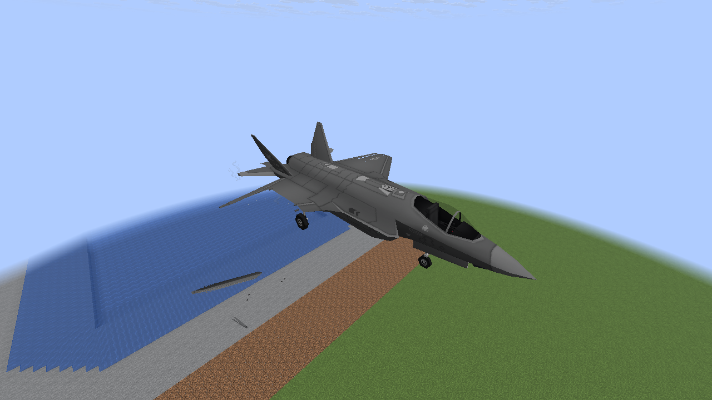

## Existing damage and style transitions — OpenGL

| Loaded already damaged: no fresh flying control pieces | Classic → Polished: current missing panels without replayed breakaway |
| --- | --- |
| 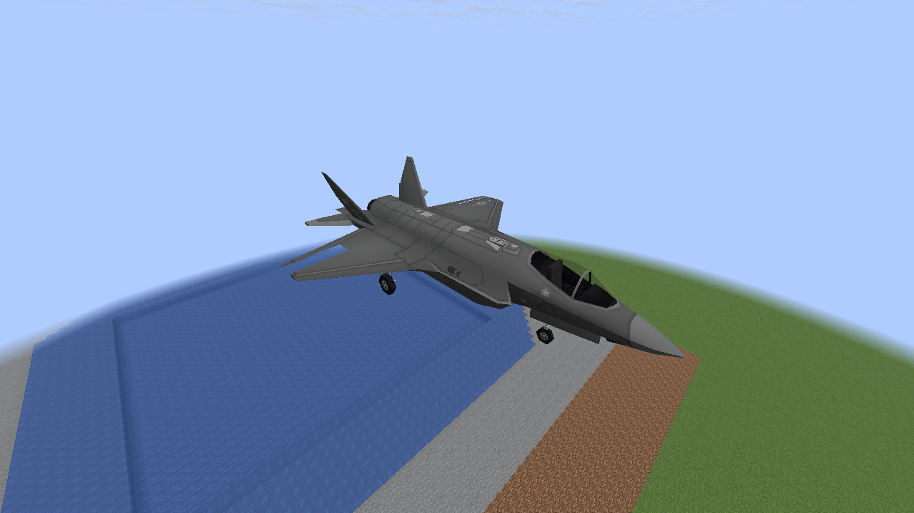 | 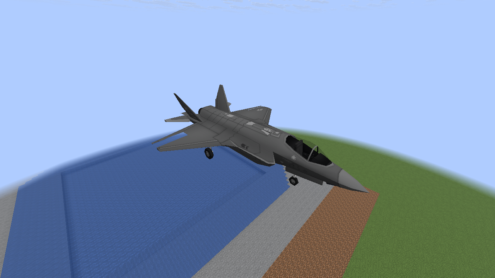 |

The native run also checks damage-detail and destruction-sequence off/on transitions and repair
cleanup. All existing global mesh-piece limits remain in effect.

## Shared load — OpenGL

Thirty-two damaged aircraft share a global cap of eight loose mesh pieces. This crowded fixture
checks bounds and cleanup; it is not a representative target-PC FPS benchmark.

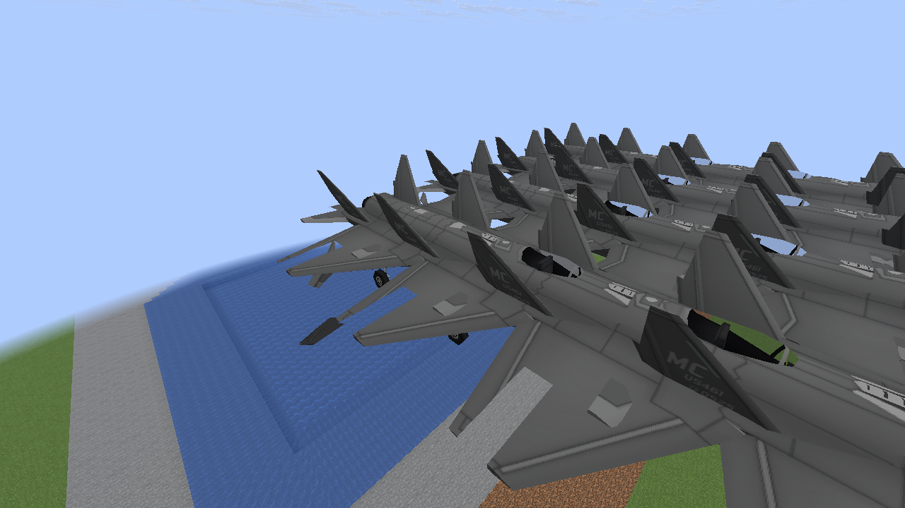

[Implementation, bounds and current decal behavior](M8_DAMAGED_CONTROLS.md) ·
[Capture hashes and observed counts](performance/m8-realism/damaged-controls.json).
Software Mesa Vulkan/OpenGL captures do not establish 60 FPS on the target RTX 3060 / 7800X3D PC.

The stock examples use component health 40% for flutter, roughly 8% for panel separation, then
left-wing health zero for whole-wing loss, followed by full repair. PNGs are copied directly
without cropping, recoloring or compositing. No screenshot was generated as concept art.

Reproduce in the disposable `M6Smoke` world with cheats enabled:

```sh
./gradlew -I scripts/visual-probe.init.gradle --no-configuration-cache \
  -Dmcheli.probeDamagedControls=true -Dmcheli.probeBackend=VULKAN runClient
```

Use `-Dmcheli.probeControlStart=3 -Dmcheli.probeBackend=OPENGL` for the four transition/load
scenes on the other renderer. This fixture is excluded from normal builds.
