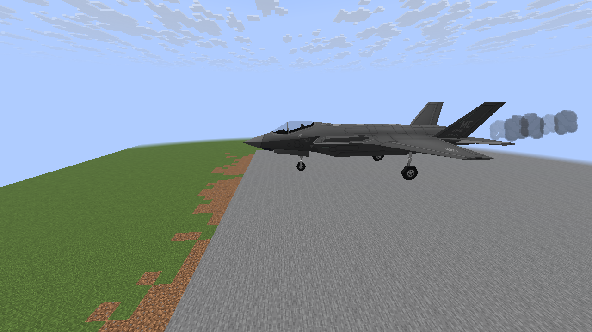
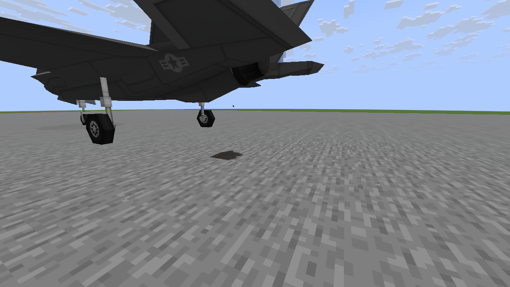

# Destruction effects follow-ups

Implement in order, with native in-game previews on three stock vehicles for each feature.
Keep the original crater and damage rules, preserve Claude's NTM work and target 60 FPS on
RTX 3060 8GB / Ryzen 7 7800X3D at 1080p. Hardware FPS needs target-PC verification.

| Step | Feature | Status |
| --- | --- | --- |
| 1 | Uneven damaged-engine smoke trails that stretch with movement | Complete |
| 2 | Coolant/oil leaks and temporary ground stains | Complete |
| 3 | Directional tumbling metal fragments | Complete |
| 4 | Flickering/failing damaged lights and local sparks | Complete |
| 5 | Wreck fires, embers and cooling smoke that die away | Pending |
| 6 | Localized blast soot, exposed metal and panel smoke | Pending |
| 7 | Rattling and detachable small authored panels | Pending |
| 8 | Progressive cracks on identifiable glazing | Pending |

All additions are cosmetic and respect the existing damage-details switch, distance and
quality controls. Avoid unbounded particles, repeated full-model scans, world lighting
updates and new gameplay entities. Temporary previews use controlled vehicle states;
images are native screenshots, never generated mockups.

## 1. Damaged engine trails

Smoke sheds only a small part of vehicle velocity, with uneven pulses, darker cores and
shorter-lived wisps. Maximum radius is charged to existing particle admission; no collision
queries are added. Native previews on M1A2/AH-64/F-35A and 301 local unit tests pass.

## 2. Fluid leaks

Small oil/coolant drips leave growing, drying patches on surviving ground under slow or
parked vehicles. Footprints clip to the sampled block face, including slabs. Water/air and
removed supports are rejected. Four downward rays per tick, eight support validations,
128 stored patches and one shared atlas bound the cost. Tank runoff uses already resident
visual bounds without loading models. 303 local unit tests and native terrain/vehicle
checks pass.

## 3. Directional metal fragments

Bullet/cannon impacts shed small, cold, three-face metal pieces from the fitted model
surface. Reflected direction plus an uneven outward fan keeps them away from the panel.
Known glass groups skip metal. Global live limits are 16/32/48; at most 16 births per tick,
40-block range and 20–28 tick lifetimes. Existing particle admission applies; no entities,
block scans or extra packets. Delayed model loads do not replay old fragments. Native
M1A2/AH-64/F-35A previews and 305 local unit tests pass.

## 4. Damaged lights

Authored searchlights/headlights dim, flicker independently or fail as damage grows. Cones
and living-entity highlights share the same deterministic intensity; repairs restore them.
Occasional tiny sparks originate at actual lamp anchors and use the existing particle cap.
No world light-engine work. Native healthy/damaged Growler, Mi-24PS and An-2 comparisons
and 308 local unit tests pass.

