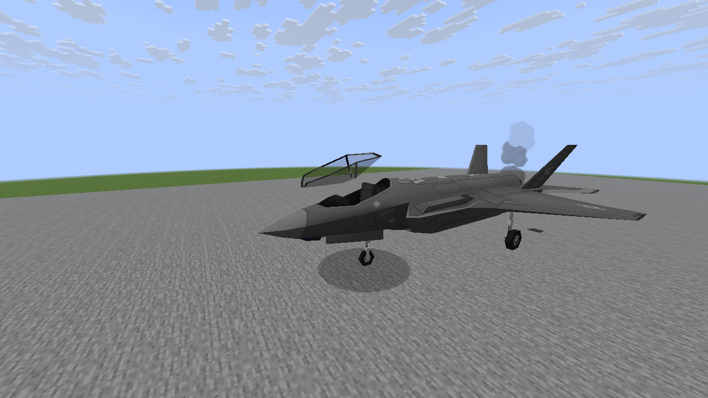

# Destruction effects follow-ups

[View all 24 native vehicle screenshots](M8_DESTRUCTION_GALLERY.md).

Implement in order, with native in-game previews on three stock vehicles for each feature.
Keep the original crater and damage rules, preserve Claude's NTM work and target 60 FPS on
RTX 3060 8GB / Ryzen 7 7800X3D at 1080p. Hardware FPS needs target-PC verification.

| Step | Feature | Status |
| --- | --- | --- |
| 1 | Uneven damaged-engine smoke trails that stretch with movement | Complete |
| 2 | Coolant/oil leaks and temporary ground stains | Complete |
| 3 | Directional tumbling metal fragments | Complete |
| 4 | Flickering/failing damaged lights and local sparks | Complete |
| 5 | Wreck fires, embers and cooling smoke that die away | Complete |
| 6 | Localized blast soot, exposed metal and panel smoke | Complete |
| 7 | Rattling and detachable small authored panels | Complete |
| 8 | Progressive cracks on identifiable glazing | Complete |

Enabled by default with `effects.effectQuality = ENHANCED` and
`effects.vehicleDamageDetails = true`. Open ESC → MC Heli Effects → Full settings to
change these options; Detail and Adaptive controls still bound presentation cost.
Authored lamps and small removable model groups are required for light/panel effects.
Mixed canopy glazing uses source alpha; unknown or oversized textures keep paint marks.

All additions are cosmetic and respect the existing damage-details switch, distance and
quality controls. Avoid unbounded particles, repeated full-model scans, world lighting
updates and new gameplay entities. Temporary previews use controlled vehicle states;
images are native screenshots, never generated mockups.

## 1. Damaged engine trails

Smoke sheds only a small part of vehicle velocity, with uneven pulses, darker cores and
shorter-lived wisps. Maximum radius is charged to existing particle admission; no collision
queries are added. Native previews on M1A2/AH-64/F-35A and 301 local unit tests pass.


## 2. Fluid leaks

Small oil/coolant drips leave growing, drying patches on surviving ground under slow or
parked vehicles. Footprints clip to the sampled block face, including slabs. Water/air and
removed supports are rejected. Four downward rays per tick, eight support validations,
128 stored patches and one shared atlas bound the cost. Tank runoff uses already resident
visual bounds without loading models. 303 local unit tests and native terrain/vehicle
checks pass.


## 3. Directional metal fragments

Bullet/cannon impacts shed small, cold, three-face metal pieces from the fitted model
surface. Reflected direction plus an uneven outward fan keeps them away from the panel.
Known glass groups skip metal. Global live limits are 16/32/48; at most 16 births per tick,
40-block range and 20–28 tick lifetimes. Existing particle admission applies; no entities,
block scans or extra packets. Delayed model loads do not replay old fragments. Native
M1A2/AH-64/F-35A previews and 305 local unit tests pass.


## 4. Damaged lights

Authored searchlights/headlights dim, flicker independently or fail as damage grows. Cones
and living-entity highlights share the same deterministic intensity; repairs restore them.
Occasional tiny sparks originate at actual lamp anchors and use the existing particle cap.
No world light-engine work. Native healthy/damaged Growler, Mi-24PS and An-2 comparisons
and 308 local unit tests pass.


## 5. Cooling wrecks

Fresh wrecks develop small fire pockets and rising embers. Fire ends after 12 seconds;
smoke becomes cooler and sparser, then stops after 50 seconds. Seeing an already destroyed
vehicle starts with cooling smoke, avoiding replayed fire. Flames/smoke share the existing
8/16/24 atmosphere births-per-tick cap; no gameplay fire blocks or damage are added.

Native previews on three stock vehicles and 310 local unit tests pass.


## 6. Blast scars and panel smoke

Nearby blast notifications fit irregular soot and exposed-metal centers to facing vehicle
surfaces, with local panel smoke following the current part pose. Solid terrain occludes the
blast notification. Six occlusion rays and eighteen pending patches per tick; normal mark,
fitting and particle caps apply. No extra packets or gameplay damage. Native checks cover
wall occlusion and successful exposed-panel marks.

Native previews on three stock vehicles and 310 local unit tests pass.


## 7. Loose authored panels

Small authored hatch/canopy/panel groups rattle as damage rises. A fresh critical-damage
transition can detach one cosmetic piece; old damage never replays it. Repair restores the
panel and clears its debris. Groups are limited to 600 vertices and 4.5 blocks across; the
scene keeps at most eight pieces, two births and two swept collision rays per tick. Hitboxes,
weapons, inventory and entities remain unchanged. Canopy access still follows the vehicle's
existing open/closed state. Native checks cover detachment and repair.

Native previews on three stock vehicles and 313 local unit tests pass.



## 8. Progressive glazing damage

Repeated hits spread a single glass fracture into denser cracks, capped at 0.6 blocks and
four stages. Cracks remain attached to their animated part and fade with repair. Mixed canopy
frames use source UV and a bounded, asynchronous PNG-alpha cache so opaque frame hits retain
metal marks. Sixteen masks, two pending decodes, one megapixel per texture; no PNG decoding
on the render thread. Native checks cover first hit, four-hit progression and repair.

Native previews on three stock vehicles and 316 local unit tests pass.


## Reproducing the previews

Use JDK 25 and a graphical client with the development-only visual-probe source set:

```sh
./gradlew -I scripts/visual-probe.init.gradle --no-configuration-cache \
  -Dmcheli.destructionPreview=8 -Dmcheli.probeBackend=VULKAN test runClient
```

Choose stages 1–8. The disposable `M6Smoke` preview world must exist; never point the
fixture at a valued save. Screenshots are native 1280×720 captures in the preview run's
`screenshots` directory. Stage 4 includes healthy/damaged lamps, stage 7 checks repaired
panels, and stage 8 checks opaque frames, repeated fractures and repaired glass.
Stages 2 and 6 also assert terrain fitting/removal and blast occlusion respectively.
Local previews used JDK 25/Mesa with optional integration dependency exclusions;
GitHub CI validates the normal build and dedicated GameTests with and without NTM Next.

## Final compatibility checks

All eight stages have native Vulkan examples on three vehicles each. The final gallery uses
M1A2/AH-64/F-35A for stages 1–3/5–6, Growler/Mi-24PS/An-2 for lamps, and F-35A/F-15E/A-10
for panels and glass. Glazing also passes native OpenGL checks, including opaque-frame hits
and repair. The feature branch includes main's M9 updates; gun cosmetics map rewound hits
back onto the current vehicle surface. Gameplay lag compensation is unchanged.

The final local suite passes 333 unit tests after the M9 merge and cosmetic-contact regression
fix. Native captures are 1280×720; 1920×1080 on the target PC remains a performance check.
