# M8 destruction sequence examples

Unedited native Minecraft screenshots of controlled cosmetic preview states, rendered by the production effects. These are not concept images or combat captures. Still images cannot demonstrate the full timing, rotor slowdown or sounds.

[Implementation and limits](M8_DESTRUCTION_SEQUENCES.md). Gameplay hitboxes, handling, craters and NTM integration remain unchanged. Target-PC 60 FPS is unmeasured.

## Tank sequences

The T-90/T-84 fixtures deliberately select a qualifying rare cook-off seed and carry explosive ammunition. They do not represent every tank death. Abrams keeps its turret. Broken tracks, cover blowouts, ring fire and secondary bursts share this scene.

### T-90

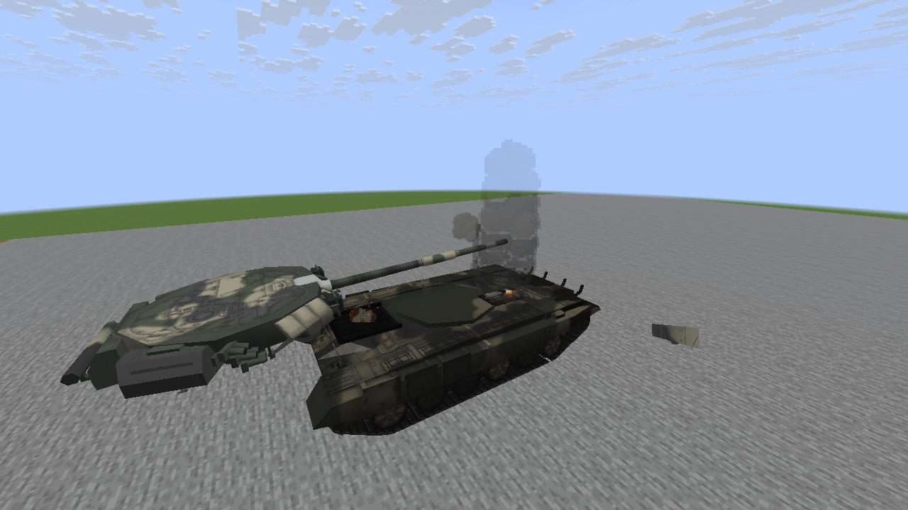

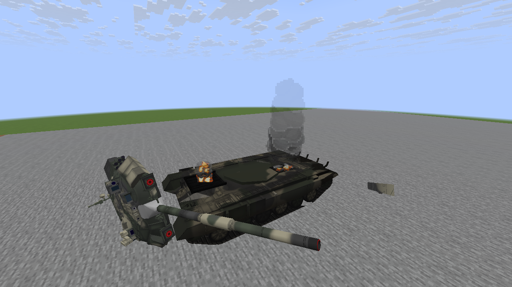

### M1A2 Abrams

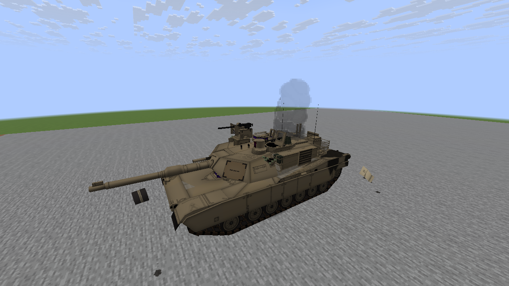

### T-84

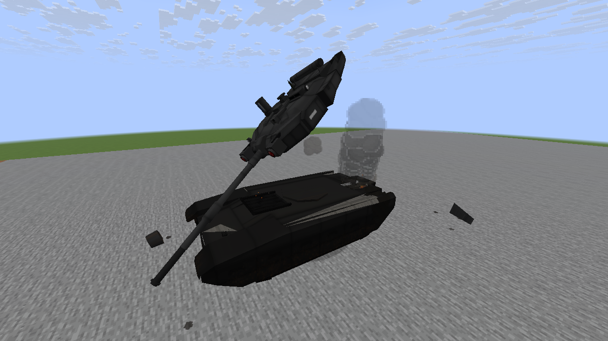

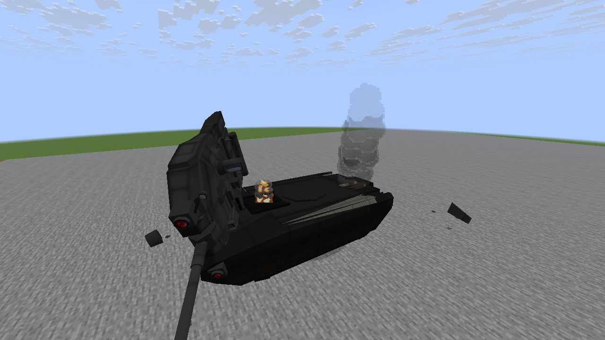

## Aircraft breakup

Wing and rear sections detach, exposing spars. Later frames show settled geometry and smoldering openings.

### F-35A

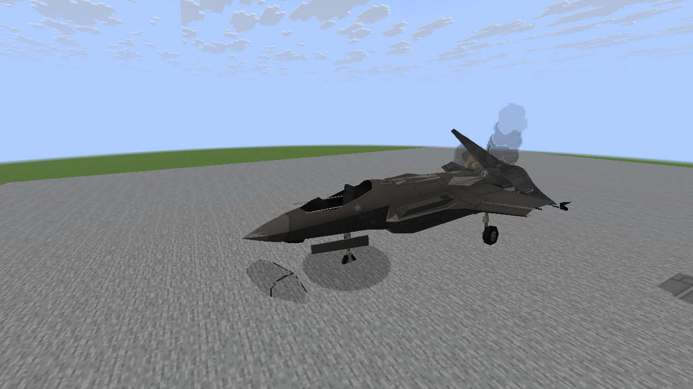

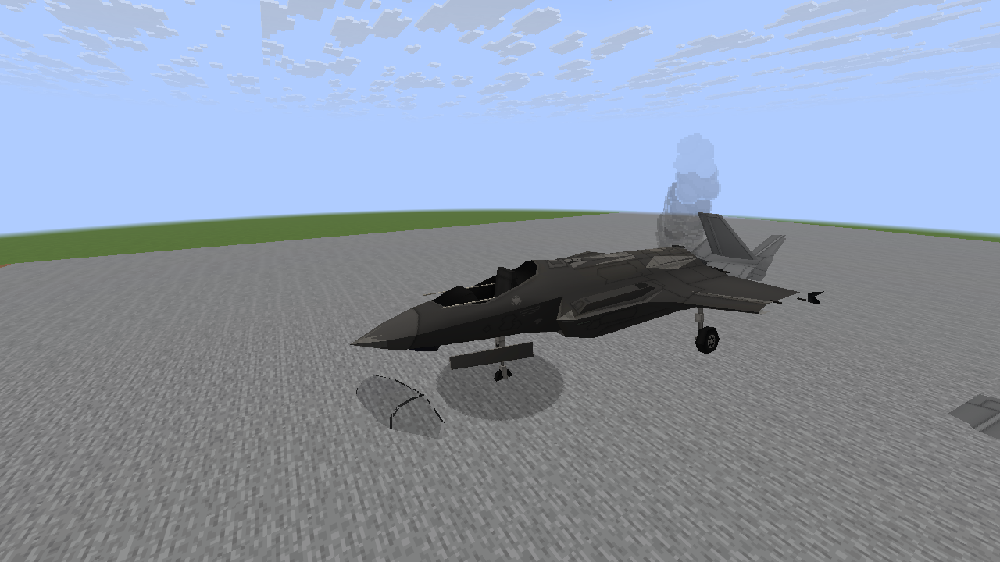

### F-15E

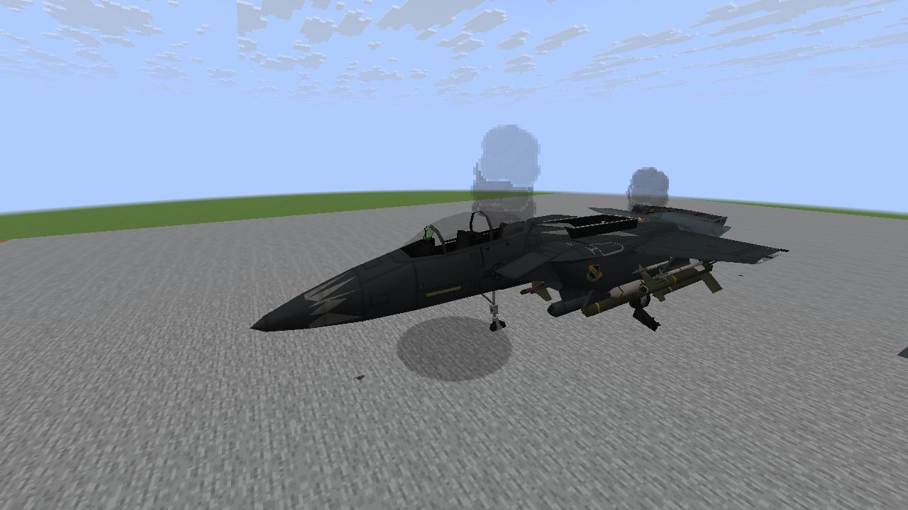

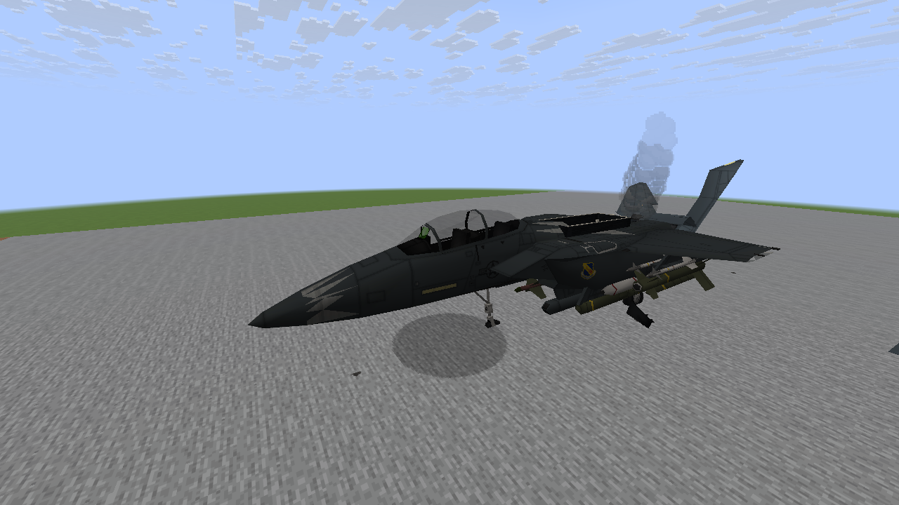

### A-10

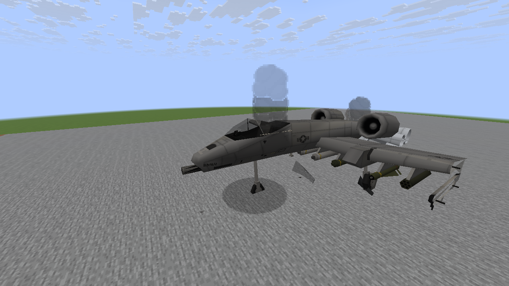

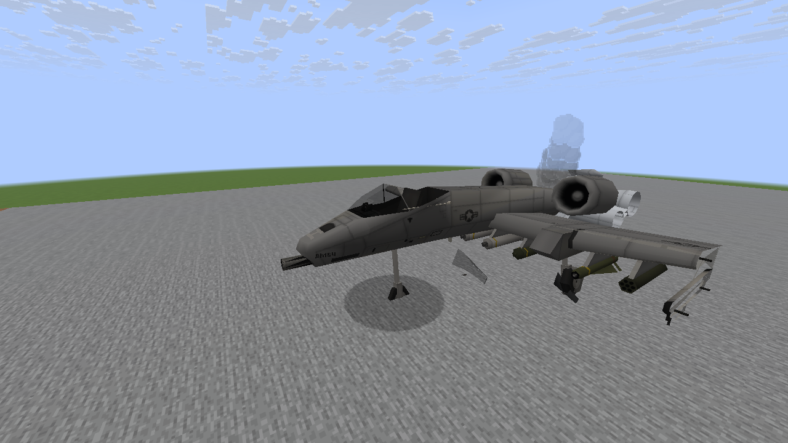

## Ground-contact rotor damage

Controlled tipped wrecks make real swept rotor-tip contacts with the ground. The rotors visually slow and stop. Unarmed MH-6 produces no ammunition bursts. OpenGL is used for this family; the other two use Vulkan.

### AH-64

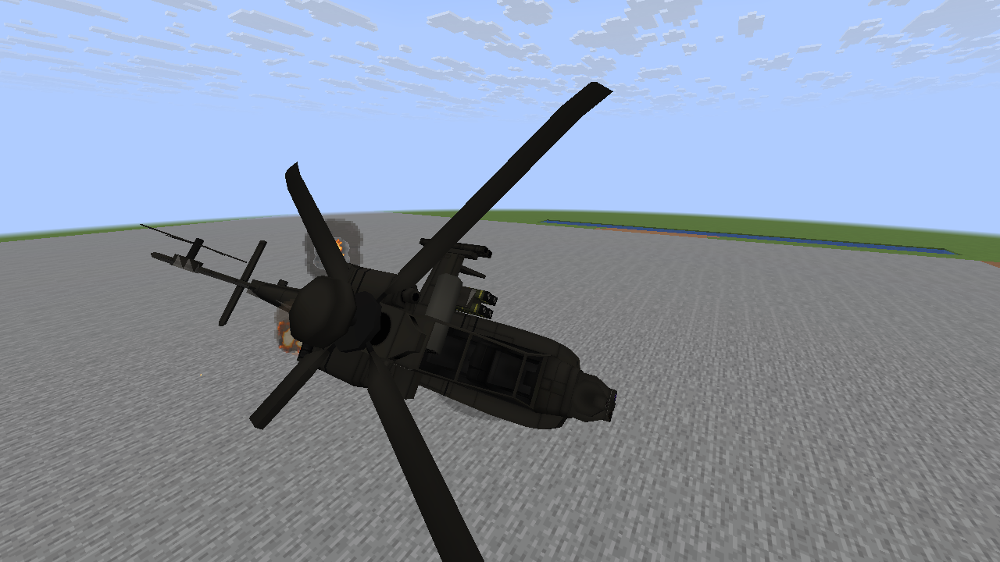

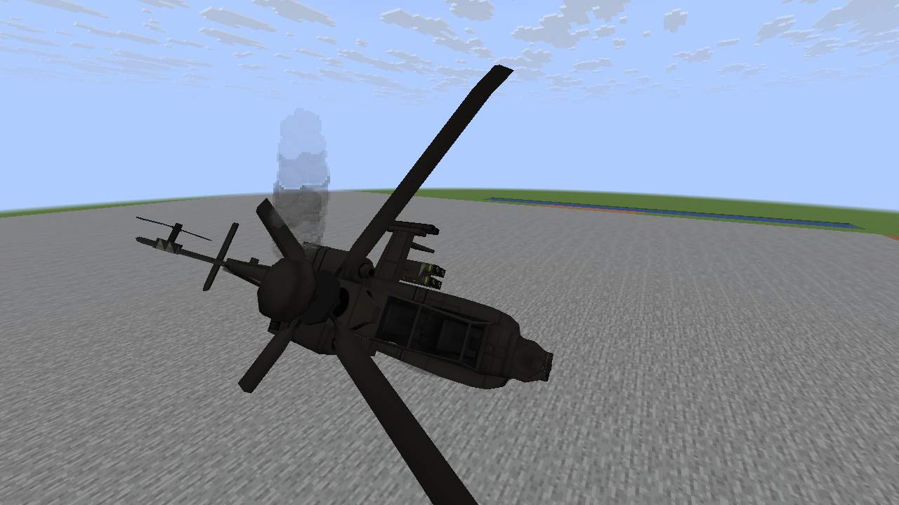

### MH-60L DAP

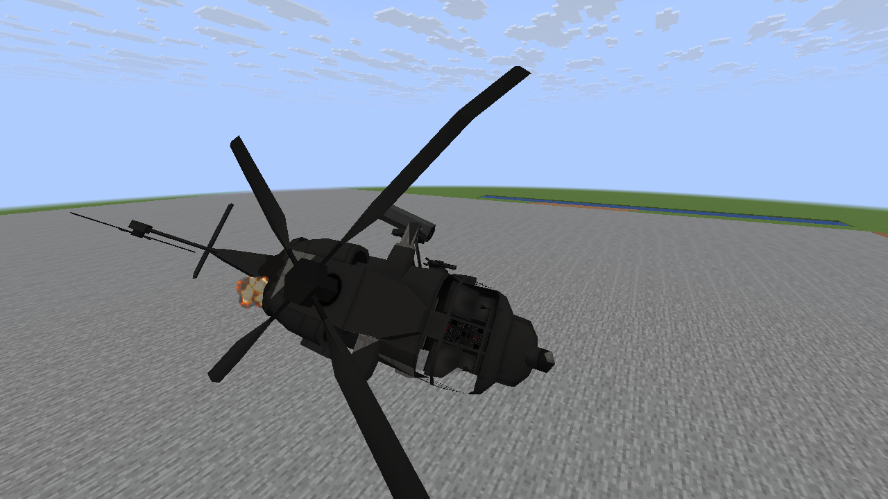

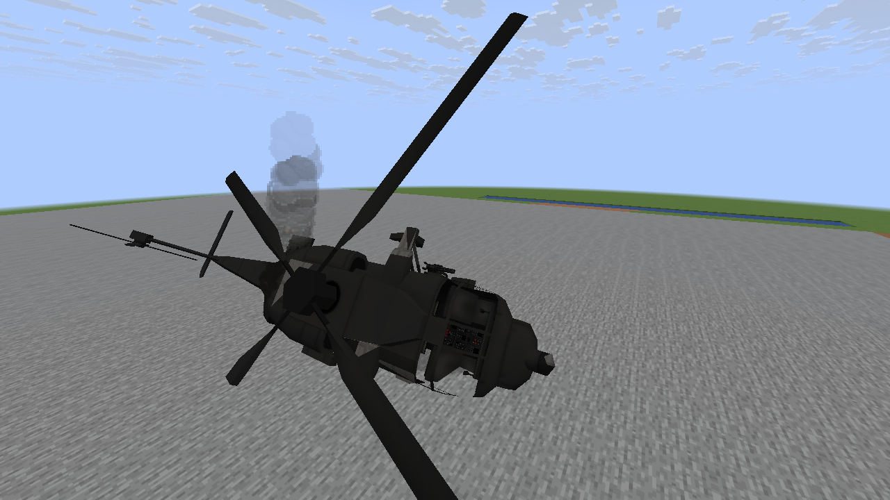

### MH-6

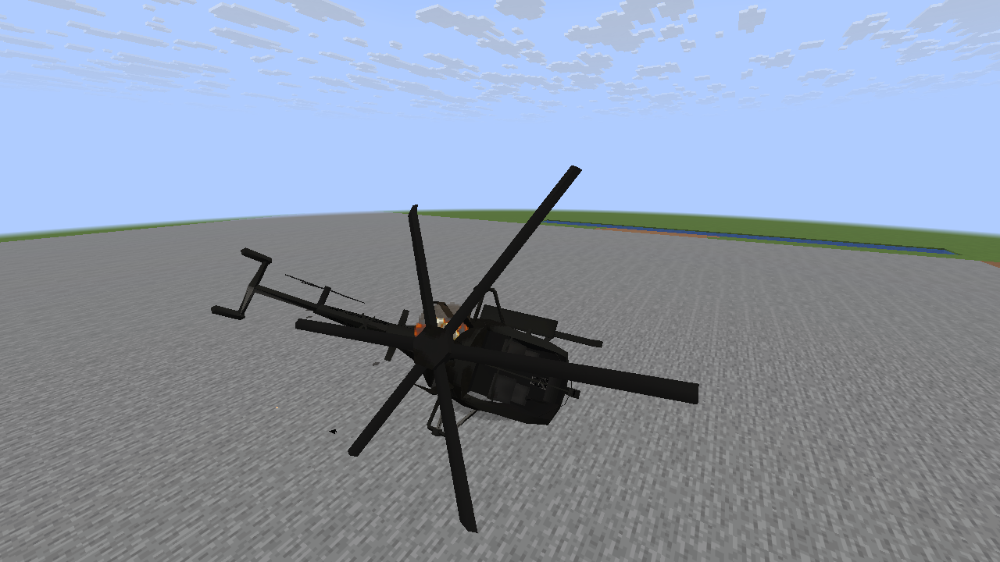

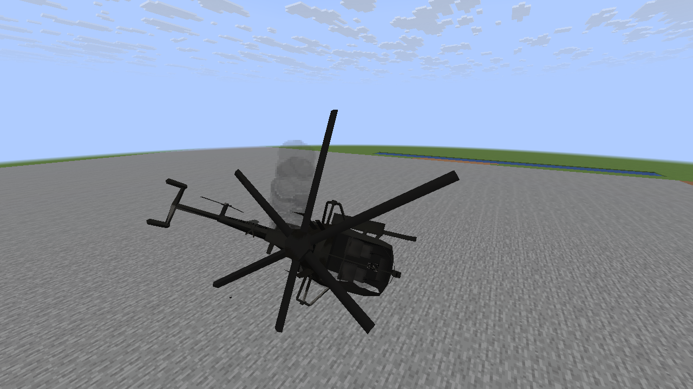
