# Vehicle destruction examples

Unedited native Vulkan captures of stock vehicles, using production emitters and debris motion.
These are held client wreck/repair fixtures, not actual server crash captures. The interior views
move closer to the opened machinery; other stages use the wider camera. Smoke and fire keep moving
between captures. Click an image for its full 1280×720 size.

## T-90

| Opening rupture | Fire-lit interior |
| --- | --- |
| 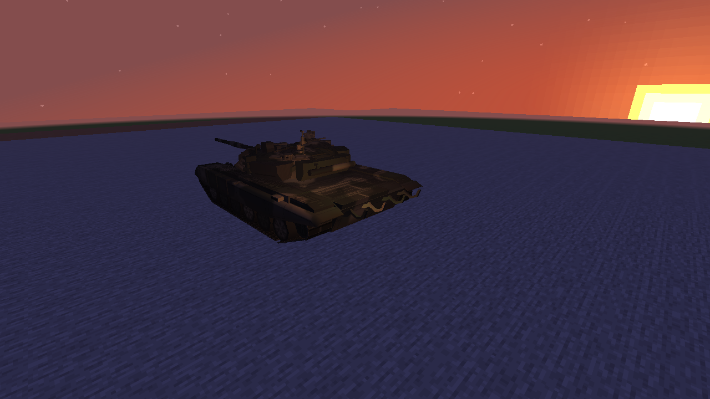 | 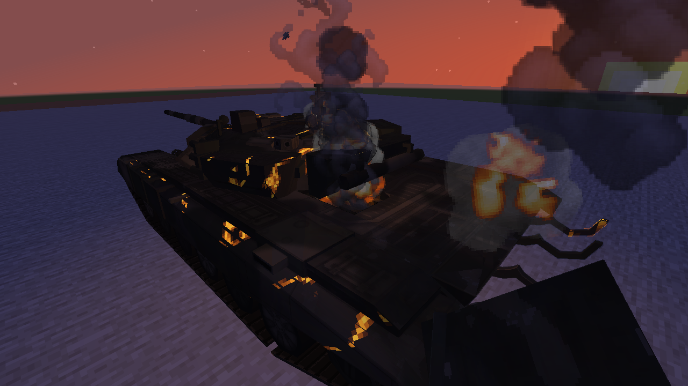 |

| Ammunition pop | Settling and ground dust |
| --- | --- |
| 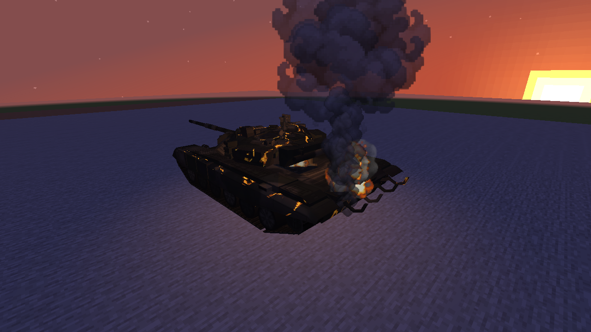 | 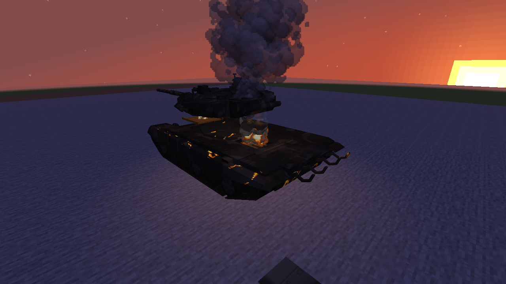 |

The tank fixture deliberately uses a seed and conventional ammunition load eligible for the existing
rare turret-ejection sequence. This does not make every tank eject its turret.

## AH-64

| Opening rupture | Fire-lit interior |
| --- | --- |
| 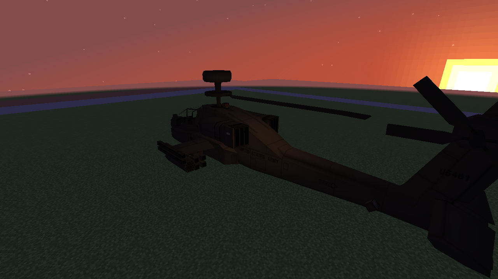 | 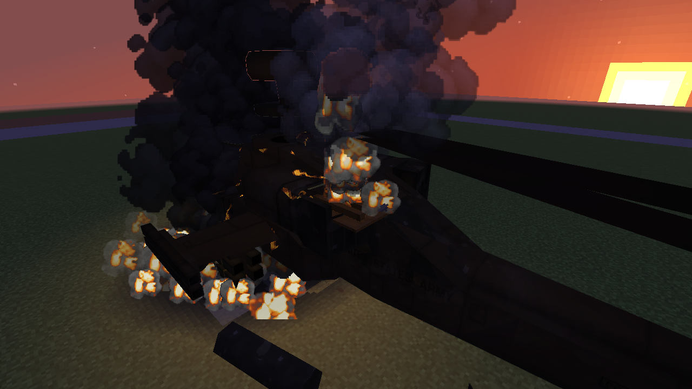 |

| Secondary pop | Settling and ground dust |
| --- | --- |
| 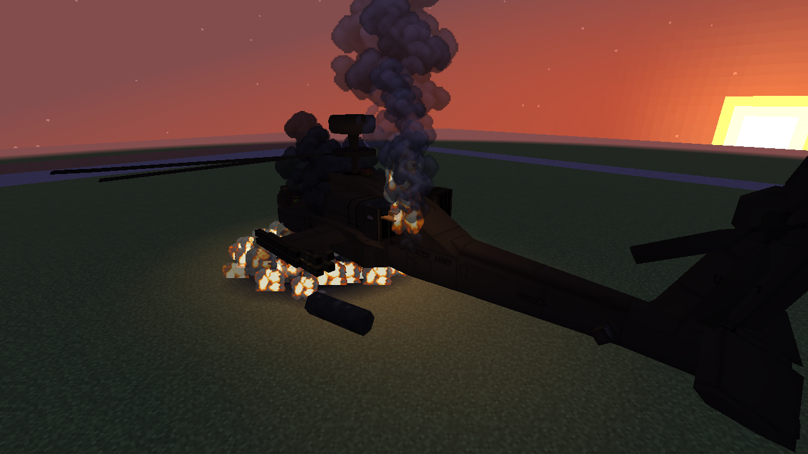 | 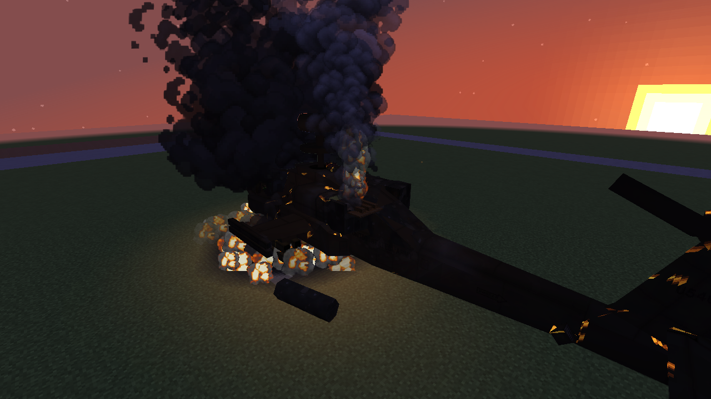 |

## F-35

| Opening rupture | Fire-lit interior |
| --- | --- |
| 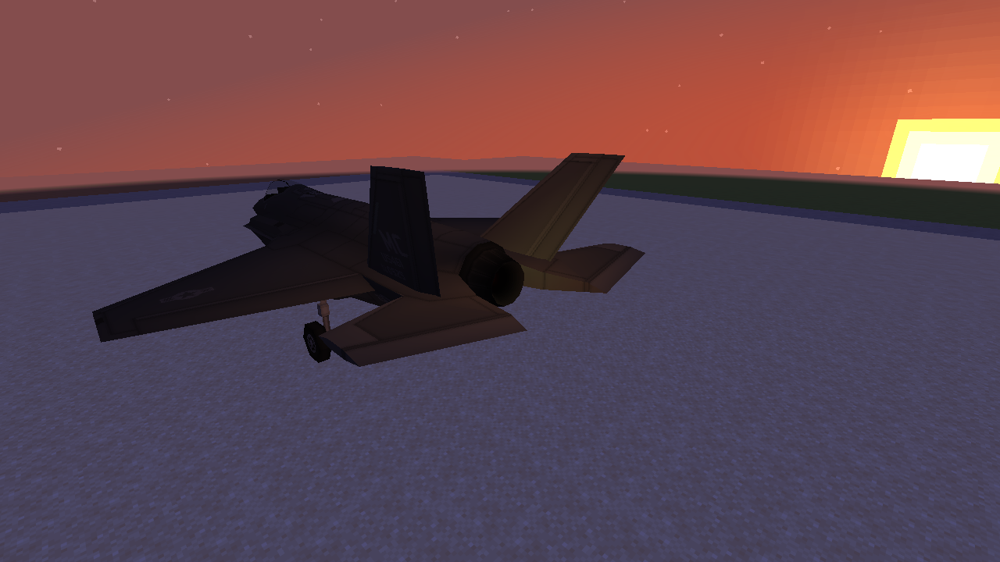 | 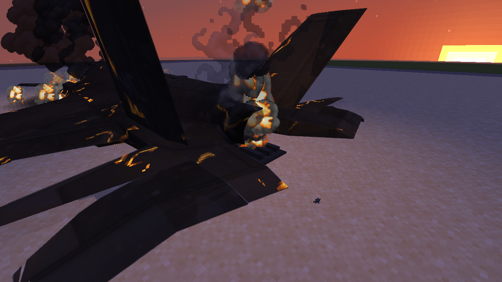 |

| Secondary pop | Settling and ground dust |
| --- | --- |
| 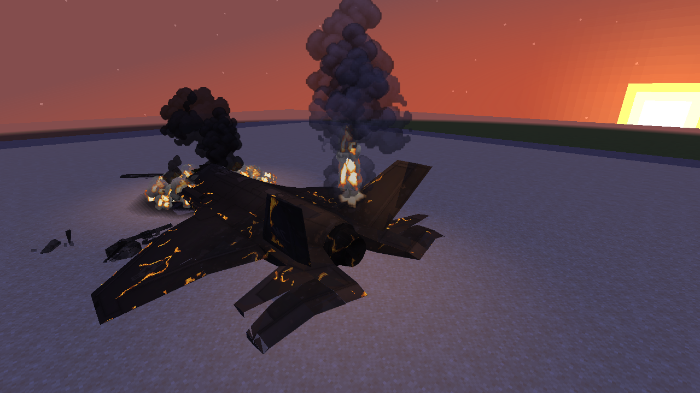 | 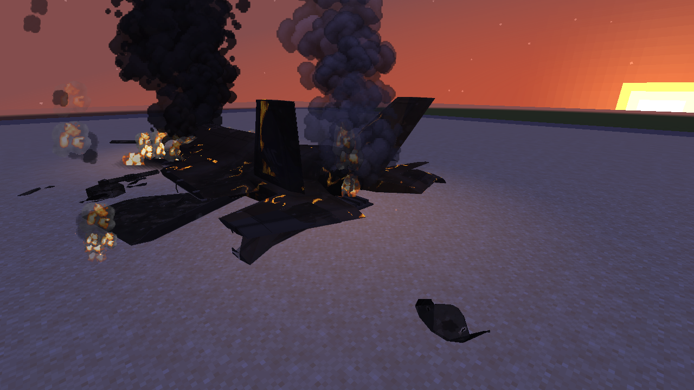 |

The existing main rear fuselage remains attached; recognizable smaller parts can still separate.

[Behavior, controls and performance limits](M8_DRAMATIC_DESTRUCTION.md).
