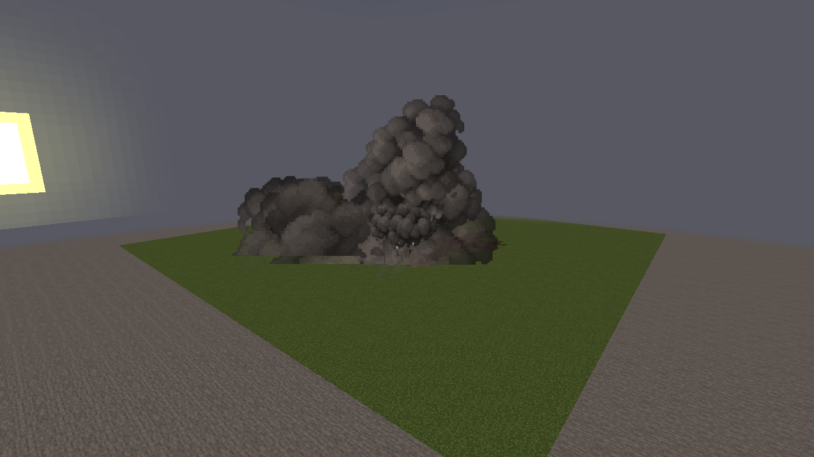
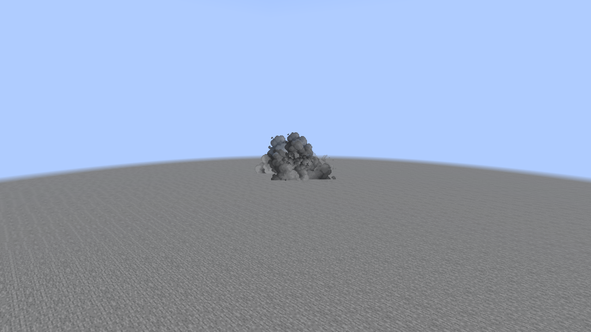
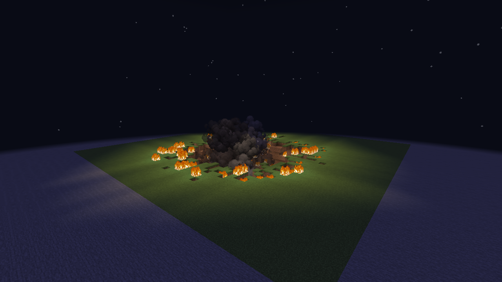
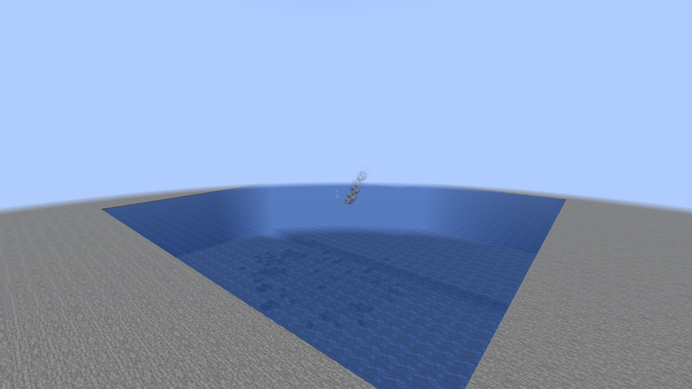
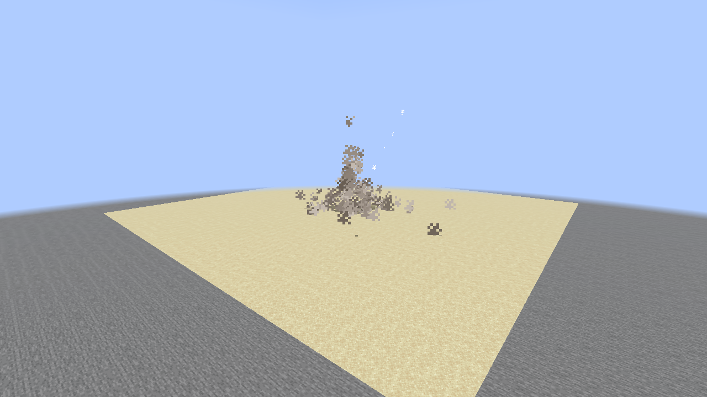
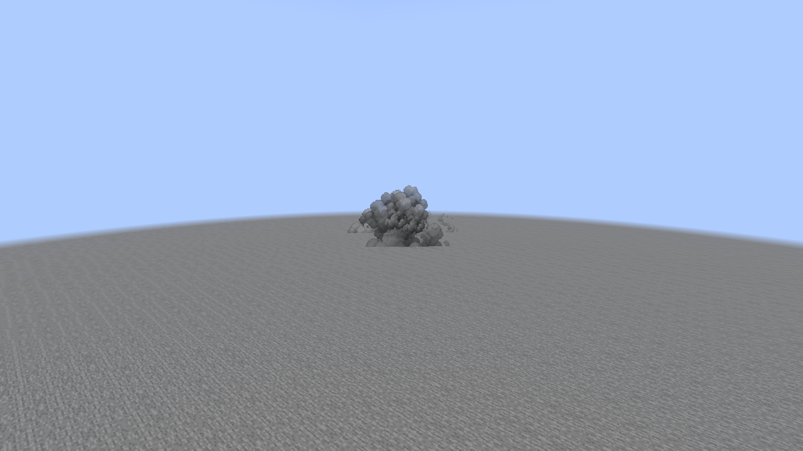
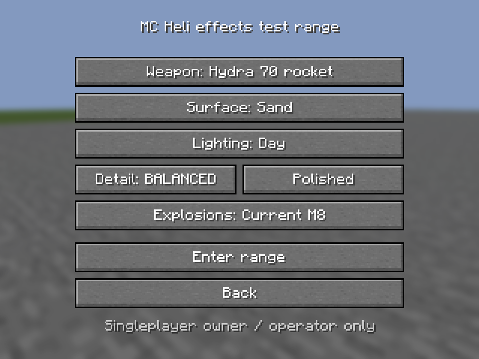
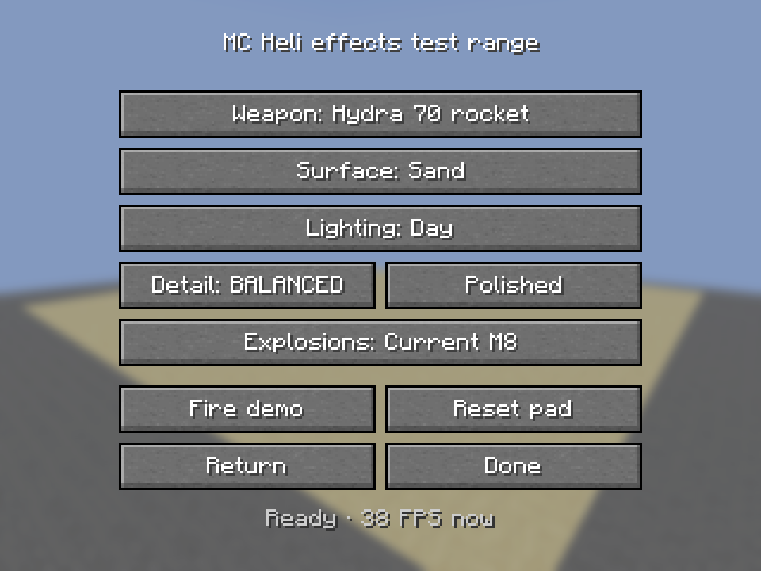

# Effects test range: real impacts

Unedited captures of real production projectiles detonating on the temporary range pads.
The exterior Vulkan views use the same observation position and 60° FOV at 1280×720, with
Balanced / Polished / Current M8 effects. Smoke frames are taken 24 client ticks after the
projectile disappears; these stills do not necessarily capture the brief peak flash.
The different apparent sizes and crater shapes come from the existing weapon definitions.

## Hydra 70 rocket — sand, daylight

## AGM-158 JASSM — soil, dusk

## Mk 82 bomb — stone, daylight

## GBU-57 penetrator — soil, night

## Water and presentation checks

These OpenGL scenes use actual impacts as well.

## Player controls

The 960×720 control captures use a 320×240 GUI. Enter/Return, the comparison controls and
reset all fit. The displayed FPS belongs to the software Mesa preview; it does not establish
performance on the requested GPU.

[Controls, isolation and limits](M8_EFFECTS_TEST_RANGE.md). The native run also verifies return
to the original position/mode and that range lighting leaves the original world's clock alone.
