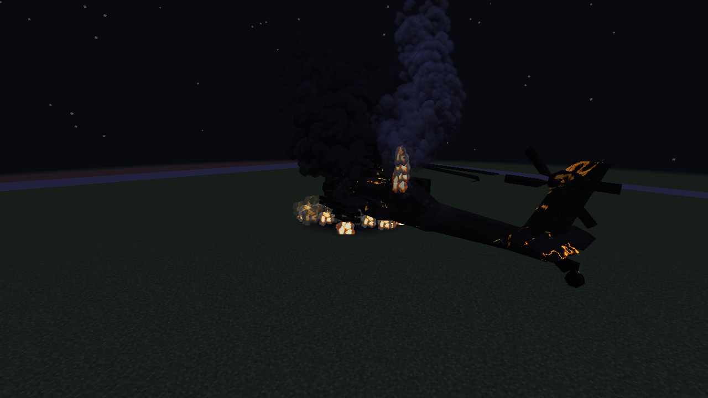
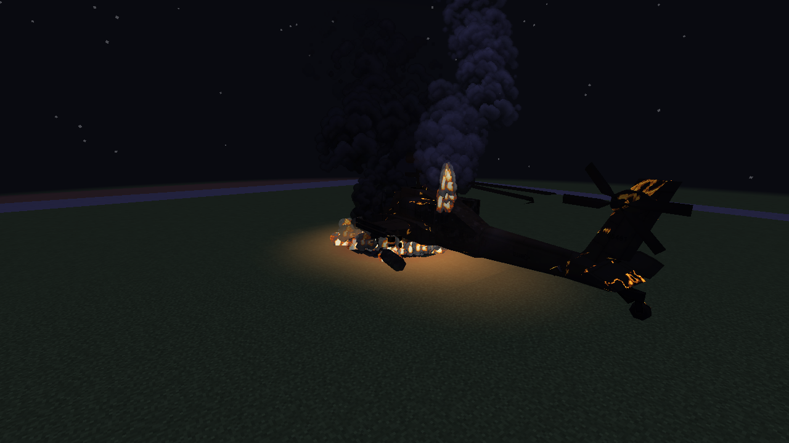
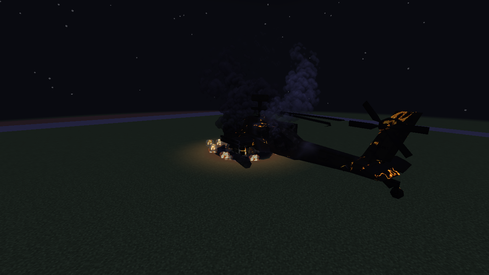
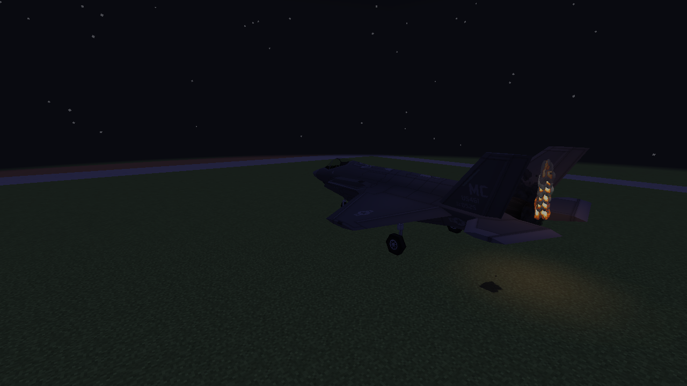
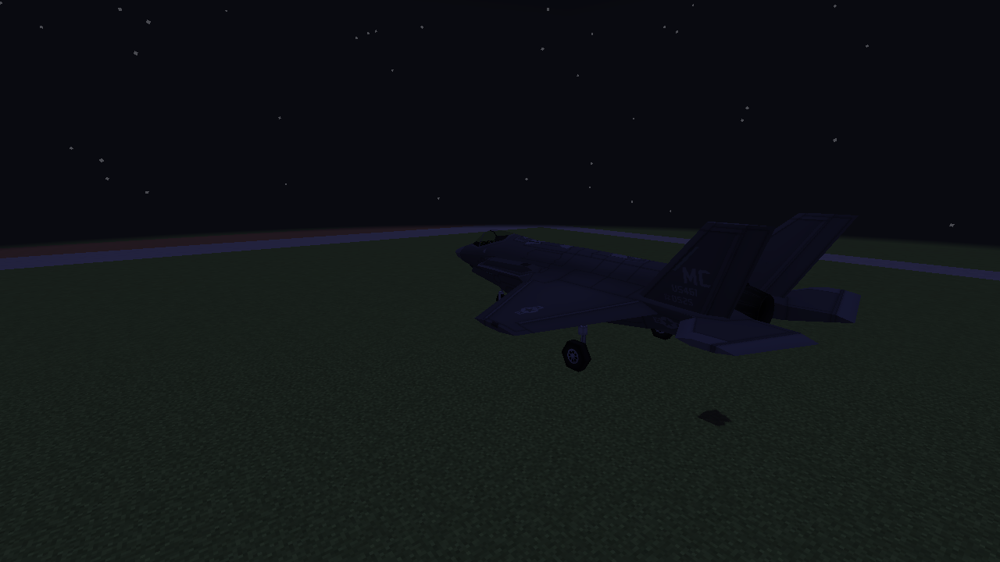
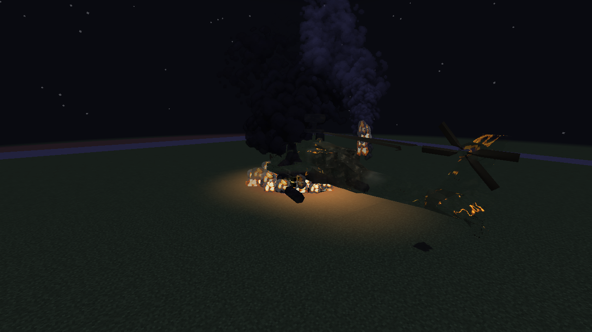
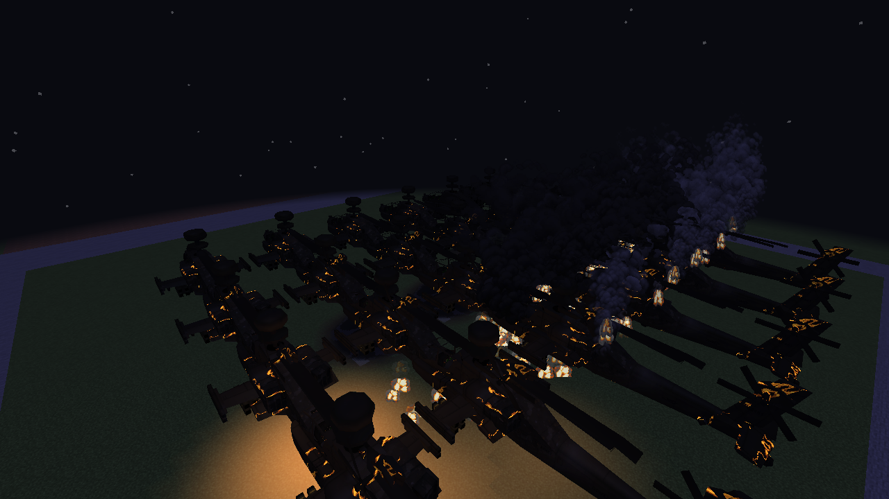
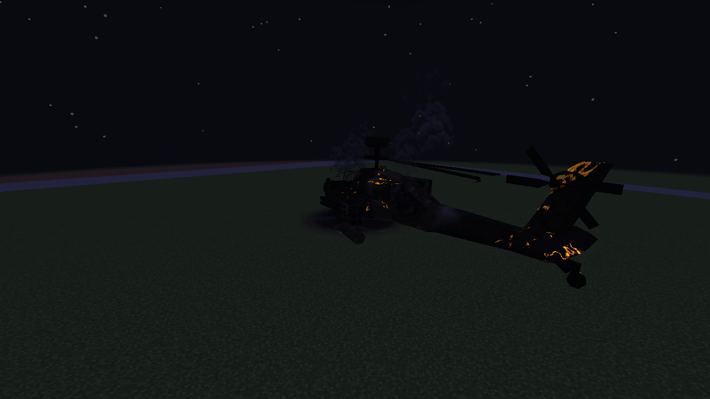

# Fire lighting examples

Unedited 1280×720 Vulkan screenshots from controlled client HP/wreck states, using real stock
vehicle models and the production fire emitters. These are lighting fixtures, not server crash
captures. The smoke/flame animation continues normally between scenes.

## AH-64 at night

| Realistic Lighting off | Realistic Lighting on |
| --- | --- |
|  |  |

Two main sources illuminate the fresh wreck: its hull fire and its fuel pool. Small nearby flame
sprites share those lights.

## Fuel still burning after the hull fire ends

The pool keeps its own light after the shorter hull fire ends.

## Damaged engine and repair

| F-35 engine burning | F-35 after repair |
| --- | --- |
|  |  |

## Compatibility renderer and shared load

| GPU model buffers disabled | 24 wrecks sharing the existing budgets |
| --- | --- |
|  |  |

The compatibility renderer uses a local lightmap lift; directional amber vehicle lighting remains
on the GPU path. The load check also deliberately fills all 96 source slots before ignition to
verify weaker flame lights can be evicted for the main fires.

## Cooled wreck

Smoke can linger after the fuel burns out. It does not keep emitting light.

See [implementation and limits](M8_FIRE_LIGHTING.md). These software-renderer checks do not measure
the 60 FPS target on the user's RTX 3060 / Ryzen 7 7800X3D.
