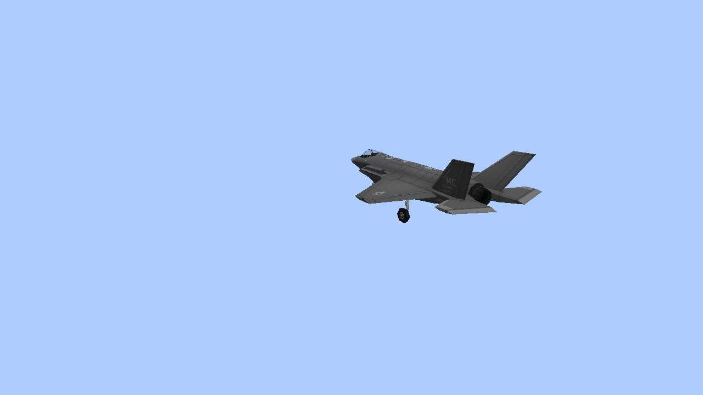
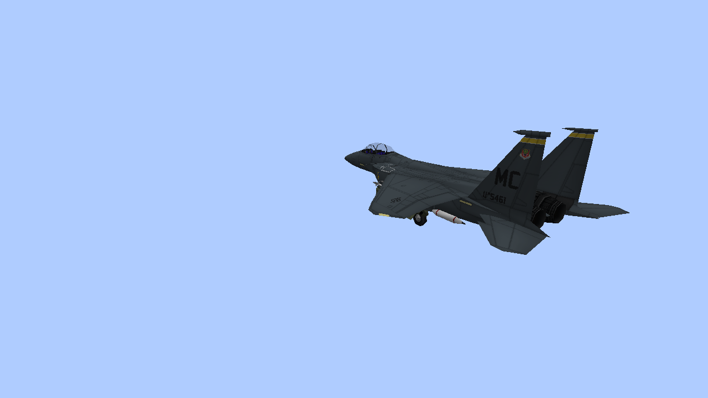
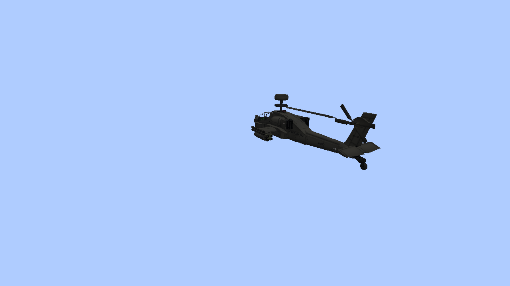

# Flyby audio: native examples

Unedited 1280×720 Vulkan captures of the actual F-35A, F-15E and AH-64 models on controlled
client flyby trajectories. These show the vehicles used to validate audio; sound has no new
visible effect, and these are not AI combat recordings.

[Settings, behavior and admission limits](M8_FLYBY_AUDIO.md).

## F-35A

## F-15E

## AH-64

The engine samples are unchanged. The new original
[rocket air-rush](../src/main/resources/assets/mcheli_ce_port/sounds/m8_rocket_flyby.ogg) and
[shell whizz](../src/main/resources/assets/mcheli_ce_port/sounds/m8_shell_flyby.ogg) are individual
cue files, not recordings of the game's positional mix. They are generated by the checked-in
[audio script](../scripts/generate-flyby-audio.py).

Local playback tests use OpenAL's silent output device with the game master volume enabled.
Human listening and target-PC 60 FPS acceptance are still unmeasured.
