# Aircraft fracture interiors: native examples

Unedited 1280×720 Vulkan captures of held aircraft using production component damage and rendering.
These are controlled client scenes, not combat screenshots. Each plane loses its left wing, is repaired,
then loses its tail; the wreck view follows, then a complete repair.

The added details are small: exposed spars and hanging cables sit at the cut skin. Dark inset
cross-sections appear only where the source mesh supplies closed contours. Open wing contours on
the F-35A and F-15E retain their openings rather than acquiring a fabricated wall. Existing fuel
spray, smoke and fire remain visible. [Implementation and limits](M8_FRACTURE_INTERIORS.md).

## F-35A

Left-wing loss: overall silhouette

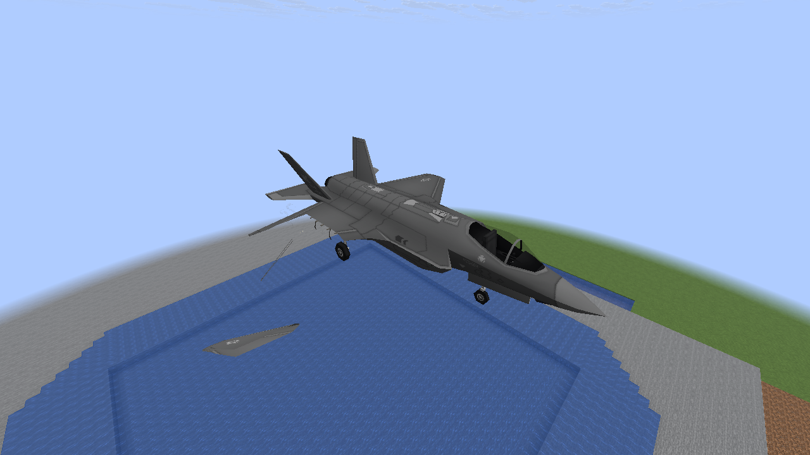

Wing cut: exposed spars and cables

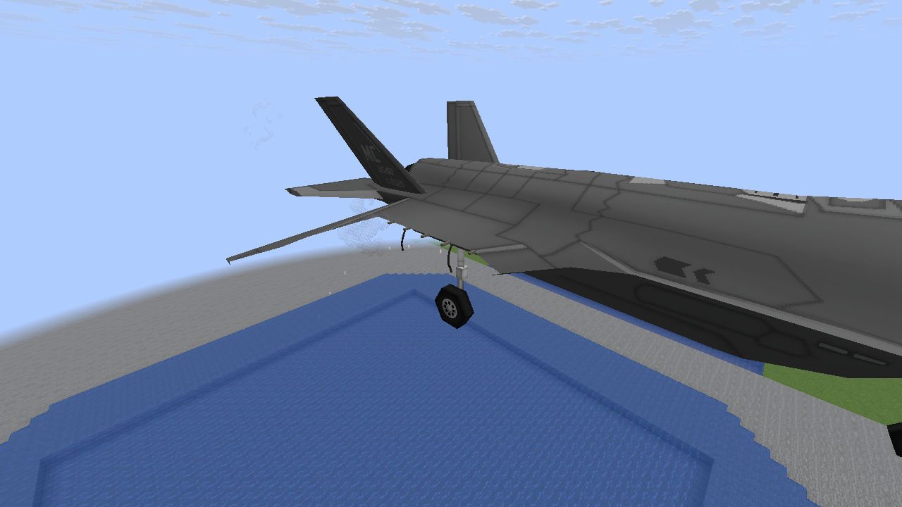

Tail cut: recessed interior

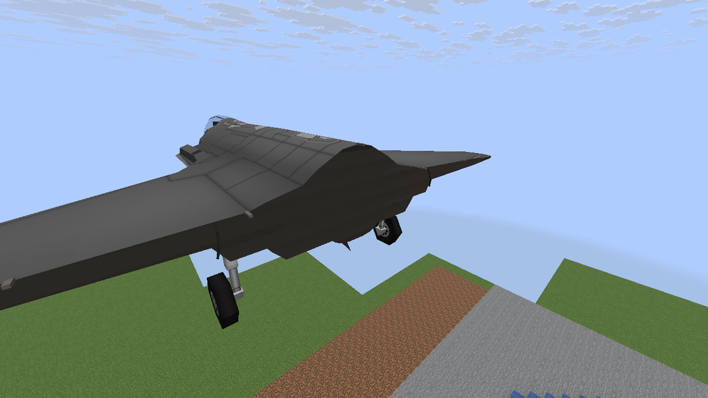

Wreck stage with existing fire

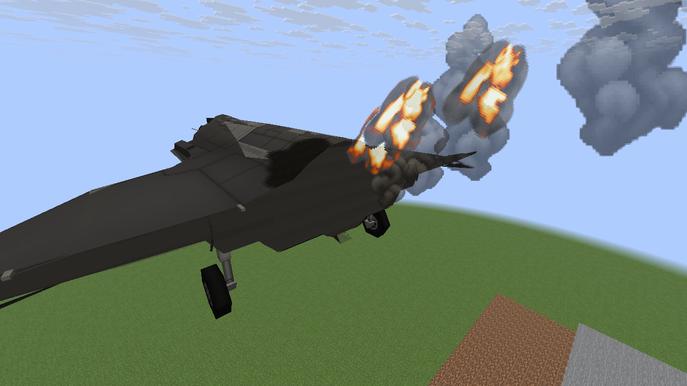

Repaired aircraft

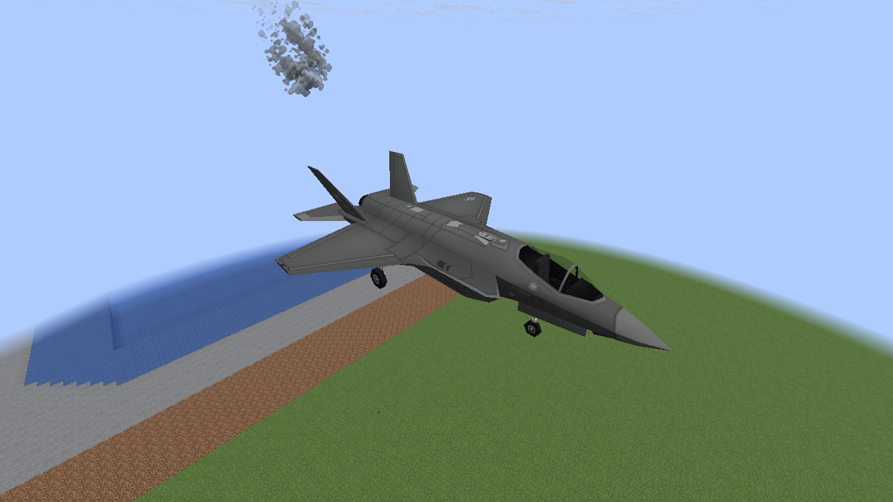

## F-15E

Left-wing loss: overall silhouette

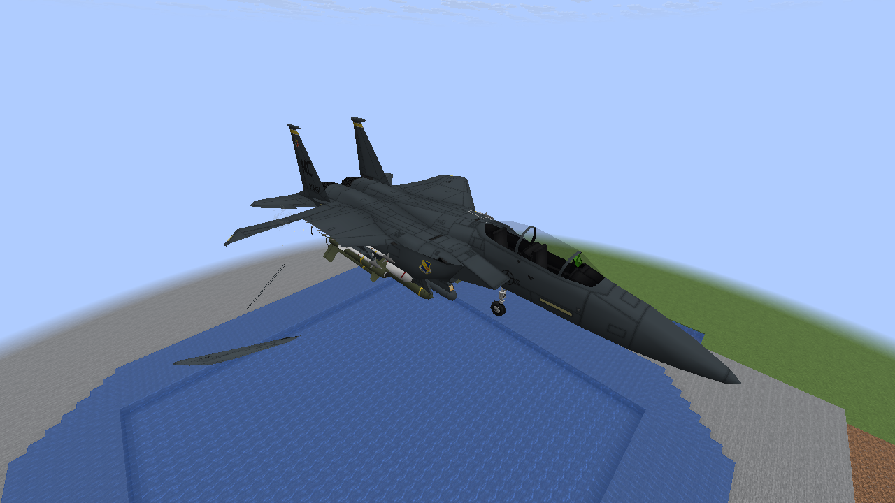

Wing cut: exposed spars and cables

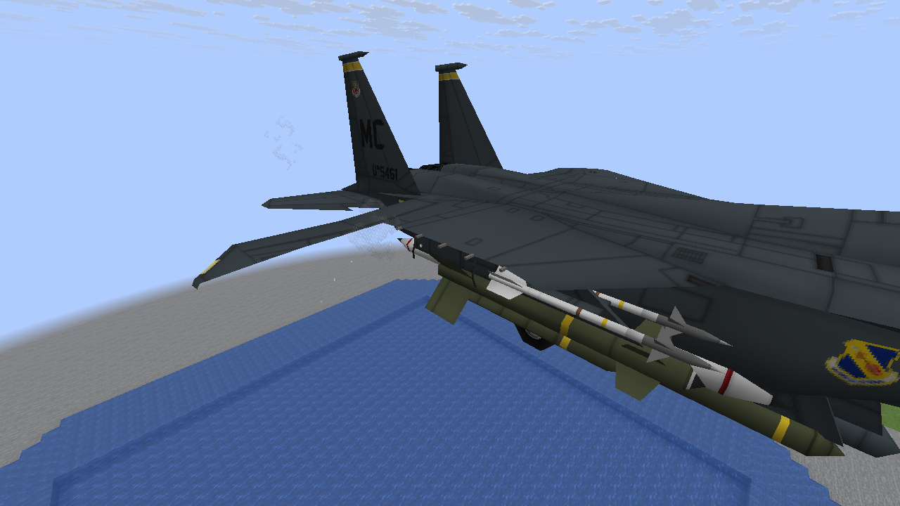

Tail cut: recessed interior

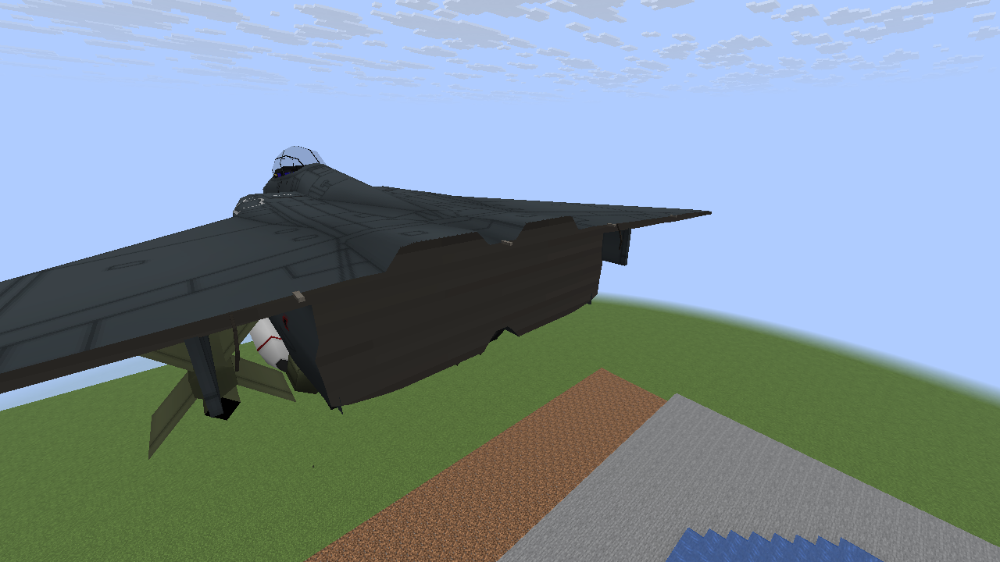

Wreck stage with existing fire

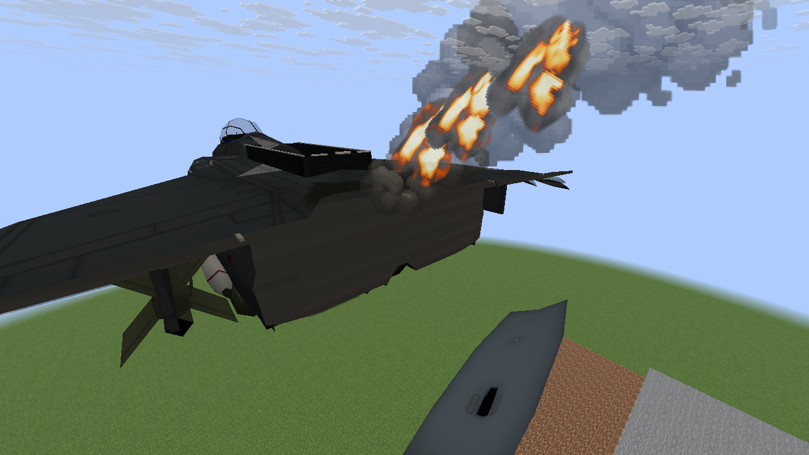

Repaired aircraft

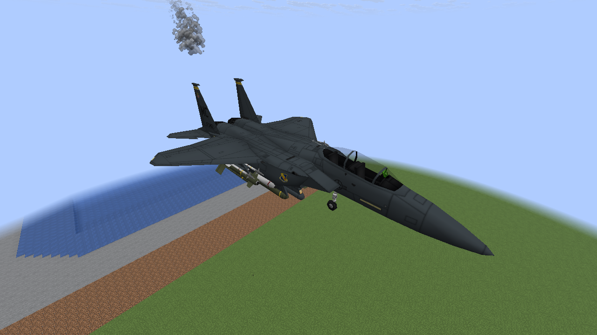

## A-10

Left-wing loss: overall silhouette

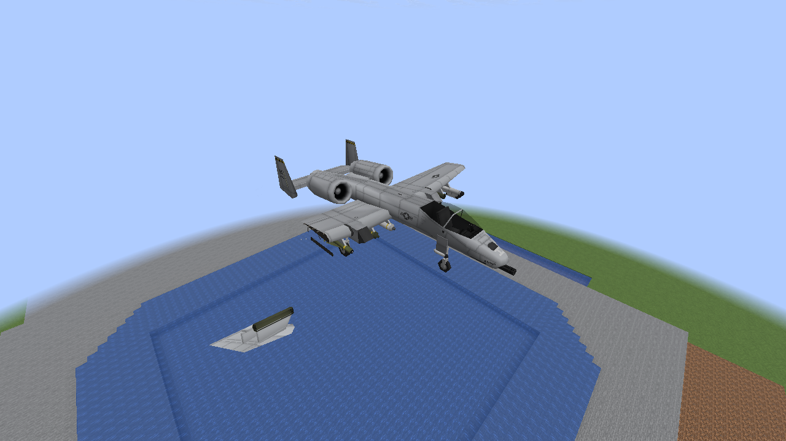

Wing cut: exposed spars and cables

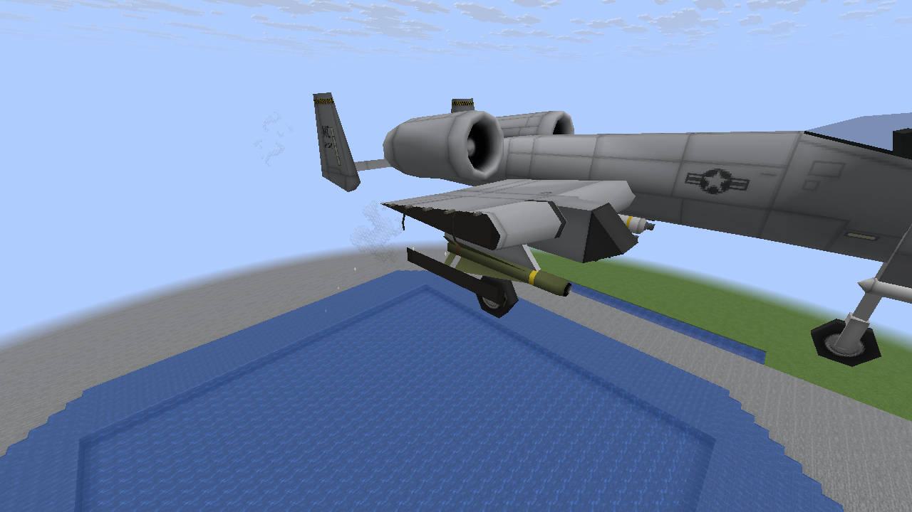

Tail cut: recessed interior

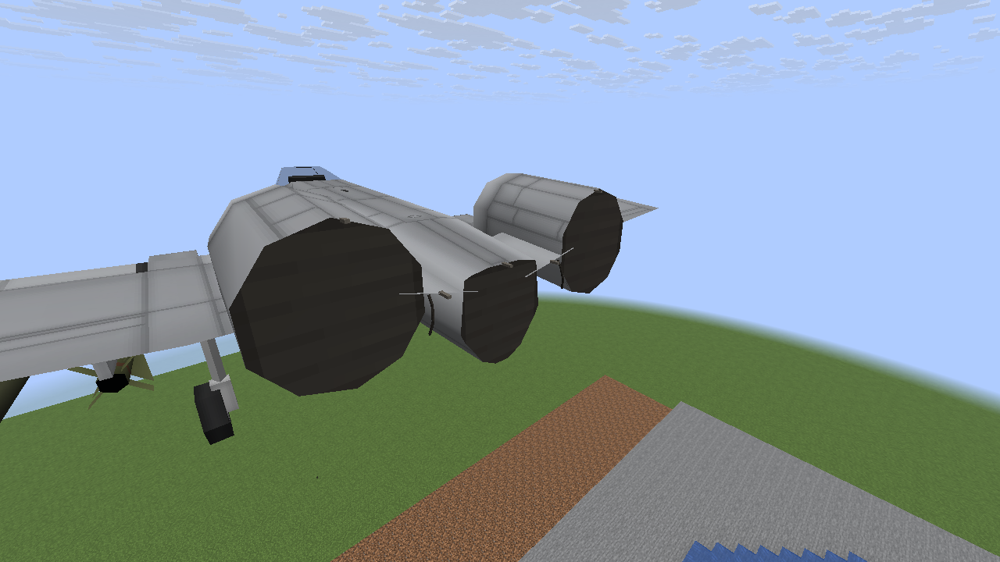

Wreck stage with existing fire

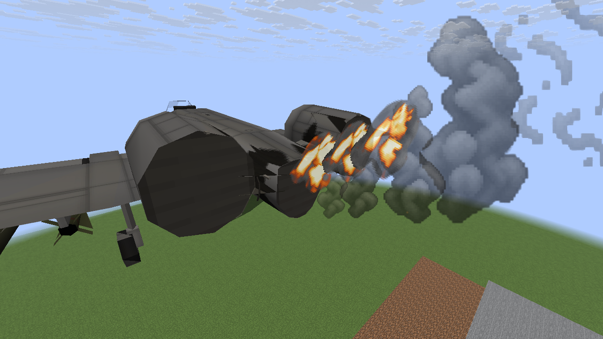

Repaired aircraft

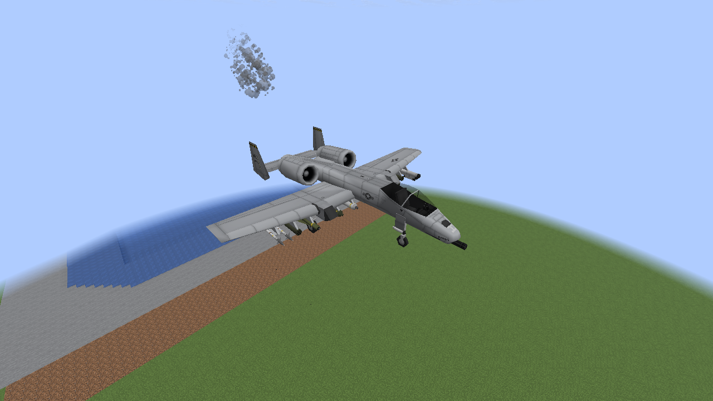

## Classic comparison

Left-wing loss: overall silhouette

## Damage details disabled

Left-wing loss: overall silhouette

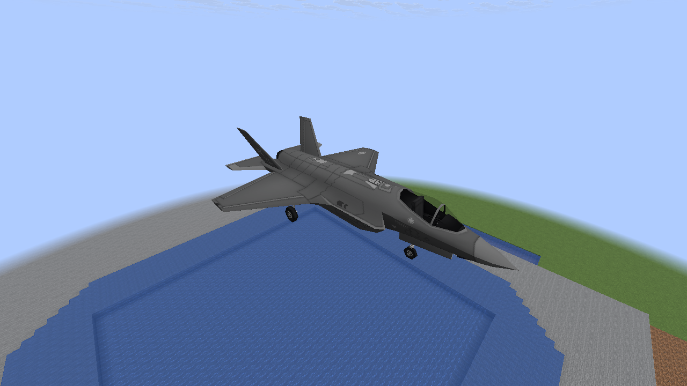

## 32-aircraft shared load

Left-wing loss: overall silhouette

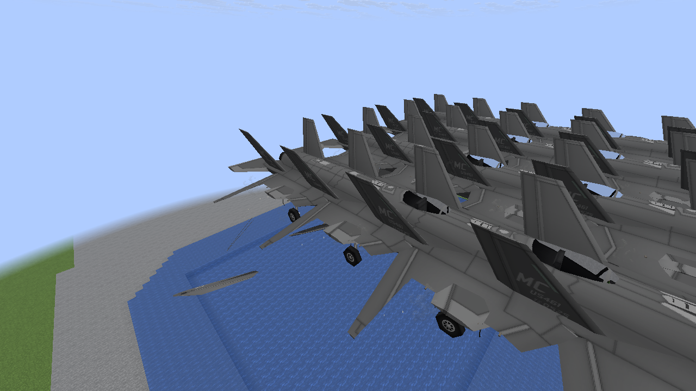

Software Mesa validation checks rendering and bounds; it does not establish target-PC 60 FPS.
