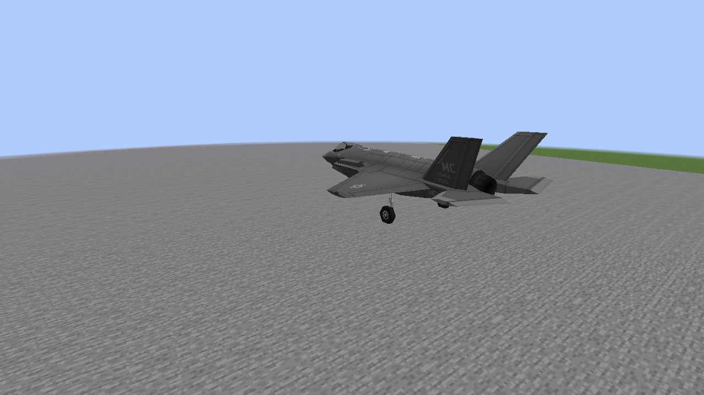
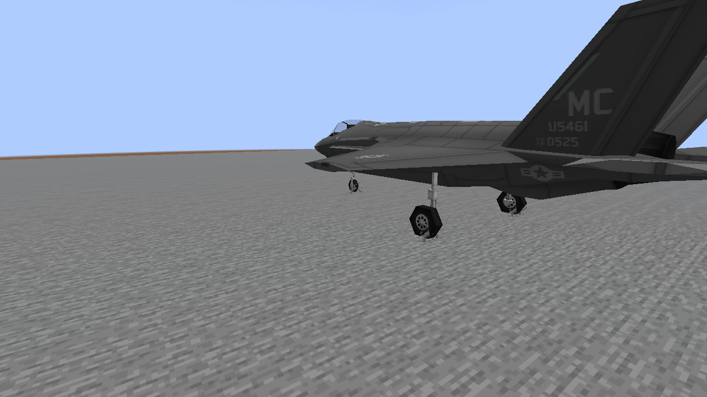
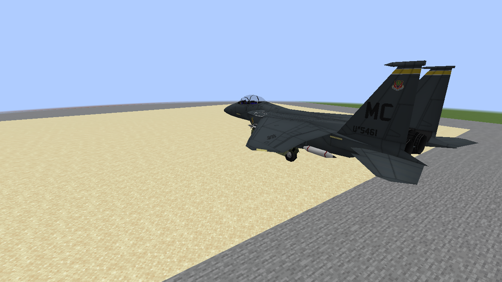
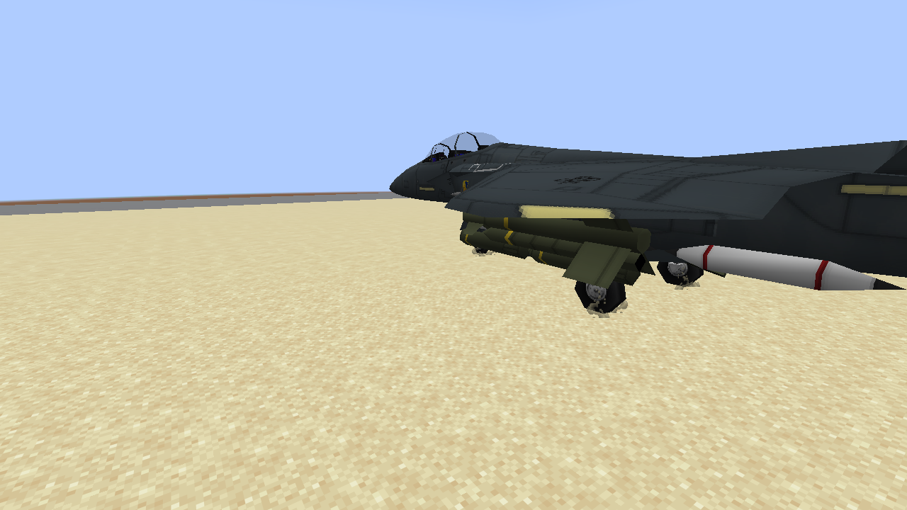
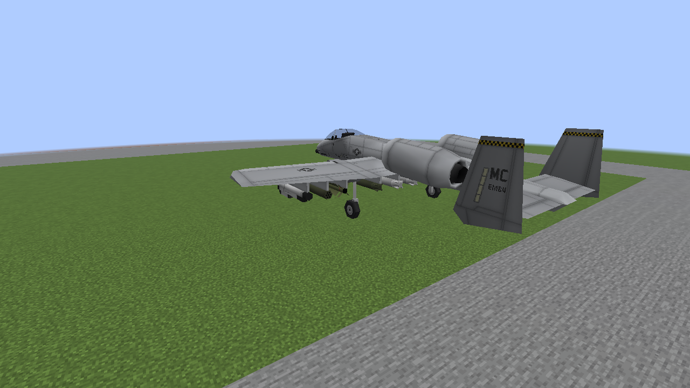
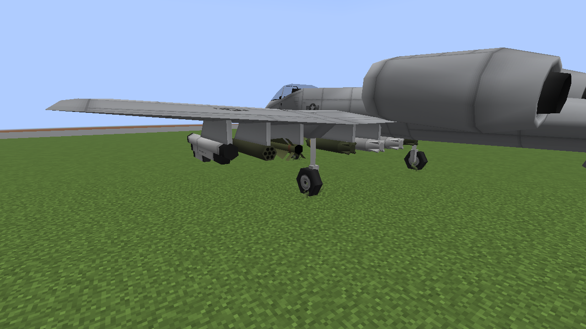

# Landing feedback: native examples

Unedited 1280×720 Vulkan captures of actual aircraft on controlled landing trajectories.
Wide views show each vehicle; closer views show the brief, restrained tire/dust wisps.
These are client test fixtures over real terrain, not recordings of piloted landings.

[Settings, support and limits](M8_LANDING_FEEDBACK.md).

## F-35A on pavement

## F-15E on sand

## A-10 on grass

The effect changes existing gear poses and uses the existing wisps atlas. Compression is
restrained and is easier to read in motion; these images are not a before/after physics comparison.
