# Live airborne wing and tail breakup

Twelve unedited 1280×720 screenshots from Minecraft’s Vulkan renderer (Mesa llvmpipe).
These are **controlled airborne damage previews**, not combat captures. Aircraft move along a
fixed path above the ground; component health is set explicitly to show each failure. The
production renderer and falling mesh debris run normally. Actual projectile/blast damage,
hull survival, saving/loading and repair are checked by the separate server GameTests.
No image generation, compositing, cropping or recoloring was used.

All damaged aircraft shown here still have **60% hull HP**. Left and right loss are separate
states with a repair between them. The final view combines right-wing and tail loss while
the aircraft is alive. Small separated pieces visible beside/below the model are tumbling
debris. This pass changes structural visuals; flight handling stays unchanged.
[Damage rules, settings and model limits](M8_LIVE_AIRFRAME.md).

## F-35A

| Intact | Left wing lost |
| --- | --- |
| 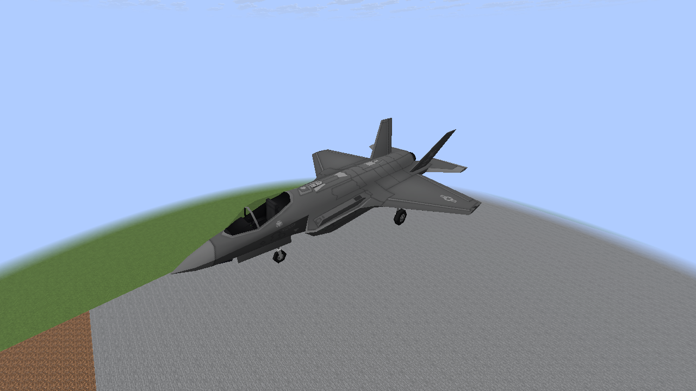 | 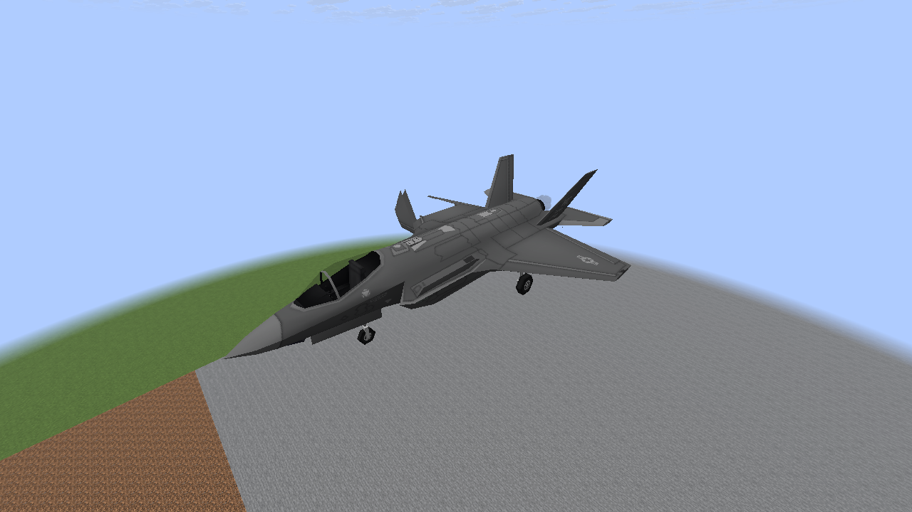 |

| Right wing lost | Right wing and tail lost, still alive |
| --- | --- |
| 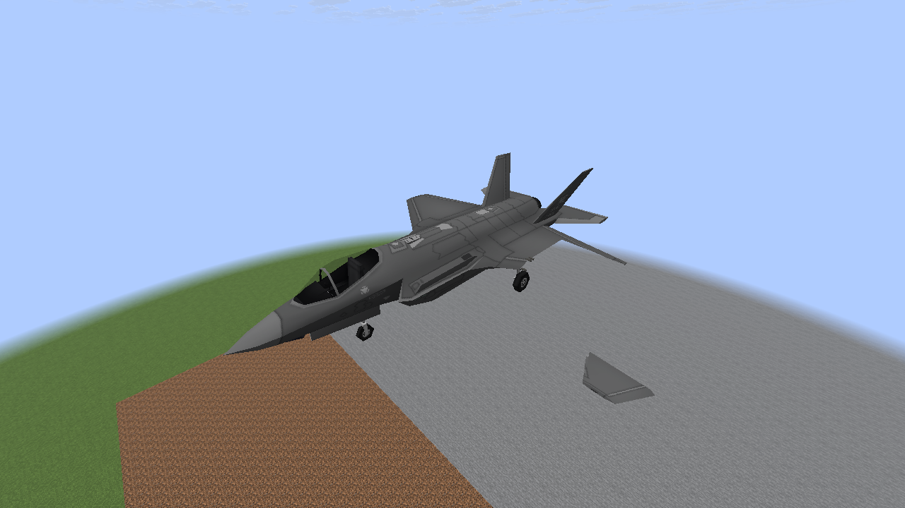 | 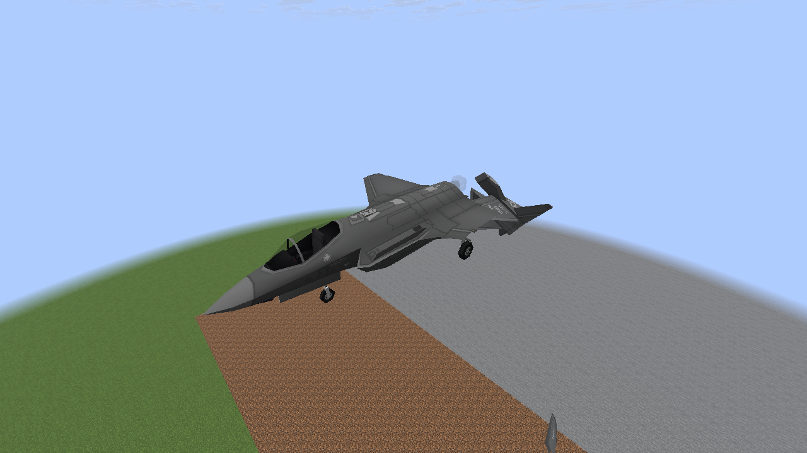 |

## F-15E

| Intact | Left wing lost |
| --- | --- |
| 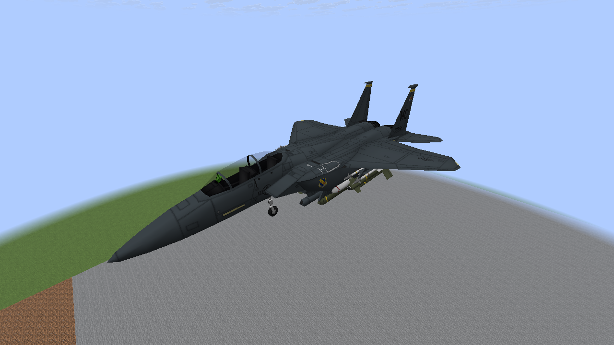 | 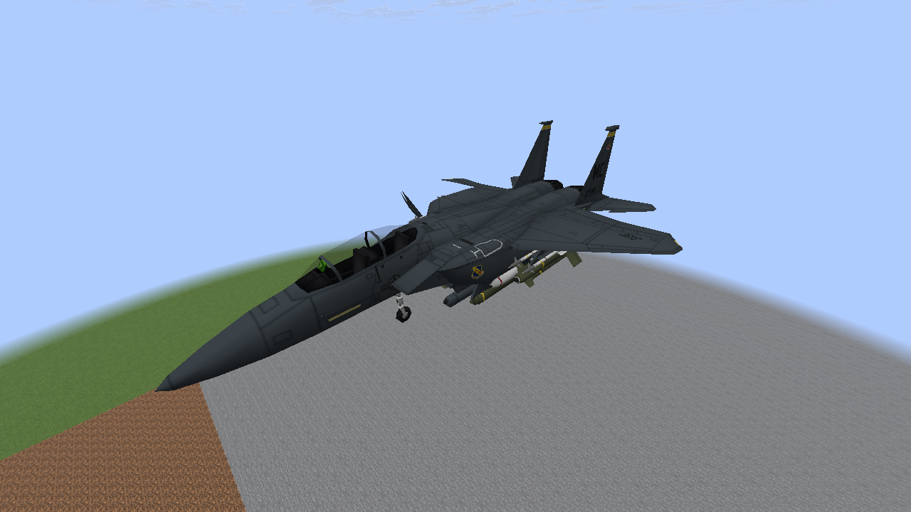 |

| Right wing lost | Right wing and tail lost, still alive |
| --- | --- |
| 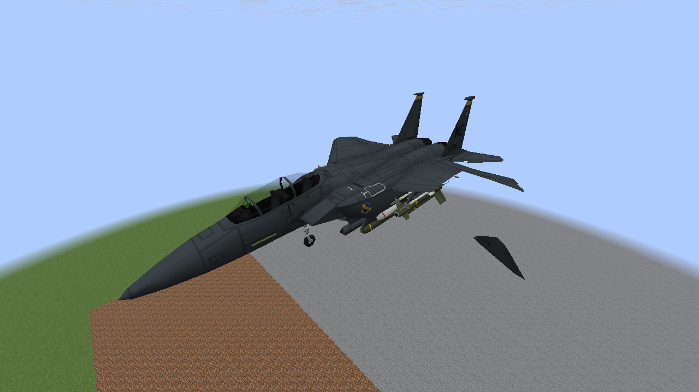 | 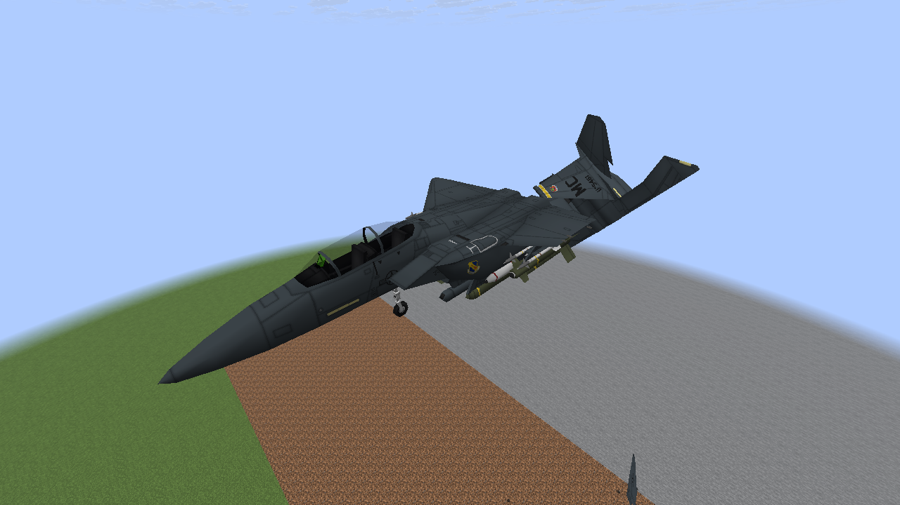 |

## A-10

| Intact | Left wing lost |
| --- | --- |
| 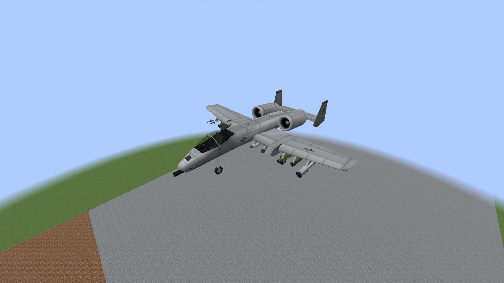 | 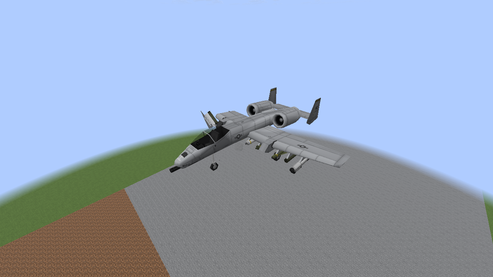 |

| Right wing lost | Right wing and tail lost, still alive |
| --- | --- |
| 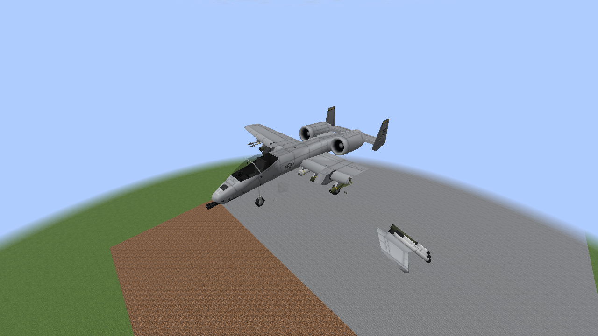 | 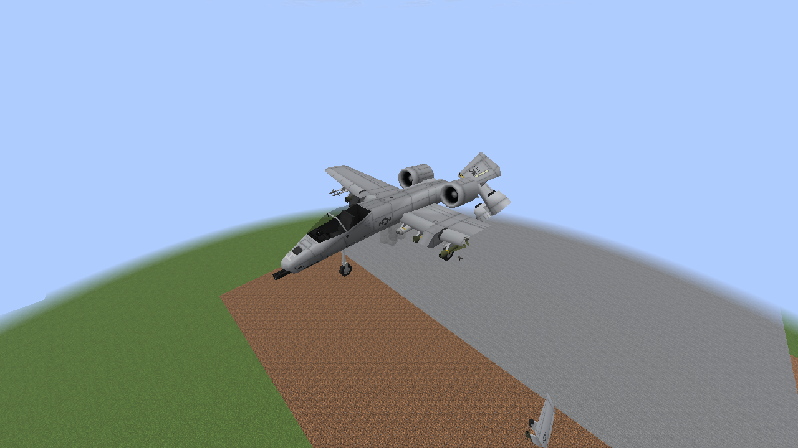 |

The full three-aircraft run passed nine live failure checks, six repair checks, three
destruction-toggle cleanups and three transitions into wrecks without regrowing lost parts.
The A-10 was captured again with a wider camera to fit its whole span. Software rendering
validates behavior and appearance; the target-PC 60 FPS goal remains unmeasured.
