# Aircraft damage smoke: native examples

Unedited 1280×720 Vulkan captures of real vehicle models under controlled HP and motion.
The aircraft hold 25% hull HP while turning, then repair. These are development fixtures,
not combat recordings. Existing engine-fire particles remain separate from the new cold smoke.

Dense cores use the approved 16-frame billow art; shorter wisps open gaps. Severe damage keeps
its cores between opacity surges. Old smoke stays in world space and drifts with the shared wind.
The remote F-15E reports zero velocity and exercises observed-motion fallback.
[Implementation and bounds](M8_MANEUVER_SMOKE.md).

## F-35A

Early turn

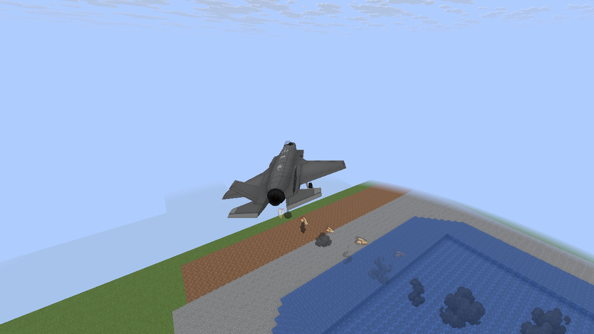

Changing heading

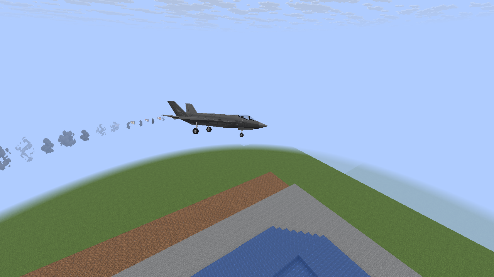

Older billows and dispersing wisps

Repaired: new emission stopped, old smoke drained

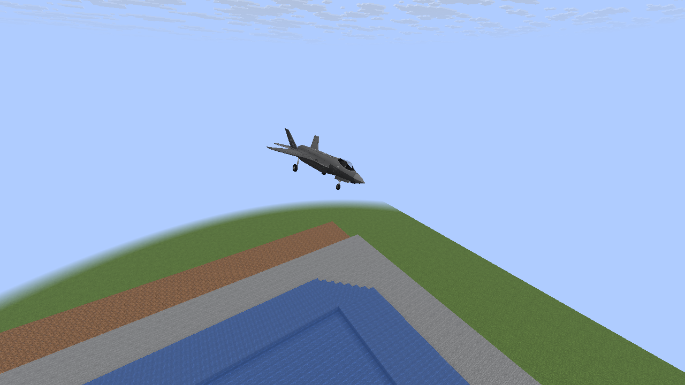

## F-15E with zero reported velocity

Early turn

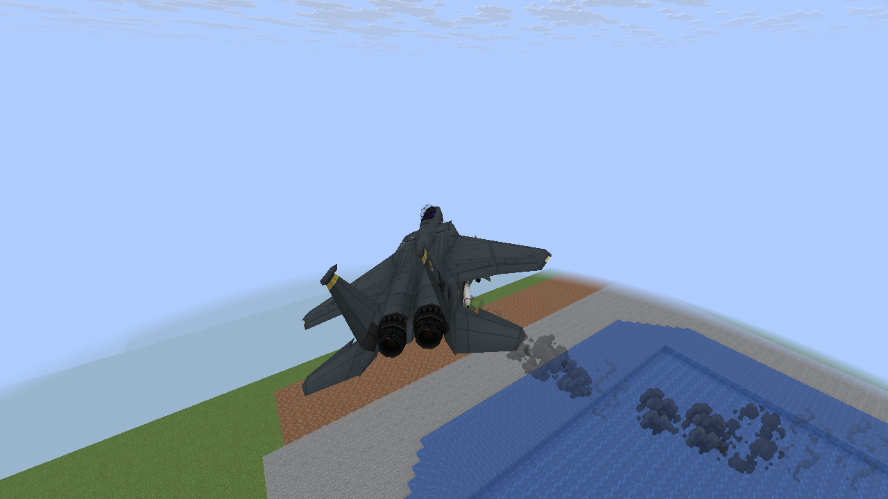

Changing heading

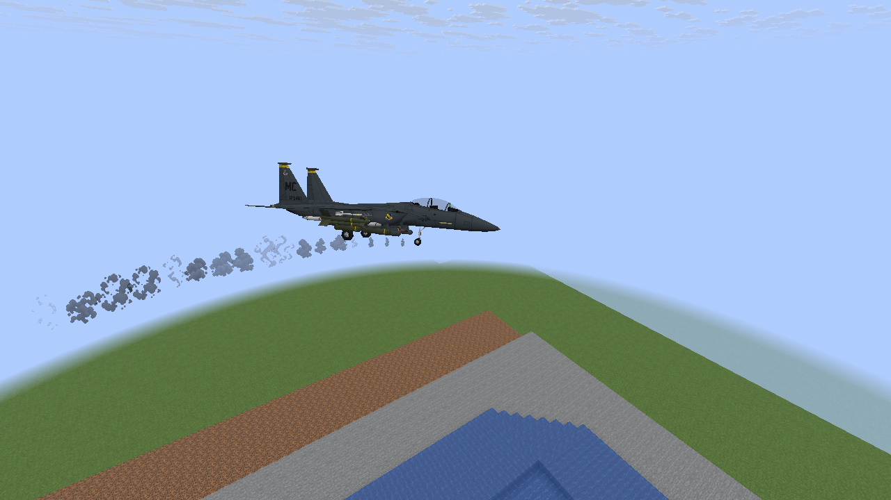

Older billows and dispersing wisps

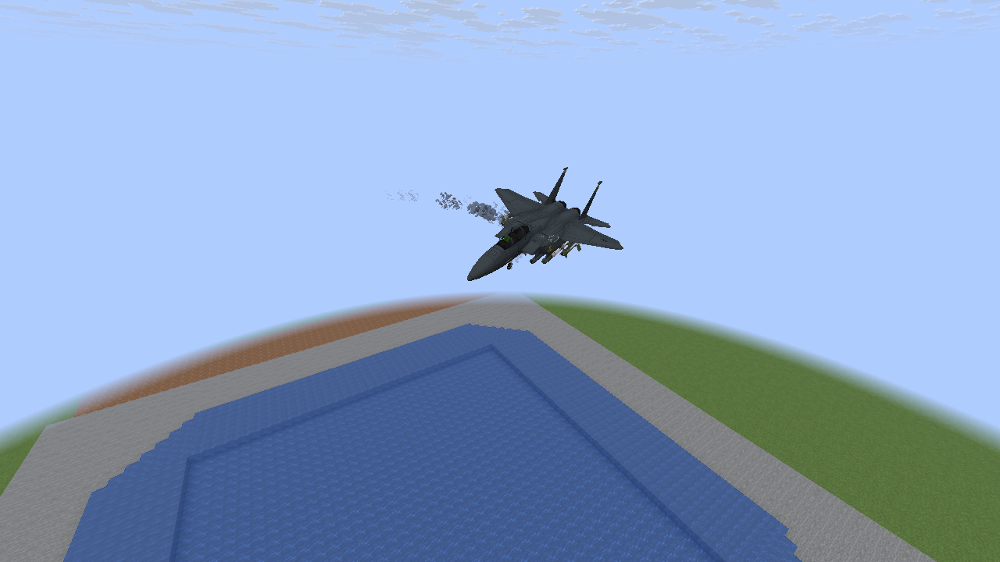

Repaired: new emission stopped, old smoke drained

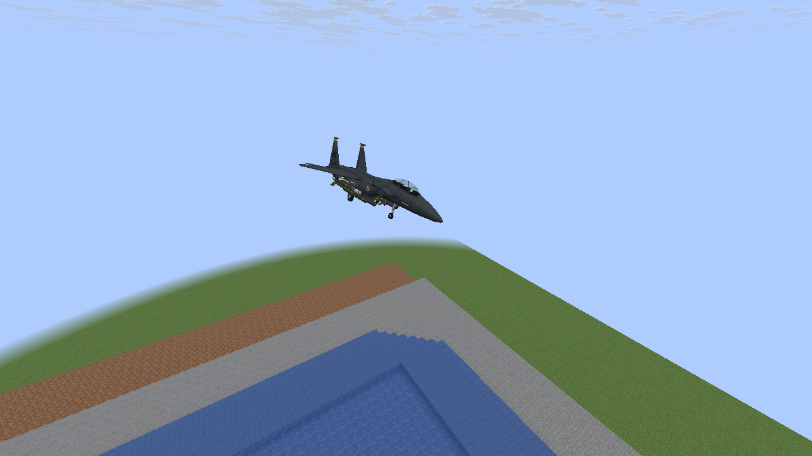

## A-10

Early turn

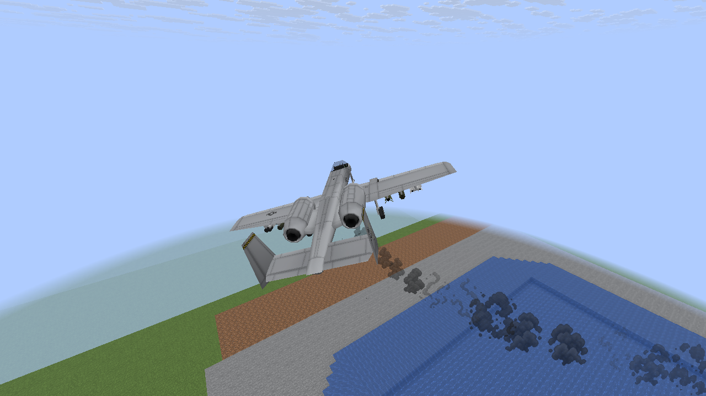

Changing heading

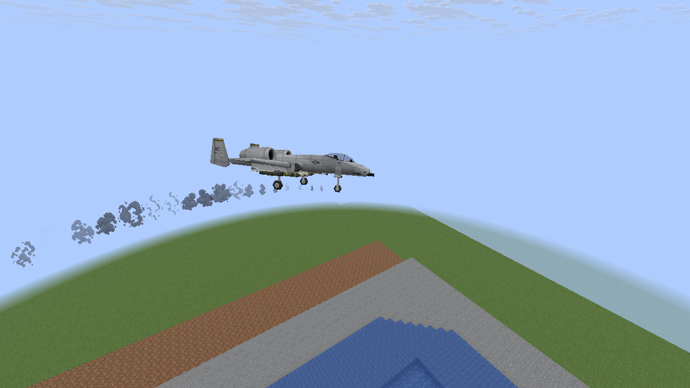

Older billows and dispersing wisps

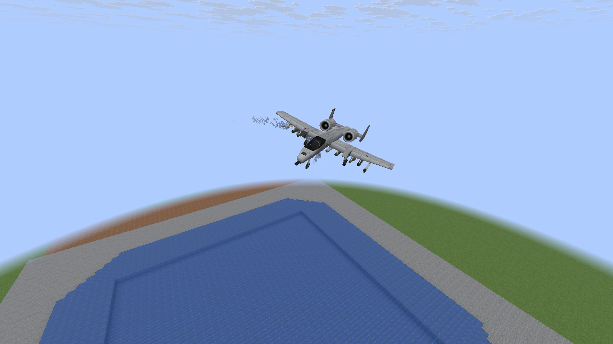

Repaired: new emission stopped, old smoke drained

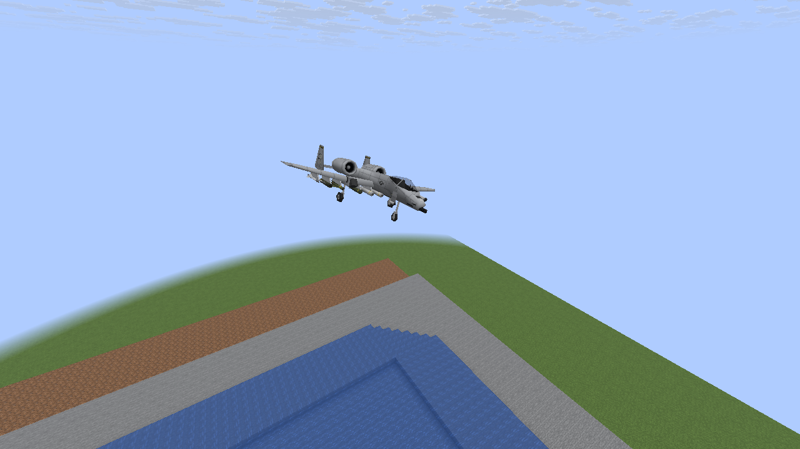

## Stationary A-10

Older billows and dispersing wisps

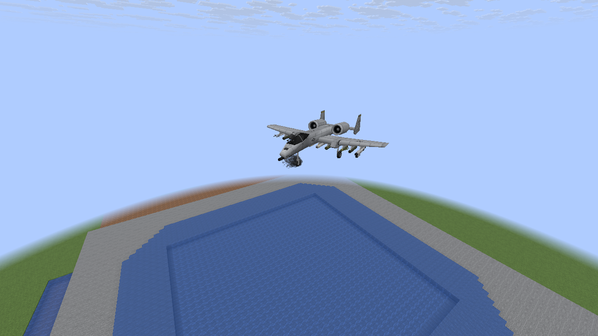

## Night lighting

Older billows and dispersing wisps

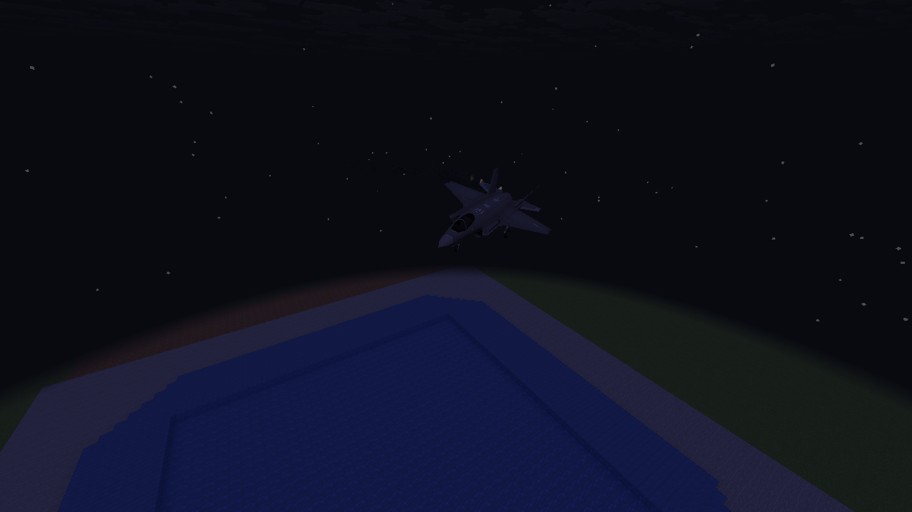

## 32-aircraft shared load

Older billows and dispersing wisps

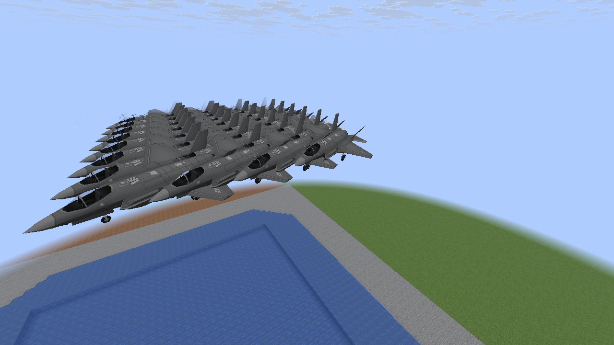

Classic/settings and repair-drain checks also run in the opt-in fixture. Software Mesa rendering
checks do not measure the 60 FPS target on the player’s RTX 3060 / 7800X3D at 1080p.
