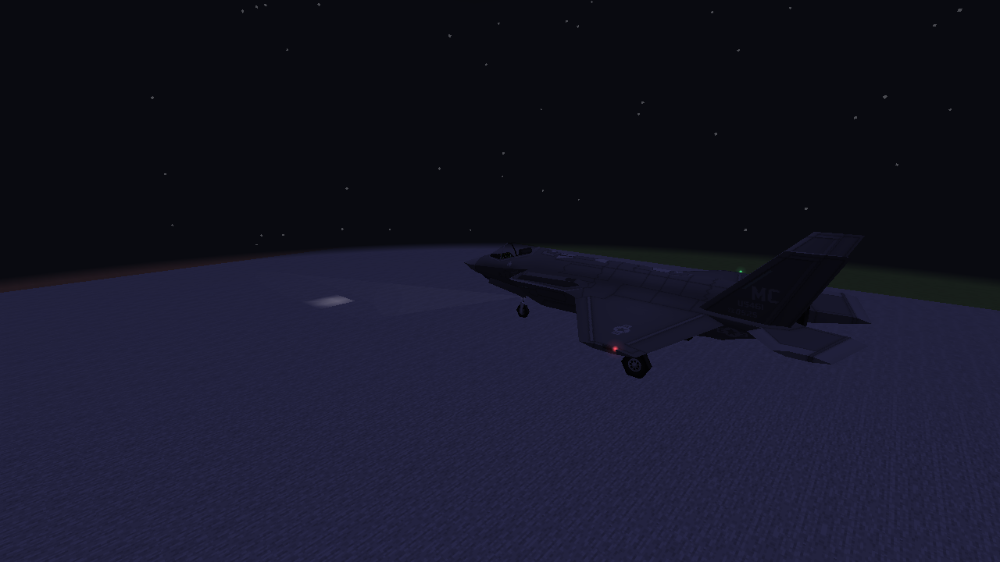
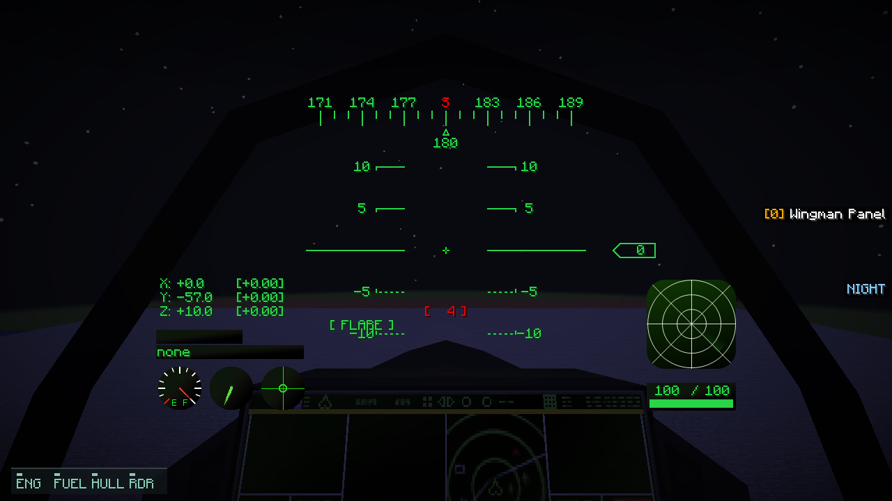
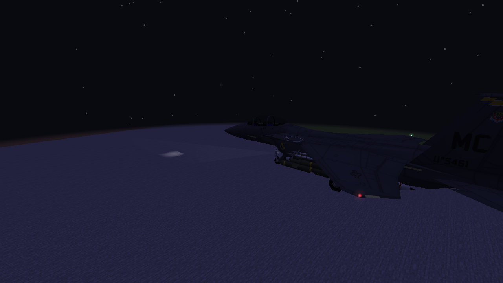
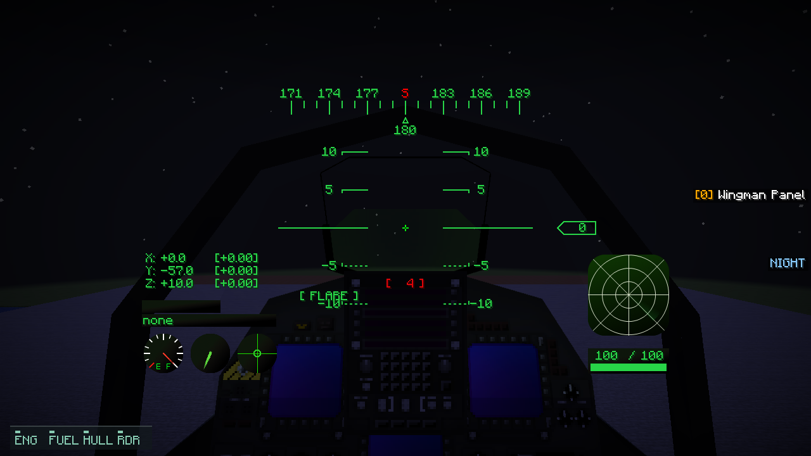
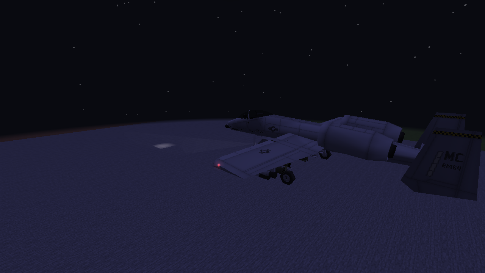
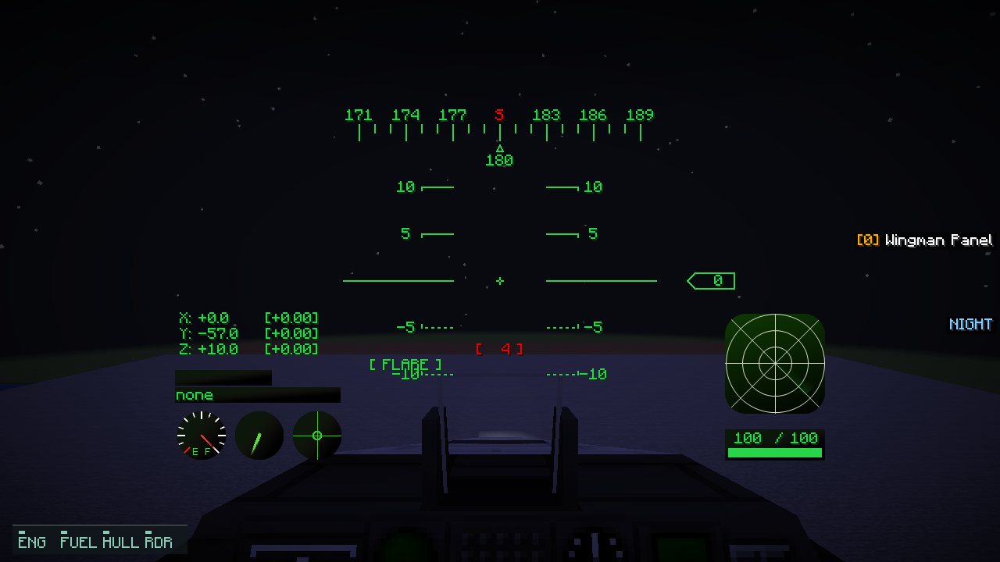

# Night-flight lighting: native examples

Unedited 1280×720 captures of actual aircraft and original cockpit surfaces. Exterior views
use Vulkan; pilot views use OpenGL. The fixture holds real models above a stone pad at midnight,
with clear weather, clouds off, 60° FOV and gamma 0.5. These are lighting test scenes, not piloted
flight recordings. Quarter views may crop an aircraft extremity.

[Settings, support and limits](M8_NIGHT_FLIGHT_LIGHTING.md).

## F-35A

## F-15E

## A-10

The brief strobes are not lit in every captured frame. Navigation lamps and instrument
illumination are deliberately small; the clear-air beam does not become a solid white wedge.
Target-PC 60 FPS / 1080p acceptance remains unmeasured.
