# Missile and rocket trails: native examples

Unedited 1280×720 captures of real weapon definitions/models on held trajectories through the
production client effects path. These are controlled previews, not combat recordings. OpenGL
launch views include A-10, F-35A and F-15E context; Vulkan flight views show the trails more closely.

Solid motors keep fuller billows and wisps. The Harpoon uses a thinner cruise-exhaust profile.
The stock AGM-158 disables smoke and stays smokeless, with a restrained motor point.
[Implementation, compatibility and bounds](M8_PROJECTILE_TRAILS.md).

## Hydra 70 — A-10 context

Launch context (OPENGL)

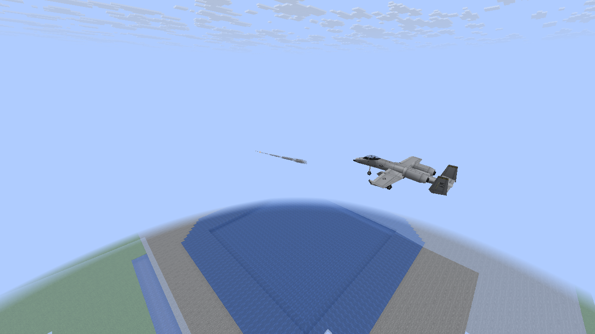

Flight and expanding trail (VULKAN)

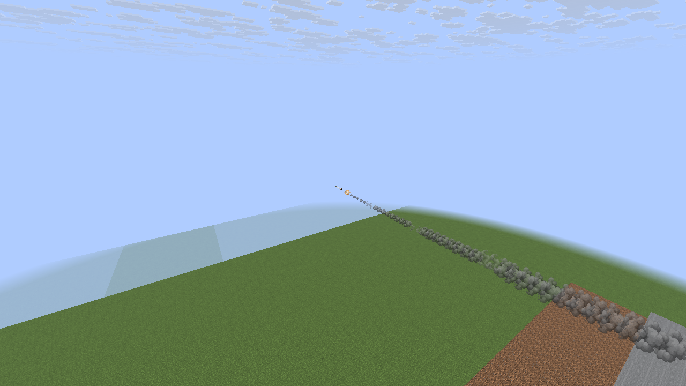

Closer flight view (VULKAN)

## AIM-9 — F-35A context

Launch context (OPENGL)

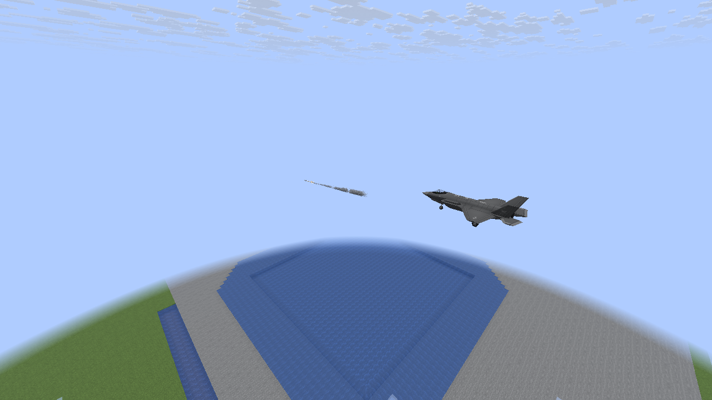

Flight and expanding trail (VULKAN)

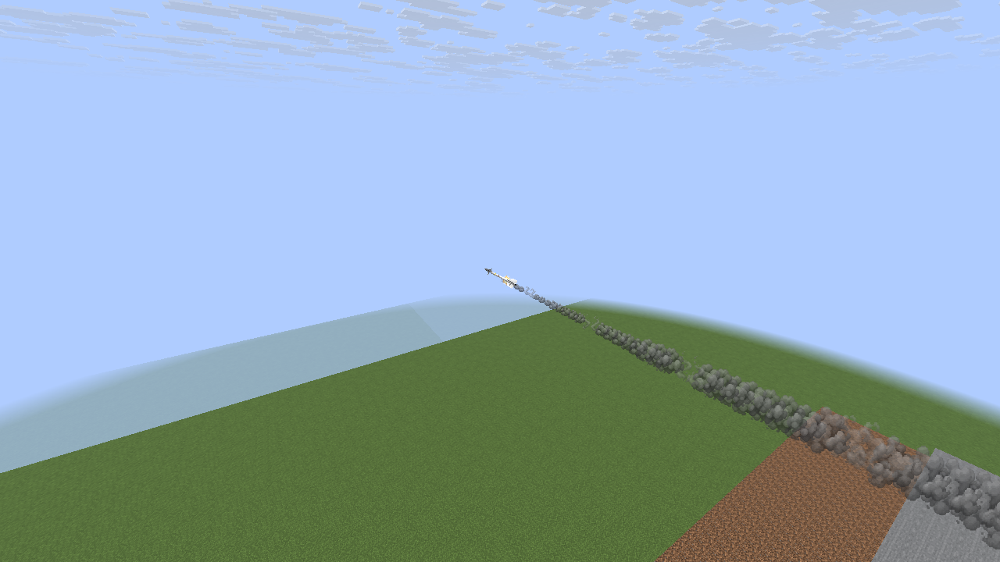

Closer flight view (VULKAN)

## AGM-84 Harpoon — F-15E context

Launch context (OPENGL)

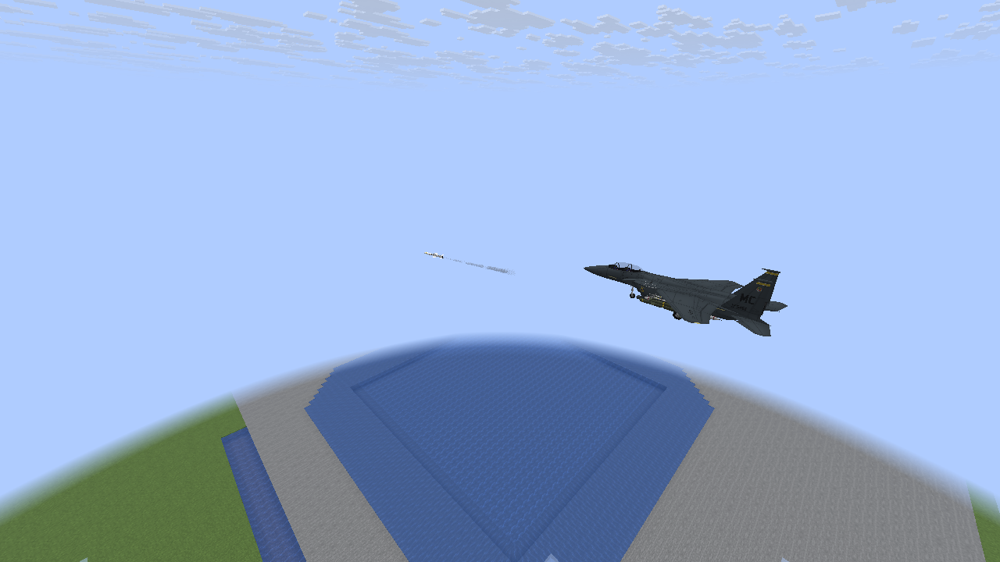

Flight and expanding trail (VULKAN)

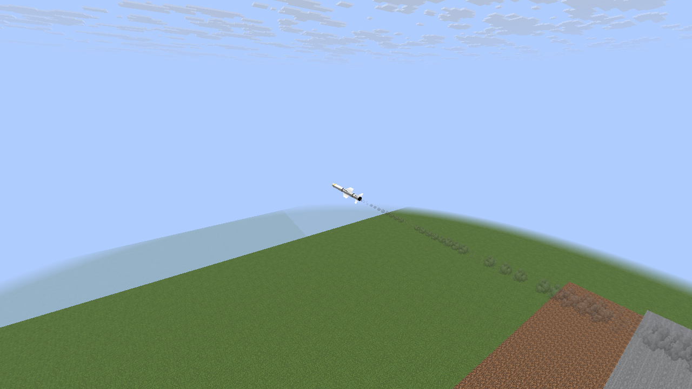

Closer flight view (VULKAN)

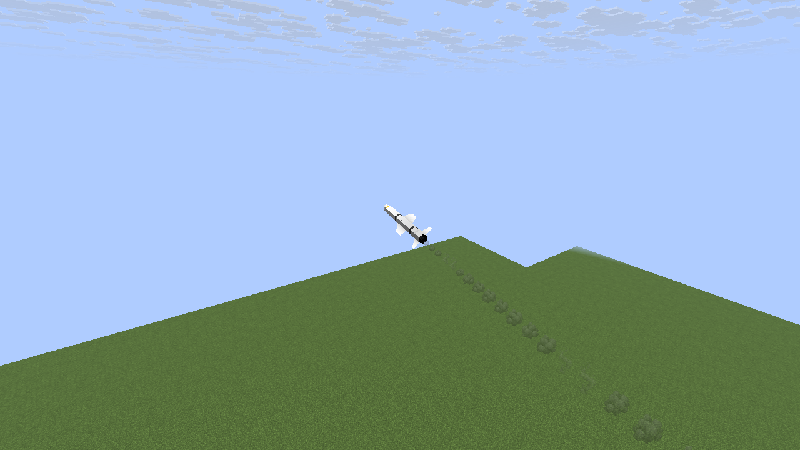

## AGM-158 — authored smokeless exhaust

Launch context (OPENGL)

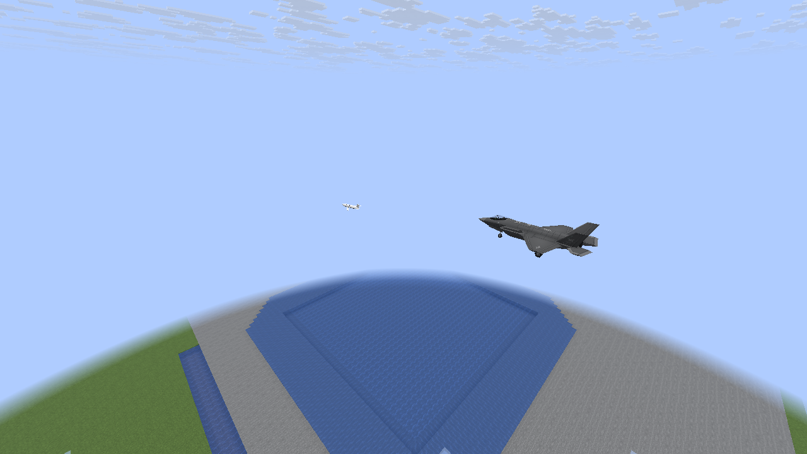

Closer flight view (VULKAN)

## Authored motor-window fixture

An isolated AIM-9 fixture uses start/end ages 10/90. It demonstrates cosmetic burnout;
the registered stock AIM-9 definition and its thrust/guidance are unchanged.

Motor active (VULKAN)

Motor extinguished; earlier smoke remains (VULKAN)

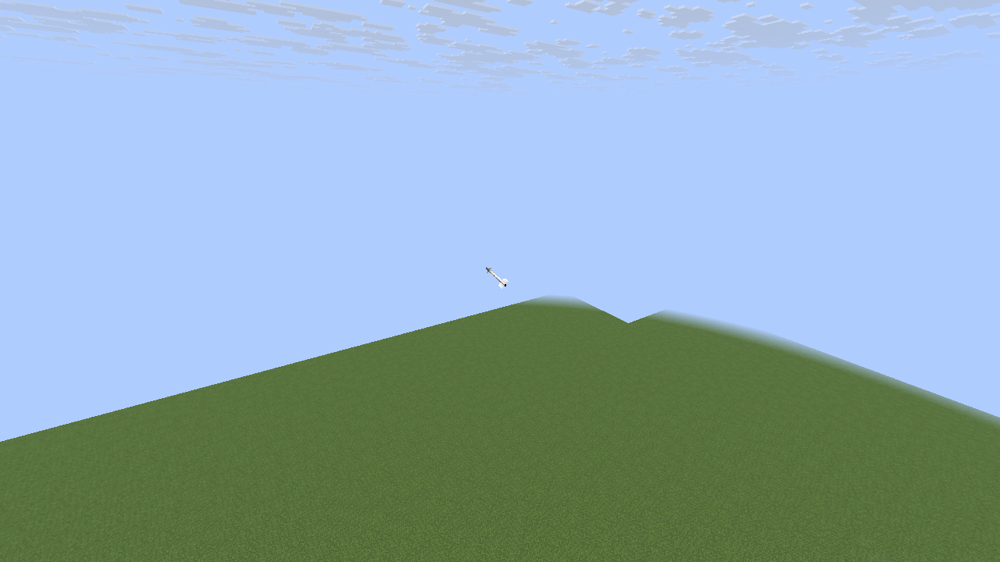

## 32 missiles — Balanced

A deliberately dense held-trajectory load, with adaptive reduction disabled to check fixed limits.

Closer flight view (VULKAN)

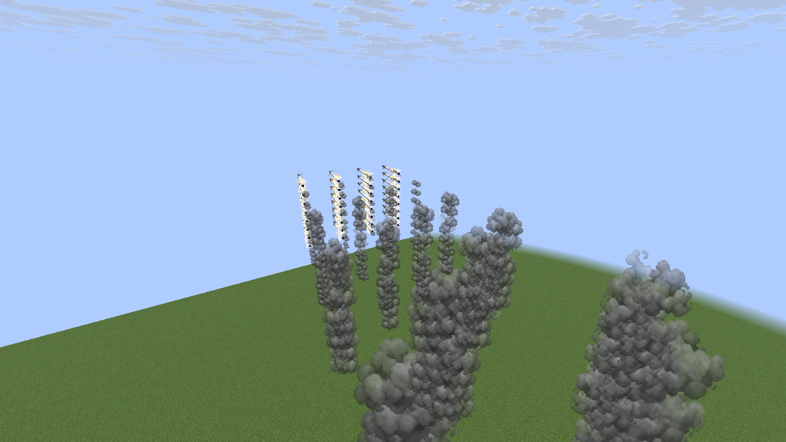

## 32 missiles — Low

A deliberately dense held-trajectory load, with adaptive reduction disabled to check fixed limits.

Closer flight view (VULKAN)

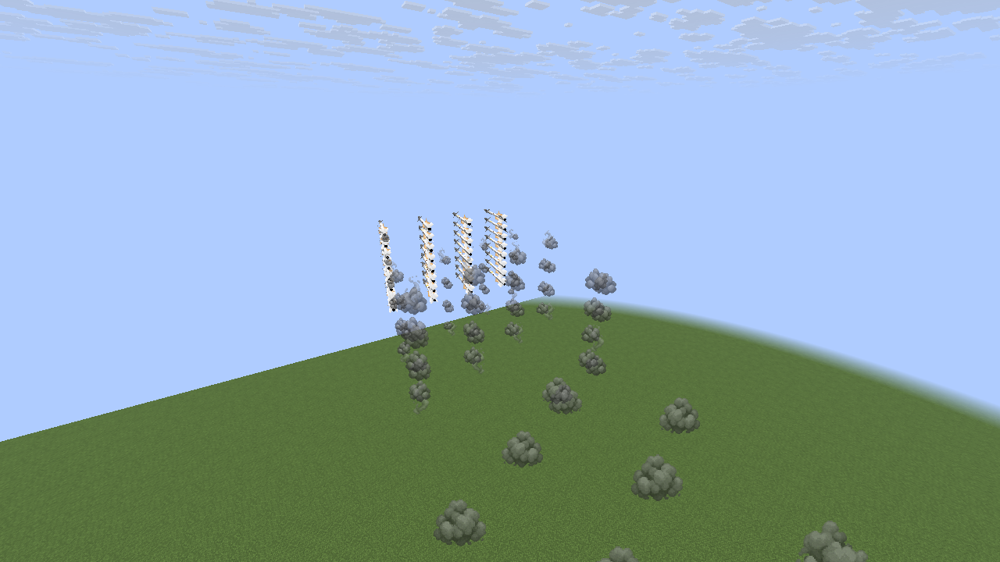

Both backends also check Classic, an isolated NTM-filter fixture, authored smoke disabling,
cutoff, drain and shared limits. No NTM integration or payload is invoked by the filter fixture.
Software Mesa checks do not measure target-PC 60 FPS / 1080p.
