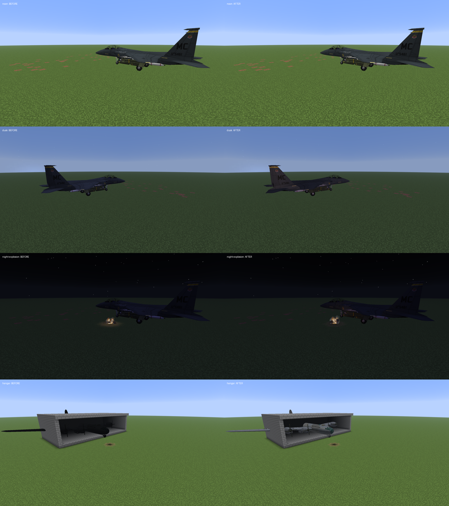

# M8 realistic lighting

`effects.realisticLighting` (default on, Enhanced / Polished) changes how vehicles are lit and
lets the mod's own fire and flashes light what is around them. It is client-only and never changes
the world's block light, so no chunk is rebuilt and servers are unaffected.

## Sun and moon on vehicles

Vanilla lights every entity from two fixed directions, so a jet looked the same at noon, at sunset
and under the moon. Vehicles drawn from GPU buffers (the default path, `render.gpuModelBuffers`)
are now lit in `baked_vehicle.vsh` from the real sun or moon direction, read from the sky's
`visual/sun_angle` and `visual/moon_angle` attributes:

- A key light from the sun by day, warm and orange when it is low, nearly white when it is high,
  and from the moon by night, faint and cool. It never lights a hull from below the horizon.
- A sky fill brighter on upward faces, neutral by day, warm at dusk and dawn, cool at night.
- Rain and storms dim the key light and flatten the shading, as overcast light does.
- A soft sun glint on the panels, scaled by the texture so dark paint and rubber glint less than
  bare metal. It is added in `baked_vehicle.fsh`, after lighting and before fog.

Light still goes through the vanilla lightmap, so time of day, dimension, gamma and night vision
behave as before. Under cover the sky light falls and the vanilla fixed lights take over smoothly,
so a vehicle in a dark hangar is not lit by a sun it cannot see. Dimensions without the overworld
sky (Nether, End) get no key light.

## Flash and fire light

The [fire-light follow-up](M8_FIRE_LIGHTING.md) gives fuel pools their own lifetime, lights damaged
engines and small detached fires, strengthens nearby ground glow, and keeps fire lights alive when
particle admission is full.

`SceneLights` keeps up to 96 brief lights: explosions (radius 5–28 blocks, 6–20 ticks, from the
client explosion entry point), muzzle flashes (2.5–9 blocks, 3 ticks), burning wrecks (3–10 blocks
with flicker, refreshed while the wreck burns) and burning flares (7 blocks). Each frame the eight
that matter most to the camera are passed to the vehicle shader, which adds their light with a soft
wrap and quadratic falloff. Living entities take the strongest nearby light as block light through
a render state modifier, as search lights already do. Burning wrecks and flares also light the
ground with cached top-face patches like the landing lights: one source is resampled per tick from
block states only (no rays), at most four patches draw, and they show at night or under cover.
Explosions and gun flashes keep their existing ground flash patches.

## Light along the airframe

Vanilla samples one light value at the entity's position. Vehicles at least 2.5 blocks across now
sample block and sky light at the eight corners of their box (hull plus hit boxes, inset half a
block; a corner inside a solid block reads the block above it). The shader blends the corners
across the hull, so a bomber half inside a hangar is dark at its tail and lit at its nose. Small
vehicles and vehicles past the render distance keep the single value.

## Limits

- With `render.gpuModelBuffers` off, vehicles get a local lightmap lift from nearby fires;
  directional coloured point lighting remains on the GPU path. Outlines/emissive layers keep vanilla lighting.
- Walls are not lit by fire patches; only top faces are.
- Point lights reach at most eight per frame for vehicles.
- Performance on target hardware has not been measured; the shader adds one eight-light loop and
  one trilinear blend per vertex, and the CPU adds eight light reads per large vehicle per frame.

## Repeating the native scene

```sh
./gradlew runClient -I scripts/visual-probe.init.gradle --no-configuration-cache \
  -Dmcheli.probeLighting=true -Dmcheli.probeBackend=VULKAN
```

Use `-Dmcheli.probeBackend=OPENGL` for the other backend. The opt-in driver uses the disposable
flat `M6Smoke` world in `.run/m8-preview` and captures noon, low sun, a night explosion beside an
F-15E and a B-29 parked in a shed that is open at the front, with one wing through its side
wall, each with the setting off and then on, from the same camera.

## Validation

The scene passes on both backends at 1920×1080: Vulkan on Mesa lavapipe (Mesa 25.2.8, Xvfb,
`MESA_VK_WSI_PRESENT_MODE=immediate`, `earlyWindowControl = false`) and OpenGL on llvmpipe. It
asserts that the explosion registers a scene light with the setting on and that none exist with
it off. Unit tests cover fades, flicker, ranking, source sizes, the sun and moon key light, dusk
and night colours, rain, the light probe blend and both uniform block sizes. These are software
renderer checks, not target-GPU frame rates.



Vulkan captures, setting off then on: [noon](screens/lighting/lighting-noon-off.png) /
[on](screens/lighting/lighting-noon-on.png), [low sun](screens/lighting/lighting-dusk-off.png) /
[on](screens/lighting/lighting-dusk-on.png), [night explosion](screens/lighting/lighting-night-explosion-off.png) /
[on](screens/lighting/lighting-night-explosion-on.png), [hangar](screens/lighting/lighting-hangar-off.png) /
[on](screens/lighting/lighting-hangar-on.png). At noon the sun is overhead, so the side view changes
little by design; the difference shows on upper surfaces and at low sun.
