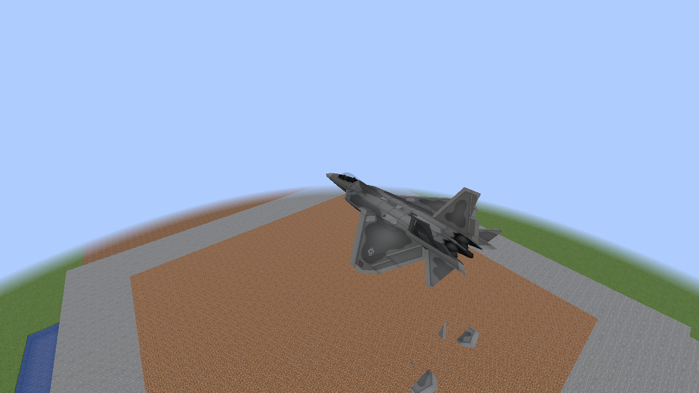
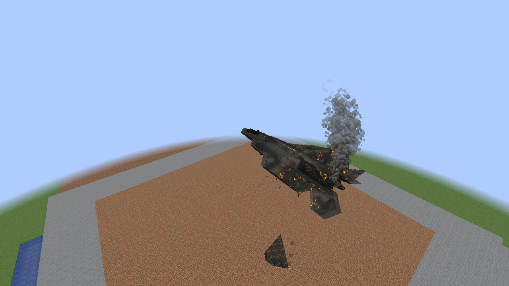
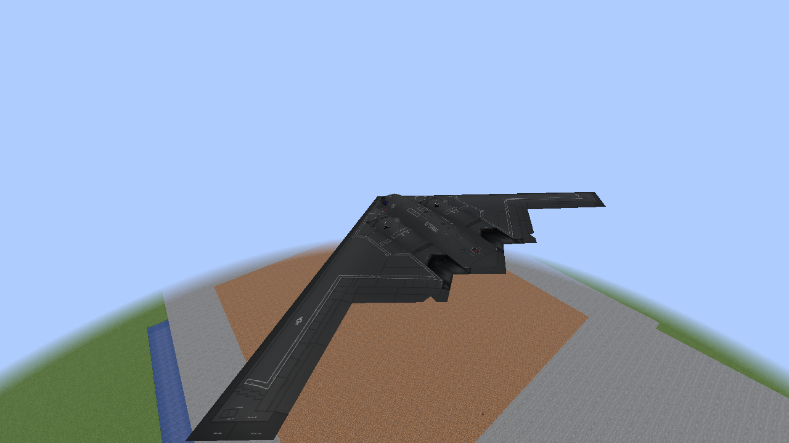
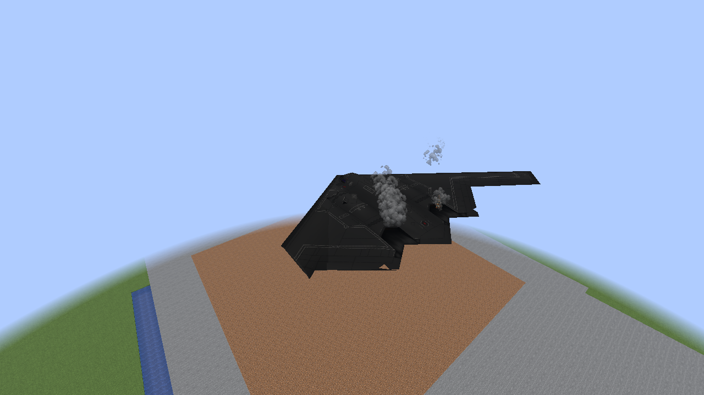
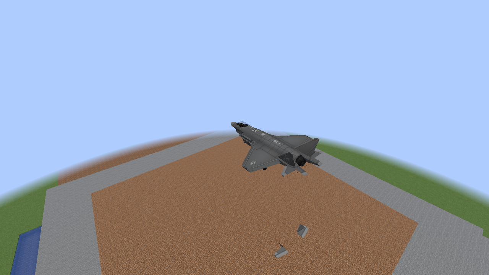
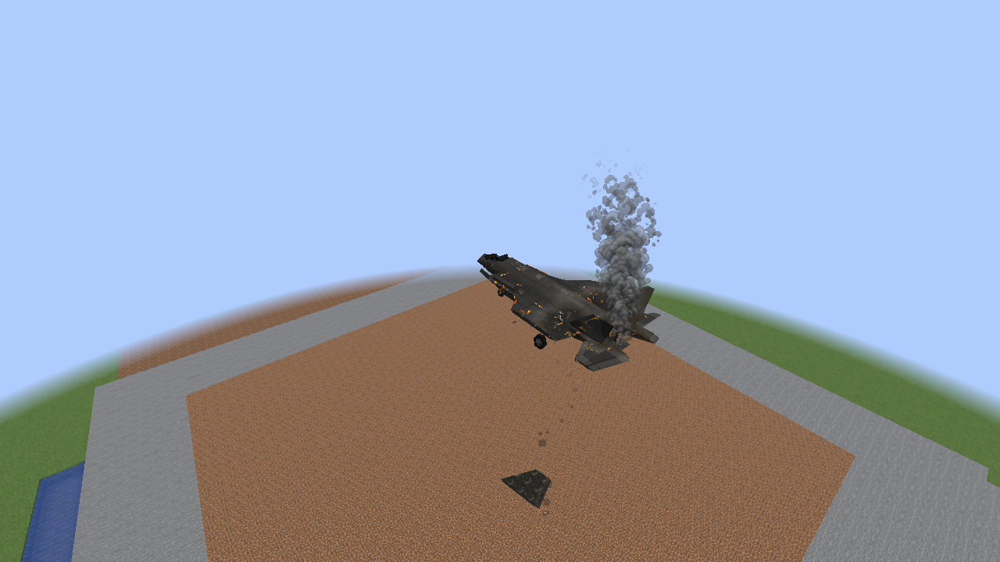
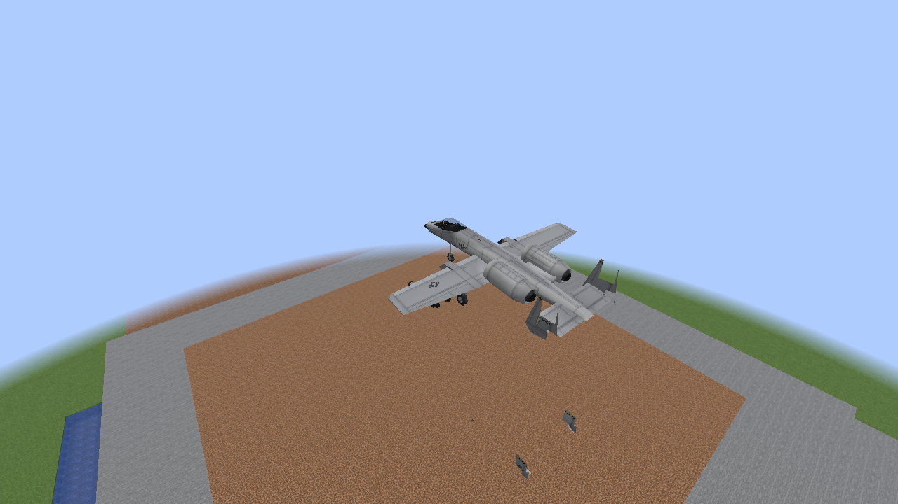
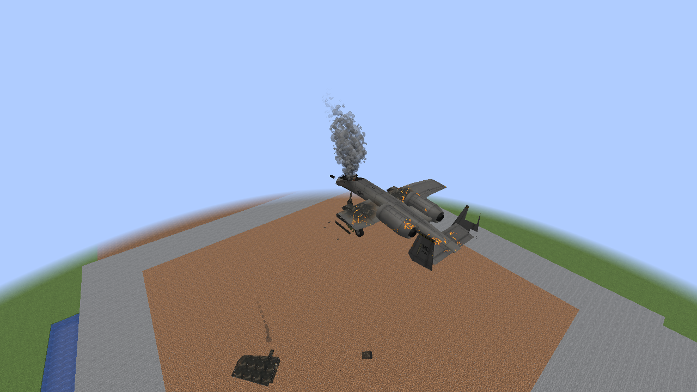

# Plane rear fuselages stay attached

Unedited native Minecraft screenshots using the production plane models and renderer. These
are held client damage/wreck states, not actual crash recordings. Each damaged plane has its
rear structural component at zero health. The wreck images also retain the existing wing-loss
stage; the engine section and rear fuselage remain part of the main aircraft.

| Aircraft | Rear damage while alive | Late wreck stage |
| --- | --- | --- |
| F-22A |  |  |
| B-2A |  |  |
| F-35A |  |  |
| A-10 |  |  |

The correction applies to every plane through the common breakup builder. Bounded smaller
rudder/elevator panel damage remains; whole-rear separation is retired. Vulkan and OpenGL
checks cover damage present at spawn, a new live-damage transition and the late wreck stage.

[Implementation and scope](M8_RETAINED_FUSELAGE.md).
