# Aircraft skin shedding: native examples

Unedited 1280×720 Vulkan captures of controlled component damage on real vehicle models.
Small painted skin fragments tumble after a fresh cut, then fade. They are deliberately tiny;
the large wing/tail fragments, fuel spray and exposed cables are existing effects. Close views
make the small chips easier to inspect below and behind the cut. No image has been altered.

[Implementation and bounds](M8_SKIN_SHEDDING.md). The scenes are held client states, not combat recordings.

## F-35A

Wing breakup with the existing large fragment

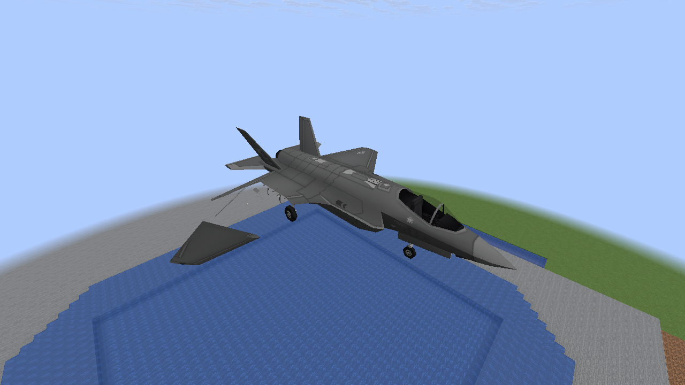

Wing cut and small trailing skin pieces

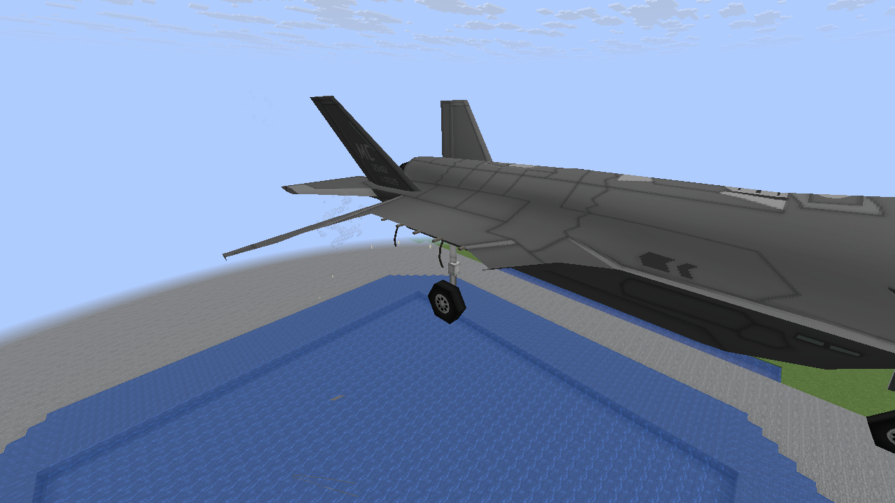

Tail cut and shedding

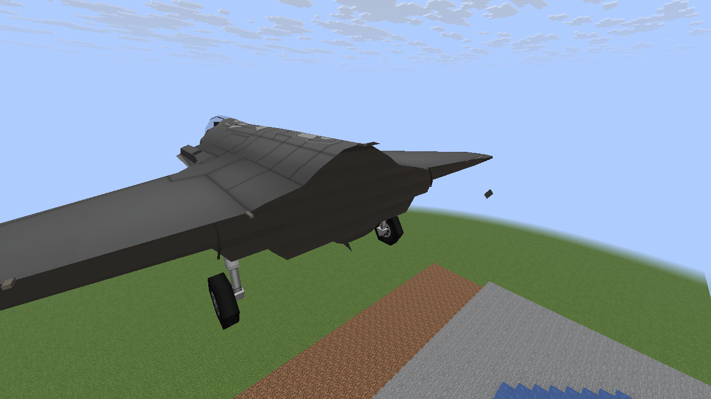

Repaired aircraft

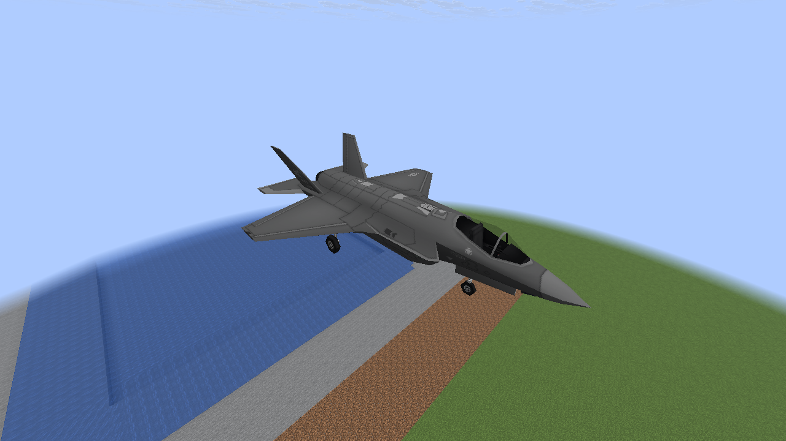

## F-15E

Wing breakup with the existing large fragment

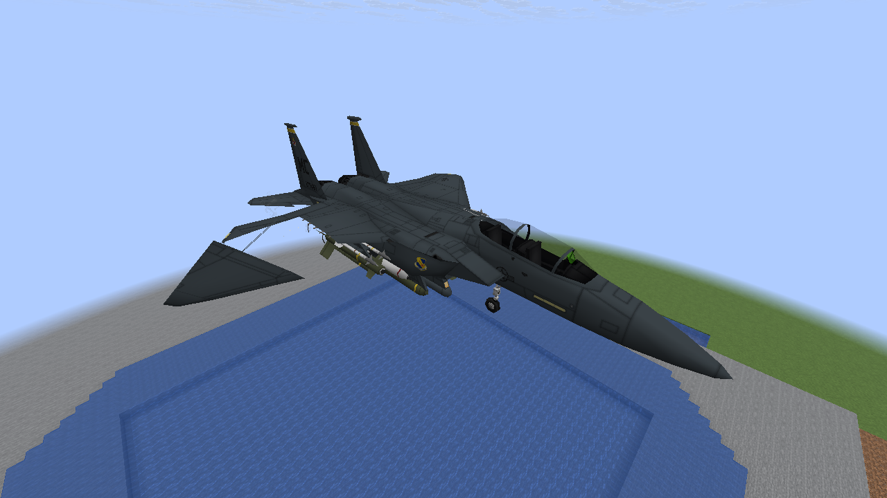

Wing cut and small trailing skin pieces

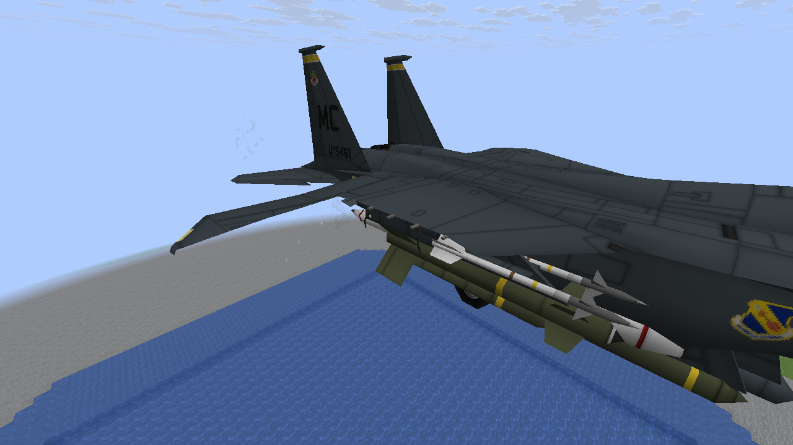

Tail cut and shedding

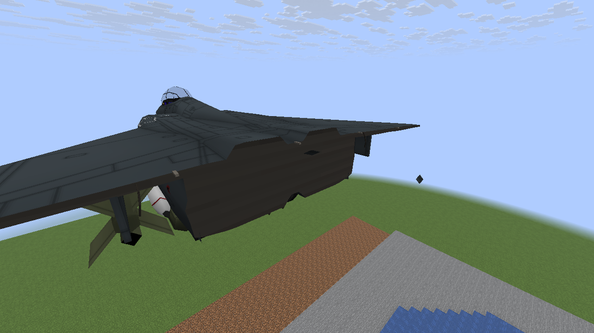

Repaired aircraft

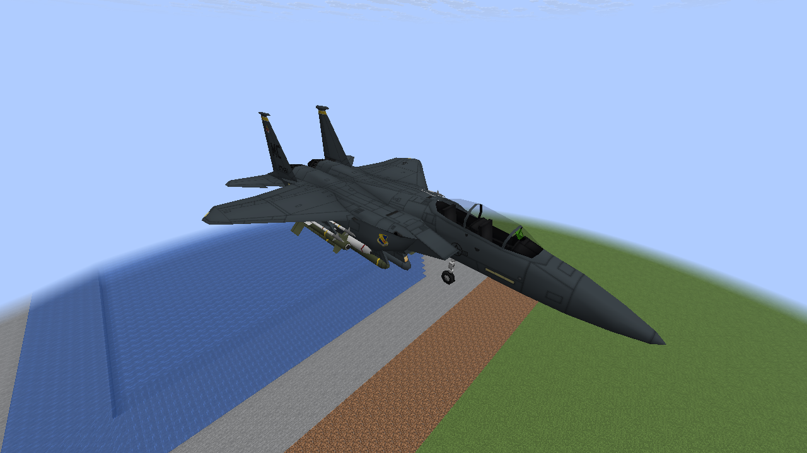

## A-10

Wing breakup with the existing large fragment

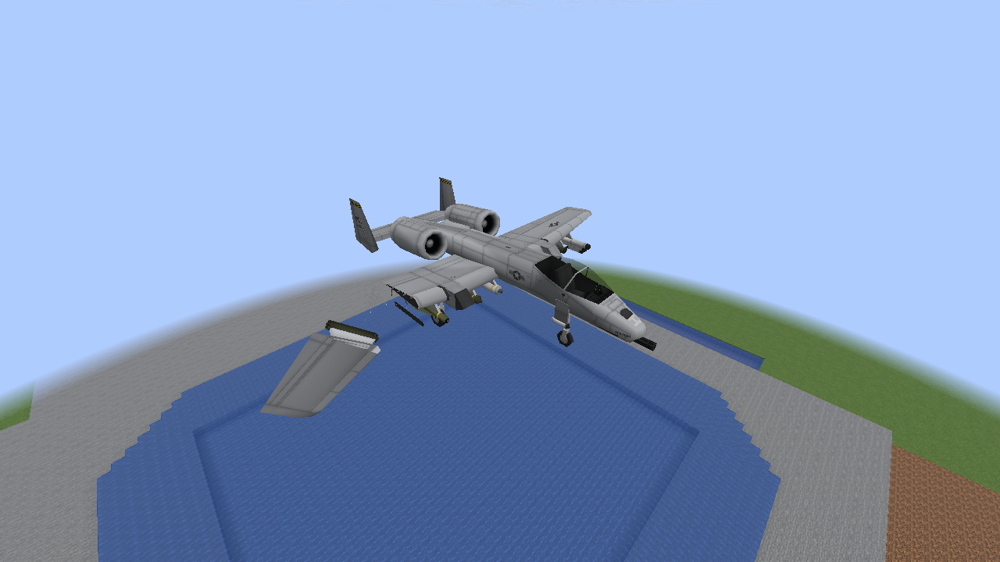

Wing cut and small trailing skin pieces

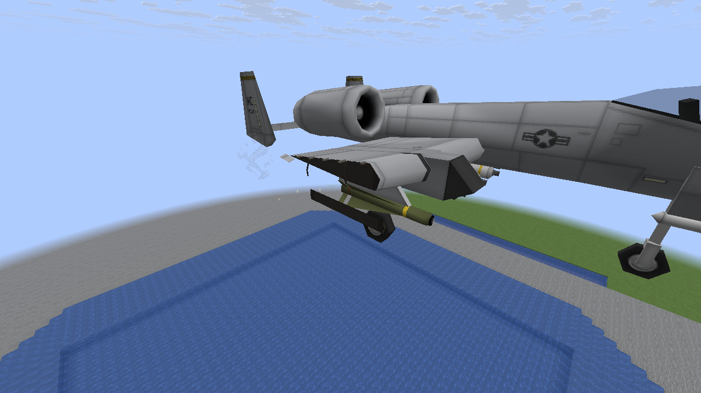

Tail cut and shedding

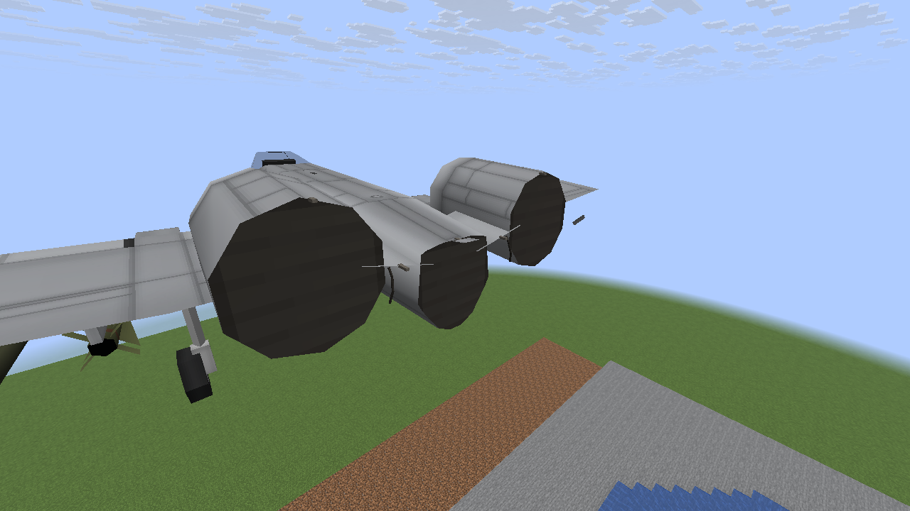

Repaired aircraft

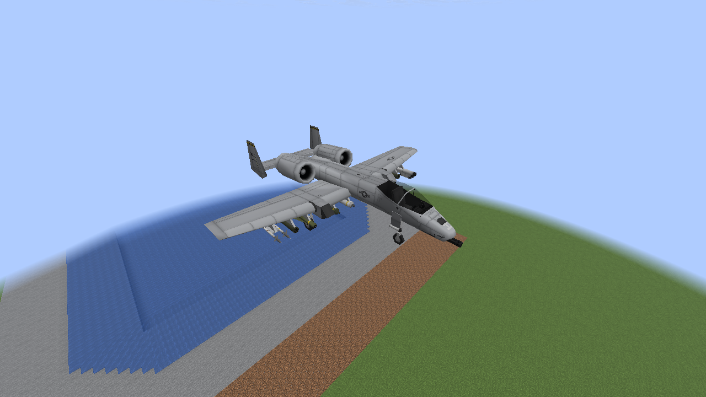

## Fresh wreck breakup

Wing cut and small trailing skin pieces

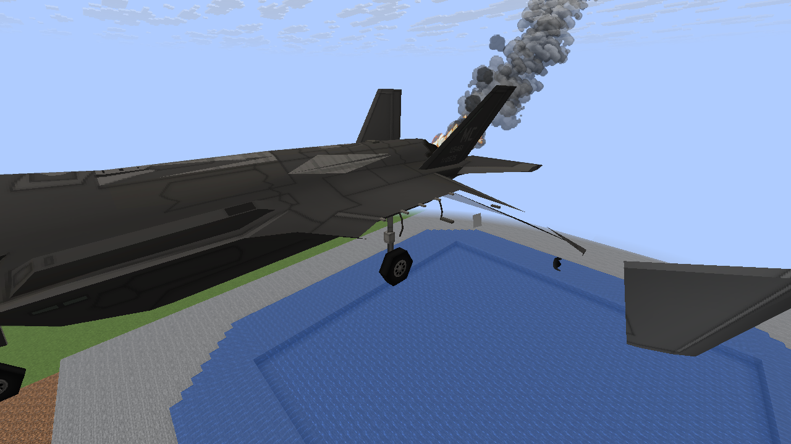

Tail cut and shedding

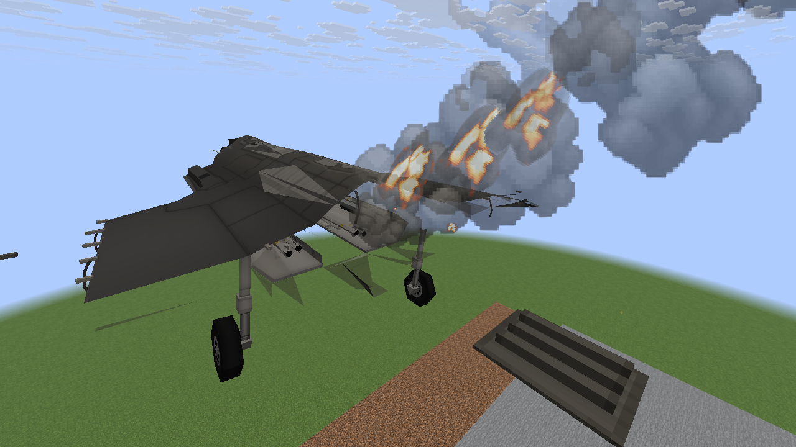

## 32-aircraft shared load

Wing breakup with the existing large fragment

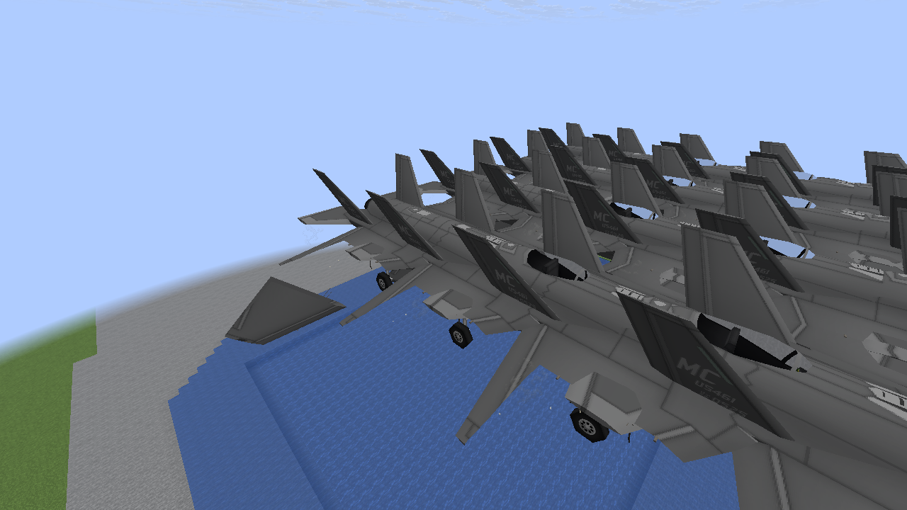

Loaded damage and style re-enable produce no fresh skin pieces. Repairs and settings clear them.
All pieces share the existing eight-mesh limit. Software Mesa checks do not establish target-PC FPS.
