# Smoke billows: native Minecraft examples

Twelve unedited 1280×720 captures from the production effects in controlled Minecraft scenes.
Wreck ages use held vehicle fixtures; explosions are client visual-effect fixtures on flat
terrain. These are **native previews**, not combat captures. Crater creation, weapon damage
and the terrain destruction algorithm are unchanged. No screenshot was generated, composited,
cropped or recolored. The new sprite artwork was generated separately and is linked below.

[Implementation, controls and budgets](M8_SMOKE_BILLOWS.md).

## M1A2 — Vulkan

| Burning wreck | Cooling, interrupted plume |
| --- | --- |
| 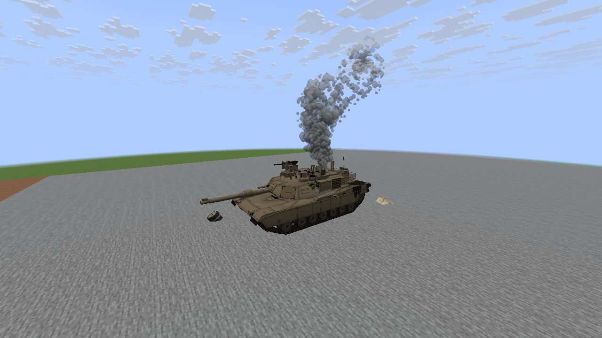 | 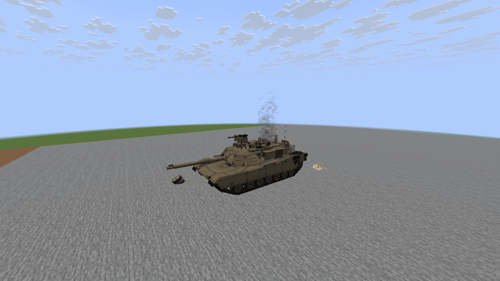 |

## AH-64 — Vulkan

| Burning wreck | Cooling, interrupted plume |
| --- | --- |
| 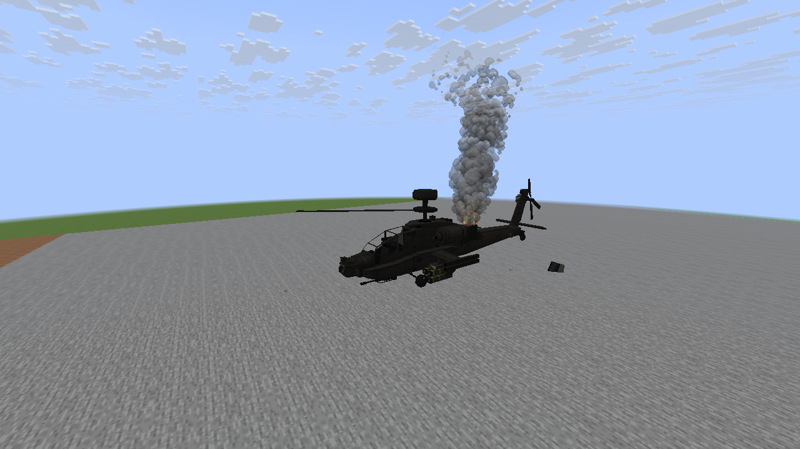 | 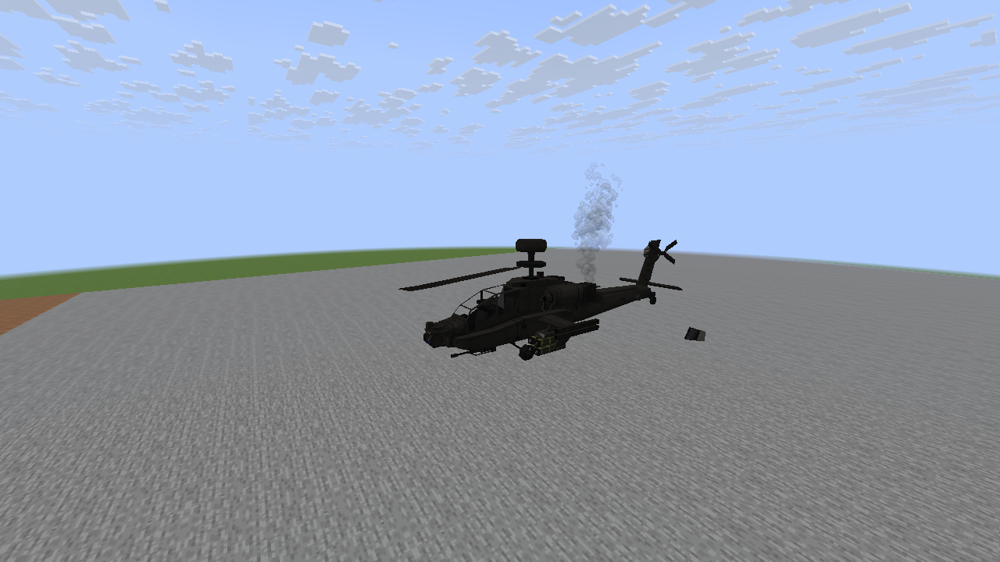 |

## F-35A — Vulkan

| Burning wreck | Cooling, interrupted plume |
| --- | --- |
| 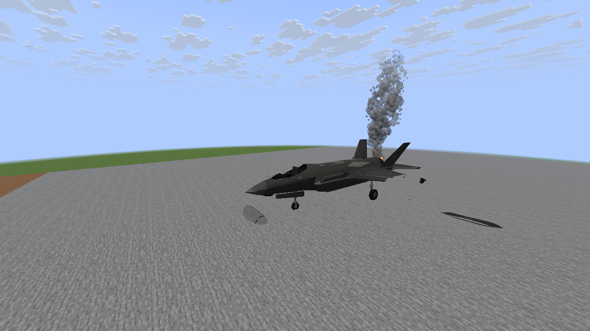 | 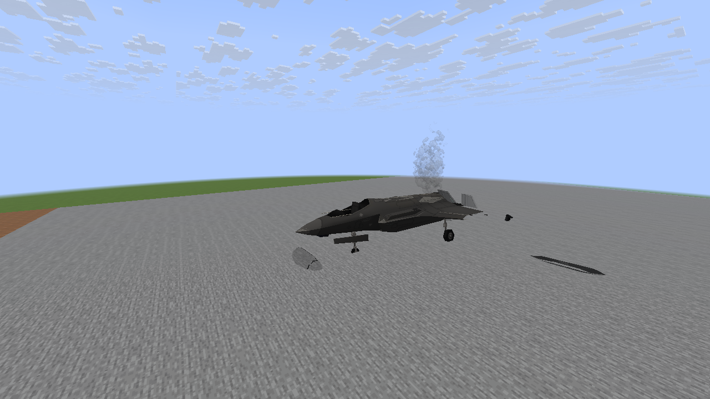 |

## Explosion smoke — OpenGL

| Small impact, 11 ticks | Small impact, 35 ticks |
| --- | --- |
| 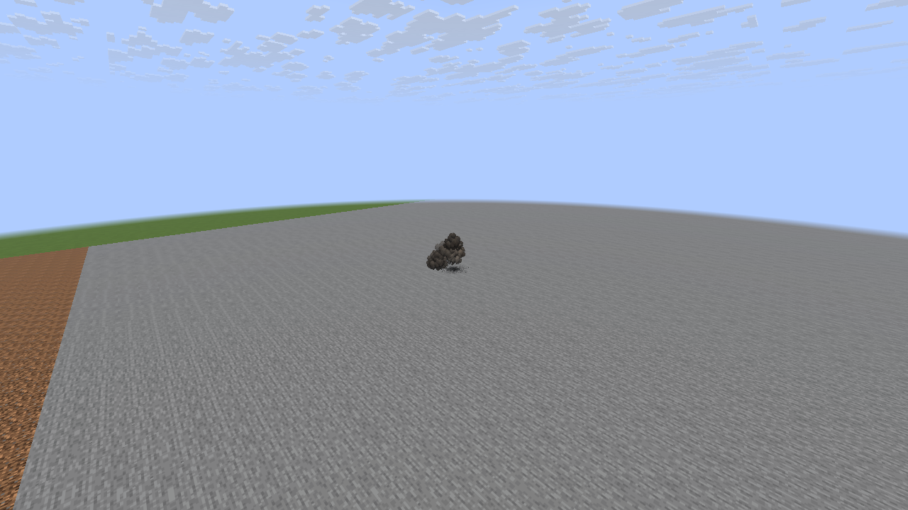 | 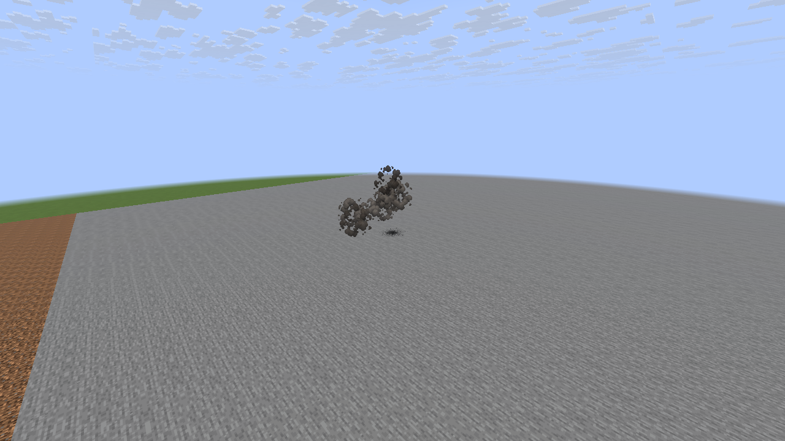 |

| Large blast, 35 ticks | Large blast, 75 ticks |
| --- | --- |
| 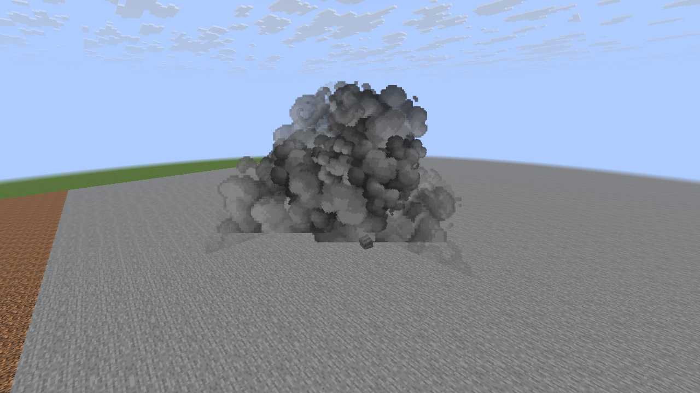 | 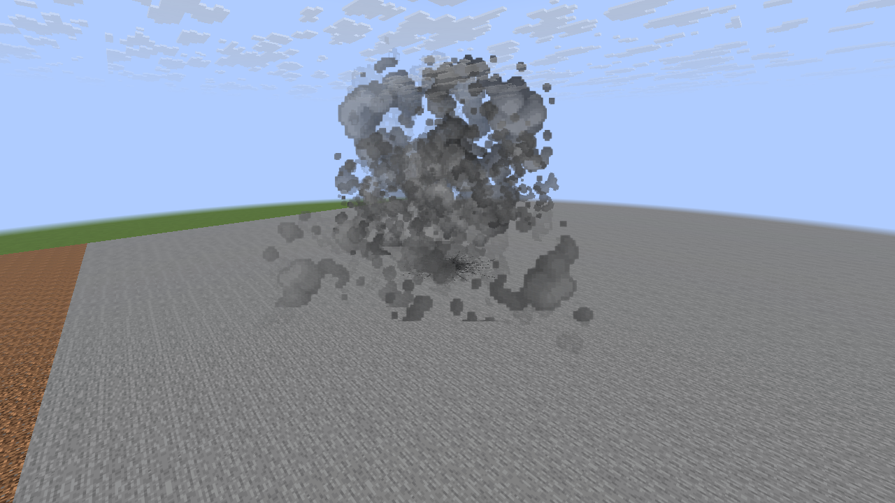 |

| Modern blast at night, 11 ticks | Modern blast at night, 35 ticks |
| --- | --- |
| 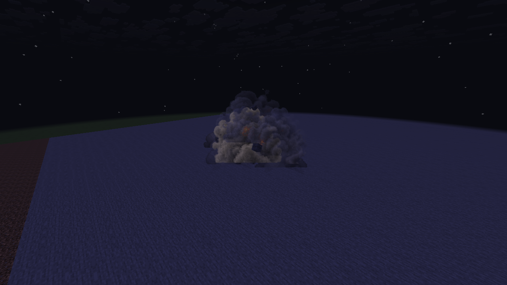 | 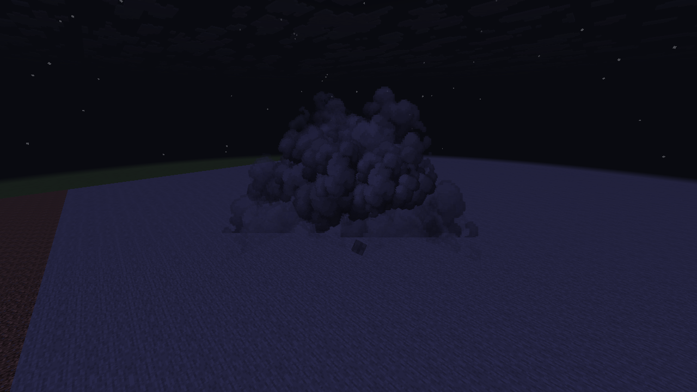 |

## The three 16-frame sprite sheets

These are the **new generated artwork**, distinct from the native screenshots above:

- [Explosion billows](../src/main/resources/assets/mcheli_ce_port/textures/particle/m8_billow_explosion.png)
- [Wreck-soot curls](../src/main/resources/assets/mcheli_ce_port/textures/particle/m8_billow_wreck.png)
- [Dissipating wisps](../src/main/resources/assets/mcheli_ce_port/textures/particle/m8_billow_wisps.png)

Both native runs passed effect/atmosphere bounds and mod-owned particle drain checks. The
Vulkan wreck run peaked at 37 / 41 / 39 total particles in its three scenes. The OpenGL
mixed-volley scene peaked at 346; its Classic comparison peaked at 970. These are observed
fixture counts, not per-weapon guarantees or target-PC frame-rate measurements.
