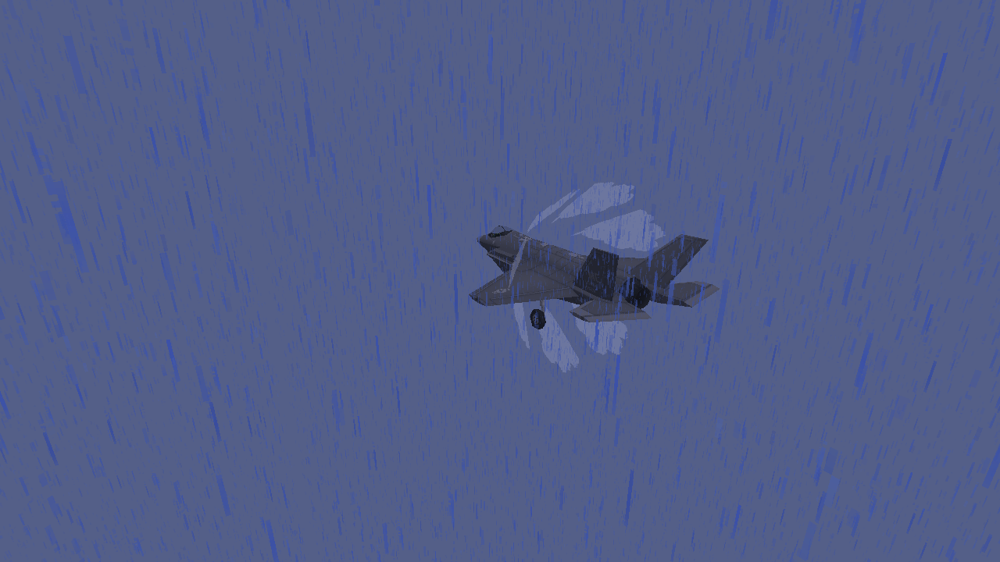
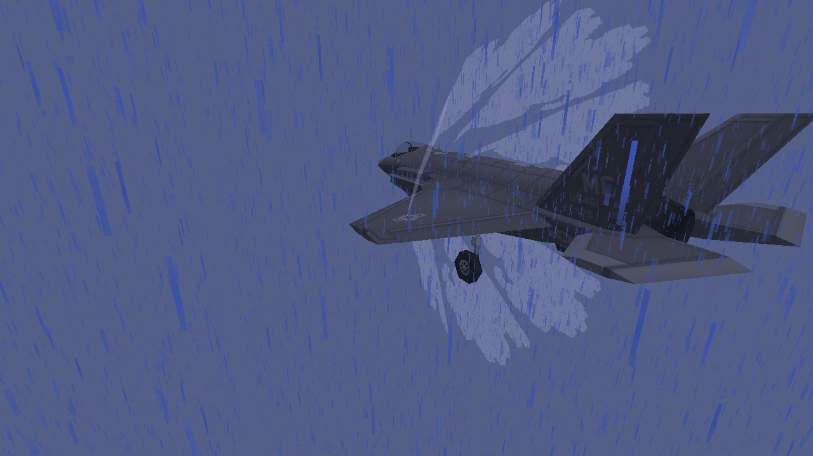
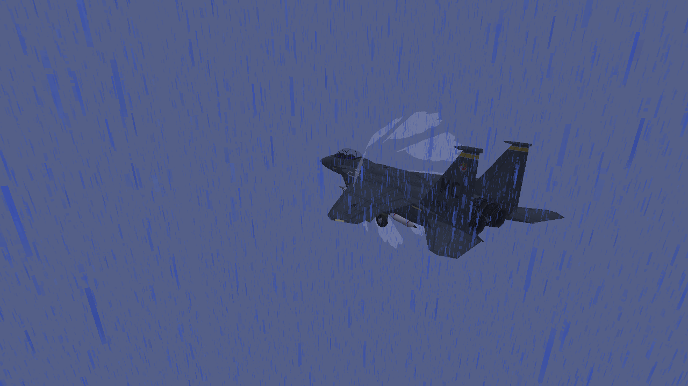
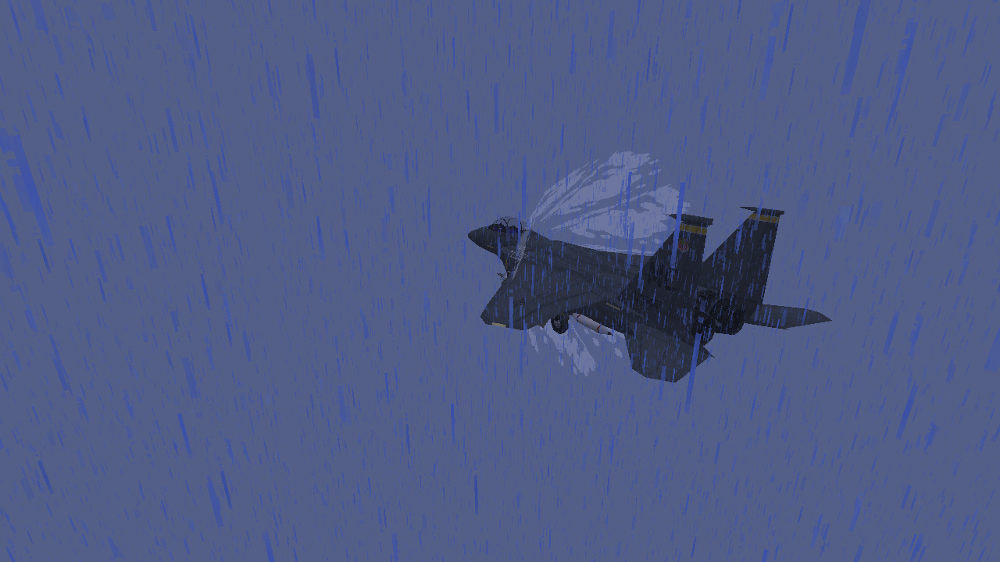
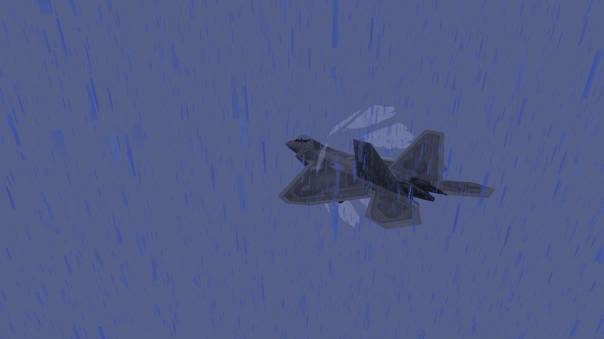
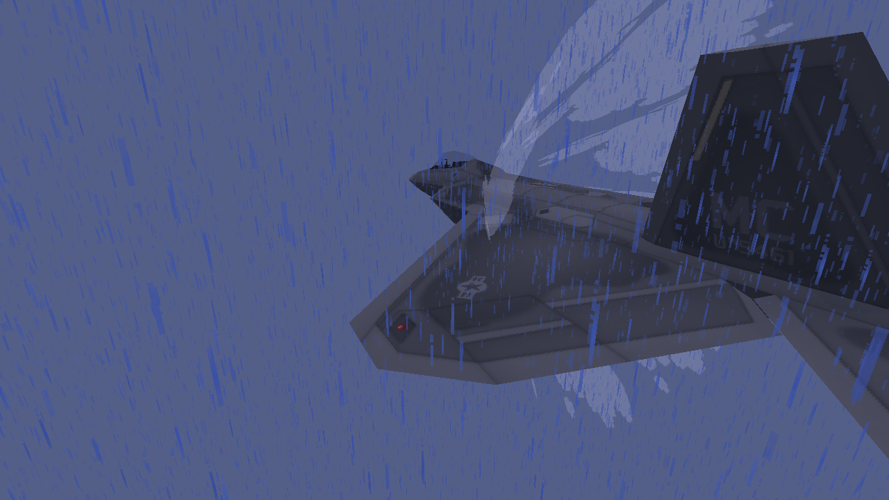

# Transonic vapor: native examples

Unedited 1280×720 Vulkan captures of real aircraft on controlled acceleration trajectories.
These are native client fixtures, not combat recordings. The eight-face vapor cone is
ambient-lit, translucent and visible for only 14 ticks.

Views use 60° FOV with clouds disabled and actual rain enabled. Crossing views are wider;
close-ups move the camera nearer to show the cone’s depth and may crop aircraft extremities.

[Capability mapping, settings and limits](M8_SUPERSONIC_EFFECTS.md).

## F-35A

## F-15E

## F-22A

The delayed boom is tested separately with fixed external observers. Its
[original synthetic cue](../src/main/resources/assets/mcheli_ce_port/sounds/m8_sonic_boom.ogg)
is generated by a checked-in script; that file is a sample, not a recorded flyby.
Software Mesa does not establish target-PC 60 FPS.
