# Tank cook-off correction examples

Original 1280×720 Vulkan captures of real server-owned tanks. The spectator never mounts them and
receives its ammo counts through the normal network path. The fixture fills ammo on the server and
invokes the existing server destruction API; these are controlled deaths, not weapon-impact captures.

## M1A2 pressure panels

| Opening above the bustle | Panels ejected; turret retained |
| --- | --- |
| 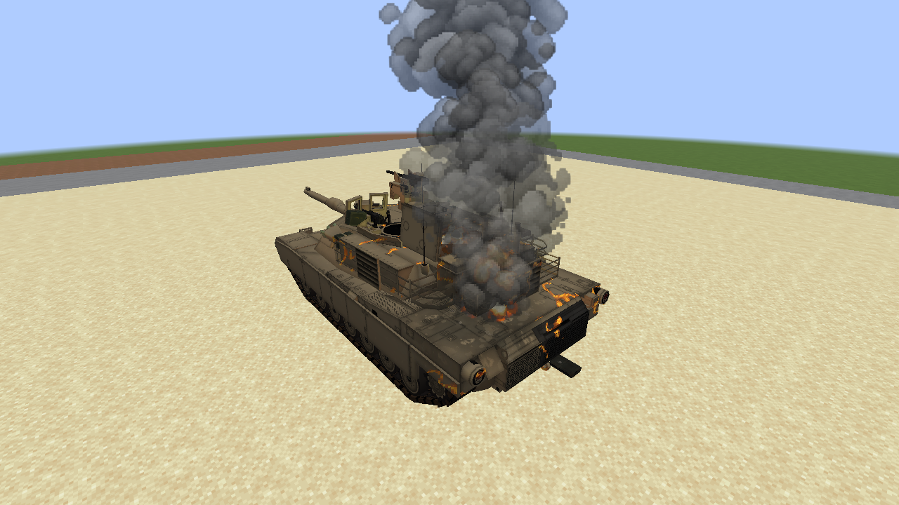 | 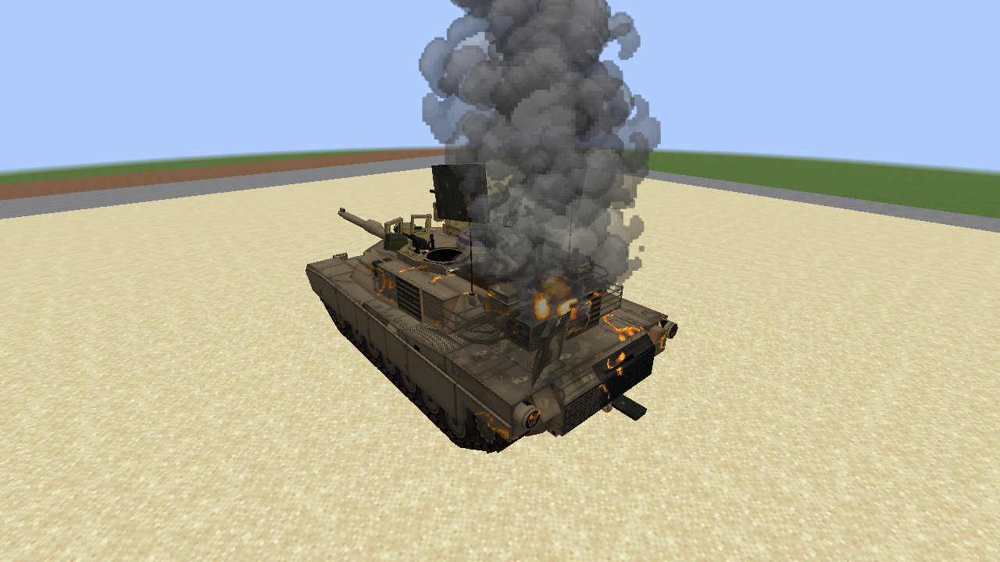 |

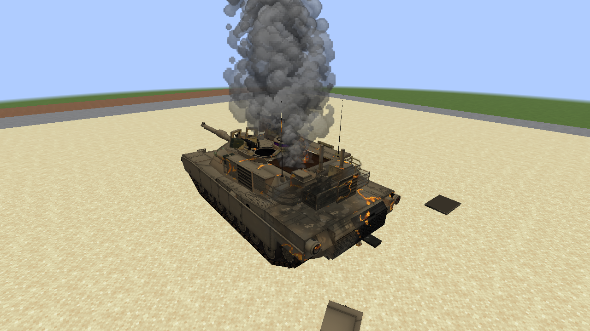

The pressure roof behind the crew hatches opens independently. It does not eject the protected
turret design. The remaining turret roof, crew openings and rear rack retain their original geometry.

## T-90 complete turret

| Before the cook-off stage | Complete turret and gun separated |
| --- | --- |
| 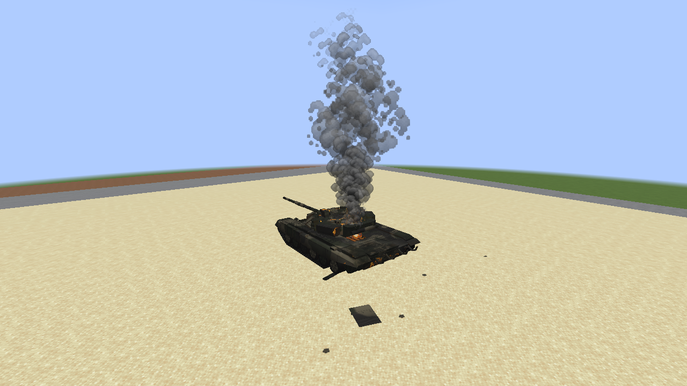 | 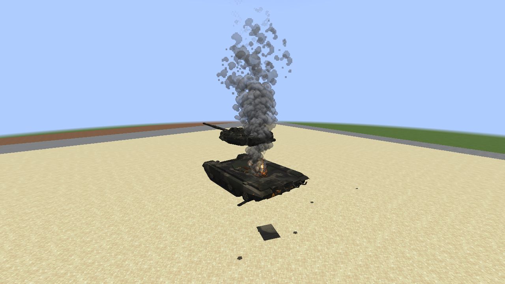 |

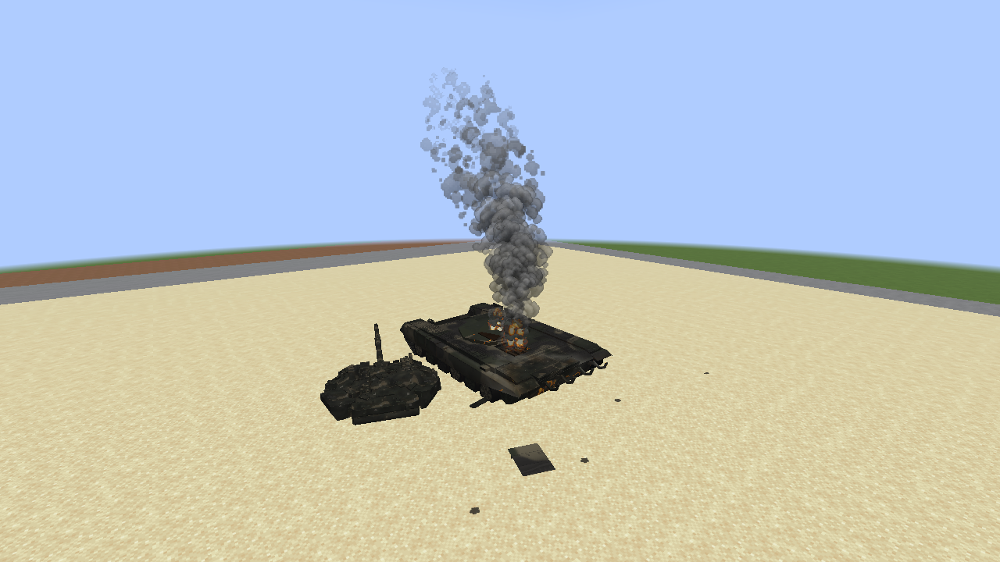

## T84 complete turret

| Before the cook-off stage | Complete posed turret separated |
| --- | --- |
| 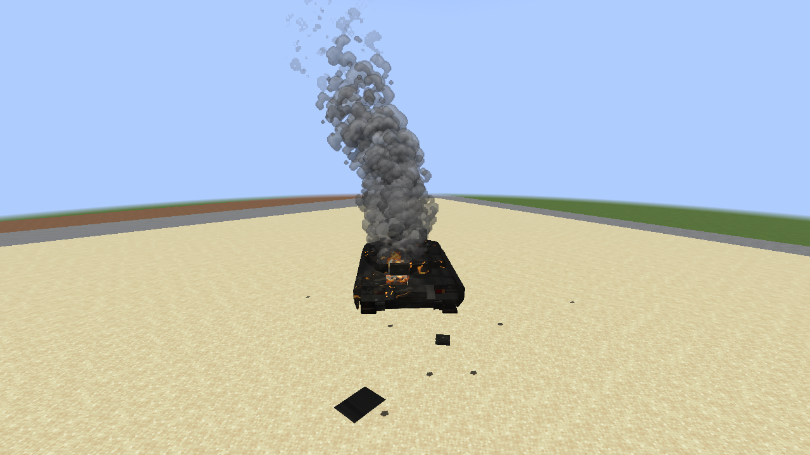 | 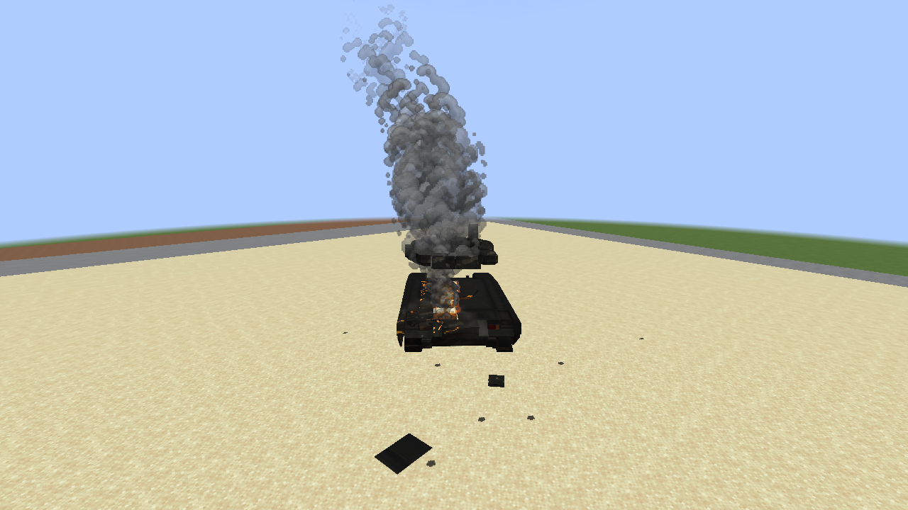 |

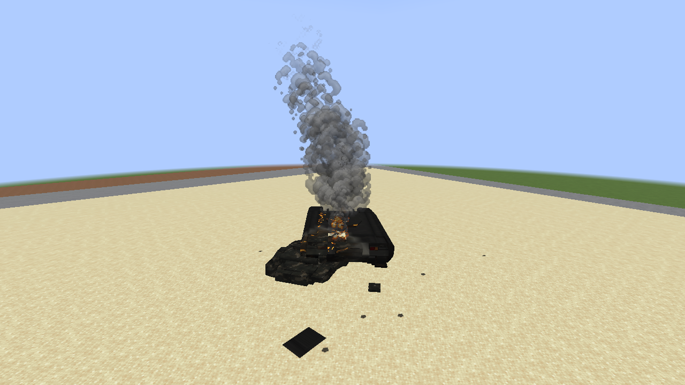

Both carousel examples use ordinary UUID seeds that failed the former one-in-eight random gate.

## Full debris budget

| Pressure panels remain raised | Turret remains visibly dislodged |
| --- | --- |
| 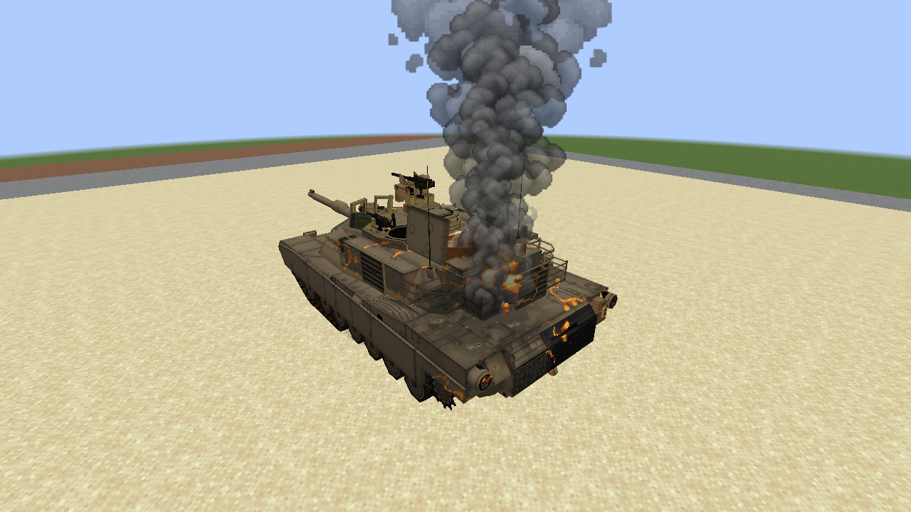 | 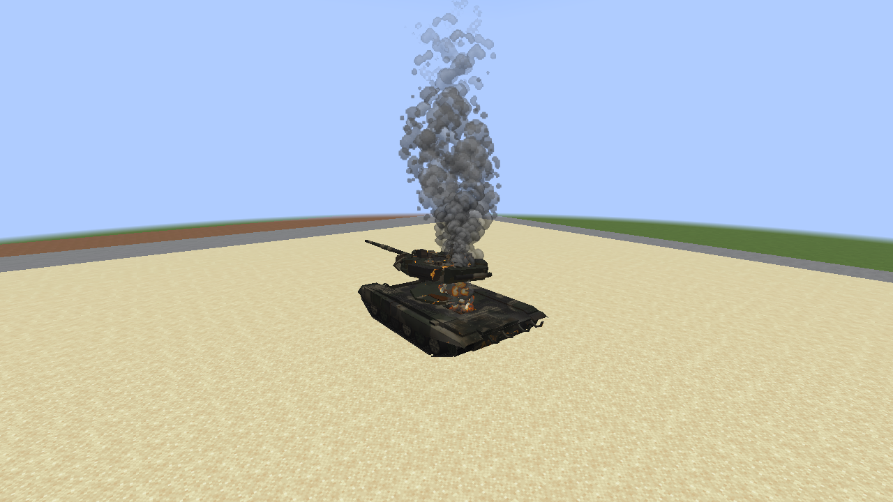 |

These two diagnostic scenes deliberately occupy the eight fragment slots with tiny airborne pieces
far outside the camera. The visible panels/assembly remain on screen instead of disappearing when
admission fails. [Implementation, eligibility and limits](M8_TANK_COOKOFF_PARTS.md).
