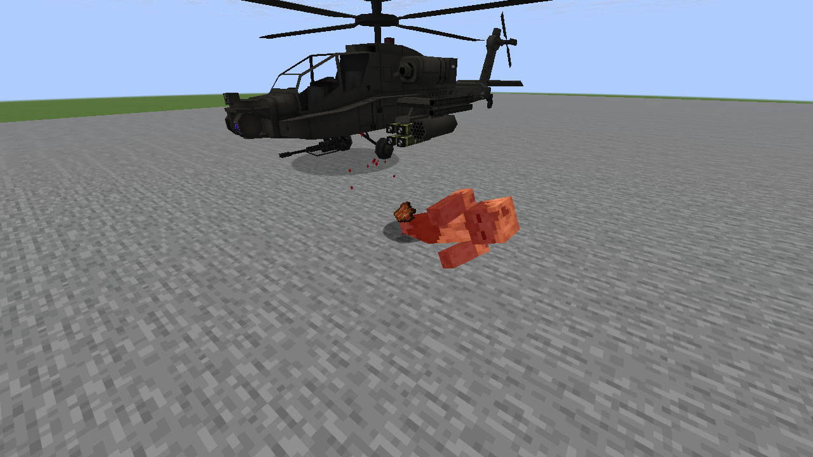
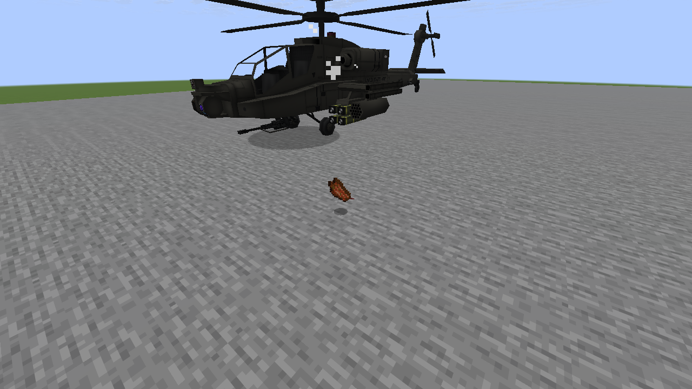
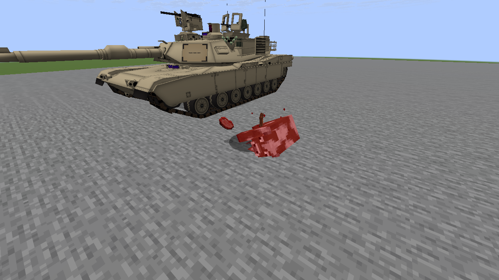
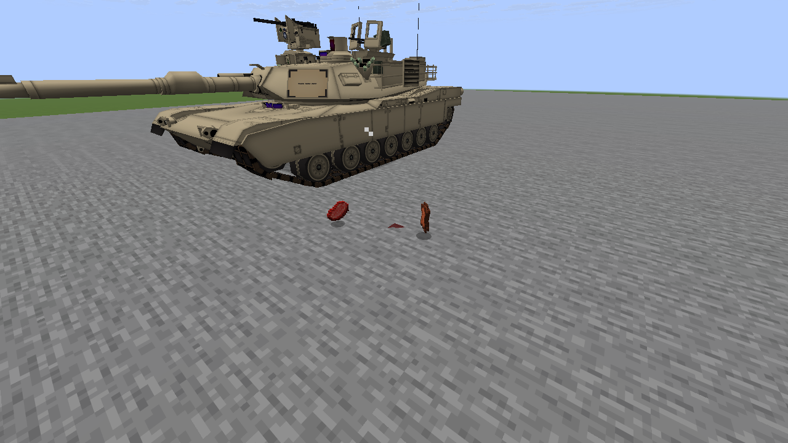
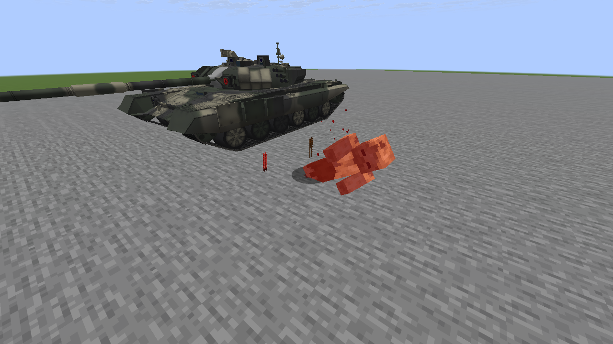
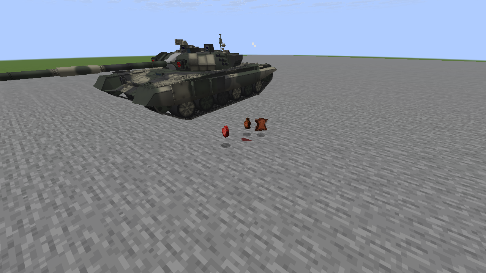

# Vehicle-kill blood: native Minecraft previews

Six unedited 1280×720 screenshots from Minecraft’s Vulkan renderer (Mesa llvmpipe).
These are **controlled kill previews**, not combat captures: vehicles are held in place; real
server damage calls, kill checks, optional network packets and production client effects run.
The M1A2 fixture runs the damage half of a conventional projectile blast without terrain damage
or the full fireball, to isolate blood. The T-90 is repositioned after its actual ram so the
victim stays visible. Vanilla red hurt tint, death smoke and item drops are unchanged.
No image generation, compositing, recoloring, cropping or NTM assets were used.

Blood is deliberately restrained: small dark red airborne pixels and one small temporary
ground splash. It does not replace the mob’s body. [Behavior, toggle and limits](M8_VEHICLE_BLOOD.md).

## AH-64 — conventional vehicle round on a husk

Airborne droplets after the confirmed kill:

Ground splash after the mob disappears:

## M1A2 — conventional blast damage on a cow

Airborne droplets after the confirmed kill:

Ground splash after the mob disappears:

## T-90 — ramming a husk

Airborne droplets after the confirmed kill:

Ground splash after the mob disappears:

The run confirms 10 / 14 / 10 admitted droplets, one ground mark per scene, three successful
toggle cleanups, and immediate suppression/cleanup after changing a supporting block.
This establishes rendering and behavior; target-PC 60 FPS performance is unmeasured.
