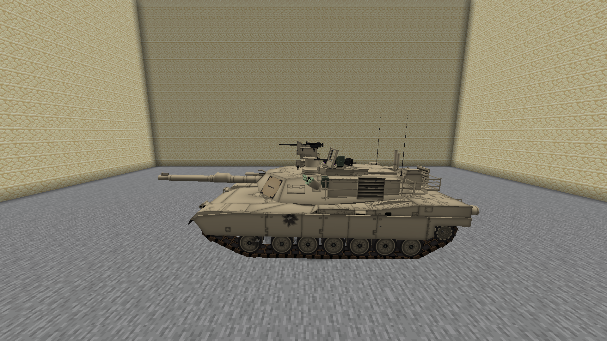

# Localized vehicle impact marks

Enhanced M8 damage details include irregular paint chips and metal scars from direct gun
hits, larger soot/chip patches from explosive cannon rounds, and cracked-glass art on
explicitly named glass/window/windscreen/windshield groups. Unidentified merged materials
receive ordinary painted-metal marks; this does not invent glass or armour penetration.

The server recovers the projectile ray's contact with the selected collision box because
the legacy entity hit result contains that entity's origin. It sends a small optional S2C
notification only to nearby players tracking the vehicle whose connection knows the channel.
The client fits that ray to visible model triangles, clips the overlay to the selected panel,
and stores its geometry in that model group's coordinates. Marks follow current turret,
canopy and hull transforms. Hidden/replaced groups and instance-count changes drop the
attachment rather than transferring it to another part.

Repair reduces mark opacity based on health restored, then fades it over several ticks.
Full repair clears existing marks. New damage does not restore faded marks. Marks also
expire after five minutes and clear when the vehicle unloads or the client changes world.
They are cosmetic session state: late joiners see subsequent impacts, not historical marks.

## Cost and compatibility

- Existing **vehicleDamageDetails** controls marks along with damage smoke/leaks/sparks.
  Classic presentation, disabled details, thermal and far vehicle rendering omit overlays.
- One shared 128×64 pixel atlas and one small translucent submission per marked vehicle;
  ordinary entity lighting, no glow or dynamic lights. The base GPU model is not rebuilt.
- Low/Balanced/High retain at most 8/16/24 marks per vehicle and draw at most 32/96/128 marks
  across the scene. Adaptive pressure reduces the visible cap. Fine marks fade at distance.
- At most 64 vehicle states, 512 stored marks, four pending hits per vehicle and two fits per
  frame. At most 32 clipped triangles per mark and 256 group instances per fitting attempt.
- Triangle indexes build on the model loader. Weak keys do not retain unloaded model arrays;
  indexes cover at most 262,144 triangles total and 65,536 per group. Evicted indexes rebuild
  off-thread with at most eight queued/running groups; pending hits expire after two seconds.
  Oversized addon groups omit fitting. No full-model index is built on the render thread.
- Server notifications allow four per vehicle per four ticks and 32 per level per tick.
  No C2S mark requests, existing packet encoding changes or required protocol changes.

Gameplay damage, armour, component health, bullet collisions, legacy explosion placement,
original craters and Claude's NTM integration are unchanged. Glass cracks are cosmetic;
this pass does not deform meshes, break windows or detach panels.

## Validation

Automated coverage checks ray selection, clipping at panel edges, bounded geometry, moving
part attachment, material choice, repair arithmetic, rate limits and packet validation.
The opt-in `mcheli.probeVehicleImpacts` fixture uses real stock gun projectiles against a
stock M1A2 and checks optional packet delivery, rotation, index recovery, repair and disabled
effects. It is excluded from normal builds. Native results accompany the PR.

299 local unit tests pass. Native Vulkan/OpenGL checks passed real gunfire, rotation, index
recovery, repair and disabled effects. Vulkan additionally checked moving turret transforms,
partial repair fading and an 11,520-notification client burst that stayed at 16 marks and
cleared correctly. [Results](performance/m8-realism/vehicle-impact-marks.json).

Local M8 builds exclude unavailable JEI and compile the optional NTM bridge and HBM-specific
GameTests against isolated signatures; NTM is absent at runtime. Those signatures are not
included in mod output. Normal GitHub CI builds all integrations and runs the complete
standard and NTM GameTests. No repository dependency is changed.

The target remains 60 FPS on RTX 3060 8GB / Ryzen 7 7800X3D at 1080p. Software-renderer checks
validate behavior and bounded work; hardware FPS still requires target-PC measurement.
