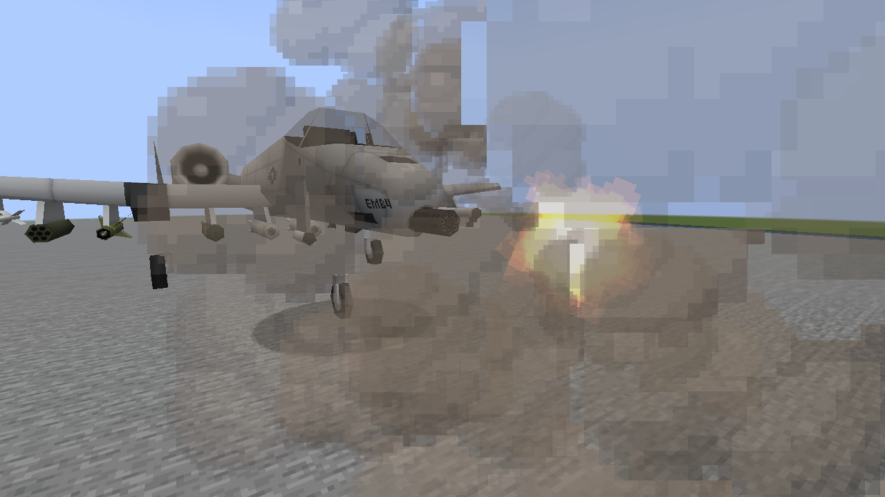
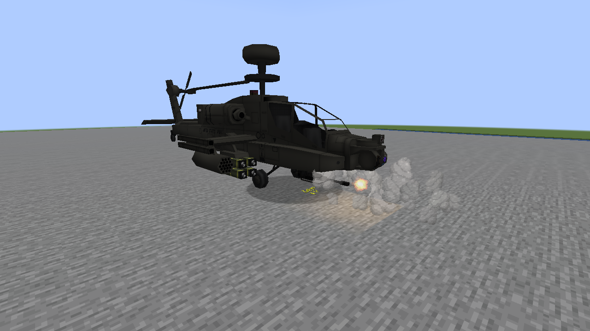
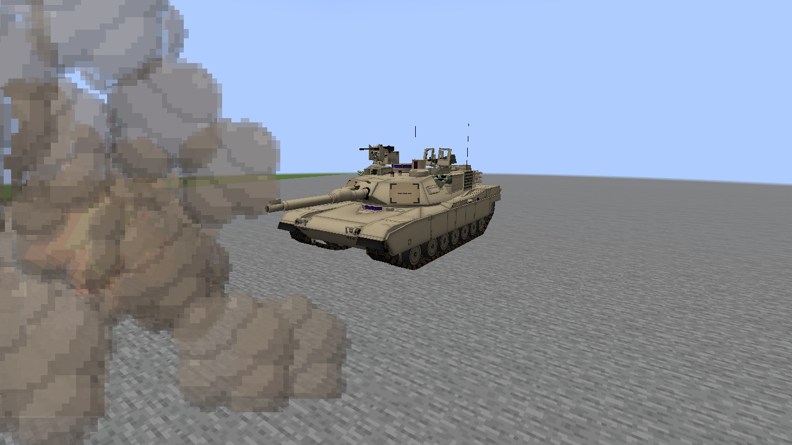
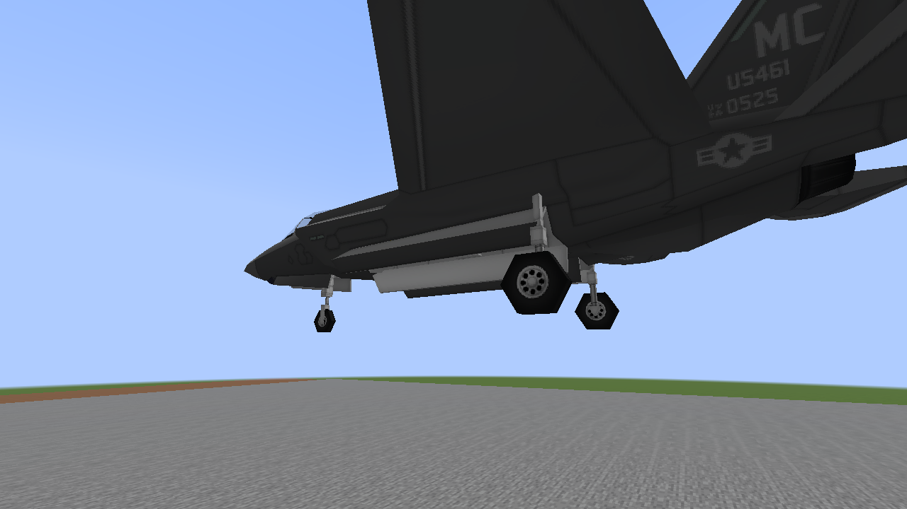

# Weapon mechanisms: native examples

Unedited 1280×720 Vulkan captures of the actual A-10, AH-64, M1A2 and F-35A models.
The development fixture replays replicated client firing states above a stone pad in daylight.
It does not fire server projectiles or consume ammunition. Animation checks accompany these
still frames; a still image alone cannot demonstrate barrel rotation or recoil recovery.

## A-10

The GAU-8 retains its cases; no automatic muzzle-case shower is added. Existing smoke can
obscure the barrel during sustained fire.

## AH-64

The M230 cases are capped to approximately 11 cm. Forty emitted cases settled in the native
check and shared one casing draw batch.

## M1A2

The original recoil travel remains the maximum; only the client presentation curve changes.
The tank gun produces no automatic muzzle-case fallback.

## F-35A

This close view intentionally crops the airframe. All four doors linked to the selected GBU
reach their authored open angle inside the unchanged switch wait. An NTM-flagged selected set retains
its original curve in a separate native check.

[Behavior, controls and limits](M8_WEAPON_MECHANISMS.md). Target-PC 60 FPS acceptance remains open.
