# Torn-wing fuel spray: native Minecraft examples

These are **unedited controlled Minecraft previews**, using actual component damage, live
breakup meshes and production atmosphere effects. The aircraft are held airborne and moved
for comparison; these are not recordings of player-driven combat. Normal examples keep
85% overall hull HP, so the new leak can be seen independently of engine-damage smoke.

The fuel effect is deliberately small: pale droplets below the cut and faint wisps left behind.
It does not form a sustained smoke hose. Settings: Enhanced, Polished, Balanced, damage
details/destruction sequences on, adaptive effects off, daylight, 1280×720.

## F-35A — left wing — Vulkan

| Overview, 25 ticks after loss | Native close-up, 45 ticks after loss | Repaired, no new fuel |
| --- | --- | --- |
| 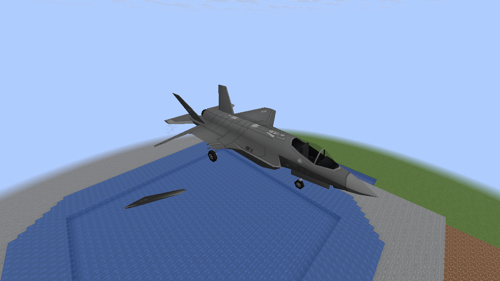 | 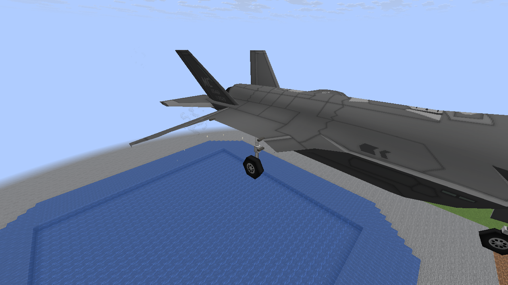 | 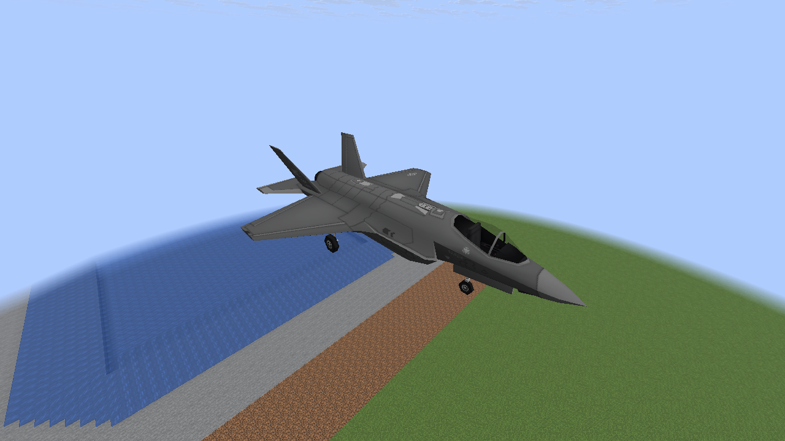 |

## F-15E — right wing — Vulkan

| Overview, 25 ticks after loss | Native close-up, 45 ticks after loss | Repaired, no new fuel |
| --- | --- | --- |
| 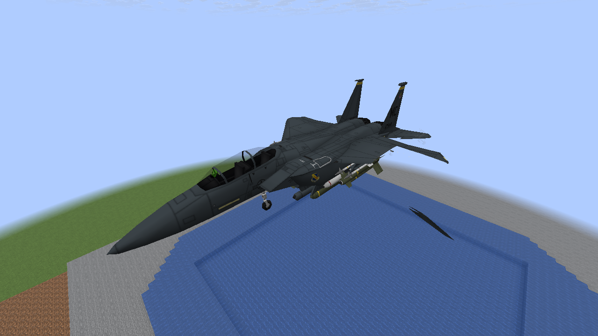 | 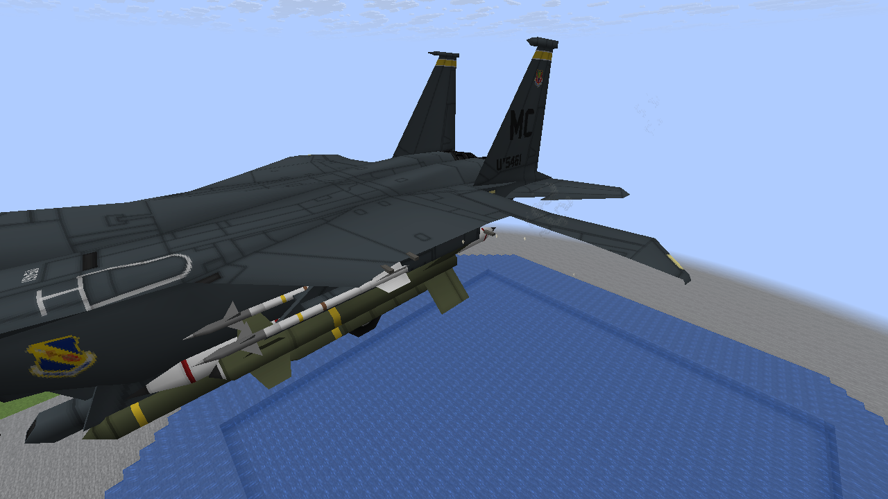 | 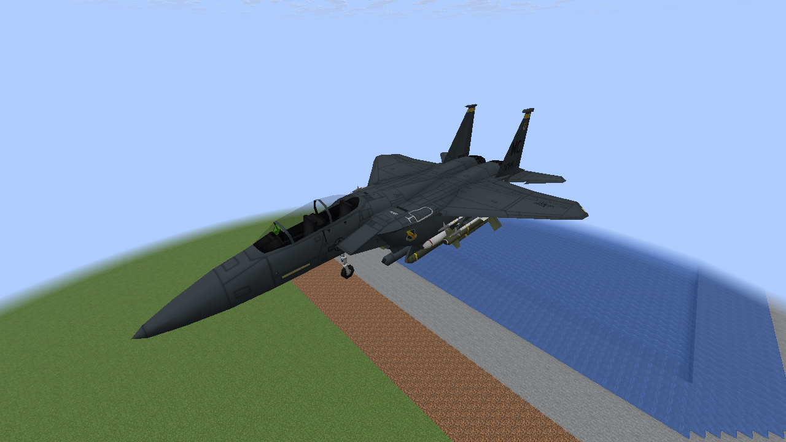 |

## A-10 — both wings — Vulkan

The aircraft alternates the active sides within one shared per-aircraft emission rate.

| Overview, 25 ticks after loss | Native close-up of the right cut | Repaired, no new fuel |
| --- | --- | --- |
| 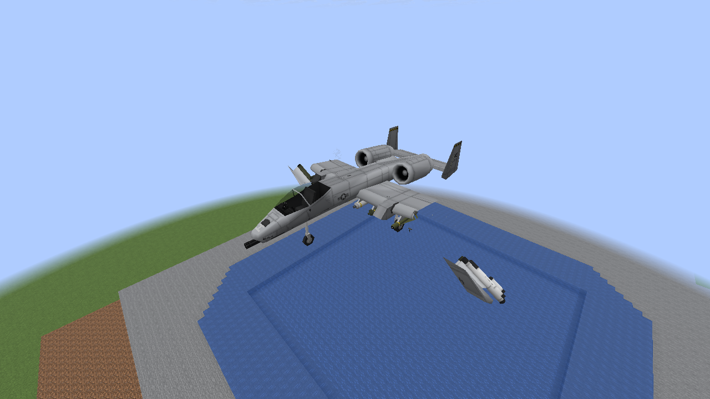 | 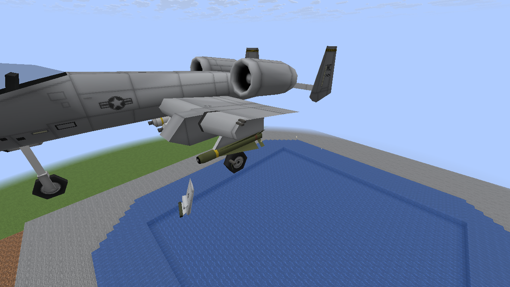 | 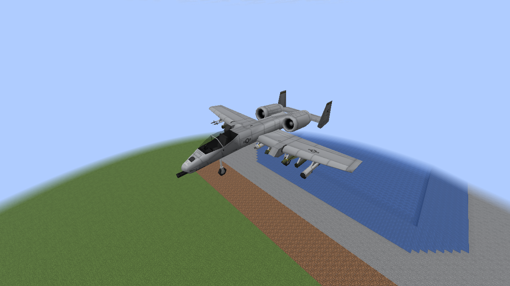 |

The middle column moves the camera closer; it is not a larger effect or an edited crop.
Existing detached wing pieces in the early images come from the already merged breakup system.

## Banked, burning F-35A — OpenGL

This fixture checks that the source stays with the rotated cut face. Its natural wing stream
stays unlit because it misses the engine fire; burning engines do not automatically ignite
every fuel droplet.

| Banked cut and existing engine fire | Later stream |
| --- | --- |
| 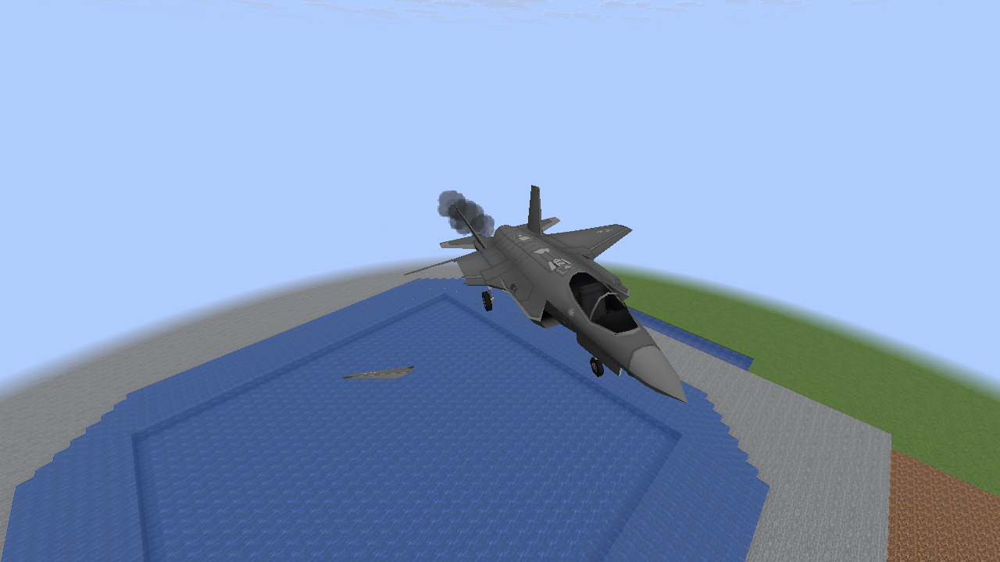 | 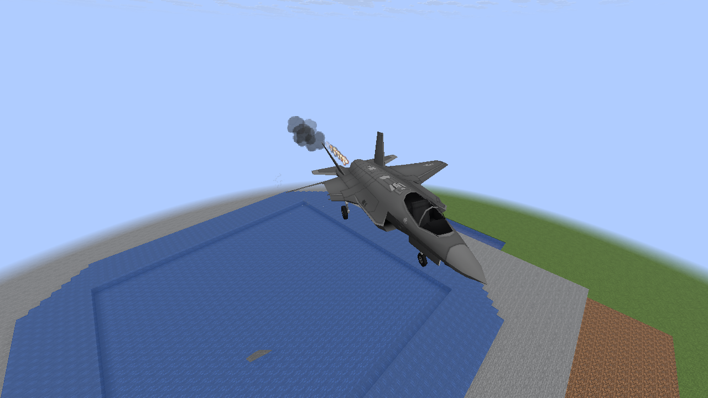 |

## Already missing on arrival — OpenGL

Loading an aircraft with a wing already missing keeps its structural silhouette without
replaying a fresh fuel spray. The native run asserts zero new fuel particles in this scene.

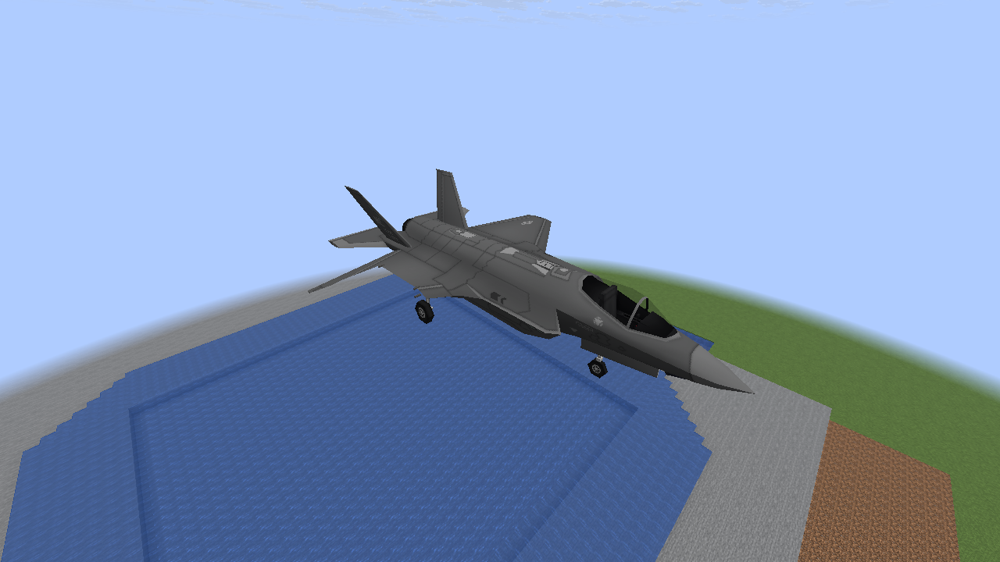

## Conditional ignition — separate development fixture — OpenGL

This image **manually places a few fuel particles next to an existing engine fire** to exercise
the conditional art/light transition. It is not a natural torn-wing ignition capture. The
ordinary photographed streams above did not ignite. A hot droplet changes its own sprite;
it creates no child particles or gameplay fire.

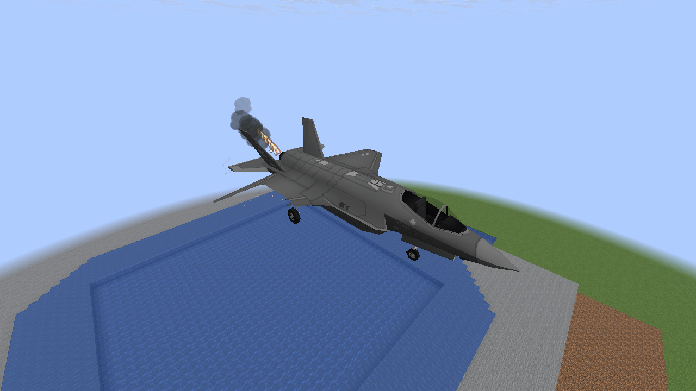

## Shared load — Vulkan

Thirty-two damaged aircraft with torn wings share the existing atmosphere and effects limits.
This is a synthetic bounds/cleanup check, not a target-PC frame-rate benchmark.

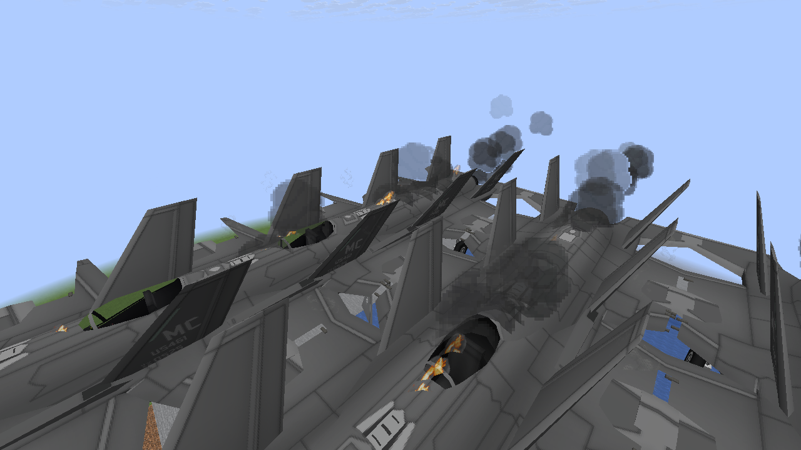

Both renderers pass repair, expiry, no-replay, Classic, disabled-detail and disabled-sequence
checks. [Implementation and controls](M8_WING_FUEL_SPRAY.md) ·
[Capture hashes and observed counts](performance/m8-realism/wing-fuel-spray.json).
Software Mesa captures do not establish 60 FPS on the target RTX 3060 / 7800X3D PC.

To reproduce in the disposable `M6Smoke` world with cheats enabled:

```sh
./gradlew -I scripts/visual-probe.init.gradle --no-configuration-cache \
  -Dmcheli.probeWingFuel=true -Dmcheli.probeBackend=VULKAN runClient
```

The opt-in fixture is excluded from normal builds. PNGs are copied directly without cropping,
recoloring or compositing. Use `-Dmcheli.probeWingFuelEnd=3` to capture only the three ordinary
vehicle examples, or `-Dmcheli.probeBackend=OPENGL` for the other renderer.
