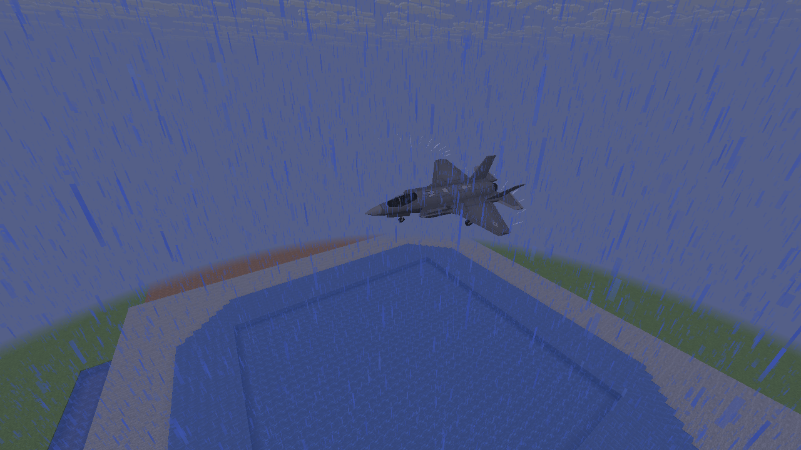
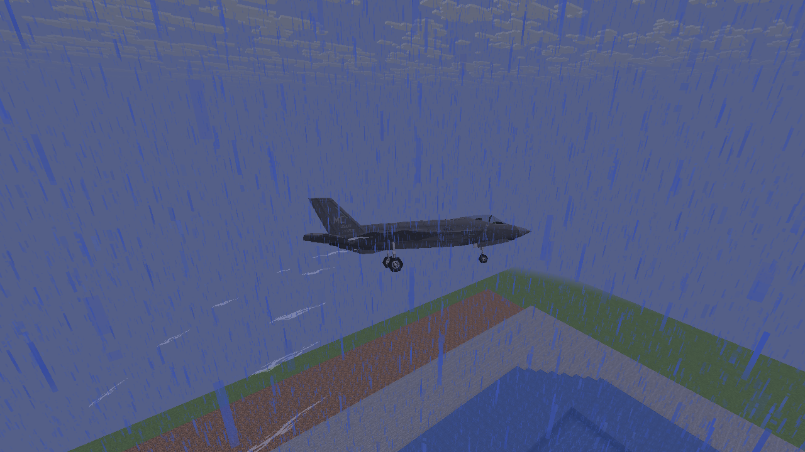
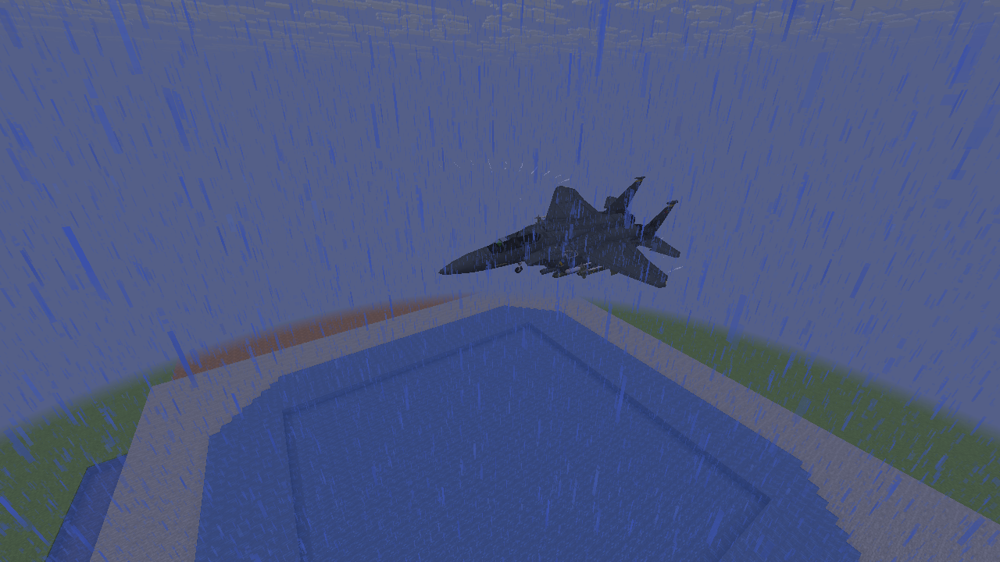
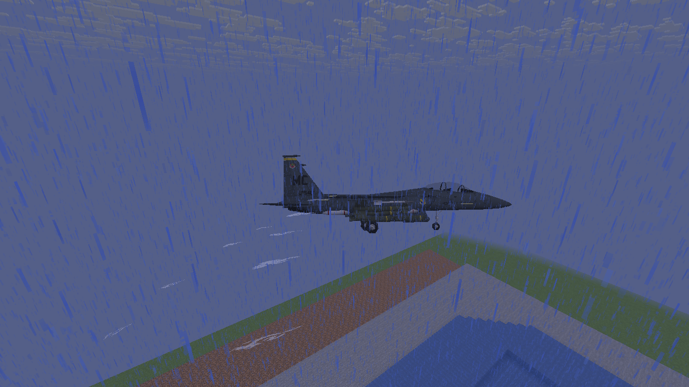
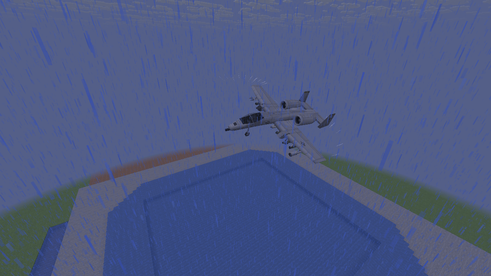
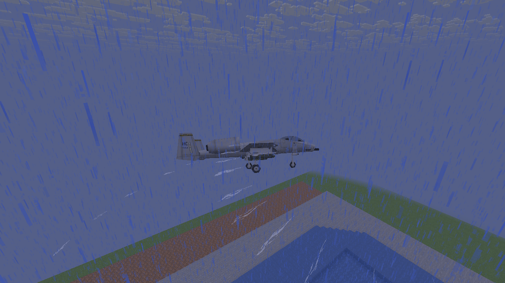
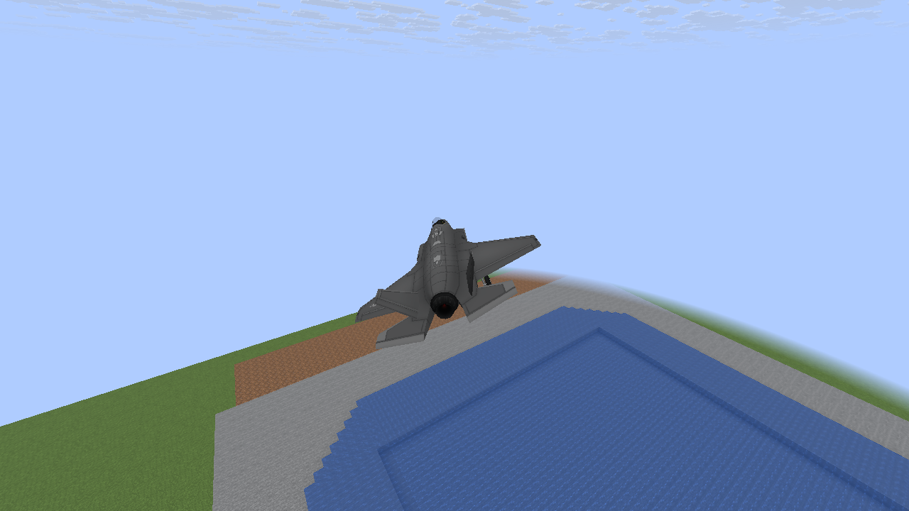
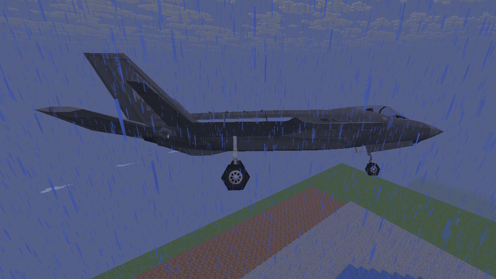
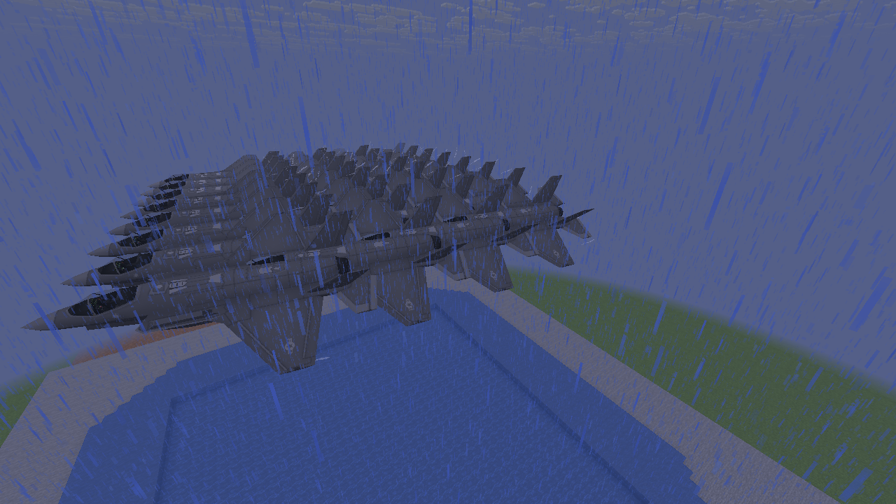

# Wingtip vapor: native examples

Unedited 1280×720 Vulkan captures of real vehicle models on held wet-turn trajectories.
These are controlled previews, not combat recordings. Vapor is deliberately thin: look for
the pale strands curving behind the wing tips. The blue diagonal streaks are vanilla rain.

Vapor follows actual supported tips, stays in world space and disappears after straightening.
The F-15E reports zero velocity and uses observed motion. The lost-wing scene stops the missing
left emitter while retaining the right tip. [Implementation and settings](M8_WING_VAPOR.md).

## F-35A

## F-15E — observed-motion fallback

## A-10

## After the weather clears

## Left wing lost: surviving right tip only

## 32-aircraft shared load

Native checks also cover straight flight, configuration and Classic transitions, smooth drain
and shared limits. Software Mesa does not establish the 60 FPS target on the player’s PC.
