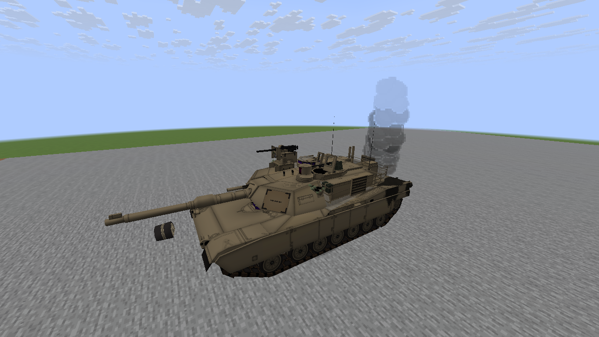
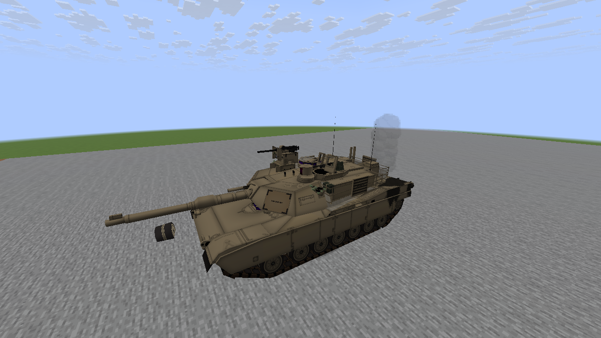
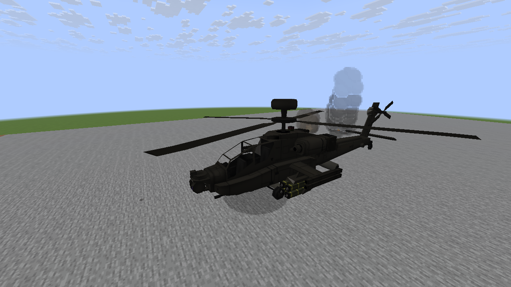
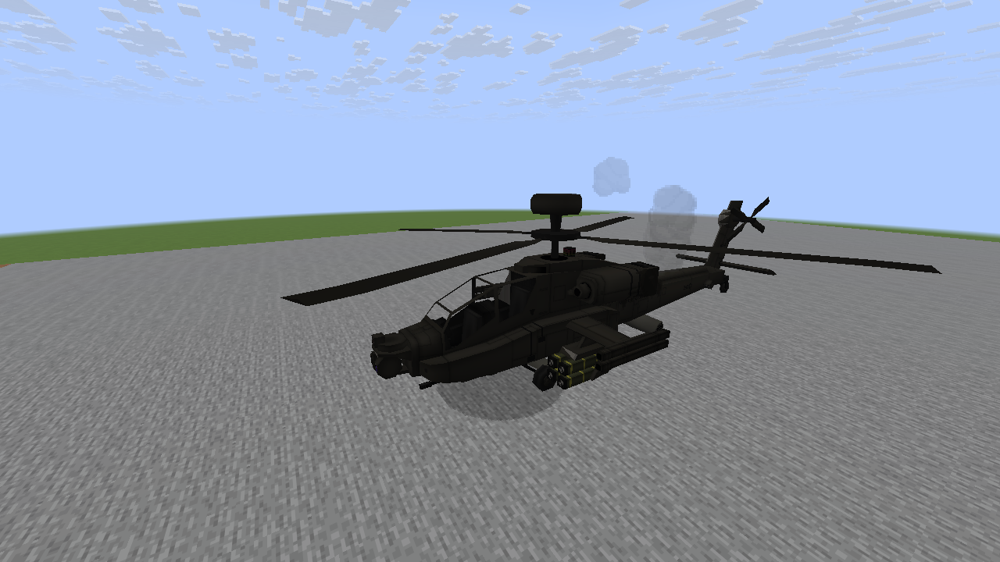
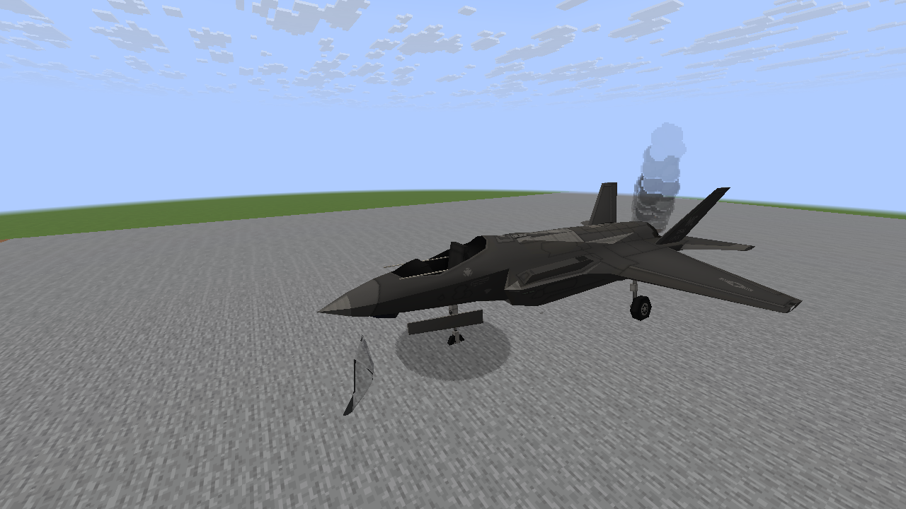
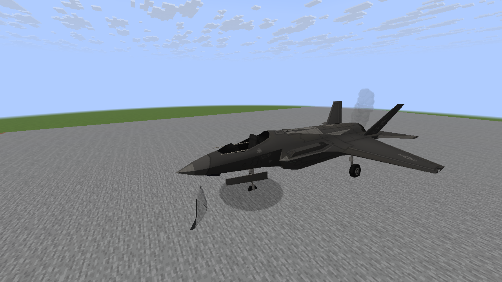

# M8 wreck aftermath examples

Unedited native Minecraft captures of controlled live-to-wreck states in the production renderer. Each example shows the early burning wreck and later cooling smoke. These are not combat captures or concept images.

Supported parts vary by model: the Abrams loses a small running-gear part, the Apache loses a small weapon assembly, and the F-35A loses its canopy and gains damaged outer wing geometry. Full model-specific hull breakup is not part of this pass.

## M1A2 Abrams

Early burning wreck

Cooling wreck

## AH-64 Apache

Early burning wreck

Cooling wreck

## F-35A Lightning II

Early burning wreck

Cooling wreck

