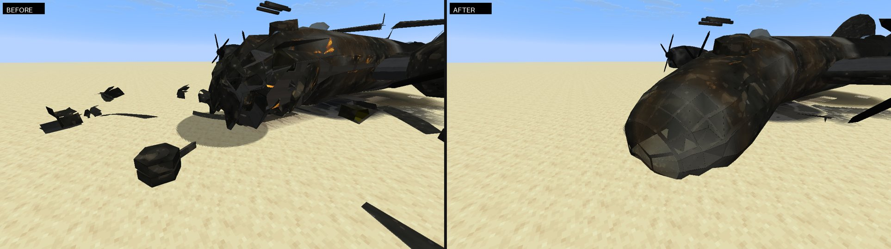
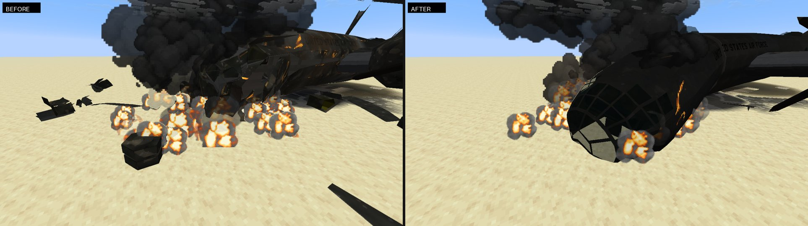
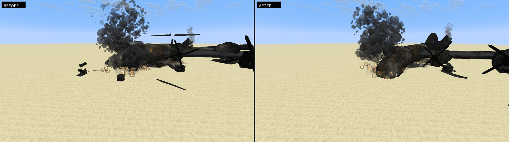
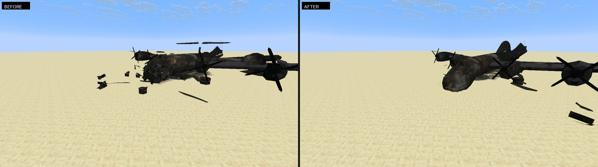

# M8 wreck glitch fixes

Crashed bombers looked broken in ways the wreck work never meant: a B-29's nose was a bristle of black
spikes, the hull split lengthwise through the fuselage with its inboard engines and wing hanging beside it,
propellers and gun turrets floated in the air, wing tips and the tail cone were see-through, and a torn-off
tail could come to rest balanced on the tip of its fin with its stabilisers held up in mid-air. All of it is
client-side and cosmetic, like the rest of the wreck work.

## What was wrong, and the fix

1. **Spiky nose.** The crushed nose's wrinkles were scaled by the whole airframe's length: a few
   centimetres on a fighter, but a block on a 38-block bomber, so neighbouring corners shot apart into
   spikes. Wrinkles are now at most 0.16 blocks deep (and never more than an eighth of the distance from
   the fuselage axis); the nose is crushed back at most 1.3 blocks and droops at most 0.6.
2. **Bombers and airliners split down the middle.** The nose only broke off where the fuselage was under
   1.6 blocks wide, which no B-29, C-5, 767, MD-90, AC-130 or Cessna fuselage is. With no nose cut they fell
   through to the flying-wing rule and split lengthwise just right of the cockpit, taking half the
   fuselage, the inboard wing and its engines off sideways. The nose now breaks where the fuselage is a
   tube for its size (up to 7.5% of the length either side, or no wider than the nose and a third), and only
   a real flying wing or delta, whose leading edges sweep steadily outward behind the nose, splits through
   its centre body. Of the stock planes that is the B-2.
3. **Floating propellers and turrets.** Parts that are separate model groups (propellers, gunner turrets,
   guns) stayed where they were while the section they sit on broke away, and they ignored the crushed
   nose and drooped wings. They now move with the skin under them and with their section.
4. **See-through wing tips.** Every third triangle near the right wing tip was dropped to make it look
   torn, which punched holes through the skin. Every triangle is kept now.
5. **Floating soot patch.** The dark patch where the fire was is cut from the wrecked shape, not from the
   undamaged airframe, which hung beside the drooped wing as a see-through ghost.
6. **See-through tail cone.** Where a fin is modelled into the fuselage skin, snapping it off left a slot
   along the top of the tail; through it the tail cone's culled inner walls made the whole rear fuselage
   look like a flat see-through wedge. The slot is now closed on both the kept fuselage and the falling fin.
7. **Tail resting on its fin tip.** A falling piece settled onto whichever broad face was nearest, so a
   tail that landed upside down stayed on the tip of its fin. Torn pieces now settle heavy side down,
   which puts a tail on its stabilisers with the fin up.

## Captures

Native OpenGL (llvmpipe) captures from `WreckRealismProbe` with a B-29 shot down over the desert test
world, before (left) and after (right).

Cold hulk, close: the spiky nose is now a crushed, dented forward fuselage that has snapped off.

Burning: no spikes, and the hull lies in a fuselage, a nose and a wing instead of two lengthwise halves.

Smouldering: the torn-off tail lies on its stabilisers with the fin up.

Cold hulk, wide: the tail lies fin up, and the propellers sit on their engines.

## Checks

`WreckCrumpleTest`: on a 38-block hull no edge of the crushed skin stretches by more than a dent, and the
nose moves back no more than the limit. `WreckSectionsTest`: the B-29, C-5, 767, MD-90, AC-130 and Cessna
lose their nose and do not split, and the B-2 still splits; a point on a broken-off wing or nose goes with
it; a B-29 that loses its fin keeps its tail cone closed. `DebrisMotionTest`: a tail that lands upside down
comes to rest on its stabilisers.
