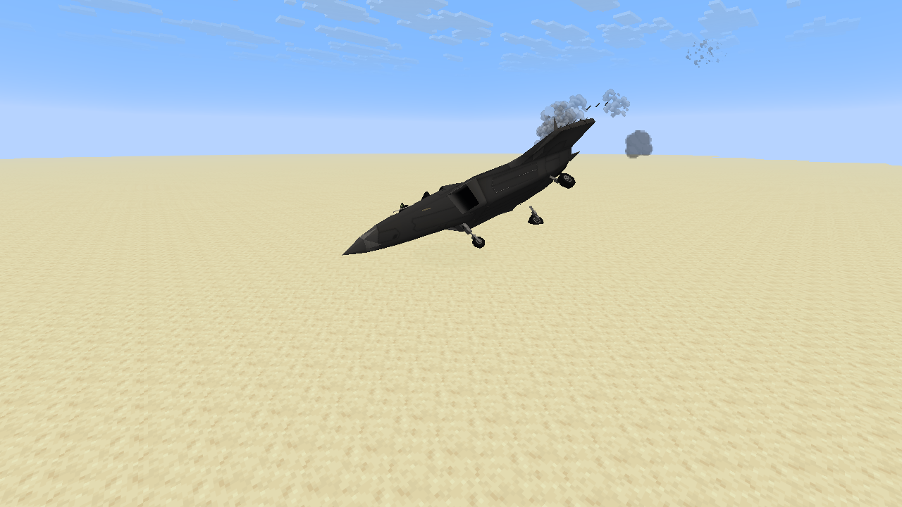
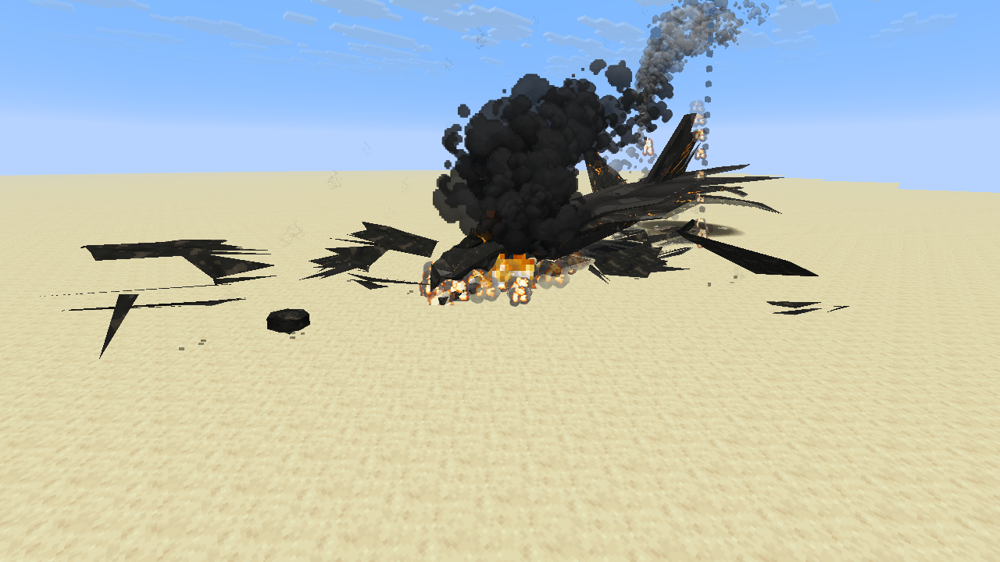
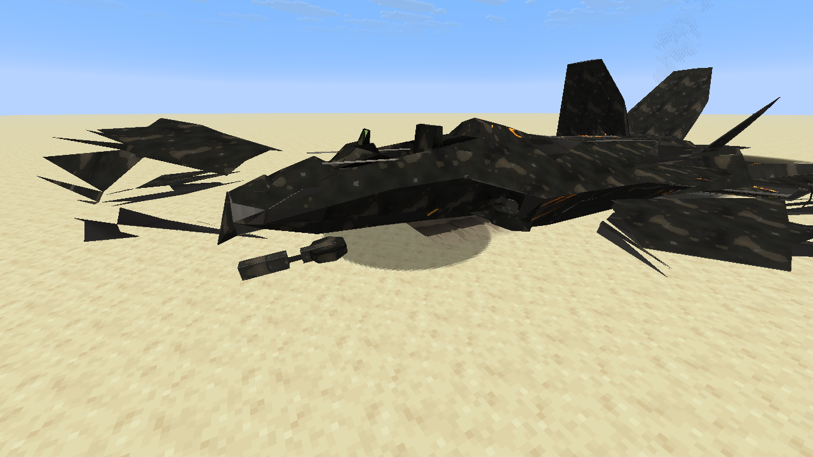
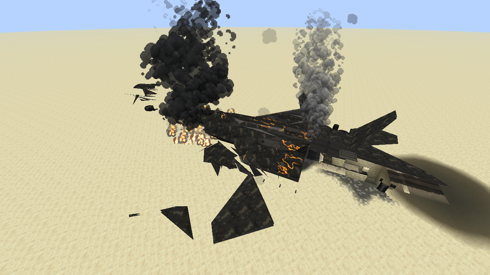
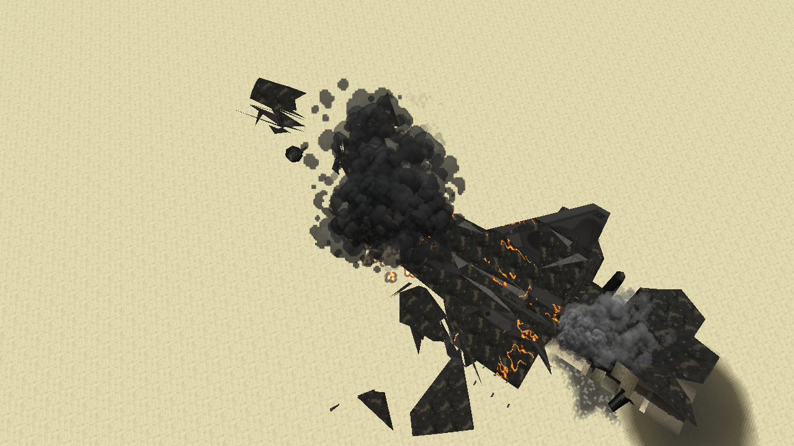
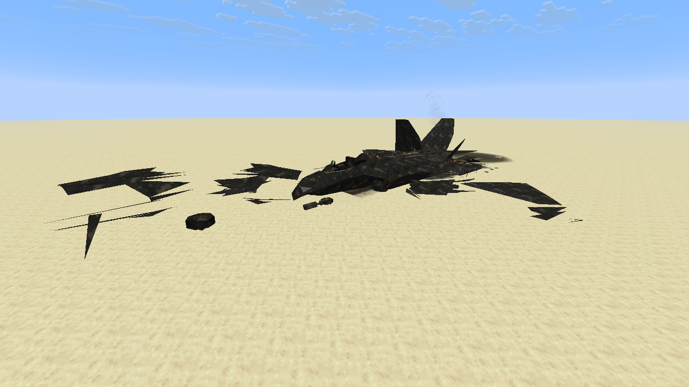

# M8 realistic crash wrecks

A shot-down plane used to come to rest looking like a clean model cut into pieces: paint and markings
intact, propped at the angle it hit, vanilla fire blocks dotted around it and gone after 25 seconds.
This pass makes a crash read as a crash. It builds on the closed breakaway sections (PR #125) and their
rigid-body motion (PR #126). Everything except the server settings below is client-side and cosmetic,
and follows the existing Enhanced quality and vehicle damage details settings.

## What changed

1. **Burnt-out shell.** The hull starts a shade darker than paint and chars over the first fire
   (18 seconds). The burn spreads from where the fire was (the engines and, on planes, the wing roots)
   and fades over a fifth of the airframe with a ragged edge (`WreckBurn`): the charred layer
   (`m8_wreck_char.png`) is nearly solid at the fire and only a light film elsewhere, so the nose, tail,
   tips and markings stay readable under a darkened, greyed paint. Around the char the paint has
   peeled to dull bare metal (`m8_wreck_bare.png`), with a narrow bronze heat tint on its hot side.
   Faces are split to 0.75 blocks first so the fade is smooth on low-poly hulls. Embers (`m8_wreck_embers.png`, drawn full bright) glow in seams at the engine end and wing
   roots, in three nested tiers that go out one by one over 90 seconds after the fire. Torn wings and
   tails and the wreck's loose panels char the same way.
2. **Fuel fire instead of fire blocks.** Crash and destruction blasts no longer set fire blocks (server
   config `wrecks.fireBlocks`, off by default). The client draws a pool of burning fuel where the wreck
   comes to rest: flames across the pool with heavy black smoke for 7 seconds, dying out over the next
   31. The hull's own plume keeps going, and after it thins out a faint wisp rises from the hulk for
   another three minutes.
3. **Crumpled on impact.** A crashed plane's hull mesh is rebuilt on the loader thread: the front 38%
   droops up to 4 degrees, the nose is shortened and flattened, and its skin wrinkles, with faceted
   normals on the crushed part. The rear (where the breakaway caps sit) is untouched, so cut sections
   still line up. The canopy bursts into glass shards instead of flying off in one piece. Once the
   wreck stops it is drawn settling level onto its belly or back over a second and a half, lowered by
   the height of its lost landing gear, instead of staying propped at its landing angle. The entity's own
   pose is unchanged; this is only how the hulk is drawn.
4. **Ground scar.** A burn scar (sized to the airframe, 1.6 to 4.5 blocks) at the impact point and a
   darker fuel stain where it rests. They are cut to the top faces of the block columns underneath and
   skip water and ledges, on top of the explosion's own crater and scorch.
5. **Debris field and skid trail.** While the wreck slides, a gouged groove is laid along its path.
   The landing gear is sheared off and, with up to nine chunks of charred skin cut from the hull, is
   flung forward with the wreck's speed; the pieces bounce, slide and come to rest along the path
   (the `DebrisMotion` model from PR #126). A wreck first seen already down (joining near an old crash)
   gets its scar and a settled debris field behind it, but no fresh fire, flying debris or trail.
6. **Persistent hulk.** Destroyed vehicles stay for 10 minutes (server config `wrecks.persistentWrecks`,
   `wrecks.wreckLifetime`; 0 keeps them until cleared). `/mcheli clearwrecks [radius]` removes hulks
   in every level, or within a radius of the caller. The scars, debris and rested sections stay as
   long as the hulk and fade over 10 seconds after it goes. Turning `persistentWrecks` off restores
   upstream's `despawnCount`.

## Budgets

Wreck mesh variants stay on the existing loader (24 cached, four pending, 60,000 source vertices).
The charred layer is one extra pass over each wreck part within 48 blocks; embers are at most
6,000 triangles a tier. Debris fields: six wrecks, 72 pieces and 36,000 vertices in all, three world
rays a tick. Ground marks: 48 column reads a tick, 600 drawn pieces (160 on the Low budget), 96 blocks.
Fuel fire and smoke go through the shared atmosphere admission. Thermal view skips the char and ember
layers.

## Captures

Native OpenGL (llvmpipe) captures from the non-shipping `WreckRealismProbe`
(`-Dmcheli.probeWreckRealism=true` with `scripts/visual-probe.init.gradle`): a real F-22A is shot down
over the desert test world, crashes at about 15 m/s and is followed from the impact to the cold hulk.
`-Dmcheli.probeWreckTag=before` on the previous build gave the "before" shots.

| Before | After |
|---|---|
|  |  |

## Checks

`WreckCrumpleTest` (only the front moves, shared corners stay together, crushed faces keep facing out,
the charred layer covers every triangle just off the hull, ember tiers and debris chunks are bounded),
`WreckGroundTest` (a rotated groove cut into columns adds up to its area), `WreckFuelFireTest` (the
pool outlasts the hull's flames, the wisp ends), and `WreckAppearanceTest` (the hull chars and darkens, a wreck at rest
settles onto its belly or back and drops by the gear height).
