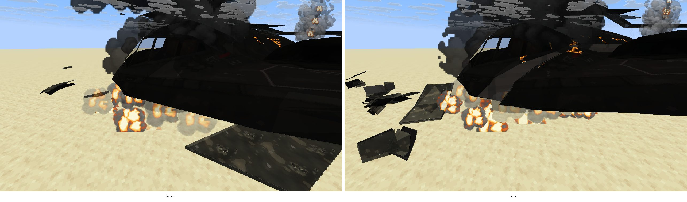
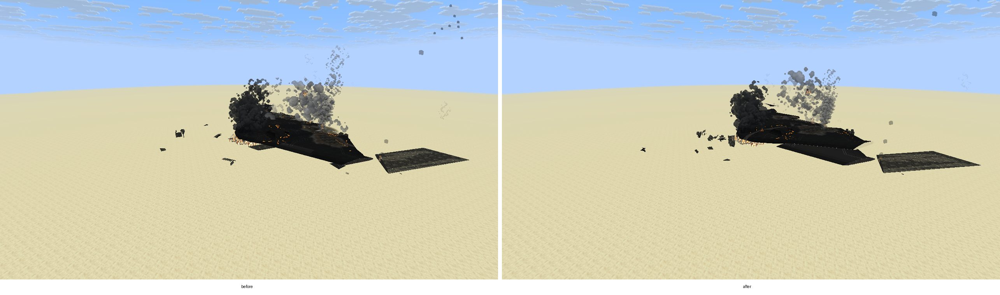
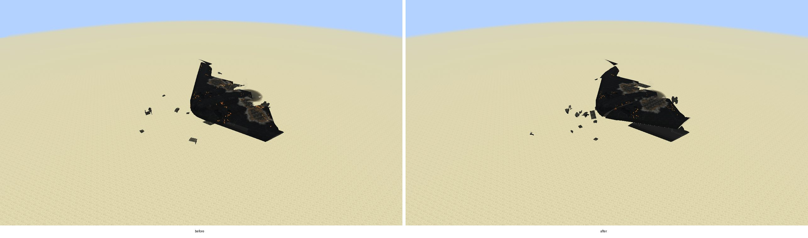
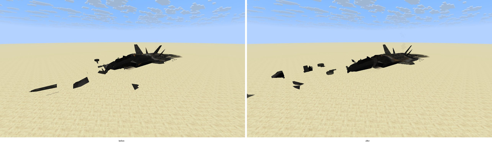
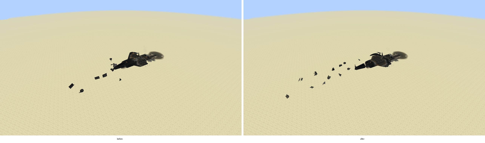

# M8 crash wrecks that break into sections

A crashed plane used to come to rest as one model: the whole hull charred, the right wing and fins gone,
and a scatter of flat cut slabs around it. On a big flying wing such as the B-2 that meant one huge black
slab with embers glowing over its entire surface. This pass makes a crash break the airframe into a few
believable structural pieces and makes the small debris look like torn sheet metal. Like the rest of the
wreck work it is client-side and cosmetic, and follows the Enhanced quality and vehicle damage details
settings.

## What changed

1. **Forward fuselage snaps off.** The hull is cut where the fuselage is still a narrow tube, 18% to 34%
   of the length back from the nose (no wider than twice the nose, at most 1.6 blocks either side). On
   impact the nose section is shoved forward, slews 8 to 24 degrees, rolls and digs its nose in, over half
   a second. Both sides of the cut are closed with the same lining and cap as a torn wing. The crushed
   nose from the earlier pass is untouched, because the cut sits behind it.
2. **Outer left wing breaks away.** The right wing already tears off during the destruction sequence. On
   impact the left wing now breaks at the same span station the in-flight breakup uses, is pulled out at
   the root, swept back 12 to 30 degrees about its trailing edge and dropped to the hull's belly. A left
   wing that was already shot off in flight is not cut again.
3. **Flying wings split through the centre body.** A hull too wide to lose its nose (a flying wing or a
   delta wider than 8 blocks once its wings are off) splits just right of the cockpit instead: the right
   half is pushed out, swung back and buckled, so a B-2 lies in distinct pieces rather than as one slab.
4. **Debris is bent metal.** The chunks in the debris field are smaller (a sixteenth of the airframe, 0.5
   to 1.1 blocks) and there are up to 14 of them. Each is folded 35 to 80 degrees along a clean crease and
   dented, so none is a flat slab.
5. **Embers where the fire was.** Embers no longer cover the whole span band of the wing: they gather
   around the two wing roots, at the engine end and along every torn edge. The base scatter elsewhere
   dropped from 4% to 1.5%.

Each section is burnt, charred and glowing like the hull, from the same fire sources seen from where it
now lies. Angles come from the wreck's seed, so each crash breaks a little differently but a given wreck
always looks the same. Wrecks first seen already down show their sections at rest.

Kept from earlier work: the rear fuselage stays on the hull when the tail goes (only fins and stabilisers
break off, PR #150), wrecks stay out of their crater (PR #147), the crushed nose, the burn spread, the
fuel fire, the scars and the persistent hulk.

## Budgets

Sections are built once per hull on the existing wreck-mesh loader thread (24 cached, four pending,
60,000 source vertices); a section over 12,000 vertices stays on the hull. Linings are capped at 4,096
vertices for the hull side of each cut and 2,048 for the section side. The debris field keeps its 72-piece,
36,000-vertex limits.

## Captures

Native OpenGL (llvmpipe) captures from `WreckRealismProbe`, B-2 and F-22 shot down over the desert test
world. "Before" is the previous build. The probe gained two shots framed by the airframe's size
(`2b-burning-wide`, `9-cold-overview`) so a bomber is seen whole. Each image is before (left) and after (right).

B-2, close: the centre body has split beside the cockpit and the debris is folded metal, not slabs.

B-2, burning and cold, framed whole: two halves with a gap between them, embers only near the fire.

F-22, cold hulk: the forward fuselage has snapped off and slewed round.

## Checks

`WreckSectionsTest`: a fighter breaks into hull, nose and outer left wing whose areas add up to the whole
hull, each piece lies on its side of its cut and every cut is capped on both sides; a delta keeps its nose
and splits its centre body instead; sections are joined before impact and torn away after it; debris
chunks are folded out of the skin's plane. `WreckCrumpleTest` allows for the fold in a chunk's size.
