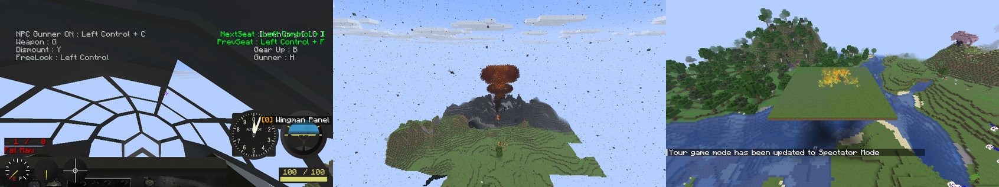

# NTM Next weapon payloads

McHeli weapons can carry the warheads of [NTM Next](https://www.curseforge.com/minecraft/mc-mods/ntm-next)
(mod id `hbm`), as upstream McHeli CE's HBM integration did. NTM Next is optional: without it, a
weapon with a payload logs one warning and explodes normally. The port is built and tested against
NTM Next 1.0.3 (CurseForge file 9130786); NTM Next clients also need its CrankShaft dependency.
Use OpenGL; see KNOWN_ISSUES 7 for Vulkan.

With NTM Next installed, 14 stock planes also carry NTM bombs (see [Stock NTM bombs](#stock-ntm-bombs)).
Any other weapon gets a payload when an addon pack adds an `NTM` block to its YAML in
`assets/mcheli/weapons/`. The weapon keeps its normal McHeli explosion; the payload goes off at
the same point. `EffectOnly: true` drops the McHeli explosion and keeps only the payload's
visuals, where it has any. Restart after changing addon files.

```yaml
NTM:
  PayloadType: FIRE        # VNT, NT, MININUKE, NUKE, CHEMICAL, MIST or FIRE
  EffectOnly: false
  Fire: {FireType: PHOSPHORUS, Count: 3}
```

| PayloadType | Settings block | What it does | With `EffectOnly` |
|---|---|---|---|
| `FIRE` (also `PHOSPHORUS`, `WP`, `BALEFIRE`) | `Fire` | NTM lingering fire (`FireType`: `DIESEL`, `BALEFIRE`, `PHOSPHORUS`, `OXY`, `BLACK`; `Count`, `Width`, `Height`, `AreaSpread`, `Lifetime`, `LifetimeVariance`) and NTM's flame burst (`Particles`) | Flame burst only |
| `MIST` | `Mist` | NTM fluid mist clouds, like its canisters (`FluidType` such as `WATER`; `CloudCount`, `Width`, `Height`, `AreaSpread`, `Lifetime`, `LifetimeVariance`) | Nothing |
| `CHEMICAL` | `Chemical` | NTM gas clouds (`Type`: `CHLORINE`, `CLOUD`, `PINK_CLOUD`, `ORANGE`; `Count`, default 8; `Speed`, default 0.2). Without the block, 8 chlorine clouds | The same clouds (as upstream) |
| `MININUKE` | `MiniNuke` | NTM's small nuke: a preset (`SAFE`, `TOTS`, `LOW`, `MEDIUM`, `HIGH`) or `BlastRadius`, `KillRadius`, `RadiationLevel`, `Safe`, `UseTorex`, `Particle` (`Muke`, `TinyTot` or `None`), `ShrapnelCount`, `Resolution` | Fireball only |
| `NUKE` | none | NTM's MK5 nuclear blast and mushroom cloud; the weapon's `Explosion.DestructionPower` is the radius | Cloud only |
| `VNT` | `VNT` | NTM's configurable VNT explosion, sized by `Explosion.DestructionPower` (see below) | `Effect` only |
| `NT` | `NT` | Upstream's legacy NT explosion (`Resolution`, `Attributes`), sized by `Explosion.DestructionPower` and rebuilt from VNT parts | Nothing |

## VNT

```yaml
NTM:
  PayloadType: VNT
  VNT:
    Preset: STANDARD          # or AMAT; sets NTM's standard parts first
    Effect: LARGE             # MEDIUM (or LOW), STANDARD, LARGE or a map, see below
    Attributes:
      BlockAllocator: {Type: BlockAllocatorStandard, Constructor: [24]}
      BlockProcessor:
        Type: BlockProcessorStandard
        NoDrop: true
        WithBlockEffect: {Type: BlockMutatorFire}
      EntityProcessor: {Type: EntityProcessorStandard}
      PlayerProcessor: {Type: PlayerProcessorStandard}
      SFX: [{Type: ExplosionEffectStandard}]
```

Each part names a class of NTM's `com.hbm.explosion.vanillant.standard` package (and only that
package), with `Constructor` arguments. Other keys call the part's method of that name: `true`
calls a method without arguments (`NoDrop` → `setNoDrop()`), a map builds a nested part, and any
other value is the argument. Numbers convert to the parameter type, and a block id such as
`minecraft:lava` gives a block. Unknown parts or settings are logged once.

An `Effect` map keeps upstream's keys. With `IsSmall: true`, NTM's small effect uses `CloudCount`,
`CloudScale` and `CloudSpeedMult`. Otherwise NTM Next has three fixed effects in place of
upstream's configurable one, picked by `CloudScale`: below 3.5 the small one, below 5.75 the
standard one, and the large one above that.

## Stock NTM bombs

These bombs ship with the port and appear only when NTM Next is installed: each has
`RequiredMod: hbm`, and the port drops weapons of a mod that isn't loaded when it reads the content.
They come after each plane's own weapons, so the weapons of vehicles saved before keep their
numbers. Their ammo needs NTM Next items. A weapon of an addon pack can use `RequiredMod` the same way.

| Plane | Bomb | Payload |
|---|---|---|
| B-29 | Little Boy ×1, Fat Man ×1 | `NUKE`, radius 60 and 80 |
| B-2A | B61 ×2, B83 ×1, balefire bomb ×1 | `NUKE` 70 and 120; `NT` with `BALEFIRE` |
| F-15E | B61 tactical ×1 | `NUKE` 35 |
| F-35A | B61 tactical ×2 | `NUKE` 35 |
| Tornado IDS | WE.177 ×2 | `NUKE` 40 |
| MiG-29 | RN-40 ×1 | `NUKE` 35 |
| Su-37 | ODAB-500 thermobaric ×2, chlorine bomb ×2 | `VNT` with fire; `CHEMICAL` chlorine |
| F-4, F/A-18F, Harrier | Mk 77 napalm ×4 | `FIRE` diesel |
| A-10 | white phosphorus bomb ×4 | `FIRE` phosphorus |
| MQ-9, X-47B | mini-nuke bomb ×2 | `MININUKE` `MEDIUM` |
| PZL M-18 | Agent Orange sprayer | `CHEMICAL` orange, effect only |

The nukes keep a small McHeli blast (`NewBreak: true`, `Radio: 6`) while `DestructionPower`
sizes the NTM blast. Bays open for the bombs on the B-29, B-2A, F-35A and X-47B.



## Differences from upstream

- NTM Next removed the legacy `ExplosionNT`. `NT` payloads use a VNT explosion with the same
  resolution. Their attributes map to VNT parts: `FIRE`, `BALEFIRE`, `DIGAMMA`, `DIGAMMA_CIRCUIT` and
  `LAVA` (`LAVA_V`, `LAVA_R`) set the block effect; `NODROP` and `ALLDROP` set the drops; `NOHURT`
  leaves entities unhurt; `NOPARTICLE` or `NOSOUND` drops the explosion's effect. Other attributes
  are logged once and ignored.
- Mini-nuke `Attributes` (upstream's `ExAttrib` list) no longer exist in NTM Next and are ignored.
- Upstream's chemical payload had no settings and released nothing; here `Chemical` configures it.
- Upstream had no stock weapons with payloads. The port's stock NTM bombs and `RequiredMod` are new.

## Checking it

`./gradlew runGameTestServer -PwithHbm` runs GameTests against NTM Next 1.0.3: one per payload,
a rocket's explosion path, and Little Boy's stock blast. `ntm_bombs_only_with_ntm_next` checks with and
without NTM Next that each plane lists its bombs exactly when NTM Next is loaded. `scripts/make-ntm-validation-pack.sh` writes an addon pack
that gives six stock rockets a payload each, for firing them in game with `./gradlew runClient
-PwithHbm`. All six were fired that way on an OpenGL client of a dedicated server:


