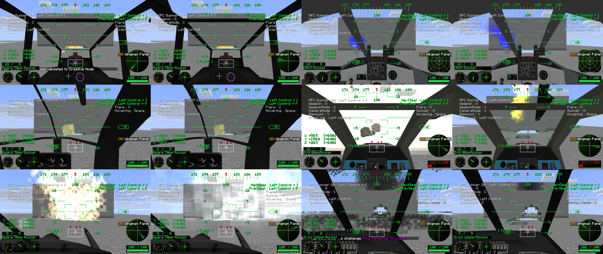

# NTM Next weapon payloads

McHeli weapons can carry the warheads of [NTM Next](https://www.curseforge.com/minecraft/mc-mods/ntm-next)
(mod id `hbm`), as upstream McHeli CE's HBM integration did. NTM Next is optional: without it, a
weapon with a payload logs one warning and explodes normally. The port is built and tested against
NTM Next 1.0.3 (CurseForge file 9130786); NTM Next clients also need its CrankShaft dependency.
Use OpenGL; see KNOWN_ISSUES 7 for Vulkan.

No stock weapon has a payload. An addon pack gives one by adding an `NTM` block to a weapon's YAML
in `assets/mcheli/weapons/`. The weapon keeps its normal McHeli explosion; the payload goes off at
the same point. `EffectOnly: true` drops the McHeli explosion and keeps only the payload's
visuals, where it has any. Restart after changing addon files.

```yaml
NTM:
  PayloadType: FIRE        # VNT, NT, MININUKE, NUKE, CHEMICAL, MIST or FIRE
  EffectOnly: false
  Fire: {FireType: PHOSPHORUS, Count: 3}
```

| PayloadType | Settings block | What it does | With `EffectOnly` |
|---|---|---|---|
| `FIRE` (also `PHOSPHORUS`, `WP`, `BALEFIRE`) | `Fire` | NTM lingering fire (`FireType`: `DIESEL`, `BALEFIRE`, `PHOSPHORUS`, `OXY`, `BLACK`; `Count`, `Width`, `Height`, `AreaSpread`, `Lifetime`, `LifetimeVariance`) and NTM's flame burst (`Particles`) | Flame burst only |
| `MIST` | `Mist` | NTM fluid mist clouds, like its canisters (`FluidType` such as `WATER`; `CloudCount`, `Width`, `Height`, `AreaSpread`, `Lifetime`, `LifetimeVariance`) | Nothing |
| `CHEMICAL` | `Chemical` | NTM gas clouds (`Type`: `CHLORINE`, `CLOUD`, `PINK_CLOUD`, `ORANGE`; `Count`, default 8; `Speed`, default 0.2). Without the block, 8 chlorine clouds | The same clouds (as upstream) |
| `MININUKE` | `MiniNuke` | NTM's small nuke: a preset (`SAFE`, `TOTS`, `LOW`, `MEDIUM`, `HIGH`) or `BlastRadius`, `KillRadius`, `RadiationLevel`, `Safe`, `UseTorex`, `Particle` (`Muke`, `TinyTot` or `None`), `ShrapnelCount`, `Resolution` | Fireball only |
| `NUKE` | none | NTM's MK5 nuclear blast and mushroom cloud; the weapon's `Explosion.DestructionPower` is the radius | Cloud only |
| `VNT` | `VNT` | NTM's configurable VNT explosion, sized by `Explosion.DestructionPower` (see below) | `Effect` only |
| `NT` | `NT` | Upstream's legacy NT explosion (`Resolution`, `Attributes`), sized by `Explosion.DestructionPower` and rebuilt from VNT parts | Nothing |

## VNT

```yaml
NTM:
  PayloadType: VNT
  VNT:
    Preset: STANDARD          # or AMAT; sets NTM's standard parts first
    Effect: LARGE             # MEDIUM (or LOW), STANDARD, LARGE or a map, see below
    Attributes:
      BlockAllocator: {Type: BlockAllocatorStandard, Constructor: [24]}
      BlockProcessor:
        Type: BlockProcessorStandard
        NoDrop: true
        WithBlockEffect: {Type: BlockMutatorFire}
      EntityProcessor: {Type: EntityProcessorStandard}
      PlayerProcessor: {Type: PlayerProcessorStandard}
      SFX: [{Type: ExplosionEffectStandard}]
```

Each part names a class of NTM's `com.hbm.explosion.vanillant.standard` package (and only that
package), with `Constructor` arguments. Other keys call the part's method of that name: `true`
calls a method without arguments (`NoDrop` → `setNoDrop()`), a map builds a nested part, and any
other value is the argument. Numbers convert to the parameter type, and a block id such as
`minecraft:lava` gives a block. Unknown parts or settings are logged once.

An `Effect` map keeps upstream's keys. With `IsSmall: true`, NTM's small effect uses `CloudCount`,
`CloudScale` and `CloudSpeedMult`. Otherwise NTM Next has three fixed effects in place of
upstream's configurable one, picked by `CloudScale`: below 3.5 the small one, below 5.75 the
standard one, and the large one above that.

## Differences from upstream

- NTM Next removed the legacy `ExplosionNT`. `NT` payloads use a VNT explosion with the same
  resolution. Their attributes map to VNT parts: `FIRE`, `BALEFIRE`, `DIGAMMA`, `DIGAMMA_CIRCUIT` and
  `LAVA` (`LAVA_V`, `LAVA_R`) set the block effect; `NODROP` and `ALLDROP` set the drops; `NOHURT`
  leaves entities unhurt; `NOPARTICLE` or `NOSOUND` drops the explosion's effect. Other attributes
  are logged once and ignored.
- Mini-nuke `Attributes` (upstream's `ExAttrib` list) no longer exist in NTM Next and are ignored.
- Upstream's chemical payload had no settings and released nothing; here `Chemical` configures it.

## Checking it

`./gradlew runGameTestServer -PwithHbm` runs eight GameTests against NTM Next 1.0.3, one per
payload plus a rocket's explosion path. `scripts/make-ntm-validation-pack.sh` writes an addon pack
that gives six stock rockets a payload each, for firing them in game with `./gradlew runClient
-PwithHbm`. All six were fired that way on an OpenGL client of a dedicated server:


