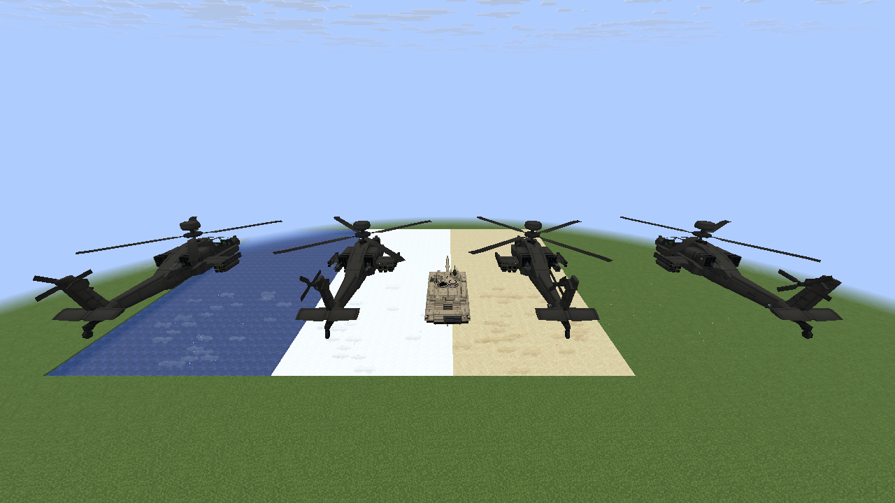
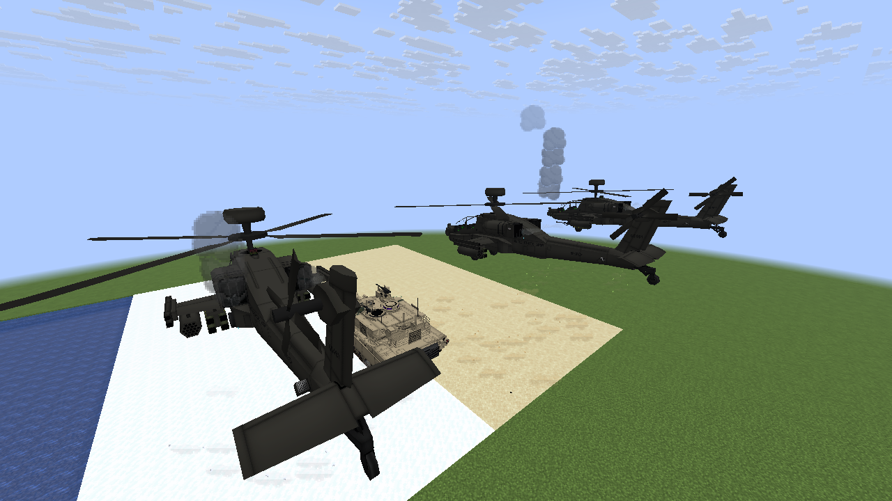
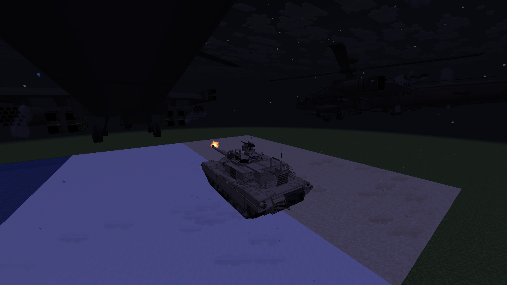

# Vehicle atmosphere and firing effects

With `effects.style = "POLISHED"` and `effects.effectQuality = "ENHANCED"`, the client adds:

- Rotor wash with biome-colored grass flecks, sand grit, snow flakes and water droplets alongside
  the existing surface wisps and water ripples. Throttle, rotor height, forward speed, terrain,
  folded blades and particle pressure determine emission. Lift rotors share the existing loaded
  terrain samples; solid paving does not produce grass, snow or sand debris.
- Engine startup puffs and a four-second turbine tone whose pitch follows cosmetic spool speed.
  Exhaust heat builds gradually as the engine accelerates and cools as it winds down. Watching
  an already running vehicle does not replay a cold start. Authored `Render.EngineOutlets` and
  plane nozzles take priority; startup/damage accents may use machinery below a lift rotor or a
  bounded body anchor where content has no explicit engine outlet.
- Cosmetic coolant vapor and falling droplets below 65% health, short blue electrical sparks at
  severe damage, and irregular smoke surges. Near tracked vehicles use this emitter instead of
  overlapping legacy damage smoke. Repairing the vehicle stops new damage emissions; submerged
  anchors do not emit sparks or vapor. Classic mode restores the legacy emitter and resets its
  position history so toggling styles cannot draw a long stale smoke trail.
- Brief warm illumination projected onto nearby terrain beneath gun muzzles and expanding ground
  dust for explosive cannon shots. The short flash follows loaded collision surfaces and checks
  line of sight; it does not modify the world's light engine or blocks. Casings retain authored
  ejection behavior and gain a small generic fallback for machine guns without an explicit casing.
  Lasers, missiles and bombs do not gain generic brass cases.

All four additions are client presentation. They use the existing replicated firing state and
vehicle throttle/health, with no new gameplay packets, fuel use, damage or terrain changes.
The original turbine tone and neutral debris sprite are reproducible with
`scripts/generate-turbine-spool.py` (Python and ffmpeg) and `scripts/generate-debris-texture.py`.
They contain no sampled third-party audio or artwork.

## Controls and limits

The client config at `config/mcheli_ce_port-client.toml` includes independent switches under
`[effects]`, all enabled by default:

| Setting | Controls |
| --- | --- |
| `rotorWashDebris` | Loose material and spray accents in rotor wash |
| `engineStartupEffects` | Startup puffs, turbine whine and gradual heat buildup |
| `vehicleDamageDetails` | Coolant, electrical sparks and pulsing smoke |
| `weaponGroundEffects` | Muzzle ground illumination and cannon dust |
| `engineHeatHaze` | Existing exhaust refraction |
| `aliveTimeOfCartridge` | Existing casing lifetime; zero disables casings |

Existing Low/Balanced/High and adaptive particle budgets remain in effect. Atmosphere tracks at
most 128 vehicles within 80 blocks, emits at most 8/16/24 accents per tick and allows eight startup
sound voices. Casings are capped at 64/128/192, with at most 4/8/12 spawned per tick; new cases replace the oldest when full. Gun ground effects have at most 12 transient flashes,
nine surface tiles per flash and 24 terrain/occlusion rays per tick. Wash debris uses the existing
particle admission and live limits, adds at most two flecks per accepted puff and disappears under
heavy adaptive pressure. No effect requests server chunk loads.

## Development validation

`scripts/atmosphere-probe.init.gradle` opts into a disposable `M6Smoke` scene: four helicopters
above grass, sand, snow and water, a throttle ramp, damage, cannon firing at night and a Classic-mode
cleanup check. The probe overrides client poses only in this development source set; it is not
included in normal builds. Prepare disposable world copies at `.run/atmosphere-opengl` and
`.run/atmosphere-vulkan`, then run:

```sh
./gradlew -I scripts/atmosphere-probe.init.gradle runClient
./gradlew -I scripts/atmosphere-probe.init.gradle \
  -Dmcheli.atmosphereDir=.run/atmosphere-vulkan -Dmcheli.atmosphereBackend=VULKAN runClient
```

The scene checks actual startup sound voices, heat sources, emissions, hard resource bounds and
cleanup after switching to Classic. Pure tests cover startup/restart, observing a running engine,
invalid inputs, damage pulses, material gating, light falloff and casing limits. Standard content
asset tests check the startup sound's generated definition and file.

The combined crafting/effects build passed 250 unit tests and all 253 server GameTests.
OpenGL and Vulkan client runs both verified four active startup voices, wash/damage emissions,
heat sources, resource limits and Classic cleanup. The packaged mod contains the original sound
and debris texture and excludes the development probe. Local Gradle validation excluded the
optional JEI integration because its Maven host is unavailable in this environment; GitHub CI
uses the normal dependency set.




